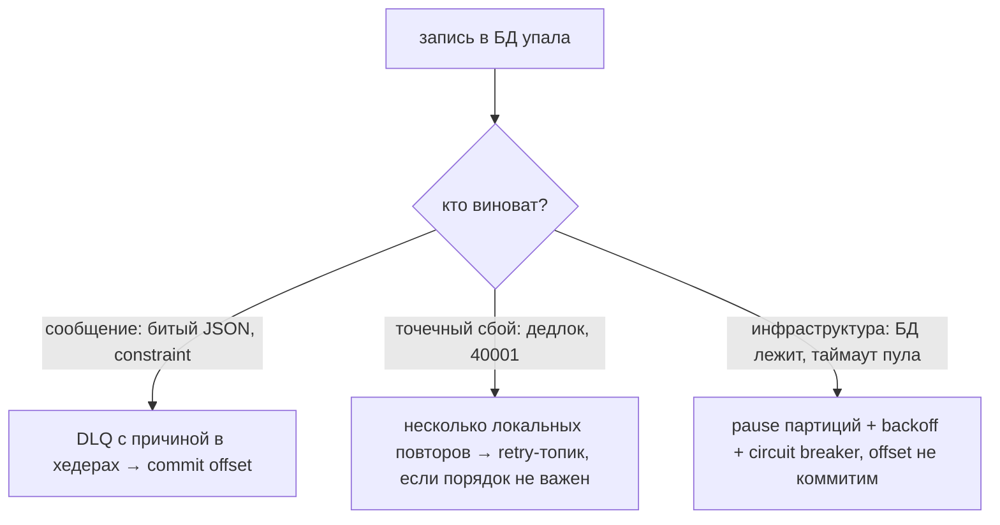

Конспект к собеседованию по Kafka: порядок событий, ретраи при падении базы, семантики доставки и коммит offset, outbox и inbox, схема событий и compaction, саги. Слои те же, что в [[PostgreSQL]]: суть, техника, бизнес-кейс, что спросят дальше. Примеры — для Kafka 3.x–4.x, клиентский код — Python (aiokafka, confluent-kafka).
Рядом: [[PostgreSQL]] · [[SQL-задачи]] · [[Redis]] · [[RabbitMQ]] · [[Celery]] · [[Чек-лист бэкенда]] (быстрые ответы на 30 секунд).
Разделы: [[#Порядок событий]] · [[#Ретраи при падении базы]] · [[#Когда двигать offset]] · [[#Схема событий и compaction]] · [[#Распределённые транзакции и саги]]

## Порядок событий

**Суть.** Kafka гарантирует порядок только внутри одной партиции. Всё, что раскидывает события одной сущности по разным партициям или потокам обработки, ломает порядок.

### База, которую надо знать

- **Топик** → **партиции** (упорядоченные append-only логи) → сообщения с **offset**.
- Партиция выбирается как `murmur2(key) % partitions` (Java-клиент, kafka-python, aiokafka); без ключа — sticky partitioner (пачками в случайную). У librdkafka и confluent-kafka дефолт другой — `consistent_random` (CRC32), и тот же ключ попадёт в другую партицию.
- **Consumer group**: каждая партиция читается ровно одним консюмером группы. Параллелизм ≤ числа партиций.
- **Репликация**: leader + followers, ISR (реплики, которые не отстали). `acks=all` ждёт все реплики ISR, `min.insync.replicas` — нижняя граница: если в ISR меньше, продюсер получает `NotEnoughReplicas`, а не тихую потерю. `acks=all` + `min.insync.replicas=2` при RF=3 — стандарт для важных данных. Консюмер видит только сообщения ниже **high watermark** — записанные во все реплики ISR.
- **Retention** по времени/размеру или **log compaction** (хранится последнее значение на ключ).
- С Kafka 4.0 ZooKeeper убран — только KRaft.

### Где ломается порядок

| # | Причина | Сторона | Как избежать |
| --- | --- | --- | --- |
| 1 | Нет ключа или ключ не тот (случайный UUID события вместо id заказа) | producer | ключ = id агрегата |
| 2 | Увеличили число партиций → сменился `hash % N` | эксплуатация | закладывать партиции с запасом; или новый топик + миграция |
| 3 | Ретраи продюсера при `max.in.flight > 1` без идемпотентности | producer | `enable.idempotence=true` (дефолт с Kafka 3.0), in-flight ≤ 5 |
| 4 | Параллельная обработка внутри консюмера (thread pool, async) | consumer | параллелизм по ключу (Confluent Parallel Consumer, шардирование по ключу) |
| 5 | Retry-топик / DLQ: сообщение ушло на повтор, следующие обработались | consumer | блокирующий retry или «парковка» всего ключа |
| 6 | Ребаланс + at-least-once: повтор старого сообщения после нового | consumer | идемпотентность + версия |
| 7 | Несколько продюсеров одной сущности (два сервиса/инстанса) | архитектура | один владелец агрегата; события через outbox в порядке коммита |
| 8 | Разные топики для событий одной сущности (`order-created`, `order-paid`) | архитектура | один топик на агрегат, тип события — поле/хедер |
| 9 | Потеря при unclean leader election | кластер | `unclean.leader.election.enable=false` (дефолт) |
| 10 | Продюсеры на разных клиентах (Java и confluent-kafka) считают партицию разными хешами | producer | один партиционер: в confluent-kafka `partitioner=murmur2_random` |

### Техника: надёжный продюсер

```python
from aiokafka import AIOKafkaProducer
from confluent_kafka import Producer

# aiokafka
producer = AIOKafkaProducer(
    bootstrap_servers=settings.kafka_bootstrap,
    acks="all",
    enable_idempotence=True,   # PID + sequence number: ретрай не задвоит и не переставит
)
await producer.start()
await producer.send_and_wait(topic, key=str(order_id).encode(), value=payload)  # ждём подтверждения брокера

# confluent-kafka: имена настроек как у Java-клиента
producer = Producer({
    "bootstrap.servers": settings.kafka_bootstrap,
    "acks": "all",
    "enable.idempotence": True,          # in-flight ≤ 5, порядок сохраняется
    "partitioner": "murmur2_random",     # как у Java-клиента, см. таблицу выше
})

# топик: replication.factor=3, min.insync.replicas=2
```

### Техника: защита от устаревших событий на стороне консюмера

```sql
-- В событии есть монотонная version агрегата (или sequence из outbox)
INSERT INTO order_view (order_id, status, version)
VALUES (:id, :status, :version)
ON CONFLICT (order_id) DO UPDATE
SET status = EXCLUDED.status, version = EXCLUDED.version
WHERE order_view.version < EXCLUDED.version;   -- старое событие просто игнорируется
```

> [!warning] Не timestamp
> Не полагайтесь на timestamp для упорядочивания: часы разных инстансов расходятся, и два события в одну миллисекунду неразличимы.

Альтернатива — **state machine**: консюмер знает допустимые переходы (`created → paid → shipped`) и не откатывает `shipped` обратно в `paid`.

### Бизнес-кейс: статусы заказа

Пользователь оплатил и сразу отменил заказ. Если `OrderCancelled` обработается раньше `OrderPaid`, склад соберёт отменённый заказ, а деньги не вернутся. Вопросы к продукту и архитектуре:

- Кто источник правды статуса? Если оплата и отмена пишутся разными сервисами в разные топики, порядок не гарантирован вообще — нужен сервис-владелец заказа, который решает переходы и публикует события с версией.
- Нужен ли строгий порядок для всех событий? Для аналитики кликов — нет, можно максимально параллелить. Для денег и статусов — да, в рамках агрегата. Глобальный порядок (1 партиция) — почти никогда: это потолок пропускной способности.
- **Hot key**: один крупный мерчант даёт 30% трафика → одна партиция перегружена. Ключ должен быть мельче (id заказа, а не id мерчанта), если бизнесу не нужен порядок по мерчанту.

### Что спросят дальше

- Сколько партиций завести? — от целевого throughput: `max(целевой поток / поток одного консюмера, …)` с запасом на 2–3 года роста; слишком много — дольше ребаланс и больше метаданных.
- Что такое cooperative rebalancing / static membership? — ребаланс без остановки всей группы (`CooperativeStickyAssignor`) и `group.instance.id`, чтобы рестарт пода не вызывал ребаланс. Отдельно — новый протокол групп KIP-848 (GA в Kafka 4.0, включается `group.protocol=consumer`): назначение партиций считает брокер, а не клиент.
- Kafka vs RabbitMQ? — подробная таблица в [[RabbitMQ#Kafka vs RabbitMQ]]. Kafka: лог, реплей, высокий throughput, порядок в партиции. Rabbit: маршрутизация, per-message ack, отложенные сообщения, сообщение удаляется после обработки.

## Ретраи при падении базы

**Суть.** Схема Kafka → consumer → DB. Когда лежит БД, виновато не сообщение, а инфраструктура. Поэтому сообщения не надо разгонять по retry-топикам: нужно поставить консюмер на паузу и оставить данные в Kafka, которая и есть буфер. Retry делается на одном уровне, с экспоненциальной паузой, джиттером и circuit breaker.



Только постоянная ошибка выводит сообщение из потока. При падении БД партиция стоит на паузе, а сообщения спокойно ждут в Kafka.

### Откуда берётся снежный ком

- **Ретраи на нескольких слоях перемножаются**: драйвер 3 × tenacity 3 × retry-топики 3 = 27 попыток на одно сообщение.
- **Синхронные повторы**: все инстансы ретраят по одному таймеру — волны нагрузки (thundering herd).
- **Восстанавливающаяся БД получает пик**: накопленный лаг + ретраи + холодный кэш → снова падает.
- **Все сообщения улетают в retry/DLQ**, хотя с ними всё в порядке; потом их приходится вручную реплеить, и порядок потерян.
- **Ребалансы**: консюмер застрял в долгом retry внутри обработки → превысил `max.poll.interval.ms` → выкинут из группы → другой консюмер берёт те же сообщения → дубли и бесконечный цикл.

### Классификация ошибок — первый шаг

| Тип | Примеры | Реакция |
| --- | --- | --- |
| Постоянная (виновато сообщение) | невалидный JSON, нет обязательного поля, constraint violation, неизвестная версия схемы | сразу в DLQ с причиной в хедерах, коммит offset |
| Временная, точечная | связанная сущность ещё не приехала, дедлок, serialization failure | несколько локальных повторов; затем retry-топик с задержкой (если порядок не важен) |
| Инфраструктурная | БД недоступна, таймаут пула, read-only после failover | **pause партиций + backoff + circuit breaker**, offset не коммитить |

### Техника: консьюмер с pause/resume и circuit breaker

```python
import asyncio
import random

from aiokafka import AIOKafkaConsumer


async def consume(consumer: AIOKafkaConsumer, dlq: AIOKafkaProducer) -> None:
    loop = asyncio.get_running_loop()
    failures = 0        # неудачи подряд — состояние предохранителя (circuit breaker)
    resume_at = None    # когда снять паузу: half-open, пробуем снова

    while True:
        if resume_at is not None and loop.time() >= resume_at:
            consumer.resume(*consumer.paused())
            resume_at = None

        # getmany вызываем ВСЕГДА, и на паузе тоже: иначе max_poll_interval_ms и ребаланс
        batch = await consumer.getmany(timeout_ms=500, max_records=50)
        try:
            for tp, records in batch.items():
                for rec in records:
                    try:
                        await handle(rec)                   # идемпотентная запись в БД
                        failures = 0                        # closed: БД отвечает
                    except PermanentError as exc:           # виновато сообщение
                        await send_to_dlq(dlq, rec, reason=exc)
                    await consumer.commit({tp: rec.offset + 1})
        except InfraError:                                  # БД лежит: виновато не сообщение
            failures += 1
            consumer.pause(*consumer.assignment())          # open: не читаем ни одну партицию
            await consumer.seek_to_committed()              # необработанный хвост пачки перечитаем
            delay = min(60, 2**failures)                    # 2, 4, 8 … максимум 60 с
            resume_at = loop.time() + delay * random.uniform(0.5, 1.5)  # jitter
```

Пауза ставится на все партиции сразу: БД общая, и если она лежит, нет смысла читать соседние партиции. `seek_to_committed` нужен, потому что `getmany` уже сдвинул позицию за всю пачку — без него необработанный хвост пропал бы до рестарта. Готового обработчика с такими политиками в aiokafka и confluent-kafka нет (в отличие от `DefaultErrorHandler` в Spring Kafka), цикл пишут сами; неблокирующие повторы — отдельные retry-топики со своим консьюмером.

### Чек-лист анти-лавины

1. Классифицировать ошибки; постоянные — сразу в DLQ.
2. Retry только на одном уровне; в драйвере/ORM отключить или минимизировать.
3. Exponential backoff + **jitter** + верхний предел.
4. Circuit breaker вокруг БД: open → pause партиций, half-open → одна пробная запись.
5. Продолжать `poll()` на паузе, чтобы не вылететь из группы.
6. Bulkhead: ограниченный пул соединений и concurrency на инстанс; общее число соединений всех подов < `max_connections` (или PgBouncer).
7. Плавный разгон после восстановления: rate limiter, меньший `max_records` в `getmany`, постепенное увеличение.
8. Идемпотентная запись (upsert или inbox) — повторы гарантированно дадут дубли.
9. Мониторинг: consumer lag, размер DLQ, состояние breaker. Алерт на лаг во времени (секунды отставания), а не в штуках.
10. Процедура реплея DLQ — инструмент + runbook, а не «когда-нибудь посмотрим».

### Бизнес-кейс

Сервис начисления бонусов читает события покупок. БД была недоступна 15 минут во время распродажи. Вопросы к продукту, от которых зависит дизайн:

- Допустима ли задержка начисления на 15–30 минут? Если да — просто пауза и догоняем лаг, никаких retry-топиков. Это почти всегда дешевле и надёжнее.
- Что видит пользователь, пока бонусы не начислены? Статус «бонусы поступят в течение часа» снимает нагрузку с поддержки — это тоже часть решения.
- Что хуже для бизнеса: начислить дважды или не начислить? Для денег — at-least-once + идемпотентность по `purchase_id`.
- SLA на разбор DLQ и кто владелец — организационный вопрос, без него DLQ превращается в кладбище потерянных денег.

### Что спросят дальше

- Чем блокирующий retry отличается от неблокирующего? — блокирующий держит партицию и сохраняет порядок; неблокирующий (retry-топики 5s → 1m → 10m → DLQ) не тормозит поток, но ломает порядок.
- Poison pill? — сообщение, которое всегда падает (часто ошибка десериализации). Без DLQ оно блокирует партицию навсегда. В aiokafka ошибка `value_deserializer` вылетает прямо из `getmany`, и одно битое сообщение аккуратно не пропустить: читай сырые bytes и разбирай в обработчике, где битое уходит в DLQ.
- Backpressure — что это в Kafka? — pull-модель: консюмер сам решает, сколько брать; рычаги — `pause/resume`, `max_records` в `getmany`, ограничение параллелизма.

## Когда двигать offset

**Суть.** Это вопрос о семантике доставки. Offset коммитят **после** успешной обработки (после COMMIT в БД) — это at-least-once. Дубли неизбежны, поэтому обработка должна быть идемпотентной. Закоммиченный offset = следующее сообщение к чтению (последний обработанный + 1).

### Семантики

| Семантика | Когда коммит | Риск | Где уместна |
| --- | --- | --- | --- |
| At-most-once | до обработки | падение = потеря | метрики, логи, некритичная телеметрия |
| At-least-once | после обработки | падение = повтор | по умолчанию для бизнес-событий + идемпотентность |
| Exactly-once (эффективно) | атомарно с результатом | сложность | Kafka→Kafka (транзакции), Kafka→DB (offset в той же транзакции БД) |

### Правила

- `enable_auto_commit=False`. Автокоммит раз в 5 секунд фиксирует позицию уже выданных сообщений, а не результат обработки: в aiokafka это фоновая задача, и падение посреди пачки теряет её хвост; в Java-клиенте — при асинхронной обработке.
- Порядок: **обработать → COMMIT БД → commit offset**. Падение между двумя коммитами даст повтор — его поглотит идемпотентность.
- Батчевый коммит (раз в N сообщений или T мс) быстрее, но увеличивает объём повторной обработки при сбое.
- `await consumer.commit(...)` после обработки и при остановке; в `on_partitions_revoked` (`ConsumerRebalanceListener`) — дождаться текущего сообщения и закоммитить, иначе после ребаланса новый владелец партиции повторит уже обработанное. Коммит по отозванной партиции падает с `CommitFailedError` — сообщение придёт повторно, идемпотентность это переживёт.
- При параллельной обработке внутри партиции коммитится только **непрерывный префикс**: если готовы 100, 101, 103 — коммитим 102.
- Poison message: после N попыток → DLQ → commit. Иначе партиция стоит.
- `auto_offset_reset` (`earliest`/`latest`) срабатывает, только когда закоммиченного offset нет или он невалиден: группа простояла дольше `offsets.retention.minutes` (7 дней) и её offset удалён, или сами сообщения уже удалены retention топика. Для новой группы с `latest` история будет пропущена.

### Техника: идемпотентный консьюмер с inbox-таблицей

```sql
CREATE TABLE inbox (
  message_id text PRIMARY KEY,           -- event_id из события (или topic:partition:offset)
  processed_at timestamptz NOT NULL DEFAULT now()
);

BEGIN;
INSERT INTO inbox (message_id) VALUES (:msg_id) ON CONFLICT DO NOTHING;
-- 0 строк → уже обрабатывали: ROLLBACK и просто коммитим offset
UPDATE accounts SET bonus = bonus + :amount WHERE user_id = :u;
COMMIT;
-- затем await consumer.commit({tp: offset + 1})
-- старые записи inbox чистим по TTL длиннее retention топика
```

### Техника: exactly-once Kafka → DB через хранение offset в БД

```sql
CREATE TABLE consumer_offsets (
  group_id text, topic text, partition int, next_offset bigint,
  PRIMARY KEY (group_id, topic, partition)
);
-- В одной транзакции: бизнес-запись + UPDATE consumer_offsets SET next_offset = :offset + 1
-- В on_partitions_assigned (ConsumerRebalanceListener): consumer.seek(tp, next_offset из БД)
-- Фенсинг от «зомби» после ребаланса: UPDATE ... WHERE next_offset = :expected; 0 строк → партицию уже забрали
```

### Смежное: transactional outbox

Обратная сторона — DB → Kafka. Проблема dual write: «записали в БД, упали до отправки в Kafka» или наоборот. Решение: событие пишется в таблицу `outbox` **в той же транзакции**, что и бизнес-данные; отдельный релей читает её (polling с `SKIP LOCKED`, см. [[PostgreSQL#Техника: очередь задач на SKIP LOCKED]], или CDC через Debezium) и публикует в Kafka. Доставка at-least-once. Порядок по агрегату сам не держится: `id` из sequence виден не в порядке COMMIT, а несколько релеев со `SKIP LOCKED` публикуют пачки вперемешку — нужен один релей на шард ключа или версия агрегата в событии (см. [[#Техника: защита от устаревших событий на стороне консюмера]]).

```sql
BEGIN;
UPDATE orders SET status = 'paid', version = version + 1 WHERE id = :id;
INSERT INTO outbox (aggregate_id, type, payload) VALUES (:id, 'OrderPaid', :json);
COMMIT;
```

### Бизнес-кейс

- **Платежи и начисления** — дубль стоит денег, потеря — ещё и доверия. At-least-once + идемпотентность по бизнес-ключу (`payment_id`), а не по техническому id сообщения: один и тот же платёж может прийти двумя разными сообщениями (вебхук + сверка).
- **Отправка push/SMS** — внешний побочный эффект, exactly-once недостижим. Продуктовое решение: что хуже — два одинаковых SMS или ни одного? Для кода подтверждения — лучше два; для маркетинга — лучше ни одного. Многие провайдеры принимают idempotency key.

### Что спросят дальше

- Что такое exactly-once в Kafka на самом деле? — идемпотентный продюсер + транзакции (в aiokafka — `transactional_id`, `async with producer.transaction()`, `send_offsets_to_transaction`) + `isolation_level="read_committed"` у консьюмера. Работает только внутри Kafka (read-process-write).
- Что будет при ребалансе в середине батча? — незакоммиченная часть будет обработана повторно другим консьюмером.
- Как перечитать топик заново? — новая consumer group или `kafka-consumer-groups --group g --topic t --reset-offsets --to-datetime 2026-11-19T00:00:00.000 --execute` при остановленной группе (без `--execute` — только показать план).

## Схема событий и compaction

**Суть.** Событие — публичный контракт, как API: его читают сервисы, которых ты не видишь. Схему держат в Schema Registry и меняют только совместимо.

- Формат — Avro или Protobuf + Schema Registry: в сообщении id схемы, а не сама схема. Голый JSON без схемы — источник тихих поломок консюмеров.
- Режимы совместимости: `BACKWARD` (новый консюмер читает старые сообщения; дефолт Confluent Schema Registry), `FORWARD` (старый консюмер читает новые), `FULL` — оба. `*_TRANSITIVE` — проверка против всех прошлых версий, а не только последней.
- Безопасно: добавить необязательное поле с дефолтом. Ломает: удалить или переименовать поле, сменить тип, сделать поле обязательным — это новый тип события или новый топик, старый живёт до миграции потребителей.
- В событии: `event_id` (для идемпотентности), тип, версия схемы, время, ключ и версия агрегата.
- **Log compaction** (`cleanup.policy=compact`): хранится последнее значение на ключ, топик работает как таблица (справочники, текущее состояние, `__consumer_offsets`). Компакция не мгновенная: активный сегмент не трогается, старые значения по ключу видны до прохода cleaner.
- **Tombstone** (value = `null`) удаляет ключ при компакции и живёт `delete.retention.ms` — консюмер, отставший сильнее, удаления не увидит. Обработчик обязан разбирать `value is None`, а не падать. `compact,delete` — компакция плюс удаление по времени.

## Распределённые транзакции и саги

- **CAP / PACELC**: при сетевом разделении выбираем консистентность или доступность; без разделения — latency или консистентность.
- **2PC** — атомарно, но блокируется при падении координатора; в микросервисах почти не используется.
- **Сага** — цепочка локальных транзакций + компенсирующие действия. Хореография (сервисы реагируют на события) или оркестрация (центральный координатор, например Temporal).
- Бизнес-кейс саги: «забронировать товар → списать деньги → создать доставку». Если оплата не прошла — компенсация «снять бронь». Продукт должен решить, что пользователь видит в промежуточных состояниях («заказ оформляется») — eventual consistency видна в UX.
