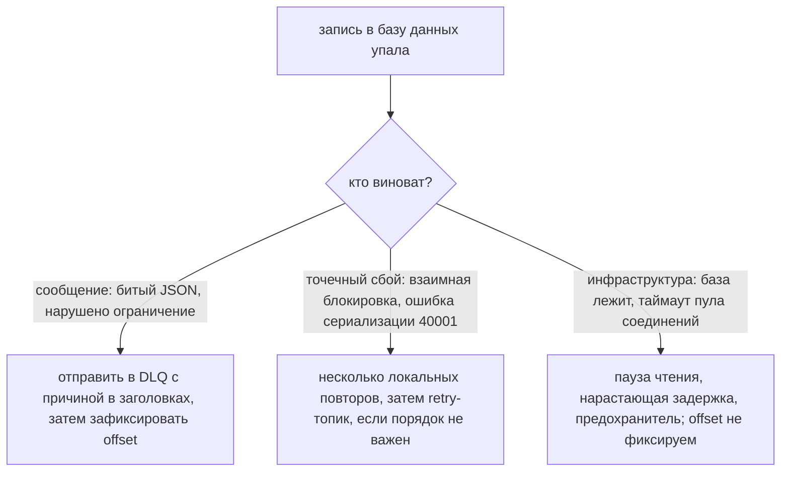

Конспект к собеседованию по Kafka. Темы: порядок событий, повторные попытки при падении базы данных, семантики доставки и момент фиксации offset, таблицы outbox и inbox, схема событий и сжатие топика, распределённые транзакции и саги. Слои те же, что в [[PostgreSQL]]: суть, техника, бизнес-кейс, что спросят дальше. Примеры написаны для Kafka 3.x–4.x, клиентский код — на Python (библиотеки aiokafka и confluent-kafka).
Рядом: [[PostgreSQL]] · [[SQL-задачи]] · [[Redis]] · [[RabbitMQ]] · [[Celery]] · [[Чек-лист бэкенда]] (быстрые ответы на 30 секунд).
Разделы: [[#Порядок событий]] · [[#Повторные попытки при падении базы]] · [[#Когда двигать offset]] · [[#Схема событий и compaction]] · [[#Распределённые транзакции и саги]]

## Порядок событий

**Суть.** Kafka хранит сообщения в топиках, а каждый топик делится на партиции (упорядоченные журналы, в которые сообщения только дописываются). Порядок гарантирован только внутри одной партиции. Всё, что раскидывает события одной сущности по разным партициям или по разным потокам обработки, этот порядок ломает.

### Базовые понятия Kafka

- **Топик** (topic) — именованный поток сообщений, например `orders`. Он делится на **партиции** (partition): каждая партиция — упорядоченный журнал, куда сообщения только дописываются. Каждому сообщению в партиции присваивается номер — **offset** (позиция сообщения в партиции, считается с нуля).
- **Как выбирается партиция.** Если у сообщения есть ключ, партиция считается как `murmur2(key) % partitions`. Здесь `murmur2` — быстрая хеш-функция, `partitions` — число партиций топика. Так считают Java-клиент, kafka-python и aiokafka. Благодаря этому все сообщения с одним ключом попадают в одну партицию и остаются упорядоченными. Без ключа работает sticky partitioner («липкий» разбрасыватель): он копит пачку сообщений для одной случайной партиции, потом переключается на другую. У librdkafka и confluent-kafka по умолчанию другой алгоритм — `consistent_random` на основе CRC32 (контрольной суммы), поэтому тот же ключ попадёт в другую партицию, чем у Java-клиента.
- **Consumer group** (группа консьюмеров) — набор процессов-читателей с общим именем группы. Каждая партиция читается ровно одним консьюмером группы, поэтому параллелизм чтения не больше числа партиций. Когда консьюмер входит в группу или выходит из неё, происходит **rebalance** (перебалансировка): партиции заново раздаются между живыми консьюмерами, и на это время чтение может приостановиться.
- **Репликация.** У каждой партиции есть leader (реплика, которая принимает записи и отдаёт чтение) и followers (копии, которые подтягивают данные с лидера). **ISR** (In-Sync Replicas) — множество реплик, которые не отстали от лидера. Настройка продюсера **`acks`** (acknowledgements, подтверждения) говорит, кого ждать перед ответом «записано»: `acks=all` означает, что ответ приходит, когда сообщение записано на все реплики из ISR. Настройка топика `min.insync.replicas` задаёт нижнюю границу: если в ISR реплик меньше, продюсер получает ошибку `NotEnoughReplicas` и знает, что запись не принята, а не теряет её молча. Для важных данных стандарт — `acks=all` и `min.insync.replicas=2` при RF=3 (replication factor, фактор репликации — число копий партиции). Консьюмер видит только сообщения ниже **high watermark** (верхней отметки) — те, что уже записаны на все реплики из ISR.
- **Retention** (срок хранения) — сколько Kafka хранит сообщения: по времени или по размеру. Альтернатива — **log compaction** (сжатие журнала): хранится только последнее значение для каждого ключа, подробнее в разделе [[#Схема событий и compaction]].
- Начиная с Kafka 4.0 ZooKeeper (внешняя служба координации кластера) убран; кластер управляет собой сам через KRaft (встроенный протокол согласования на базе Raft).

### Где ломается порядок

| # | Причина | Сторона | Как избежать |
| --- | --- | --- | --- |
| 1 | Нет ключа или ключ не тот (случайный UUID, то есть уникальный идентификатор события, вместо id заказа) | producer (отправитель) | ключ равен id агрегата, то есть сущности, чьи события нельзя перемешивать |
| 2 | Увеличили число партиций, и результат `hash % N` для тех же ключей изменился | эксплуатация | закладывать партиции с запасом сразу; либо завести новый топик и перенести данные |
| 3 | Повторные отправки продюсера при `max.in.flight > 1` без идемпотентности | producer | включить `enable.idempotence=true` (дефолт с Kafka 3.0), `max.in.flight` не больше 5 |
| 4 | Параллельная обработка внутри одного консьюмера (пул потоков, async) | consumer (читатель) | параллелить по ключу: Confluent Parallel Consumer или шардирование по ключу |
| 5 | Сообщение ушло в retry-топик или DLQ, а следующие по ключу обработались без него | consumer | блокирующая повторная попытка или «парковка» всего ключа |
| 6 | Rebalance и доставка at-least-once: старое сообщение приходит повторно после нового | consumer | идемпотентная обработка и версия события |
| 7 | Несколько продюсеров пишут одну сущность (два сервиса или два инстанса) | архитектура | один владелец агрегата; события идут через outbox в порядке коммита |
| 8 | События одной сущности лежат в разных топиках (`order-created`, `order-paid`) | архитектура | один топик на агрегат, тип события — поле или заголовок |
| 9 | Потеря сообщений при unclean leader election | кластер | `unclean.leader.election.enable=false` (это дефолт) |
| 10 | Продюсеры на разных клиентах (Java и confluent-kafka) считают партицию разными хешами | producer | один партиционер: в confluent-kafka `partitioner=murmur2_random` |

Расшифровка терминов из таблицы:

- **Агрегат** — группа связанных данных, которую всегда меняют целиком и по порядку (например, заказ со всеми его статусами). Его идентификатор берут ключом.
- **`max.in.flight`** — сколько неподтверждённых запросов продюсер держит в полёте одновременно. Если их больше одного и один из них пришлось повторить, повтор может обогнать следующий запрос, и порядок собьётся. **Идемпотентный продюсер** (`enable.idempotence=true`) нумерует запись и позволяет брокеру отбросить дубль и сохранить порядок.
- **at-least-once** — доставка «минимум один раз»: сообщение может прийти повторно, но не потеряется. Подробнее в разделе [[#Когда двигать offset]].
- **Retry-топик** — отдельный топик, куда сообщение отправляют на повторную обработку позже. **DLQ** (Dead Letter Queue, очередь «мёртвых» сообщений) — топик, куда складывают сообщения, которые обработать не удалось, чтобы разобрать их вручную.
- **Идемпотентная обработка** — повторная обработка того же сообщения даёт тот же результат, что и первая, без задвоения эффекта.
- **Outbox** — таблица в базе, через которую события безопасно попадают в Kafka; подробнее в разделе [[#Когда двигать offset]].
- **Unclean leader election** — выбор новым лидером реплики, которая отстала. Так сообщения, которых у неё нет, теряются.

### Техника: надёжный продюсер

```python
from aiokafka import AIOKafkaProducer
from confluent_kafka import Producer

# aiokafka
producer = AIOKafkaProducer(
    bootstrap_servers=settings.kafka_bootstrap,
    acks="all",
    enable_idempotence=True,   # брокер получает номер продюсера и порядковый номер записи: повторная отправка не задвоит и не переставит сообщения
)
await producer.start()
await producer.send_and_wait(topic, key=str(order_id).encode(), value=payload)  # ждём подтверждения брокера

# confluent-kafka: имена настроек как у Java-клиента
producer = Producer({
    "bootstrap.servers": settings.kafka_bootstrap,
    "acks": "all",
    "enable.idempotence": True,          # не больше 5 запросов в полёте, порядок сохраняется
    "partitioner": "murmur2_random",     # тот же алгоритм выбора партиции, что у Java-клиента, см. таблицу выше
})

# топик создаётся с replication.factor=3 и min.insync.replicas=2
```

### Техника: защита от устаревших событий на стороне консюмера

Консюмер может получить событие, которое уже устарело. Чтобы не затереть новое состояние старым, в событии хранят монотонно растущую `version` агрегата (или номер из outbox), а запись в базу делают условной.

```sql
-- В событии есть монотонная version агрегата (или sequence из outbox)
INSERT INTO order_view (order_id, status, version)
VALUES (:id, :status, :version)
ON CONFLICT (order_id) DO UPDATE
SET status = EXCLUDED.status, version = EXCLUDED.version
WHERE order_view.version < EXCLUDED.version;   -- старое событие просто игнорируется
```

Запрос работает как upsert (вставка или обновление, если строка уже есть): если для заказа уже есть строка с большей или равной версией, обновление пропускается.

> [!warning] Не timestamp
> Не полагайтесь на timestamp (время события) для упорядочивания: часы разных инстансов расходятся, и два события в одну миллисекунду неразличимы.

Альтернатива — **state machine** (конечный автомат): консюмер знает допустимые переходы (`created → paid → shipped`) и не откатывает `shipped` обратно в `paid`.

### Бизнес-кейс: статусы заказа

Пользователь оплатил и сразу отменил заказ. Если событие `OrderCancelled` обработается раньше `OrderPaid`, склад соберёт отменённый заказ, а деньги не вернутся. Вопросы к продукту и архитектуре:

- Кто источник правды статуса? Если оплата и отмена пишутся разными сервисами в разные топики, порядок не гарантирован вообще. Нужен сервис-владелец заказа: он сам решает, какие переходы допустимы, и публикует события с версией.
- Нужен ли строгий порядок для всех событий? Для аналитики кликов нет, можно максимально распараллелить. Для денег и статусов нужен, но только в рамках одного агрегата. Глобальный порядок (всё в одной партиции) почти никогда не нужен: одна партиция ограничивает пропускную способность всей системы.
- **Hot key** («горячий» ключ): один крупный мерчант даёт 30% трафика, и одна партиция перегружена, пока остальные простаивают. Ключ нужно делать мельче (id заказа, а не id мерчанта), если бизнесу не нужен порядок по мерчанту.

### Что спросят дальше

- Сколько партиций завести? Считать от целевого потока: целевой поток делим на поток, который тянет один консюмер, и берём запас на 2–3 года роста. Слишком много партиций тоже плохо: дольше rebalance и больше метаданных.
- Что такое cooperative rebalancing и static membership? Cooperative rebalancing (`CooperativeStickyAssignor`) — перебалансировка без остановки всей группы: у консюмеров отбирают только те партиции, которые нужно переместить. Static membership (`group.instance.id`) — консюмер получает постоянное имя, и рестарт пода не вызывает rebalance, если он вернулся достаточно быстро. Отдельно существует новый протокол групп KIP-848 (Kafka Improvement Proposal номер 848, общедоступен с Kafka 4.0, включается настройкой `group.protocol=consumer`): партиции между консюмерами распределяет брокер, а не клиент, и перебалансировка проходит мягче.
- Kafka или RabbitMQ? Подробная таблица — в [[RabbitMQ#Kafka vs RabbitMQ]]. Kafka — журнал: сообщения можно перечитать, пропускная способность высокая, порядок есть внутри партиции. RabbitMQ — брокер с гибкой маршрутизацией, подтверждением каждого сообщения отдельно и отложенными сообщениями; сообщение удаляется после обработки.

## Повторные попытки при падении базы

**Суть.** Схема такая: Kafka, дальше консюмер, дальше база данных. Когда лежит база, виновато не сообщение, а инфраструктура. Поэтому сообщения не надо разгонять по retry-топикам (топикам для повторной обработки). Нужно поставить консюмер на паузу и оставить данные в Kafka: она сама служит буфером. Повторные попытки делаются на одном уровне, с растущей паузой между попытками, с разбросом времени повторов и с предохранителем (circuit breaker). Эти термины раскрыты ниже в разделе про консюмера.



Только постоянная ошибка выводит сообщение из потока. При падении базы партиция стоит на паузе, а сообщения спокойно ждут в Kafka.

Расшифровка схемы:

- **`40001`** — код SQLSTATE `serialization_failure` в Postgres: «транзакцию нужно повторить», потому что она конфликтовала с другой.
- **Взаимная блокировка** (дедлок, deadlock) — две транзакции ждут друг друга; база прерывает одну из них, и её можно просто повторить.
- **Фиксация offset** (commit offset) — сообщение Kafka, что группа обработала всё до этой позиции и при перезапуске читать нужно с неё. Подробнее — в разделе [[#Когда двигать offset]].
- **Пул соединений** — ограниченный набор открытых подключений к базе, которые приложение берёт по очереди. Таймаут пула значит, что свободного соединения не дождались.

### Откуда берётся снежный ком

- **Повторные попытки на нескольких слоях перемножаются.** Драйвер базы повторяет 3 раза, библиотека tenacity (повторы в коде приложения) ещё 3 раза, retry-топики ещё 3 раза: получается 3 × 3 × 3 = 27 попыток на одно сообщение.
- **Синхронные повторы.** Все инстансы повторяют по одному таймеру, и нагрузка приходит волнами. Это явление называют thundering herd («стадо в панике»): все одновременно бросаются на только что ожившую базу.
- **Восстанавливающаяся база получает пик нагрузки.** Накопленное отставание консюмера (лаг, то есть сколько сообщений не прочитано), плюс повторы, плюс холодный кэш добивают базу снова.
- **Все сообщения улетают в retry-топики или DLQ**, хотя с ними всё в порядке. Потом их приходится вручную переигрывать, и порядок потерян.
- **Перебалансировки.** Консюмер застрял в долгих повторах внутри обработки и превысил `max.poll.interval.ms` (максимальное время между двумя вызовами чтения). Брокер считает его умершим и выкидывает из группы, другой консюмер берёт те же сообщения, и получается дубль и бесконечный цикл.

### Классификация ошибок — первый шаг

| Тип | Примеры | Реакция |
| --- | --- | --- |
| Постоянная (виновато сообщение) | невалидный JSON, нет обязательного поля, нарушено ограничение базы (constraint violation), неизвестная версия схемы | сразу в DLQ с причиной в заголовках сообщения, затем фиксация offset |
| Временная, точечная | связанная сущность ещё не приехала, взаимная блокировка, ошибка сериализации | несколько локальных повторов; затем retry-топик с задержкой (если порядок не важен) |
| Инфраструктурная | база недоступна, таймаут пула соединений, база стала «только для чтения» после переключения на резервную (failover) | пауза чтения, нарастающая задержка и предохранитель; offset не фиксировать |

### Техника: консьюмер с паузой и предохранителем (circuit breaker)

Когда база недоступна, консьюмер действует по шагам:

1. Ловит ошибку инфраструктуры и понимает, что виновато не сообщение, а база. Поэтому сообщение не уходит в DLQ.
2. Ставит на паузу все партиции (`pause`): база общая, и читать соседние партиции, пока она лежит, нет смысла.
3. Возвращает позицию чтения к последнему зафиксированному offset (`seek_to_committed`), чтобы необработанные сообщения пачки не пропали.
4. Считает паузу по схеме **exponential backoff** (экспоненциальная задержка): после каждой подряд идущей неудачи пауза удваивается (2, 4, 8 секунд) до потолка в 60 секунд. Это не даёт долбить базу, которая ещё не поднялась.
5. Добавляет **jitter** (случайный разброс, здесь от 0,5 до 1,5 от рассчитанной паузы), чтобы разные инстансы возобновляли чтение не одновременно и не создавали волну нагрузки.
6. Работает как **circuit breaker** (автоматический предохранитель, как в электрощитке): в состоянии closed («замкнут») обработка идёт как обычно; после ошибок он open («разомкнут») и чтение стоит; когда пауза истекла, он half-open («полуоткрыт»): чтение возобновляется, и первая же успешная запись снова замыкает цепь, а неудача размыкает её снова.
7. Даже на паузе продолжает вызывать `getmany`: иначе брокер решит, что консьюмер умер (превышен `max_poll_interval_ms`), и устроит rebalance.

```python
import asyncio
import random

from aiokafka import AIOKafkaConsumer, AIOKafkaProducer


async def consume(consumer: AIOKafkaConsumer, dlq: AIOKafkaProducer) -> None:
    loop = asyncio.get_running_loop()
    failures = 0        # неудачи подряд: состояние предохранителя (circuit breaker)
    resume_at = None    # когда снять паузу (состояние half-open: пробуем снова)

    while True:
        if resume_at is not None and loop.time() >= resume_at:
            consumer.resume(*consumer.paused())
            resume_at = None

        # getmany вызываем ВСЕГДА, и на паузе тоже: иначе max_poll_interval_ms и ребаланс
        batch = await consumer.getmany(timeout_ms=500, max_records=50)
        try:
            for tp, records in batch.items():
                for rec in records:
                    try:
                        await handle(rec)                   # идемпотентная запись в базу
                        failures = 0                        # closed: база отвечает
                    except PermanentError as exc:           # виновато сообщение
                        await send_to_dlq(dlq, rec, reason=exc)
                    await consumer.commit({tp: rec.offset + 1})
        except InfraError:                                  # база лежит: виновато не сообщение
            failures += 1
            consumer.pause(*consumer.assignment())          # open: не читаем ни одну партицию
            await consumer.seek_to_committed()              # необработанный хвост пачки перечитаем
            delay = min(60, 2**failures)                    # 2, 4, 8 … максимум 60 секунд
            resume_at = loop.time() + delay * random.uniform(0.5, 1.5)  # разброс (jitter)
```

Пауза ставится на все партиции сразу: база общая, и если она лежит, читать соседние партиции бессмысленно. `seek_to_committed` нужен, потому что `getmany` уже сдвинул позицию чтения за всю пачку; без него необработанный хвост пачки пропал бы до перезапуска. Готового обработчика с такими политиками в aiokafka и confluent-kafka нет (в отличие от `DefaultErrorHandler` в Spring Kafka), поэтому цикл пишут сами. Неблокирующие повторы устраивают отдельно: retry-топики со своим консьюмером.

### Чек-лист: как не устроить лавину повторов

1. Классифицировать ошибки. Постоянные сразу уходят в DLQ.
2. Повторять только на одном уровне. В драйвере и ORM (библиотеке работы с базой) повторы отключить или свести к минимуму, иначе попытки перемножатся.
3. Использовать exponential backoff (растущую паузу), jitter (случайный разброс) и верхний предел паузы.
4. Поставить circuit breaker вокруг базы: в состоянии open партиции на паузе, в состоянии half-open делается одна пробная запись.
5. Продолжать вызывать `poll()` (чтение из Kafka) на паузе, чтобы не вылететь из группы.
6. Применить bulkhead («переборки», как в корабле: сбой одной части не топит остальные): ограничить пул соединений и число параллельных обработок на инстанс. Общее число соединений всех подов должно быть меньше `max_connections` базы (или стоит поставить перед базой PgBouncer, прокси, который переиспользует соединения).
7. Разгонять нагрузку плавно после восстановления: ограничитель скорости (rate limiter), меньший `max_records` в `getmany` и постепенное увеличение.
8. Писать в базу идемпотентно (upsert или таблица inbox, см. раздел [[#Когда двигать offset]]): повторы неизбежны, и они гарантированно дадут дубли.
9. Мониторить consumer lag (отставание консюмера), размер DLQ и состояние предохранителя. Алерт на лаг ставить во времени (на сколько секунд отстаём), а не в штуках сообщений.
10. Иметь процедуру переигрывания DLQ: инструмент и runbook (пошаговую инструкцию для дежурного), а не «когда-нибудь посмотрим».

### Бизнес-кейс

Сервис начисления бонусов читает события покупок. База была недоступна 15 минут во время распродажи. Вопросы к продукту, от которых зависит дизайн:

- Допустима ли задержка начисления на 15–30 минут? Если да, достаточно паузы и догона отставания, retry-топики не нужны. Это почти всегда дешевле и надёжнее.
- Что видит пользователь, пока бонусы не начислены? Статус «бонусы поступят в течение часа» снимает нагрузку с поддержки; это тоже часть решения.
- Что хуже для бизнеса: начислить дважды или не начислить? Для денег выбирают at-least-once (доставка минимум один раз) и идемпотентность по `purchase_id`.
- Какой срок разбора DLQ (SLA, согласованный срок реакции) и кто его владелец? Это организационный вопрос; без ответа на него DLQ превращается в кладбище потерянных денег.

### Что спросят дальше

- Чем блокирующий retry отличается от неблокирующего? Блокирующий держит партицию, пока сообщение не обработается, и поэтому сохраняет порядок. Неблокирующий отправляет сообщение по цепочке retry-топиков с растущей задержкой (5 секунд, 1 минута, 10 минут, затем DLQ). Он не тормозит остальной поток, но ломает порядок.
- Что такое poison pill (отравленное сообщение)? Сообщение, которое всегда падает при обработке, часто из-за ошибки десериализации. Без DLQ оно блокирует партицию навсегда. В aiokafka ошибка `value_deserializer` вылетает прямо из `getmany`, и одно битое сообщение аккуратно не пропустить. Поэтому читают сырые байты и разбирают их в обработчике, где битое сообщение уходит в DLQ.
- Что такое backpressure («обратное давление») в Kafka? Модель pull: консюмер сам решает, сколько сообщений взять, и поэтому его не заваливает отправитель. Рычаги: `pause` и `resume`, `max_records` в `getmany`, ограничение параллелизма.

## Когда двигать offset

**Суть.** Это вопрос о семантике доставки, то есть о том, сколько раз сообщение будет обработано при сбоях. Offset фиксируют **после** успешной обработки (после COMMIT транзакции в базе): это at-least-once. Дубли неизбежны, поэтому обработка должна быть идемпотентной. Зафиксированный offset означает «следующее сообщение к чтению» (последнее обработанное плюс 1).

### Семантики

| Семантика | Когда фиксируем offset | Риск | Где уместна |
| --- | --- | --- | --- |
| At-most-once (не больше одного раза) | до обработки | падение приводит к потере сообщения | метрики, логи, некритичная телеметрия |
| At-least-once (не меньше одного раза) | после обработки | падение приводит к повтору | по умолчанию для бизнес-событий, вместе с идемпотентностью |
| Exactly-once (ровно один раз, эффективно) | атомарно вместе с результатом | сложность | для Kafka в Kafka — транзакции Kafka; для Kafka в базу — offset хранится в той же транзакции базы |

«Эффективно ровно один раз» значит, что сообщение могло быть доставлено дважды, но его эффект применён один раз. Настоящей доставки ровно один раз по сети не бывает.

### Правила

- `enable_auto_commit=False` (автоматическая фиксация выключена). Автокоммит раз в 5 секунд фиксирует позицию уже выданных сообщений, а не результат их обработки. В aiokafka это фоновая задача, и падение посреди пачки теряет её хвост: сообщения отмечены прочитанными, но не обработаны. В Java-клиенте такая потеря случается при асинхронной обработке.
- Порядок действий: обработать, затем COMMIT в базе, затем фиксация offset. Падение между двумя коммитами даст повтор, но его поглотит идемпотентность.
- Фиксация пачкой (раз в N сообщений или раз в T миллисекунд) быстрее, но при сбое увеличивает объём повторной обработки.
- `await consumer.commit(...)` вызываем после обработки и при остановке. В `on_partitions_revoked` (метод `ConsumerRebalanceListener`, который вызывается, когда у консюмера отбирают партиции) нужно дождаться текущего сообщения и зафиксировать offset: иначе после rebalance новый владелец партиции повторит уже обработанное. Фиксация по отозванной партиции падает с `CommitFailedError`; тогда сообщение придёт повторно, и идемпотентность это переживёт.
- При параллельной обработке внутри партиции фиксируется только **непрерывный префикс**: если готовы сообщения 100, 101 и 103, фиксируем offset 102 (следующее к чтению), потому что 102 ещё не обработано.
- Poison message (сообщение, которое всегда падает): после N попыток отправляем его в DLQ и фиксируем offset. Иначе партиция стоит навсегда.
- `auto_offset_reset` (`earliest` — с начала, `latest` — только новое) срабатывает, только когда зафиксированного offset нет или он недействителен. Это бывает, если группа простояла дольше `offsets.retention.minutes` (по умолчанию 7 дней) и её offset удалён, или если сами сообщения уже удалены по сроку хранения топика. Для новой группы с `latest` история будет пропущена.

### Техника: идемпотентный консьюмер с таблицей inbox

**Inbox** (входящие) — таблица, в которой хранятся идентификаторы уже обработанных сообщений. Она в одной транзакции с бизнес-эффектом защищает от повторной обработки: уникальный ключ не даст вставить один и тот же `message_id` дважды.

```sql
CREATE TABLE inbox (
  message_id text PRIMARY KEY,           -- event_id из события (или topic:partition:offset)
  processed_at timestamptz NOT NULL DEFAULT now()
);

BEGIN;
INSERT INTO inbox (message_id) VALUES (:msg_id) ON CONFLICT DO NOTHING;
-- 0 вставленных строк: сообщение уже обрабатывали, делаем ROLLBACK и просто фиксируем offset
UPDATE accounts SET bonus = bonus + :amount WHERE user_id = :u;
COMMIT;
-- затем await consumer.commit({tp: offset + 1})
-- старые записи inbox чистим по сроку (TTL, time to live), который длиннее срока хранения топика
```

### Техника: exactly-once из Kafka в базу через хранение offset в самой базе

Идея: offset хранится не в Kafka, а в базе, в той же транзакции, что и бизнес-запись. Тогда запись и позиция чтения меняются атомарно: либо оба изменения применились, либо ни одно.

```sql
CREATE TABLE consumer_offsets (
  group_id text, topic text, partition int, next_offset bigint,
  PRIMARY KEY (group_id, topic, partition)
);
-- В одной транзакции: бизнес-запись + UPDATE consumer_offsets SET next_offset = :offset + 1
-- В on_partitions_assigned (ConsumerRebalanceListener): consumer.seek(tp, next_offset из базы)
-- Защита от «зомби» после ребаланса (fencing): UPDATE ... WHERE next_offset = :expected; 0 строк значит, что партицию уже забрали
```

«Зомби» — старый консюмер, который не знает, что партицию у него отобрали, и продолжает писать. Fencing («ограждение») отсекает его: условный `UPDATE` не сработает, потому что позиция уже сдвинута новым владельцем.

### Смежное: transactional outbox (таблица исходящих событий)

Обратная сторона задачи — отправка из базы в Kafka. Проблема называется dual write («двойная запись»): записали в базу и упали до отправки в Kafka, или наоборот отправили и не записали. У двух систем нет общей транзакции. Решение — transactional outbox: событие пишется в таблицу `outbox` **в той же транзакции**, что и бизнес-данные. Отдельный процесс (релей) читает таблицу и публикует события в Kafka. Читать можно двумя способами: опросом таблицы с `SKIP LOCKED` (несколько воркеров берут разные строки, не ожидая заблокированных; см. [[PostgreSQL#Техника: очередь задач на SKIP LOCKED]]) или через CDC (Change Data Capture, захват изменений из журнала базы, например Debezium). Доставка идёт по схеме at-least-once. Порядок по агрегату сам не держится по двум причинам: `id` из последовательности (sequence) становится виден не в порядке COMMIT, а несколько релеев со `SKIP LOCKED` публикуют свои пачки вперемешку. Поэтому нужен один релей на шард ключа (на группу ключей) либо версия агрегата в событии (см. [[#Техника: защита от устаревших событий на стороне консюмера]]).

```sql
BEGIN;
UPDATE orders SET status = 'paid', version = version + 1 WHERE id = :id;
INSERT INTO outbox (aggregate_id, type, payload) VALUES (:id, 'OrderPaid', :json);
COMMIT;
```

### Бизнес-кейс

- **Платежи и начисления.** Дубль стоит денег, потеря стоит ещё и доверия клиентов. Выбирают at-least-once плюс идемпотентность по бизнес-ключу (`payment_id`), а не по техническому id сообщения: один и тот же платёж может прийти двумя разными сообщениями (вебхук и сверка).
- **Отправка push и SMS.** Это внешний побочный эффект, и exactly-once здесь недостижим. Решение продуктовое: что хуже, два одинаковых SMS или ни одного? Для кода подтверждения лучше два; для маркетинга лучше ни одного. Многие провайдеры принимают idempotency key (ключ идемпотентности), по которому сами отбрасывают повтор.

### Что спросят дальше

- Что такое exactly-once в Kafka на самом деле? Это идемпотентный продюсер плюс транзакции плюс консьюмер с `isolation_level="read_committed"` (читает только сообщения зафиксированных транзакций). В aiokafka для этого задаётся `transactional_id`, используются `async with producer.transaction()` и `send_offsets_to_transaction`. Работает только внутри Kafka по схеме «прочитал, обработал, записал обратно в Kafka».
- Что будет при rebalance в середине пачки? Незафиксированная часть пачки будет обработана повторно другим консьюмером.
- Как перечитать топик заново? Завести новую consumer group либо сбросить offset командой `kafka-consumer-groups --group g --topic t --reset-offsets --to-datetime 2026-11-19T00:00:00.000 --execute` при остановленной группе. Без `--execute` команда только покажет план.

## Схема событий и compaction

**Суть.** Событие — публичный контракт, как API: его читают сервисы, которых вы не видите. Схему держат в Schema Registry и меняют только совместимо.

- **Формат.** Используют Avro или Protobuf вместе с **Schema Registry** (отдельным сервисом, который хранит схемы событий и проверяет их версии). Avro и Protobuf — бинарные форматы сообщений с заранее описанной схемой полей; они компактнее JSON. В самом сообщении лежит только id схемы, а не вся схема. Голый JSON без схемы — источник тихих поломок консюмеров.
- **Режимы совместимости** (какие изменения схемы Registry пропустит):
  - `BACKWARD` — новый консюмер читает старые сообщения (дефолт Confluent Schema Registry);
  - `FORWARD` — старый консюмер читает новые сообщения;
  - `FULL` — выполняются оба условия сразу;
  - варианты `*_TRANSITIVE` — проверка против всех прошлых версий схемы, а не только против последней.
- **Что безопасно.** Добавить необязательное поле с дефолтом. **Что ломает:** удалить или переименовать поле, сменить тип, сделать поле обязательным. В таком случае заводят новый тип события или новый топик, а старый живёт, пока все потребители не перейдут.
- **Что кладут в событие:** `event_id` (для идемпотентности), тип события, версию схемы, время, ключ и версию агрегата.
- **Log compaction** (`cleanup.policy=compact`). В топике хранится последнее значение для каждого ключа, и топик работает как таблица: справочники, текущее состояние, служебный топик `__consumer_offsets`. Сжатие происходит не мгновенно: активный сегмент (файл, в который сейчас пишут) не трогается, и старые значения по ключу видны, пока не пройдёт фоновая очистка (cleaner).
- **Tombstone** («надгробие», сообщение со значением `null`) удаляет ключ при сжатии. Он живёт `delete.retention.ms`: консюмер, отставший сильнее этого срока, удаление не увидит. Обработчик обязан разбирать `value is None`, а не падать на нём. Политика `compact,delete` объединяет сжатие и удаление старых сообщений по времени.

## Распределённые транзакции и саги

Когда одна бизнес-операция проходит через несколько сервисов с отдельными базами, обычной транзакции на всех нет. Для этого есть несколько подходов:

- **CAP и PACELC** — две теоремы о компромиссах распределённых систем. CAP: при сетевом разделении (одна часть системы не видит другую) приходится выбирать между консистентностью (все видят одни и те же данные) и доступностью (система отвечает всегда). PACELC дополняет её: пока разделения нет, выбирают между задержкой ответа (latency) и консистентностью.
- **2PC** (Two-Phase Commit, двухфазная фиксация) — координатор сначала спрашивает все сервисы, готовы ли они зафиксировать изменения, и только потом командует «фиксируй». Это даёт атомарность, но при падении координатора участники застревают в блокировке. В микросервисах почти не используется.
- **Сага** — цепочка локальных транзакций, у каждой из которых есть компенсирующее действие (операция, отменяющая результат шага, если дальше что-то пошло не так). Бывает два вида: хореография (сервисы сами реагируют на события друг друга) и оркестрация (центральный координатор ведёт процесс, например Temporal — платформа для надёжного исполнения таких процессов).
- **Бизнес-кейс саги:** «забронировать товар, затем списать деньги, затем создать доставку». Если оплата не прошла, срабатывает компенсация «снять бронь». Продукт должен решить, что пользователь видит в промежуточных состояниях («заказ оформляется»): eventual consistency (согласованность «в конце концов», данные в разных сервисах расходятся на короткое время) видна в интерфейсе.
