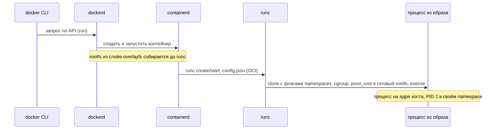

Из чего на самом деле состоит контейнер: почему он обычный процесс, а не виртуальная машина, что дают namespaces и чем их границы видны снаружи, как cgroups v2 ограничивают память и CPU и откуда берётся троттлинг, как overlayfs собирает файловую систему из слоёв и что делает `docker run` под капотом. В конце контейнер собирается руками из `unshare`, cgroup и `pivot_root`. Всё показано прогоном в песочнице, а не пересказом man.

Как читать. Окружение: Docker Desktop, ядро виртуальной машины linuxkit 6.12 (aarch64), cgroups v2. Песочница запущена с `--privileged` только для демонстрации: без привилегий `mount`, `unshare` и запись в `/sys/fs/cgroup` здесь не получились бы, а в проде так запускать контейнеры нельзя. Поднять песочницу: `make linux-up`; блок запускается `make linux-block PAGE="Linux/Контейнеры изнутри.md" TITLE="<имя>"`, вывод ниже снят именно так. Блоки убирают за собой cgroup, монтирования и фоновые процессы (по PID, а не по имени). Вывод зависит от ядра и числа ядер ВМ: PID, номера inode, время и объёмы у вас будут другими, порядок событий тот же.

Рядом: [[Процессы в Linux]], [[Сигналы в Linux]], [[Память в Linux]], [[Файлы и дескрипторы]].

## Вопросы на собеседовании

1. [Чем контейнер отличается от виртуальной машины?](#namespaces-и-unshare)
2. [Какие бывают namespaces и как увидеть, в каком из них процесс?](#namespace-снаружи-и-nsenter)
3. [Как cgroups ограничивают память и что происходит при превышении?](#cgroups-v2-и-память)
4. [Чем `memory.high` отличается от `memory.max`?](#memoryhigh-и-memorymax)
5. [Почему лимит CPU в Kubernetes замедляет приложение, даже когда ядра свободны?](#троттлинг-cpu)
6. [Как устроены слои образа и что такое copy-up?](#слои-и-overlayfs)
7. [Как собрать контейнер без Docker?](#контейнер-своими-руками)
8. [Что происходит при `docker run`?](#что-происходит-при-docker-run)

## Namespaces и unshare

Контейнер — обычный процесс на ядре хоста. Изолируют его namespaces: каждый скрывает от процесса часть глобальных ресурсов. По man namespaces(7): mount (точки монтирования), UTS (hostname), IPC, PID (идентификаторы процессов), network (интерфейсы, стек, порты), user (UID и GID), cgroup (корень каталога cgroup) и time (часы). Ограничивают процесс cgroups, а файловую систему собирают из слоёв. Своего ядра у контейнера нет, поэтому `uname -r` внутри показывает ядро хоста; у виртуальной машины ядро собственное.

`unshare` создаёт новые namespaces и запускает в них команду. Флаг `--fork` нужен для PID: новое PID-пространство получают дочерние процессы, поэтому команда запускается потомком и становится в нём PID 1; `--mount-proc` монтирует свежий `/proc` в новом mount namespace, иначе `ps` показал бы процессы хоста.

```sh title="ns-unshare.sh"
echo "хост: hostname=$(hostname) ядро $(uname -r)"
echo "хост: net $(ip -br link | cut -d ' ' -f1 | cut -d @ -f1 | tr '\n' ' ')"
unshare --pid --uts --mount --net --fork --mount-proc sh -c '
echo "внутри: pid=$$ ядро $(uname -r)"
hostname demo
echo "внутри: hostname=$(hostname)"
echo "внутри: net $(ip -br link | cut -d " " -f1 | cut -d @ -f1 | tr "\n" " ")"
ps -o pid,comm'
echo "хост снова: hostname=$(hostname)"
```

```text title="Вывод"
хост: hostname=reference-linux ядро 6.12.76-linuxkit
хост: net lo tunl0 gre0 gretap0 erspan0 ip_vti0 ip6_vti0 sit0 ip6tnl0 ip6gre0 eth0 
внутри: pid=1 ядро 6.12.76-linuxkit
внутри: hostname=demo
внутри: net lo tunl0 gre0 gretap0 erspan0 ip_vti0 ip6_vti0 sit0 ip6tnl0 ip6gre0 
  PID COMMAND
    1 sh
   10 ps
хост снова: hostname=reference-linux
```

PID и имена интерфейсов у вас будут другими. Ядро внутри то же, что на хосте. Внутри `sh` получил PID 1, `hostname demo` не изменил имя хоста (отдельный UTS namespace), а `ps` видит только свои процессы. В новом network namespace нет `eth0` хоста: остались `lo` и служебные туннельные устройства (`tunl0`, `gre0` и подобные), которые, по документации sysctl `net`, ядро создаёт в каждом сетевом пространстве при значении по умолчанию `fb_tunnels_only_for_init_net` = 0; реальных интерфейсов с адресами нет. Ссылки на PID 1 в контейнере и на сигналы — [[Сигналы в Linux#Сигналы и PID 1 в контейнере]].

### Частые ошибки в ответе

- «Контейнер — это лёгкая виртуальная машина». Виртуальная машина запускает собственное ядро поверх гипервизора, а контейнер — процесс на общем ядре хоста, которому ядро показывает урезанный вид системы.
- «Namespace что-то ограничивает». Namespace только скрывает и подменяет глобальные ресурсы. Ограничивают потребление cgroups.
- «PID 1 в контейнере — это init хоста». Это первый процесс в собственном PID namespace; PID у него на хосте другой.

## Namespace снаружи и nsenter

Принадлежность к namespace видна в `/proc/<pid>/ns/`. По man namespaces(7), это символические ссылки вида `тип:[inode]`, и два процесса в одном namespace имеют одинаковые ссылки. Команда `nsenter` присоединяет процесс к чужим namespaces по PID цели (`--target`): так `docker exec` и `kubectl exec` попадают в работающий контейнер.

Блок запускает `unshare` в фоне, сравнивает ссылки процесса из нового namespace и текущей оболочки, затем входит в него через `nsenter`. Процессы убираются в `trap` по PID.

```sh title="ns-links.sh"
pids=""
cleanup() { for p in $pids; do kill "$p" 2>/dev/null; done; wait 2>/dev/null; }
trap cleanup EXIT
unshare --pid --uts --mount --net --fork --mount-proc \
  sh -c 'hostname demo; exec sleep 60' &
u=$!
pids="$u"
for _ in $(seq 50); do c=$(pgrep -P "$u") && break; sleep 0.1; done
pids="$pids $c"
printf '%-5s %-19s %-19s\n' ns оболочка процесс-в-namespace
for ns in pid uts mnt net user; do
  a=$(readlink /proc/$$/ns/$ns); b=$(readlink /proc/$c/ns/$ns)
  if [ "$a" = "$b" ]; then s=одинаковые; else s=РАЗНЫЕ; fi
  printf '%-5s %-19s %-19s %s\n' "$ns" "$a" "$b" "$s"
done
echo "хост: $(hostname)"
nsenter --target "$c" --uts hostname
nsenter --target "$c" --net ip -br link | cut -d ' ' -f1 | head -2
nsenter --target "$c" --pid --mount sh -c 'echo "pid=$$"; ps -o pid,comm'
```

```text title="Вывод"
ns    оболочка    процесс-в-namespace
pid   pid:[4026532699]    pid:[4026532834]    РАЗНЫЕ
uts   uts:[4026532697]    uts:[4026532833]    РАЗНЫЕ
mnt   mnt:[4026532559]    mnt:[4026532832]    РАЗНЫЕ
net   net:[4026532701]    net:[4026532835]    РАЗНЫЕ
user  user:[4026531837]   user:[4026531837]   одинаковые
хост: reference-linux
demo
lo
tunl0@NONE
pid=3
  PID COMMAND
    1 sleep
    3 sh
    4 ps
```

Номера inode у вас будут другими. У `pid`, `uts`, `mnt` и `net` ссылки разные: процесс живёт в новых пространствах. У `user` одинаковые: `unshare` без `--user` его не создаёт, и контейнеры без user namespace видят те же UID, что и хост. `nsenter` вошёл в UTS namespace и увидел `demo`, в net — `lo` и `tunl0` (список обрезан `head`), а процесс, пришедший через `--pid --mount`, получил PID 3 рядом с `sleep` под PID 1.

### Частые ошибки в ответе

- «`/proc/<pid>/ns` — обычные файлы с номерами». Это символические ссылки, и сравнивают их цели.
- «Root в контейнере — не настоящий root». Без user namespace UID 0 в контейнере — тот же UID 0, что на хосте; от этого защищают не namespaces, а capabilities, seccomp и отказ от `--privileged`.

## cgroups v2 и память

Cgroups задают ограничения и учёт ресурсов группе процессов. В v2 это одно дерево каталогов в `/sys/fs/cgroup`: каталог — cgroup, вложенный каталог — дочерняя, файл `cgroup.procs` — её процессы, `memory.max`, `cpu.max` — лимиты. Включить контроллер для детей родителя можно через его `cgroup.subtree_control`, но по правилу «no internal process constraint» (документация cgroup v2) это работает, только если у родителя нет собственных процессов. Здесь корень cgroup песочницы не настоящий корень хоста, и в нём лежат процессы, поэтому блоки сначала переносят их в соседнюю cgroup `box` и возвращают в `trap`; тот же приём объяснён в [[Память в Linux#Почему free в контейнере врёт]].

Блок создаёт cgroup `demo-mem` с `memory.max` в 50 МБ, запускает в ней Python, который выделяет по 10 МиБ, и показывает `memory.events`. Подкачка отключена (`memory.swap.max`), иначе ядро могло бы выгрузить страницы вместо убийства. Порядок уборки: `cgroup.kill`, ожидание пустой cgroup, `rmdir`.

```sh title="cgroup-memory.sh"
root=/sys/fs/cgroup
cg=$root/demo-mem
cleanup() {
  if [ -d "$cg" ]; then
    echo 1 > "$cg/cgroup.kill"
    for _ in $(seq 50); do grep -q . "$cg/cgroup.procs" || break; sleep 0.1; done
    rmdir "$cg"
  fi
  echo -memory > "$root/cgroup.subtree_control" 2>/dev/null
  for p in $(cat "$root/box/cgroup.procs" 2>/dev/null); do
    echo "$p" > "$root/cgroup.procs" 2>/dev/null
  done
  rmdir "$root/box" 2>/dev/null
}
trap cleanup EXIT
mkdir "$root/box"
for p in $(cat "$root/cgroup.procs"); do
  echo "$p" > "$root/box/cgroup.procs" 2>/dev/null
done
echo +memory > "$root/cgroup.subtree_control"
mkdir "$cg"
echo 50M > "$cg/memory.max"
echo 0 > "$cg/memory.swap.max"
echo "до:"; grep -E '^(max|oom|oom_kill) ' "$cg/memory.events"
{ sh -c 'echo $$ > /sys/fs/cgroup/demo-mem/cgroup.procs
exec python3 -u -c "
b = []
for i in range(1, 21):
    b.append(bytearray(10 * 1024 * 1024))
    print(i * 10, \"MiB\")
"'; } 2>/dev/null
echo "код выхода: $?"
echo "после:"; grep -E '^(max|oom|oom_kill) ' "$cg/memory.events"
```

```text title="Вывод"
до:
max 0
oom 0
oom_kill 0
10 MiB
20 MiB
30 MiB
40 MiB
код выхода: 137
после:
max 35
oom 1
oom_kill 1
```

Число `max` у вас будет другим. Процесс остановился на 40 МиБ без ошибки Python: его убило ядро по `SIGKILL`, код выхода 137 (128 + 9, см. [[Сигналы в Linux#Коды выхода 128 + N]]). Счётчик `oom_kill` в `memory.events` стал 1: по документации cgroup v2, он считает процессы этой cgroup, убитые любым OOM killer. Счётчики лежат в самой cgroup `demo-mem`, то есть убийство произошло по её лимиту. Как OOM killer выбирает жертву и что видно в `dmesg` — в [[Память в Linux#OOM killer]]. Здесь важно другое: cgroup не даёт процессу выйти за `memory.max`, и в Kubernetes `limits.memory` работает так же: превышение заканчивается OOM-убийством контейнера.

### Частые ошибки в ответе

- «Процесс получит `MemoryError` и сам завершится». При `memory.max` ядро убивает процесс по `SIGKILL`; перехватить это нельзя.
- «Лимит памяти виден в `free`». `free` читает `/proc/meminfo` всей машины; лимит лежит в `memory.max` (см. [[Память в Linux#Почему free в контейнере врёт]]).
- «Дескрипторы и память ограничены одним механизмом». Дескрипторы — это `RLIMIT_NOFILE` процесса, а не cgroup: [[Файлы и дескрипторы#Лимит дескрипторов]].

## memory.high и memory.max

Оба файла ограничивают память cgroup, но реагируют по-разному (документация cgroup v2, admin-guide/cgroup-v2). Когда использование превышает `memory.high`, процессы cgroup притормаживаются и попадают под сильное давление на освобождение памяти; по документации, выход за `memory.high` никогда не вызывает OOM killer, но в экстремальных условиях предел может быть превышен. Жёсткая граница — `memory.max`: если использование дошло до неё и уменьшить его не удаётся, в cgroup вызывается OOM killer. `memory.high` — мягкий предел, который замедляет, `memory.max` — жёсткий, который убивает. Иерархия: по документации, ограничения всех контроллеров иерархичны, и дочерняя cgroup не может выйти за ограничения родителя; то, что задано ближе к корню, из потомка не переопределить.

Поведение `memory.high` здесь не воспроизводится: описание дано по документации.

### Частые ошибки в ответе

- «`memory.high` убивает процесс при превышении». По документации, выход за `memory.high` OOM killer не вызывает: процессы притормаживаются; OOM killer вызывает `memory.max`.
- «Достаточно `memory.high`, лимит не нужен». Без `memory.max` процесс, который не поддаётся замедлению, может вырасти и отнять память у соседей.

## Троттлинг CPU

`cpu.max` хранит пару «квота период» в микросекундах: по документации, группа может использовать до квоты за каждый период. Значение `50000 100000` — 50 мс CPU на каждые 100 мс, то есть половина одного ядра. Исчерпав квоту, процессы cgroup ждут следующего периода, даже если ядра свободны; это и есть троттлинг. По документации Kubernetes, лимит `cpu` обеспечивается именно троттлингом и это жёсткий предел.

Блок включает контроллер `cpu`, ставит `cpu.max = 50000 100000`, запускает цикл на 3 секунды и показывает `cpu.stat`.

```sh title="cgroup-cpu.sh"
root=/sys/fs/cgroup
cg=$root/demo-cpu
cleanup() {
  if [ -d "$cg" ]; then
    echo 1 > "$cg/cgroup.kill"
    for _ in $(seq 50); do grep -q . "$cg/cgroup.procs" || break; sleep 0.1; done
    rmdir "$cg"
  fi
  echo -cpu > "$root/cgroup.subtree_control" 2>/dev/null
  for p in $(cat "$root/box/cgroup.procs" 2>/dev/null); do
    echo "$p" > "$root/cgroup.procs" 2>/dev/null
  done
  rmdir "$root/box" 2>/dev/null
}
trap cleanup EXIT
mkdir "$root/box"
for p in $(cat "$root/cgroup.procs"); do
  echo "$p" > "$root/box/cgroup.procs" 2>/dev/null
done
echo +cpu > "$root/cgroup.subtree_control"
mkdir "$cg"
echo "ядер в ВМ: $(nproc)"
echo "50000 100000" > "$cg/cpu.max"
echo "cpu.max: $(cat "$cg/cpu.max")"
echo "до:"; grep -E 'usage_usec|nr_periods|nr_throttled|throttled_usec' "$cg/cpu.stat"
sh -c 'echo $$ > /sys/fs/cgroup/demo-cpu/cgroup.procs
exec timeout 3 sh -c "while :; do :; done"'
echo "код выхода timeout: $?"
echo "после:"; grep -E 'usage_usec|nr_periods|nr_throttled|throttled_usec' "$cg/cpu.stat"
```

```text title="Вывод"
ядер в ВМ: 14
cpu.max: 50000 100000
до:
usage_usec 0
nr_periods 0
nr_throttled 0
throttled_usec 0
код выхода timeout: 124
после:
usage_usec 1531064
nr_periods 30
nr_throttled 30
throttled_usec 1470553
```

Числа у вас будут другими. `timeout` вернул 124, значит остановил цикл он сам, через 3 секунды. За 3 секунды стенных часов цикл получил около 1,5 с CPU (`usage_usec`), хотя в ВМ 14 ядер и один цикл мог бы занять ядро целиком: в каждом из 30 периодов (`nr_periods`) квота кончалась (`nr_throttled` равен `nr_periods`), а `throttled_usec` вырос примерно до 1,5 с. По документации планировщика (sched-bwc), `nr_periods` — число прошедших интервалов квоты, `nr_throttled` — сколько раз группа была ограничена, а `throttled_time` (в v1 в наносекундах) — суммарное время ограничения; `throttled_usec` в `cpu.stat` v2 — соответствующий счётчик в микросекундах. Отсюда ответ на вопрос про Kubernetes: лимит CPU — это квота за период, а не «число ядер». Признаки троттлинга ищут в `cpu.stat`.

### Частые ошибки в ответе

- «Если на узле есть свободные ядра, лимит CPU не мешает». Квота не зависит от свободных ядер: в прогоне выше в ВМ 14 ядер, а цикл всё равно ждал конца периода.
- «`cpu.max` задаёт, на каких ядрах работать». Это квота времени; привязка к ядрам — `cpuset`.

## Слои и overlayfs

Образ контейнера — набор слоёв только для чтения; контейнер добавляет сверху один слой для записи. Склеивает их overlayfs: `lowerdir` — нижние слои (для чтения), `upperdir` — верхний слой для записи, `workdir` — служебный каталог на той же файловой системе, что и `upperdir`; результат виден в точке монтирования. По документации overlayfs, файл нижнего слоя при записи сначала копируется в верхний (copy-up), а удаление записывается в верхнем слое как whiteout: символьное устройство 0/0, которое скрывает имя нижнего слоя. Отсюда запись в слой образа дороже обычной (сначала копия) и пропадает при пересоздании контейнера (верхний слой удаляется).

Рядом стоит bind mount: `mount --bind` показывает уже существующий каталог в другом месте. Так, по документации Docker, работает bind mount при `docker run -v` или `--mount type=bind`, а в блоке «Контейнер своими руками» ниже через него виден `/dev/zero`.

Блок собирает три каталога на tmpfs, пишет в файл нижнего слоя, удаляет другой и пересоздаёт монтирование с пустым `upperdir`. Монтирования убираются в `trap`.

```sh title="overlay.sh"
d=/tmp/ovl
cleanup() { umount "$d/merged" 2>/dev/null; umount "$d" 2>/dev/null; rmdir "$d" 2>/dev/null; }
trap cleanup EXIT
mkdir "$d"
mount -t tmpfs tmpfs "$d"
mkdir "$d/lower" "$d/upper" "$d/work" "$d/merged"
echo "из образа" > "$d/lower/config.txt"
echo "тоже из образа" > "$d/lower/old.txt"
mount -t overlay overlay \
  -o lowerdir="$d/lower",upperdir="$d/upper",workdir="$d/work" "$d/merged"
echo "== merged до записи: $(ls "$d/merged" | tr '\n' ' ') | upper: [$(ls "$d/upper")]"
echo "правка контейнера" >> "$d/merged/config.txt"
echo "== после записи в merged/config.txt"
echo "merged:"; cat "$d/merged/config.txt"
echo "lower:";  cat "$d/lower/config.txt"
echo "upper (копия):"; cat "$d/upper/config.txt"
rm "$d/merged/old.txt"
echo "== после rm merged/old.txt"
echo "merged: $(ls "$d/merged" | tr '\n' ' ')| lower: $(ls "$d/lower" | tr '\n' ' ')"
stat -c '%A %F %n' "$d"/upper/*
echo "== пересоздание с пустым upper"
umount "$d/merged"
mkdir "$d/upper2" "$d/work2"
mount -t overlay overlay \
  -o lowerdir="$d/lower",upperdir="$d/upper2",workdir="$d/work2" "$d/merged"
echo "merged: $(ls "$d/merged" | tr '\n' ' ')"
cat "$d/merged/config.txt"
```

```text title="Вывод"
== merged до записи: config.txt old.txt  | upper: []
== после записи в merged/config.txt
merged:
из образа
правка контейнера
lower:
из образа
upper (копия):
из образа
правка контейнера
== после rm merged/old.txt
merged: config.txt | lower: config.txt old.txt 
-rw-r--r-- regular file /tmp/ovl/upper/config.txt
c--------- character special file /tmp/ovl/upper/old.txt
== пересоздание с пустым upper
merged: config.txt old.txt 
из образа
```

Вывод от окружения не зависит. Нижний слой не изменился: правка легла в `upper/config.txt` вместе с копией исходного содержимого, а удалённый `old.txt` в `upper` стал `c---------` (символьное устройство, whiteout) и исчез из `merged`, оставшись в `lower`. После пересоздания с пустым `upperdir` обе правки пропали. Поэтому данные, которые должны пережить контейнер, хранят в томе, а не в слое.

### Частые ошибки в ответе

- «Запись в контейнере меняет образ». Образ (`lowerdir`) не меняется; запись идёт в верхний слой, который исчезает вместе с контейнером.
- «Удаление файла освобождает место в образе». В нижнем слое файл остаётся, в верхнем появляется whiteout.
- «Копирование при записи делается для каждого запроса». Copy-up случается один раз на файл; дальше он живёт в `upperdir`.

## Контейнер своими руками

Все части вместе: корневая файловая система на tmpfs из статического `busybox` (в нём нет зависимостей от библиотек, поэтому копируется один файл), cgroup с лимитом памяти и `unshare` с namespaces. `pivot_root` меняет корневую файловую систему процесса и в новом mount namespace работает, если новый корень — точка монтирования (man pivot_root(2)); поэтому rootfs смонтирован как tmpfs, а перед `pivot_root` на `/` выставлено `--make-rprivate`, чтобы монтирования не утекали на хост. Здесь `pivot_root` сработал без `chroot`. Старый корень отмонтируется (`umount -l`), и хост из контейнера не виден. Флаг `--cgroup` создаёт cgroup namespace: внутри корнем cgroup оказывается cgroup контейнера, и смонтированная `cgroup2` показывает его `memory.max`.

Блок готовит корень, ставит лимит 30 МБ и запускает внутри `tail /dev/zero`, который накапливает бесконечную строку и упирается в лимит.

```sh title="container.sh"
root=/sys/fs/cgroup
R=/tmp/rootfs
cg=$root/demo-box
export R
cleanup() {
  if [ -d "$cg" ]; then
    echo 1 > "$cg/cgroup.kill"
    for _ in $(seq 50); do grep -q . "$cg/cgroup.procs" || break; sleep 0.1; done
    rmdir "$cg"
  fi
  echo -memory > "$root/cgroup.subtree_control" 2>/dev/null
  for p in $(cat "$root/box/cgroup.procs" 2>/dev/null); do
    echo "$p" > "$root/cgroup.procs" 2>/dev/null
  done
  rmdir "$root/box" 2>/dev/null
  umount "$R" 2>/dev/null
  rmdir "$R" 2>/dev/null
}
trap cleanup EXIT
mkdir "$R" && mount -t tmpfs tmpfs "$R"
mkdir "$R/bin" "$R/proc" "$R/sys" "$R/dev" "$R/old"
cp /usr/bin/busybox "$R/bin/busybox"
for a in sh ls cat ps hostname umount rmdir tail; do ln -s busybox "$R/bin/$a"; done
touch "$R/dev/zero"
cat > "$R/init.sh" <<'INIT'
umount -l /old; rmdir /old
echo "pid=$$"
echo "hostname=$(hostname)"
echo "ls /: $(ls / | tr '\n' ' ')"
ps -o pid,comm
echo "memory.max: $(cat /sys/memory.max)"
echo "cgroup: $(cat /proc/self/cgroup)"
tail /dev/zero
echo "tail: код выхода $?"
INIT
cat > "$R/launch.sh" <<'LAUNCH'
mount --make-rprivate /
hostname box
mount -t proc proc "$R/proc"
mount -t cgroup2 none "$R/sys"
mount --bind /dev/zero "$R/dev/zero"
cd "$R" && pivot_root . old
exec /bin/sh /init.sh
LAUNCH
mkdir "$root/box"
for p in $(cat "$root/cgroup.procs"); do
  echo "$p" > "$root/box/cgroup.procs" 2>/dev/null
done
echo +memory > "$root/cgroup.subtree_control"
mkdir "$cg"
echo 30M > "$cg/memory.max"
echo 0 > "$cg/memory.swap.max"
{ sh -c 'echo $$ > /sys/fs/cgroup/demo-box/cgroup.procs
exec unshare --pid --uts --mount --net --cgroup --fork sh "$R/launch.sh"'; } 2>/dev/null
echo "снаружи: hostname=$(hostname)"
grep -E '^(oom|oom_kill) ' "$cg/memory.events"
```

```text title="Вывод"
pid=1
hostname=box
ls /: bin dev init.sh launch.sh proc sys 
PID   COMMAND
    1 sh
   14 ps
memory.max: 31457280
cgroup: 0::/
tail: код выхода 137
снаружи: hostname=reference-linux
oom 1
oom_kill 1
```

PID и числа у вас будут другими. Внутри процесс получил PID 1 и свой hostname `box`, `ls /` показывает только содержимое собранного rootfs, а `ps` — только свои процессы. `cgroup2`, смонтированная внутри, показывает `memory.max` = 31457280 (30 МБ), а `/proc/self/cgroup` — `0::/`, потому что корнем стал cgroup контейнера. `tail` упёрся в лимит и был убит (137), PID 1 продолжил работу и дописал строку; снаружи `oom_kill` стал 1, а hostname хоста не изменился. Ни одного шага здесь не выполнял Docker: это обычные `unshare`, cgroup и `pivot_root`.

### Частые ошибки в ответе

- «Контейнеру нужен `--privileged`, иначе он не заработает». Эта песочница привилегирована только потому, что в ней вручную монтируют и пишут в cgroup. Обычный контейнер этого не делает: `--privileged` снимает почти всю изоляцию и в проде недопустим, нужные права выдают точечно (capabilities).
- «`chroot` и `pivot_root` — одно и то же». `chroot` меняет корневой каталог процесса, а `pivot_root` — корневую точку монтирования в mount namespace (man pivot_root(2)), после чего старый корень отмонтируется, как в блоке выше.
- «Контейнер — это один системный вызов». Это набор: `clone` или `unshare` с флагами namespaces, настройка cgroup, монтирования и `pivot_root`.

## Что происходит при docker run

Это не воспроизводится здесь: в песочнице нет `dockerd`, `containerd` и `runc`, и дерево процессов Docker из контейнера не видно. Схема — текстом.

`docker run` — клиент: он отправляет запрос демону `dockerd` по API. `dockerd` передаёт запуск контейнера в `containerd`. Корневую файловую систему из слоёв образа собирает до `runc` сторона Docker и containerd: у containerd за это отвечает snapshotter (по умолчанию `overlayfs`), который возвращает определения монтирований. `runc` — реализация OCI runtime spec: получает в `config.json` путь к уже готовому rootfs (`root.path`) и описание namespaces и cgroup и делает шаги из предыдущего раздела: создаёт процесс через `clone` с флагами namespaces, настраивает cgroup, делает `pivot_root` и вызывает `execve` для процесса из образа. OCI — спецификации формата образа и runtime; благодаря им образ собирает один инструмент, а запускает другой.



### Частые ошибки в ответе

- «`docker run` запускает контейнер внутри `dockerd`». Процесс контейнера создаёт `runc` через `clone` и `execve`, а не сам демон: это обычный процесс на ядре хоста.
- «Docker и контейнер — одно и то же». Docker — удобная обвязка; ядро делает namespaces и cgroups, а запуск стандартизован OCI.
- «У контейнера своё ядро». Ядро общее с хостом: в первом блоке `uname -r` снаружи и внутри `unshare` показал одно и то же ядро (здесь это linuxkit, ядро ВМ Docker Desktop).

## Что спросят дальше

- Что такое user namespace и rootless-контейнеры.
- Как capabilities и seccomp ограничивают процесс в контейнере.
- Как Kubernetes связывает `requests` и `limits` с cgroup и QoS-классами пода.
- Как работают сетевые мосты и veth-пары контейнеров.
- Почему приложение в контейнере не реагирует на SIGTERM — [[Сигналы в Linux#Сигналы и PID 1 в контейнере]].
- Как OOM killer выбирает жертву — [[Память в Linux#OOM killer]].
