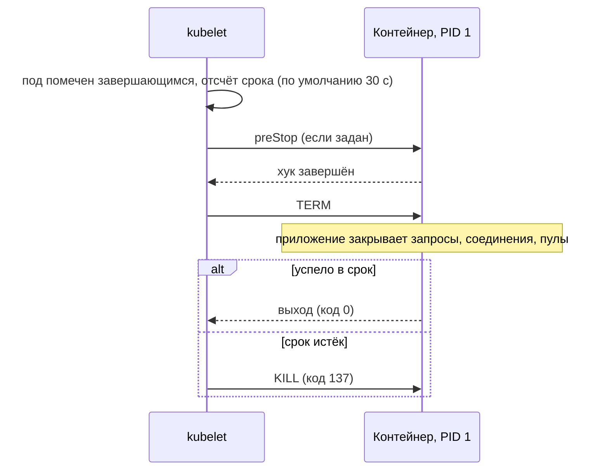

Что такое сигнал и что с ним делает процесс: действия по умолчанию, перехват и игнор, почему `KILL` и `STOP` не перехватить, откуда берутся коды выхода 130, 137 и 143, как написать аккуратную остановку в Python, чем PID 1 в контейнере отличается от остальных процессов и что делает Kubernetes, когда останавливает под. Всё показано прогоном в песочнице (Debian в Docker с привилегиями), а не пересказом man.

Как читать. Поднять песочницу: `make linux-up`; блок запускается `make linux-block PAGE="Linux/Сигналы в Linux.md" TITLE="<имя>"`, вывод ниже снят именно так. Python запускается с `-u`, у блока таймаут 120 секунд. Ядро в песочнице — ядро виртуальной машины Docker Desktop (linuxkit), поэтому поведение, зависящее от версии ядра, у вас может отличаться. PID у вас будут другими.

Рядом: [[Процессы в Linux]], [[Память в Linux]], [[asyncio под капотом]].

## Вопросы на собеседовании

1. [Что такое сигнал и что происходит, если его не обработать?](#что-такое-сигнал)
2. [Почему SIGKILL нельзя перехватить?](#kill-и-stop-нельзя-перехватить)
3. [Что значат коды выхода 130, 137 и 143?](#коды-выхода-128--n)
4. [Как в Python сделать аккуратную остановку по SIGTERM?](#аккуратная-остановка-в-python)
5. [Почему приложение в контейнере не реагирует на SIGTERM?](#сигналы-и-pid-1-в-контейнере)
6. [Что делает Kubernetes, когда останавливает под?](#kubernetes-при-остановке-пода)
7. [Чем kill PID отличается от kill -- -PGID?](#сигнал-группе-процессов)

## Что такое сигнал

Сигнал — короткое асинхронное уведомление процессу: только номер, без данных. Процесс может выбрать одно из трёх: оставить действие по умолчанию, установить обработчик или игнорировать сигнал. Действие по умолчанию у каждого сигнала своё: завершить процесс (Term), завершить с дампом памяти (Core), игнорировать (Ign), остановить (Stop), продолжить (Cont).

| Сигнал | № | По умолчанию | Кто и зачем шлёт |
| --- | --- | --- | --- |
| `HUP` | 1 | Term | Закрытие терминала; демоны по соглашению перечитывают конфиг |
| `INT` | 2 | Term | Ctrl+C в терминале |
| `QUIT` | 3 | Core | Ctrl+\\: завершить и сбросить дамп |
| `KILL` | 9 | Term | Убить без права отказа |
| `USR1` | 10 | Term | Свободный сигнал для приложения |
| `PIPE` | 13 | Term | Запись в канал, который никто не читает |
| `TERM` | 15 | Term | Вежливая просьба завершиться: `kill` без аргументов, `docker stop`, Kubernetes |
| `CHLD` | 17 | Ign | Ядро шлёт родителю, когда потомок завершился или остановился |
| `STOP` | 19 | Stop | Остановить без права отказа |

Номера указаны для x86 и ARM, на других архитектурах часть из них другая. Названия вне номеров переносимы, поэтому в скриптах пишут `kill -TERM`, а не `kill -15`.

Python поверх этого делает две поправки: `SIGINT` превращает в исключение `KeyboardInterrupt`, а `SIGPIPE` игнорирует, чтобы запись в оборванный сокет была обычным исключением, а не смертью процесса. Это видно по обработчикам, которые интерпретатор ставит при старте.

```python title="signal-defaults.py"
import signal

for name in ("SIGHUP", "SIGINT", "SIGTERM", "SIGPIPE", "SIGCHLD"):
    s = signal.Signals[name]
    h = signal.getsignal(s)
    print(f"{s.value:>2} {name:<8} {h.name if isinstance(h, signal.Handlers) else h.__name__}")
```

```text title="Вывод"
 1 SIGHUP   SIG_DFL
 2 SIGINT   default_int_handler
15 SIGTERM  SIG_DFL
13 SIGPIPE  SIG_IGN
17 SIGCHLD  SIG_DFL
```

`HUP`, `TERM` и `CHLD` в Python остались с действием по умолчанию (`SIG_DFL`): для них интерпретатор ничего не ставит.

### Частые ошибки в ответе

- «`kill` убивает процесс». `kill` только отправляет сигнал, по умолчанию `TERM`. Умрёт процесс или нет, решает он сам.
- «`kill -9` — обычный способ остановить процесс». Это последняя мера: процесс не успевает закрыть файлы, снять блокировки и сбросить буферы. Сначала `TERM` и ожидание.
- «Все сигналы завершают процесс». Для `CHLD` по умолчанию игнор, `STOP` останавливает, `CONT` продолжает.

## KILL и STOP нельзя перехватить

`KILL` и `STOP` ядро выполняет само, не спрашивая процесс: их нельзя перехватить, заблокировать или игнорировать. Попытка поставить обработчик заканчивается ошибкой `EINVAL` от системного вызова `sigaction`, которую Python показывает как `OSError`.

```python title="uncatchable.py"
import signal

for name in ("SIGTERM", "SIGKILL", "SIGSTOP"):
    sig = signal.Signals[name]
    for label, handler in (("обработчик", lambda s, f: None), ("SIG_IGN", signal.SIG_IGN)):
        try:
            signal.signal(sig, handler)
            print(f"{name}: {label} установлен")
        except OSError as e:
            print(f"{name}: {label} -> OSError: {e}")
```

```text title="Вывод"
SIGTERM: обработчик установлен
SIGTERM: SIG_IGN установлен
SIGKILL: обработчик -> OSError: [Errno 22] Invalid argument
SIGKILL: SIG_IGN -> OSError: [Errno 22] Invalid argument
SIGSTOP: обработчик -> OSError: [Errno 22] Invalid argument
SIGSTOP: SIG_IGN -> OSError: [Errno 22] Invalid argument
```

Раз `KILL` не видит процесс, у него нет шанса прибраться. Поэтому «аккуратная остановка» всегда строится на `TERM` (или `INT`), а `KILL` остаётся страховкой на случай, когда процесс завис.

### Частые ошибки в ответе

- «`SIGKILL` можно перехватить или проигнорировать». Нельзя ни то ни другое, как и `SIGSTOP`.
- «Обработчик `SIGKILL` нужен, чтобы сохранить данные перед смертью». Такого обработчика не бывает. Данные сохраняют по `TERM` или пишут так, чтобы смерть в любой момент была безопасной.
- «`kill -9` убьёт любой процесс немедленно». Процесс в непрерываемом сне (`D`) обычно получит сигнал, только когда выйдет из этого состояния, см. [[Процессы в Linux]].

## Коды выхода 128 + N

Код выхода процесса — число от 0 до 255, и о смерти от сигнала он сам рассказать не может: процесс убит и ничего не возвращает. Код 128 + N придумала оболочка: если команда завершилась по сигналу с номером N, bash подставляет в `$?` значение 128 + N. Поэтому 130 это `INT` (2), 137 это `KILL` (9), 143 это `TERM` (15).

```sh title="exit-codes.sh"
set -m
for sig in INT KILL TERM; do
  sleep 30 &
  pid=$!
  sleep 0.2
  kill -"$sig" "$pid"
  wait "$pid"
  echo "$sig -> код выхода $?"
done 2>/dev/null
```

```text title="Вывод"
INT -> код выхода 130
KILL -> код выхода 137
TERM -> код выхода 143
```

`set -m` включает управление заданиями. Без него фоновая команда в неинтерактивной оболочке запускается с игнорируемым `INT`, и `kill -INT` ей ничего бы не сделал. `2>/dev/null` прячет сообщения оболочки о заданиях. Убиваются только свои процессы по `$!`.

В Docker и Kubernetes эти числа читают так же: код 143 означает, что процесс завершён сигналом `TERM` или сам вышел с кодом 128 + 15. Приложение без обработчика под PID 1 так не закончит: `TERM` оно проигнорирует, и контейнер завершится кодом 137 после срока остановки (см. раздел про PID 1). Код 137 означает смерть от `KILL`, но причин у `KILL` несколько: истёк срок остановки, а приложение не успело завершиться, или процесс убил OOM killer ([[Память в Linux#OOM killer]]). Код сам по себе причину не называет, смотреть надо события и причину остановки контейнера.

### Частые ошибки в ответе

- «Код 137 значит, что не хватило памяти». Это значит только «убит `KILL`». OOM killer шлёт `KILL`, но и `docker stop` по истечении срока тоже.
- «Код 143 — ошибка приложения». Это завершение по `TERM` (процесс не под PID 1 и без обработчика) либо выход обработчика с кодом 128 + 15. Приложение с аккуратным обработчиком обычно выходит с 0.
- «128 + N — свойство ядра». Ядро сообщает родителю, что процесс убит сигналом N (это видно по `wait`); число 128 + N складывает оболочка.

## Аккуратная остановка в Python

Задача обработчика `TERM` — не обрывать работу на полуслове. Обработчик только ставит флаг, а основной код смотрит на флаг между единицами работы: текущую доделывает, новую не начинает. Python вызывает обработчик в главном потоке между инструкциями байткода, поэтому в обработчике безопасно ставить флаг и небезопасно делать что-то сложное (блокировки, ввод-вывод).

```sh title="graceful-sync.sh"
cat > /tmp/sync_app.py <<'PY'
import signal
import time

stop = False


def on_term(signum, frame):
    global stop
    stop = True
    print("получен TERM: доделываю текущий элемент и выхожу", flush=True)


signal.signal(signal.SIGTERM, on_term)
for item in range(1, 6):
    if stop:
        print(f"остановка: элемент {item} не начат", flush=True)
        break
    print(f"элемент {item}: начат", flush=True)
    time.sleep(0.4)
    print(f"элемент {item}: готов", flush=True)
print("чистый выход", flush=True)
PY
python3 -u /tmp/sync_app.py &
pid=$!
sleep 0.6
kill -TERM "$pid"
wait "$pid"
echo "код выхода: $?"
rm -f /tmp/sync_app.py
```

```text title="Вывод"
элемент 1: начат
элемент 1: готов
элемент 2: начат
получен TERM: доделываю текущий элемент и выхожу
элемент 2: готов
остановка: элемент 3 не начат
чистый выход
код выхода: 0
```

`TERM` пришёл посреди элемента 2: он доделан, элемент 3 не начат, код выхода 0.

В asyncio обработчик через `signal.signal` неудобен: он выполняется вне цикла и не может безопасно трогать его объекты. Для этого есть `loop.add_signal_handler`: колбэк запускает сам цикл вместе с остальными колбэками и корутинами, поэтому он может ставить `asyncio.Event` и отменять задачи. Метод доступен только в Unix и вызывается из главного потока. Подробнее про цикл — [[asyncio под капотом]].

```sh title="graceful-asyncio.sh"
cat > /tmp/aio_app.py <<'PY'
import asyncio
import signal


async def main():
    loop = asyncio.get_running_loop()
    stop = asyncio.Event()

    def on_term():
        print("получен TERM: доделываю текущий элемент и выхожу", flush=True)
        stop.set()

    loop.add_signal_handler(signal.SIGTERM, on_term)
    for item in range(1, 6):
        if stop.is_set():
            print(f"остановка: элемент {item} не начат", flush=True)
            break
        print(f"элемент {item}: начат", flush=True)
        await asyncio.sleep(0.4)
        print(f"элемент {item}: готов", flush=True)
    print("чистый выход", flush=True)


asyncio.run(main())
PY
python3 -u /tmp/aio_app.py &
pid=$!
sleep 0.6
kill -TERM "$pid"
wait "$pid"
echo "код выхода: $?"
rm -f /tmp/aio_app.py
```

```text title="Вывод"
элемент 1: начат
элемент 1: готов
элемент 2: начат
получен TERM: доделываю текущий элемент и выхожу
элемент 2: готов
остановка: элемент 3 не начат
чистый выход
код выхода: 0
```

Тот же результат, но обработчик исполняется циклом. В реальном сервисе вместо цикла по элементам — остановка приёма новых запросов, ожидание уже принятых и закрытие пулов соединений.

### Частые ошибки в ответе

- «В обработчике `TERM` делаю всю очистку». Обработчик должен быстро поставить флаг или событие, а очистка идёт в основном коде. Блокировки и долгий ввод-вывод в обработчике дают взаимные блокировки.
- «`signal.signal` можно вызвать из потока». Только из главного потока главного интерпретатора, иначе `ValueError`.
- «Достаточно поймать `TERM`, срок не важен». У остановки есть предел: после него придёт `KILL`, и всё, что не успели, потеряно. Время аккуратной остановки должно быть меньше этого срока, см. раздел про Kubernetes.
- «`except KeyboardInterrupt` ловит остановку контейнера». Контейнер получает `TERM`, а `KeyboardInterrupt` — это только `INT` (Ctrl+C).

## Сигналы и PID 1 в контейнере

Для PID 1 в пространстве имён PID ядро делает исключение: сигнал, для которого у процесса нет обработчика, ему не доставляется. Для остальных процессов это обычное действие по умолчанию (например, смерть от `TERM`), а PID 1 его просто не получает. Из самого пространства и из потомков шлётся только то, для чего у PID 1 есть обработчик. Из внешнего пространства (с хоста) `KILL` и `STOP` доставляются принудительно, остальные сигналы подчиняются тому же правилу. Защита нужна, чтобы случайный `kill` не уронил init, а вместе с ним всю систему.

Контейнер — это ровно такое пространство, а приложение в нём — PID 1. Скрипт ниже посылает `TERM` сам себе через дочерний `kill`: один раз как PID 1 в `unshare --pid --fork`, второй раз как обычный процесс.

```sh title="pid1-term.sh"
cat > /tmp/no_handler.py <<'PY'
import os
import subprocess
import time

print("мой PID:", os.getpid(), flush=True)
subprocess.run(["kill", "-TERM", str(os.getpid())])
time.sleep(0.5)
print("жив после TERM", flush=True)
PY
echo "== PID 1 в новом пространстве =="
unshare --pid --fork --mount-proc python3 -u /tmp/no_handler.py
echo "код выхода: $?"
echo "== обычный процесс =="
{ python3 -u /tmp/no_handler.py; echo "код выхода: $?"; } 2>&1
rm -f /tmp/no_handler.py
```

```text title="Вывод"
== PID 1 в новом пространстве ==
мой PID: 1
жив после TERM
код выхода: 0
== обычный процесс ==
мой PID: 69
Terminated
код выхода: 143
```

Под PID 1 `TERM` пропал, процесс продолжил работу. Не под PID 1 тот же процесс убит `TERM` (код 143 = 128 + 15; слово `Terminated` печатает оболочка). PID у вас будет другим. В Kubernetes это означает: приложение без обработчика `TERM` под PID 1 не остановится на `TERM` и будет убито `KILL` по истечении срока, то есть без аккуратной остановки и с запозданием на весь срок.

С хоста картина другая: `KILL` доставляется принудительно, `TERM` без обработчика нет.

```sh title="pid1-from-outside.sh"
unshare --pid --fork --mount-proc python3 -u -c 'import time; time.sleep(60)' 2>/dev/null &
sleep 0.5
child=$(pgrep -P "$!")
echo "PID 1 пространства виден снаружи как $child"
kill -TERM "$child"
sleep 0.3
if kill -0 "$child" 2>/dev/null; then echo "после TERM: жив"; else echo "после TERM: умер"; fi
kill -KILL "$child"
wait
sleep 0.3
if kill -0 "$child" 2>/dev/null; then echo "после KILL: жив"; else echo "после KILL: умер"; fi
```

```text title="Вывод"
PID 1 пространства виден снаружи как 298
после TERM: жив
после KILL: умер
```

`TERM` снаружи не подействовал, `KILL` подействовал (для `KILL` из внешнего пространства это принудительная доставка). PID у вас будет другим. Именно поэтому остановка контейнера заканчивается убийством: `docker stop` шлёт `TERM`, ждёт срок и шлёт `KILL`, а `KILL` ничем не остановить.

`unshare` жалуется «sigprocmask unblock failed», когда его потомка убивают `KILL`, поэтому в блоке его stderr скрыт. Побочный эффект: если `unshare` не запустится (нет привилегий), сообщения вы не увидите, а PID будет пустым.

Вторая ловушка — shell-форма `CMD` в Dockerfile. `CMD python app.py` запускает `/bin/sh -c "python app.py"`, и PID 1 оказывается оболочкой, а приложение — её потомком. Оболочка `TERM` не пересылает и не имеет на него обработчика, так что сигнал до приложения не доходит. Покажем, у какого процесса оказывается PID 1 и доходит ли `TERM`. Приложение ставит обработчик и просит `kill` послать `TERM` процессу 1.

```sh title="pid1-shell-form.sh"
cat > /tmp/app.py <<'PY'
import os
import signal
import subprocess
import time

got = []
signal.signal(signal.SIGTERM, lambda s, f: got.append(s))
print("приложение: PID", os.getpid(), "родитель", os.getppid(), flush=True)
subprocess.run(["kill", "-TERM", "1"])
time.sleep(0.5)
print("TERM дошёл до приложения" if got else "TERM до приложения НЕ дошёл", flush=True)
PY
run() { unshare --pid --fork --mount-proc "$@"; }
echo "== exec-форма: python3 app.py =="
run python3 -u /tmp/app.py
echo "== shell-форма, одна команда: sh -c 'python3 app.py' =="
run sh -c 'python3 -u /tmp/app.py'
echo "== лечение: sh -c 'exec python3 app.py' =="
run sh -c 'exec python3 -u /tmp/app.py'
rm -f /tmp/app.py
```

```text title="Вывод"
== exec-форма: python3 app.py ==
приложение: PID 1 родитель 0
TERM дошёл до приложения
== shell-форма, одна команда: sh -c 'python3 app.py' ==
приложение: PID 2 родитель 1
TERM до приложения НЕ дошёл
== лечение: sh -c 'exec python3 app.py' ==
приложение: PID 1 родитель 0
TERM дошёл до приложения
```

В этом образе `sh -c 'python3 app.py'` не заменяет оболочку приложением: PID 1 остаётся `sh`, приложение получило PID 2 и родителя 1. `TERM`, посланный процессу 1, получила оболочка, у неё нет обработчика, и сигнал пропал. Приложение `TERM` не увидело и продолжило работу. С `exec` оболочка заменяет себя приложением, и оно становится PID 1 со своим обработчиком. PID у вас будут другими. Поведение зависит от оболочки: некоторые оболочки сами делают `exec` для последней простой команды, поэтому проверять надо на своём образе, а не рассчитывать на это.

Лечится так: exec-форма (`CMD ["python", "app.py"]`), либо `exec python app.py` в скрипте запуска, либо небольшой init (`tini`, `docker run --init`), который сам получает сигналы и пересылает их приложению. Про `tini` — в разделе про PID 1 на странице [[Процессы в Linux]].

### Частые ошибки в ответе

- «`docker stop` убьёт приложение `TERM`, и оно завершится». Под PID 1 `TERM` без обработчика игнорируется, остановка закончится по `KILL` через 10 секунд (срок `docker stop` по умолчанию).
- «Shell-форма и exec-форма `CMD` равноценны». В shell-форме PID 1 — оболочка, и сигналы до приложения не доходят, если оболочка не заменила себя через `exec`.
- «Приложению достаточно обработать `INT`». Контейнеру по умолчанию шлют `TERM`; другой сигнал задаётся `STOPSIGNAL` в образе.
- «Обработчик `TERM` не нужен, PID 1 и так остановится». Наоборот: именно под PID 1 действие по умолчанию не работает, обработчик нужен обязательно.

## Kubernetes при остановке пода

Когда под удаляют (деплой, масштабирование, вытеснение с узла), kubelet останавливает контейнеры в таком порядке:

1. Под получает пометку «завершается», отсчёт срока `terminationGracePeriodSeconds` начинается сразу. По умолчанию он равен 30 секундам.
2. Если у контейнера есть `preStop`, kubelet выполняет его. Сигнал `TERM` не отправляется, пока хук не завершится.
3. Среда исполнения шлёт `TERM` процессу 1 каждого контейнера (если в образе задан другой `STOPSIGNAL`, шлётся он).
4. Когда срок истёк, а что-то ещё работает, всем оставшимся процессам шлётся `KILL`.

Параллельно control plane убирает под из списка адресов сервиса, но это идёт независимо от остановки контейнеров: часть запросов ещё может прийти уже после `TERM`. Поэтому в `preStop` часто ставят короткую паузу, чтобы балансировщики успели узнать, что адрес выбыл.

Срок один на всё: он делится между `preStop` и остановкой приложения. Хук на 25 секунд при сроке 30 оставит приложению 5 секунд на аккуратную остановку, после чего придёт `KILL`.



Это не воспроизводится здесь: в песочнице нет кластера, диаграмма и описание сверены с документацией Kubernetes (Pod Lifecycle и Termination of Pods). Прогон на настоящем поде — в [[Ресурсы и остановка в Kubernetes#Остановка пода]]. Всё, что на стороне приложения, воспроизводится: обработчик `TERM` из раздела про Python и поведение PID 1 из предыдущего раздела.

Что из этого следует для приложения:

- обработчик `TERM` обязателен, и он должен быть у PID 1 контейнера (см. предыдущий раздел);
- время аккуратной остановки должно уложиться в срок с запасом на `preStop`; если не укладывается, срок увеличивают через `terminationGracePeriodSeconds`, а не надеются на чудо;
- после `TERM` приложение сначала перестаёт принимать новые запросы, затем дожидается принятых, затем закрывает соединения.

### Частые ошибки в ответе

- «Kubernetes сразу убивает под `KILL`». Сначала `preStop` и `TERM`, `KILL` только по истечении срока.
- «Срок отсчитывается от `TERM`». Отсчёт идёт с начала остановки, `preStop` расходует тот же срок.
- «Достаточно обработчика в приложении, а как запущен контейнер — неважно». Если PID 1 — оболочка или процесс без обработчика, `TERM` до приложения не дойдёт, и каждый деплой будет ждать весь срок до `KILL`.
- «Остановка без потери запросов настраивается одним `terminationGracePeriodSeconds`». Он только задаёт предел. Потерь нет, если приложение умеет само закончить работу по `TERM`.

## Сигнал группе процессов

Процессы объединены в группы (у каждой свой PGID), группы в сеансы. `kill PID` шлёт сигнал одному процессу. `kill -- -PGID` (отрицательное число) шлёт его всем процессам группы. Сигнал процессу-родителю потомкам автоматически не передаётся: они продолжают жить, а их родителем становится init или ближайший «усыновитель» (см. [[Процессы в Linux]]).

```sh title="process-group.sh"
setsid sh -c 'sleep 60 & sleep 60 & wait' &
leader=$!
sleep 0.3
echo "== группа $leader: лидер и дети =="
ps -o pid,ppid,pgid,comm --sid "$leader"
kill "$leader"
wait "$leader" 2>/dev/null
echo "== после kill $leader: дети остались =="
ps -o pid,ppid,pgid,comm --sid "$leader"
kill -- -"$leader"
sleep 0.3
echo "== после kill -- -$leader =="
ps -o pid,ppid,pgid,comm --sid "$leader" | tail -n +2 | grep . || echo "процессов не осталось"
```

```text title="Вывод"
== группа 354: лидер и дети ==
  PID  PPID  PGID COMMAND
  354   353   354 sh
  356   354   354 sleep
  357   354   354 sleep
== после kill 354: дети остались ==
  PID  PPID  PGID COMMAND
  356     1   354 sleep
  357     1   354 sleep
== после kill -- -354 ==
процессов не осталось
```

PID у вас будут другими. `setsid` создаёт новую группу, лидером которой становится запущенная оболочка, поэтому PGID равен её PID. `kill $leader` убил только оболочку-лидера, дети-`sleep` остались сиротами с другим родителем, но тем же PGID. `kill -- -$leader` убил всю группу. Если сигнал не указан, `-PGID` будет принят за номер сигнала. Явный сигнал перед ним (`kill -TERM -268`) или `--` (`kill -- -268`) это снимают.

`kill 0` посылает сигнал всей группе вызывающего процесса, `kill -- -1` — всем процессам, которым вызывающий может послать сигнал, кроме PID 1 и самого вызывающего (kill(2)); второе почти никогда не то, что нужно.

### Частые ошибки в ответе

- «`kill PID` останавливает всё приложение вместе с подпроцессами». Только этот процесс; дети живут дальше.
- «`kill -9 PID` убьёт и детей». Нет, `KILL` тоже адресован одному процессу.
- «`kill -268` убьёт группу 268». Без сигнала и без `--` число `-268` воспримется как номер сигнала. Нужно `kill -- -268` или `kill -TERM -268`.
- «`kill -- -1` — это группа с номером 1». Адрес -1 особый: сигнал получают все процессы, которым вызывающий может послать сигнал, кроме PID 1 и самого вызывающего. Опасная команда, на сервере её не пишут.

## Что спросят дальше

- Как `strace` показывает доставку сигнала (`--- SIGTERM ... ---`) и чем сигналы отличаются от обычных системных вызовов.
- Что такое `SIGCHLD` и как родитель собирает зомби в обработчике (связь с [[Процессы в Linux]]).
- Чем реальные сигналы отличаются от сигналов реального времени и что значит «сигналы не ставятся в очередь».
- Что такое `STOPSIGNAL` и как менять сигнал остановки в Docker.
- Как блокировать сигналы на время критической секции (`sigprocmask`, `signal.pthread_sigmask`).
