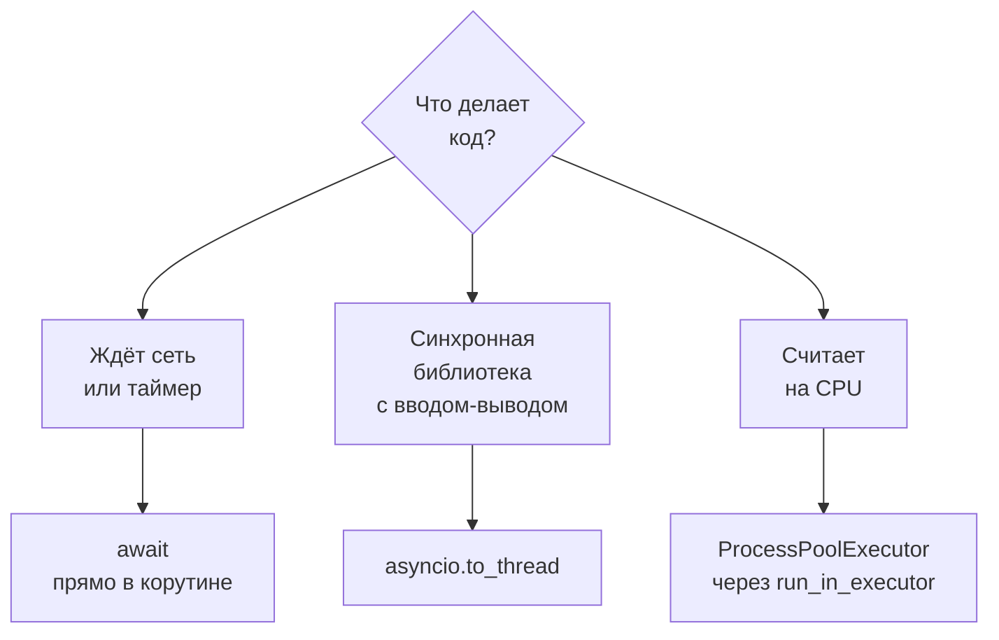
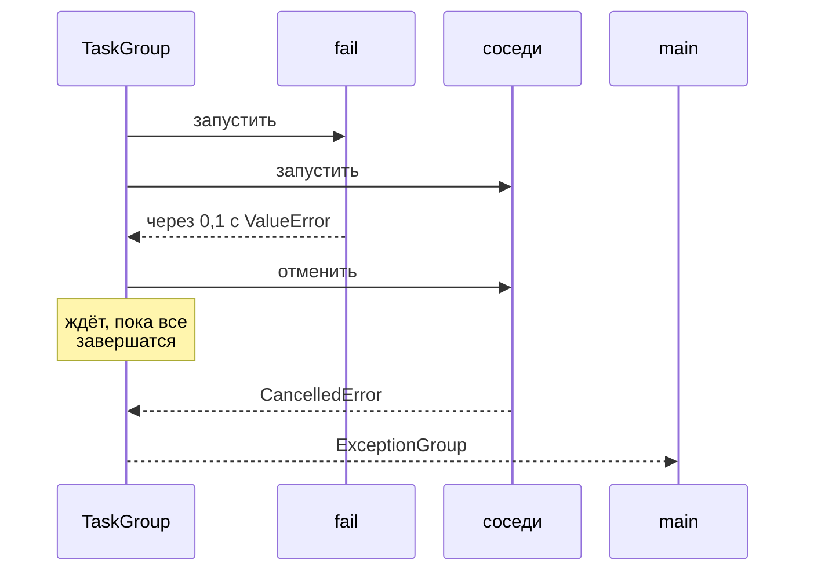

Как писать асинхронный код без сюрпризов: `TaskGroup`, `gather`, забытый `await`, контекст запроса. Ошибки и отмена, таймауты и нагрузка вынесены на соседние страницы.
Рядом: [[asyncio под капотом]] · [[Ошибки и отмена в asyncio]] · [[Таймауты и нагрузка в asyncio]] · [[Потоки и процессы]]
Разделы: Semaphore: сколько запросов летит одновременно · Блокирующий вызов в корутине · gather и TaskGroup: что с остальными задачами, когда одна упала · Забытый await · ContextVar в двух задачах · [[#Что спросят дальше]]

Аналогия с официантом и кухней — в [[asyncio под капотом#Зачем вообще async]]. Здесь она нужна в одном месте: блокирующий вызов — официант, застывший у плиты.

```python
import asyncio
import time

async def fetch(i: int, limit: asyncio.Semaphore) -> int:
    async with limit:  # не больше N запросов одновременно
        await asyncio.sleep(0.05)  # здесь — await client.get(url)
        return i

def blocking_report() -> str:
    time.sleep(0.05)  # синхронная библиотека
    return "report"

async def main() -> None:
    limit = asyncio.Semaphore(10)
    async with asyncio.timeout(5):  # общий дедлайн на всю пачку
        async with asyncio.TaskGroup() as tg:
            tasks = [tg.create_task(fetch(i, limit)) for i in range(100)]
            report = tg.create_task(asyncio.to_thread(blocking_report))
    print(sum(t.result() for t in tasks), report.result())

asyncio.run(main())
```

- **`asyncio.run(main())`** создаёт цикл событий, выполняет корутину, отменяет оставшиеся задачи, закрывает асинхронные генераторы и сам цикл. Одна точка входа на программу.
- **`TaskGroup` (3.11+) вместо `gather`.** Если одна задача группы упала, остальные отменяются, а ошибки приходят вместе как `ExceptionGroup` (ловят через `except*`). `gather` по умолчанию отдаёт первое исключение, а остальные задачи продолжают работать сами по себе, без присмотра; с `return_exceptions=True` возвращает исключения в списке результатов.
- **`Semaphore`** ограничивает число одновременных запросов: без него `create_task` на 10 000 URL откроет 10 000 соединений, и внешний API ответит 429 или упадёт.
- **`asyncio.timeout(...)`** (3.11+) или `wait_for` — дедлайн. По истечении задача внутри отменяется, наружу вылетает `TimeoutError`.
- **Блокирующий код — в поток**: `await asyncio.to_thread(fn, *args)` или `loop.run_in_executor(pool, fn)`. Вычисления — в `ProcessPoolExecutor` через тот же `run_in_executor`.

## Semaphore: сколько запросов летит одновременно

Модель: 100 задач, в каждой счётчик «сейчас внутри» растёт на входе и падает на выходе, а отдельно запоминается пик.

```python
import asyncio

async def run(max_parallel):
    stat = {"now": 0, "peak": 0}
    limit = asyncio.Semaphore(max_parallel) if max_parallel else None

    async def work():
        stat["now"] += 1  # вошли в «запрос»
        stat["peak"] = max(stat["peak"], stat["now"])
        await asyncio.sleep(0.01)  # здесь был бы сетевой вызов
        stat["now"] -= 1  # вышли

    async def guarded():
        if limit is None:
            await work()
        else:
            async with limit:  # за пределами лимита задача ждёт тут
                await work()

    async with asyncio.TaskGroup() as tg:
        for _ in range(100):
            tg.create_task(guarded())
    return stat["peak"]

async def main():
    print("без Semaphore, пик одновременных:", await run(0))
    print("Semaphore(10), пик одновременных:", await run(10))

asyncio.run(main())
```

```text title="Вывод"
без Semaphore, пик одновременных: 100
Semaphore(10), пик одновременных: 10
```

Без лимита все 100 «запросов» оказались в полёте одновременно. Семафор — это счётчик из десяти «пропусков»: на входе пропуск берут, на выходе возвращают, а у кого пропуска нет, тот ждёт у `async with`.

## Блокирующий вызов в корутине

Пока корутина выполняет обычный синхронный код, цикл стоит: передать управление он может только на `await`. Один `time.sleep` или запрос синхронной библиотеки замораживает все остальные задачи, таймауты и отмену. Эксперимент с тикером, который не успевает тикнуть, разобран в разделе «Блокирующий код в `async def` останавливает цикл» заметки [[Таймауты и нагрузка в asyncio]].

Куда отправить работу, зависит от её природы:



Поток из `to_thread` подходит для ожидания ввода-вывода: на ожидании он отпускает GIL (см. [[Потоки и процессы]]). Чистый Python-счёт в потоке всё равно упрётся в GIL, поэтому вычисления уходят в процессы.

## `gather` и `TaskGroup`: что с остальными задачами, когда одна упала

Три задачи: одна падает через 0,1 с, две другие работают дольше.

```python
import asyncio

async def job(name: str, delay: float, fail: bool = False) -> str:
    try:
        await asyncio.sleep(delay)
        if fail:
            raise ValueError(f"{name} упала")
        print(name, "готова")
        return name
    except asyncio.CancelledError:
        print(name, "отменена")
        raise

def specs():
    return [job("fail", 0.1, fail=True), job("slow", 0.5), job("fast", 0.3)]

async def with_gather() -> None:
    try:
        await asyncio.gather(*specs())
    except ValueError as e:
        print("gather поймал:", e)
    await asyncio.sleep(0.6)  # ждём: кто-то ещё доработает?

async def with_group() -> None:
    try:
        async with asyncio.TaskGroup() as tg:
            for c in specs():
                tg.create_task(c)
    except* ValueError as eg:
        print("TaskGroup поймал:", eg.exceptions[0])

print("--- gather")
asyncio.run(with_gather())
print("--- TaskGroup")
asyncio.run(with_group())
```

```text title="Вывод"
--- gather
gather поймал: fail упала
fast готова
slow готова
--- TaskGroup
slow отменена
fast отменена
TaskGroup поймал: fail упала
```

После ошибки `gather` просто отдал исключение, а остальные задачи доработали сами, уже никем не ожидаемые: их результат потерян, а побочные эффекты случились. `TaskGroup` отменил соседей и вышел только после того, как они завершились. Порядок строк «отменена» не гарантирован: на Python 3.15 при проверке первой шла `slow`.



## Забытый `await`

```python
import asyncio

async def fetch(i: int) -> int:
    return i

async def main() -> None:
    fetch(1)  # забыли await
    print("дальше")

asyncio.run(main())
```

```text title="Вывод"
a1.py:9: RuntimeWarning: coroutine 'fetch' was never awaited
  fetch(1)  # забыли await
RuntimeWarning: Enable tracemalloc to get the object allocation traceback
дальше
```

Предупреждение пришло из `stderr` сразу при удалении корутины, а программа пошла дальше как ни в чём не бывало.

## `ContextVar` в двух задачах

```python
import asyncio
import contextvars

request_id = contextvars.ContextVar("request_id", default="-")

async def handle(rid: str) -> None:
    request_id.set(rid)
    await asyncio.sleep(0.01)  # пока ждём, вторая задача успела записать своё
    print(rid, "видит", request_id.get())

async def main() -> None:
    await asyncio.gather(handle("A"), handle("B"))
    print("снаружи:", request_id.get())

asyncio.run(main())
```

```text title="Вывод"
A видит A
B видит B
снаружи: -
```

`gather` оборачивает каждую корутину в задачу с копией контекста, поэтому `set` в одной не виден другой и не виден снаружи. С глобальной переменной обе задачи увидели бы значение той, что записала последней.

## Что спросят дальше

- **Как вызвать async из sync и наоборот?** Из синхронного кода — `asyncio.run(coro())` (если цикл ещё не запущен) или `asyncio.run_coroutine_threadsafe(coro, loop).result()` из другого потока. Синхронное из асинхронного — `await asyncio.to_thread(fn)`.
- **`gather`, `wait`, `as_completed`, `TaskGroup` — в чём разница?** `gather` — результаты в порядке задач; `as_completed` — по мере готовности; `wait` — низкоуровневый, возвращает множества готовых и неготовых задач, умеет `FIRST_COMPLETED`; `TaskGroup` — структурная конкурентность: группа не завершится, пока не завершились все её задачи, и падение одной отменяет остальные.
