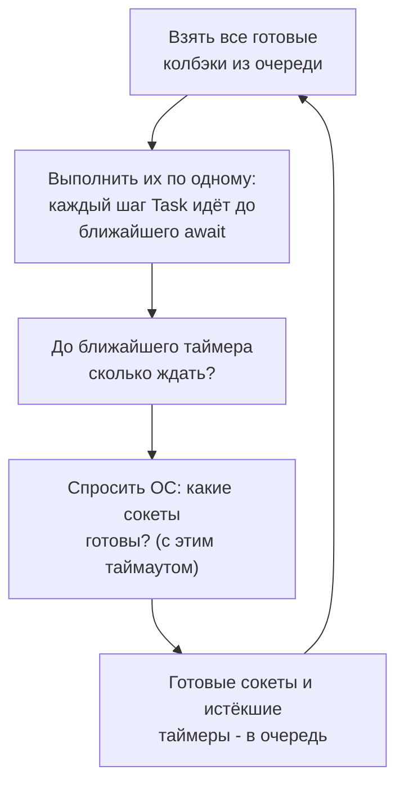
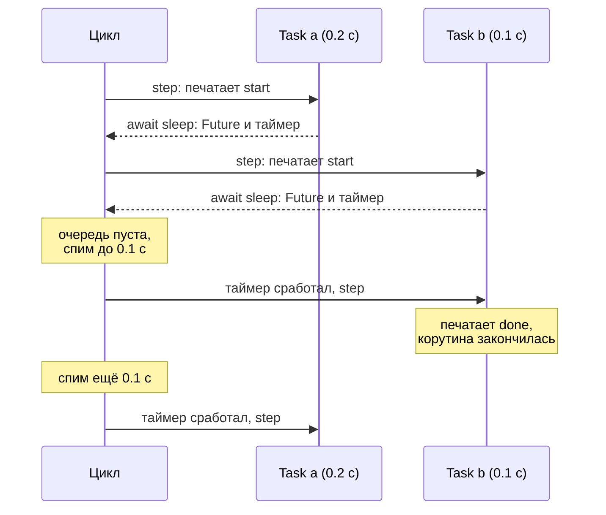

Что происходит у `async`/`await` внутри: корутина, цикл событий, задача, Future и как цикл событий устроен своими руками.
Рядом: [[Итераторы и генераторы]] (генераторы, на которых выросли корутины) · [[asyncio на практике]] · [[Потоки и процессы]] · [[Ввод-вывод и сеть]] (`epoll` под циклом событий)
Разделы: [[#Зачем вообще async]] · [[#Четыре понятия]] · [[#Корутина по шагам]] · [[#Цикл событий своими руками]] · [[#Как это выглядит во времени]] · [[#Что спросят дальше]]

## Зачем вообще async

Аналогия — ресторан. Официант принял заказ, отнёс на кухню и не стоит там, пока готовят, а идёт к другим столикам. Когда кухня звонит, он забирает блюдо. Один официант обслуживает десяток столиков, потому что почти всё время заказы готовятся. Официант — поток с циклом событий, столики — задачи, кухня — сеть. Чтение обычных файлов asyncio не умеет делать асинхронно: оно блокирует цикл, его выносят в to_thread. Плохо, если официант застыл у кухни и смотрит на плиту: это блокирующий вызов, и остальные столики ждут.

Поток на каждое соединение — простая модель, но на десяти тысячах соединений дорогая: у каждого потока свой стек (резервируются мегабайты адресного пространства), а переключает их ОС с полным сохранением контекста. При этом почти всё время потоки ждут сеть.

Идея async: один поток, неблокирующие сокеты и системный вызов, который ждёт сразу на всех сокетах и возвращает те, что готовы (`epoll` в Linux, `kqueue` в macOS; в Python — модуль `selectors`). Когда задаче нужно ждать, она отдаёт управление, и поток занимается другими задачами. Переключение — вызов функции в том же потоке, без участия ОС.

Сокет называют неблокирующим (non-blocking), когда `recv` не ждёт данных, а сразу отвечает «пока нет». Тогда поток не застревает на одном соединении и может спросить у ОС про все сразу.

## Четыре понятия

- **Корутина (coroutine).** Функция, объявленная через `async def`, — корутинная функция; её вызов ничего не выполняет, а возвращает объект-корутину. Корутина умеет приостанавливаться на `await` и продолжать с того же места. Устроена как генератор (см. [[Итераторы и генераторы#yield from, send, throw, close]]): её «прокручивают» методом `send(None)`, а на точке ожидания она отдаёт наружу объект, которого ждёт.
- **Future.** Объект-обещание: результата ещё нет, но будет. Хранит состояние (ожидает, готов, отменён), результат или исключение и список колбэков, которые вызовутся при завершении. `await future` приостанавливает корутину, пока кто-то не вызовет `future.set_result(...)`. В прикладном коде напрямую почти не встречается: на нём строятся библиотеки.
- **Task.** Наследник Future, который ведёт корутину: вызывает её `send`, пока она не завершится. Если корутина остановилась на Future, задача подписывается на него и продолжит корутину, когда Future станет готов. Результат задачи — то, что вернула корутина. Создаётся через `asyncio.create_task(coro)` или `TaskGroup.create_task(coro)`, и с этого момента корутина выполняется **конкурентно**, не дожидаясь `await`.
- **Цикл событий (event loop).** Планировщик в одном потоке. В бесконечном цикле: 1) выполнить все готовые колбэки из очереди; 2) посчитать, сколько можно ждать до ближайшего таймера; 3) спросить ОС, какие сокеты готовы, с этим таймаутом; 4) поставить колбэки готовых сокетов и истёкших таймеров в очередь. «Шаг задачи» — колбэк в этой очереди.

Как выглядит один оборот цикла:



`await x` работает с любым awaitable-объектом: корутиной, Task, Future или объектом с методом `__await__`. `await` на корутине — как `yield from`: выполнение идёт внутрь, вплоть до самого нижнего Future, который отдаётся наверх, через все корутины, до Task.

## Корутина по шагам

Корутину можно прокрутить руками, без цикла: так видно, что `await` — это остановка с передачей объекта наружу, а цикл событий — всего лишь тот, кто потом вызывает `send` снова.

```python
import asyncio


async def inner(fut):
    print("inner: жду future")
    value = await fut          # здесь корутина приостановится
    print("inner: получил", value)
    return value * 2


async def main():
    loop = asyncio.get_running_loop()
    fut = loop.create_future()
    coro = inner(fut)
    print(type(coro).__name__)             # вызов ничего не выполнил

    out = coro.send(None)                  # прокрутить до первого await
    print(out is fut)                      # наверх вышел тот самый Future

    fut.set_result(21)                     # «разбудили»
    try:
        coro.send(None)                    # продолжить с того же места
    except StopIteration as e:
        print("итог:", e.value)            # результат корутины едет в StopIteration


asyncio.run(main())
```

```text title="Вывод"
coroutine
inner: жду future
True
inner: получил 21
итог: 42
```

Вызов `inner(fut)` напечатал только тип: тело ещё не начало работать. Первый `send(None)` дошёл до `await fut` и вернул сам Future. Второй `send` продолжил с этого места, а возвращаемое значение пришло как `StopIteration.value`. Task делает ровно это: вызывает `send`, получает Future, подписывается на него и ждёт.

## Цикл событий своими руками

Игрушечный asyncio на 50 строк: Future, Task, цикл с таймерами и `sleep`. В настоящем цикле вместо `time.sleep` стоит ожидание сокетов через `selectors` с тем же таймаутом.

Взаимодействие во времени для примера ниже: две задачи ждут разное время, а цикл спит ровно до ближайшего таймера.



```python
import heapq
import time
from collections import deque


class Future:
    def __init__(self) -> None:
        self.done = False
        self.result = None
        self.callbacks = []

    def set_result(self, value) -> None:
        self.done = True
        self.result = value
        for callback in self.callbacks:
            loop.call_soon(callback)

    def __await__(self):
        if not self.done:
            yield self  # отдать себя наверх, до Task: «разбуди, когда я буду готов»
        return self.result


class Task:
    def __init__(self, coro) -> None:
        self.coro = coro
        loop.call_soon(self.step)

    def step(self) -> None:
        try:
            future = self.coro.send(None)  # выполнить корутину до следующего await
        except StopIteration:
            return  # корутина закончилась
        future.callbacks.append(self.step)  # продолжить, когда Future будет готов


class Loop:
    def __init__(self) -> None:
        self.ready = deque()
        self.timers = []  # куча (when, seq, callback)
        self.seq = 0

    def call_soon(self, callback) -> None:
        self.ready.append(callback)

    def call_later(self, delay: float, callback) -> None:
        self.seq += 1
        heapq.heappush(self.timers, (time.monotonic() + delay, self.seq, callback))

    def run(self) -> None:
        while self.ready or self.timers:
            if not self.ready:  # делать нечего — ждём ближайший таймер
                time.sleep(max(0.0, self.timers[0][0] - time.monotonic()))
            now = time.monotonic()
            while self.timers and self.timers[0][0] <= now:
                self.ready.append(heapq.heappop(self.timers)[2])
            for _ in range(len(self.ready)):
                self.ready.popleft()()


loop = Loop()


def sleep(delay: float) -> Future:
    future = Future()
    loop.call_later(delay, lambda: future.set_result(None))
    return future


async def worker(name: str, delay: float) -> None:
    print(name, "start")
    await sleep(delay)
    print(name, "done after", delay)


Task(worker("a", 0.2))
Task(worker("b", 0.1))
started = time.monotonic()
loop.run()
print(f"total {time.monotonic() - started:.1f} s")  # 0.2, а не 0.3: ожидания шли одновременно
```

```text title="Вывод"
a start
b start
b done after 0.1
a done after 0.2
total 0.2 s
```

`b` закончил раньше `a`, хотя запущен позже: порядок задаёт время ожидания, а не порядок создания.

Что следует из этого кода:

- **`await` сам по себе ничего не распараллеливает.** `await a(); await b()` выполняет `a` и `b` строго по очереди. Конкурентность появляется только от нескольких задач (`create_task`, `gather`, `TaskGroup`).
- **Переключение возможно только на `await`.** Между двумя `await` код задачи выполняется без перерыва, поэтому в asyncio гонок по данным меньше, чем в потоках. Но схема «проверить, `await`, действовать» ломается так же, как с потоками.
- **Блокирующий вызов останавливает всех.** `time.sleep(1)`, `requests.get`, синхронный драйвер БД или тяжёлый цикл внутри корутины не отдают управление циклу, и все остальные задачи стоят. Режим отладки (`asyncio.run(main(), debug=True)` или `PYTHONASYNCIODEBUG=1`) пишет в лог колбэки дольше 100 мс.

## Как это выглядит во времени

Три прогона на настоящем asyncio: время в секундах от старта, округлено до десятых (на другой машине точные значения чуть другие, порядок строк тот же).

```python
import asyncio
import time

t0 = None


def log(msg):
    print(f"{round(time.monotonic() - t0, 1):>3}  {msg}")


async def job(name, delay):
    log(f"{name} старт")
    await asyncio.sleep(delay)
    log(f"{name} готов")


async def sequential():
    await job("a", 0.2)
    await job("b", 0.2)


async def concurrent():
    ta = asyncio.create_task(job("a", 0.2))
    tb = asyncio.create_task(job("b", 0.2))
    await ta
    await tb


async def blocking():
    async def bad():
        log("bad старт")
        time.sleep(0.4)        # блокирует весь поток, цикл не получает управления
        log("bad готов")

    ta = asyncio.create_task(bad())
    tb = asyncio.create_task(job("b", 0.1))
    await ta
    await tb


for name, fn in [("подряд", sequential), ("create_task", concurrent), ("time.sleep внутри", blocking)]:
    print("---", name)
    t0 = time.monotonic()
    asyncio.run(fn())
```

```text title="Вывод"
--- подряд
0.0  a старт
0.2  a готов
0.2  b старт
0.4  b готов
--- create_task
0.0  a старт
0.0  b старт
0.2  a готов
0.2  b готов
--- time.sleep внутри
0.0  bad старт
0.4  bad готов
0.4  b старт
0.5  b готов
```

Подряд: 0,4 с. Через `create_task`: 0,2 с, ожидания наложились. Блокирующий `time.sleep` внутри `bad`: задача `b` даже не стартовала, пока `bad` не вернул управление, и вместо 0,1 с она закончила только на 0,5 с.

### Проверка и действие через await

Переключение возможно только на `await`, но это не защищает логику «проверил, `await`, действовал». Пока одна задача ждёт, вторая успевает пройти ту же проверку по старому состоянию.

```python
import asyncio

balance = 100


async def withdraw(name, amount):
    global balance
    if balance >= amount:             # проверили
        await asyncio.sleep(0)        # отдали управление циклу (как сетевой вызов)
        balance -= amount             # действуем по устаревшей проверке
        print(name, "снял", amount, "остаток", balance)
    else:
        print(name, "отказ")


async def withdraw_locked(name, amount, lock):
    async with lock:                  # проверка и действие под одной блокировкой
        await withdraw(name, amount)


async def main():
    global balance
    await asyncio.gather(withdraw("A", 80), withdraw("B", 80))
    print("без блокировки:", balance)
    balance = 100
    lock = asyncio.Lock()
    await asyncio.gather(withdraw_locked("A", 80, lock), withdraw_locked("B", 80, lock))
    print("с блокировкой:", balance)


asyncio.run(main())
```

```text title="Вывод"
A снял 80 остаток 20
B снял 80 остаток -60
без блокировки: -60
A снял 80 остаток 20
B отказ
с блокировкой: 20
```

Обе задачи проверили `100 >= 80` до того, как любая из них списала деньги. Блокировка (`asyncio.Lock`) делает проверку и списание одним неделимым блоком.

## Что спросят дальше

- **Почему asyncio не ускоряет вычисления?** Один поток, и пока корутина считает, она не доходит до `await` и не отдаёт управление. Вычисления выносят в процессы через `run_in_executor` или в отдельный сервис/очередь задач.
- **Потоки или asyncio для 10 000 соединений?** asyncio: задача весит килобайты, переключение — вызов функции. Потоков столько обычно не держат: память и переключения ОС. Но asyncio требует, чтобы вся цепочка была асинхронной: один синхронный драйвер БД — и выигрыш пропал.
- **Что такое uvloop?** Замена стандартного цикла событий, написанная на Cython поверх libuv (того же, что в Node.js); быстрее в 2–4 раза на сетевом вводе-выводе. Uvicorn ставит его, если он установлен.
