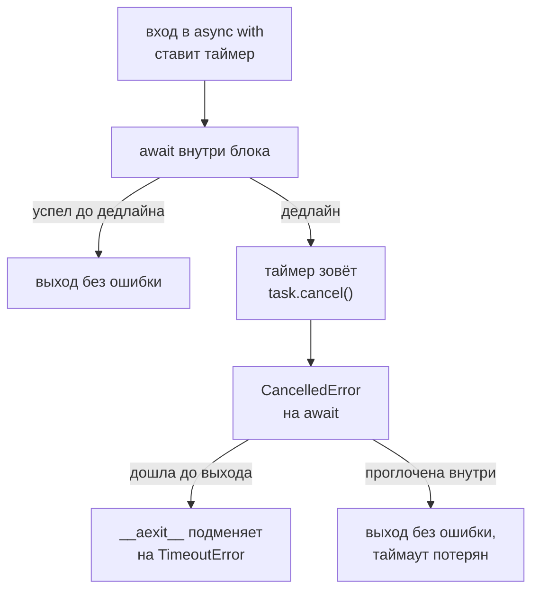
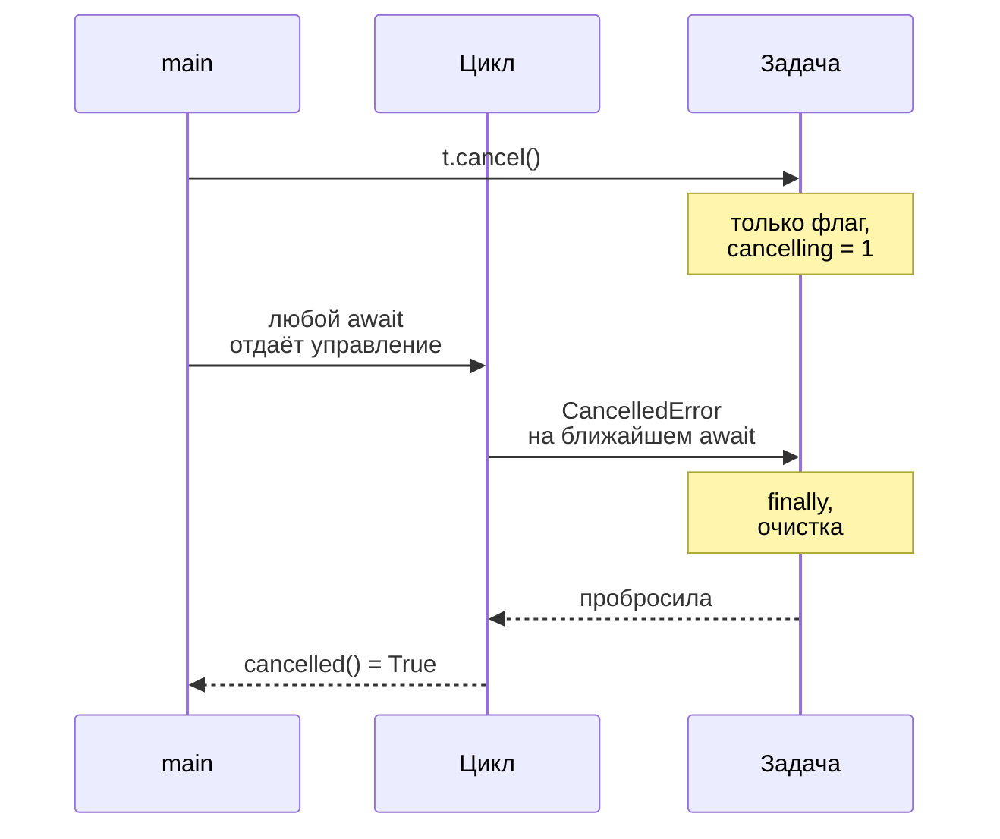

Таймаут как отмена, проглоченная `CancelledError` и `ExceptionGroup` во вложенных группах: где отмена и ошибки теряются.
Рядом: [[asyncio на практике]] · [[Таймауты и нагрузка в asyncio]] · [[asyncio под капотом]] · [[Потерянные исключения в async]]
Разделы: asyncio.timeout · [[#Как timeout превращает отмену в TimeoutError]] · [[#Отмена: проглоченная и проброшенная]] · [[#Как устроена отмена: записка на столе]] · [[#Ловушки]] · ExceptionGroup во вложенных TaskGroup · [[#Падение одной задачи отменяет соседей]] · [[#Что спросят дальше]]

## `asyncio.timeout`

```python
import asyncio


async def main() -> None:
    try:
        async with asyncio.timeout(0.1):
            await asyncio.sleep(1)
    except TimeoutError as e:
        print(repr(e))


asyncio.run(main())
```

```text title="Вывод"
TimeoutError()
```

Внутри блока задача отменена (`CancelledError` на `await`), а снаружи `async with` превратил отмену в обычный `TimeoutError`.

### Как timeout превращает отмену в TimeoutError

`timeout` не прерывает код сам. Он ставит таймер, и по истечении таймера просто вызывает `task.cancel()` у текущей задачи. Дальше всё делает обычная отмена, а на выходе из блока `async with` смотрит: пришла `CancelledError`? Тогда подменяет её на `TimeoutError`. Но только если отмену вызвал собственный таймер: `__aexit__` сверяет `uncancel()` со счётчиком `cancelling()`, и внешняя отмена так и выходит `CancelledError`.



Ветка «проглочена внутри» — ловушка. Проверка на Python 3.15:

```python
import asyncio


async def main():
    # отмену проглотили внутри блока
    async with asyncio.timeout(0.1):
        try:
            await asyncio.sleep(1)
        except asyncio.CancelledError:
            print("проглотили отмену")
    print("блок timeout завершился без TimeoutError")

    # то же, но с повторным raise
    try:
        async with asyncio.timeout(0.1):
            try:
                await asyncio.sleep(1)
            except asyncio.CancelledError:
                print("пробросили отмену")
                raise
    except TimeoutError:
        print("снаружи TimeoutError")


asyncio.run(main())
```

```text title="Вывод"
проглотили отмену
блок timeout завершился без TimeoutError
пробросили отмену
снаружи TimeoutError
```

Проглоченная отмена прячет таймаут: код после блока идёт дальше так, будто дедлайна не было.

### Ловушки

- **Забытый `await`.** `fetch(1)` без `await` создаёт корутину и ничего не делает; Python предупредит `RuntimeWarning: coroutine ... was never awaited`, но только когда объект корутины удаляется: сразу, если ссылки на неё нет (как ниже), и позже, если она где-то лежит. Пример в подразделе «Забытый `await`».
- **Задача «запустил и забыл».** Цикл событий хранит на задачи только слабые ссылки: `asyncio.create_task(send_email())` без сохранения результата может быть собрана сборщиком мусора посреди работы. Держите ссылки (множество задач с `add_done_callback(tasks.discard)`) или используйте `TaskGroup`.
- **Отмена.** `task.cancel()` бросает `CancelledError` внутрь корутины на текущем `await`. Её нужно пробрасывать дальше (или пересоздавать после очистки), а не глотать: `except Exception` её не ловит, а вот `except BaseException` и голый `except:` ловят. Защитить кусок от отмены снаружи — `asyncio.shield`. Пример ниже, в подразделе «Отмена: проглоченная и проброшенная».
- **Примитивы asyncio не потокобезопасны.** `asyncio.Lock`, `Queue`, `Event` — только для задач одного цикла. Из другого потока в цикл передают работу через `loop.call_soon_threadsafe` или `asyncio.run_coroutine_threadsafe`.
- **Контекст запроса.** `threading.local` в asyncio не работает: все задачи в одном потоке. Для id запроса, пользователя, трассировки — `contextvars.ContextVar`: каждая задача при создании получает копию текущего контекста.

## Отмена: проглоченная и проброшенная

```python
import asyncio


async def worker(swallow: bool) -> None:
    try:
        await asyncio.sleep(10)
    except BaseException as e:  # голый except ведёт себя так же
        print("поймали", type(e).__name__)
        if not swallow:
            raise
    print("корутина пошла дальше")


async def run(swallow: bool) -> None:
    t = asyncio.create_task(worker(swallow))
    await asyncio.sleep(0.1)
    t.cancel()
    try:
        await t
    except asyncio.CancelledError:
        print("main: await t бросил CancelledError")
    print("t.cancelled() =", t.cancelled())


for swallow in (True, False):
    print("проглочен:" if swallow else "проброшен:")
    asyncio.run(run(swallow))
```

```text title="Вывод"
проглочен:
поймали CancelledError
корутина пошла дальше
t.cancelled() = False
проброшен:
поймали CancelledError
main: await t бросил CancelledError
t.cancelled() = True
```

Если `CancelledError` проглочена, задача считает себя живой и завершается как обычная: `cancelled()` равно `False`, `await t` ничего не бросает. Для `TaskGroup` и `asyncio.timeout` это ломает их логику: они рассчитывают, что отмена дойдёт до границы блока.

## Как устроена отмена: записка на столе

Аналогия: `task.cancel()` — записка «прервись» на столе коллеги. Коллега не бросает работу на полуслове: он увидит записку, когда в следующий раз поднимет голову, то есть дойдёт до `await`. Выбросить записку (проглотить `CancelledError`) он тоже может, и тогда считает, что ничего не просили.



`cancel()` ничего не прерывает сразу: он ставит запрос, а исключение прилетает в задачу на её ближайшем `await`, когда `main` отдаст управление циклу (любым `await`, не обязательно `await t`).

```python
import asyncio


async def worker():
    try:
        await asyncio.sleep(10)
    except asyncio.CancelledError:
        print("  worker: CancelledError на await")
        raise


async def main():
    t = asyncio.create_task(worker())
    await asyncio.sleep(0)  # дали задаче дойти до sleep
    t.cancel()
    print("после cancel():", "cancelled =", t.cancelled(), "done =", t.done(), "cancelling =", t.cancelling())
    try:
        await t
    except asyncio.CancelledError:
        pass
    print("после await t: ", "cancelled =", t.cancelled(), "done =", t.done())


asyncio.run(main())
```

```text title="Вывод"
после cancel(): cancelled = False done = False cancelling = 1
  worker: CancelledError на await
после await t:  cancelled = True done = True
```

Сразу после `cancel()` задача ещё не отменена (`cancelled()` равно `False`), только запрос принят (`cancelling()` равно 1). Статус «отменена» появляется, когда `CancelledError` дошла до конца корутины.

## `ExceptionGroup` во вложенных `TaskGroup`

Типичный код: внешний `TaskGroup` запускает функцию, у которой внутри свой `TaskGroup`. Тогда ошибка листа обёрнута дважды. Код, который берёт `eg.exceptions[0]` и ждёт там исходное исключение, работает при одной группе и ломается при двух: во внутренней группе нет атрибутов исходной ошибки (в реальном сервисе так получили `AttributeError: 'ExceptionGroup' object has no attribute 'cause'`).

```python
import asyncio


class ActivityError(Exception):
    pass


async def activity() -> None:
    raise ActivityError("нет такого тарифа")


async def fees() -> None:  # внутренняя группа
    async with asyncio.TaskGroup() as tg:
        tg.create_task(activity())


async def workflow() -> None:  # внешняя группа
    async with asyncio.TaskGroup() as tg:
        tg.create_task(fees())


def first_leaf(exc: BaseException) -> BaseException:
    while isinstance(exc, BaseExceptionGroup):
        exc = exc.exceptions[0]
    return exc


async def main() -> None:
    try:
        await workflow()
    except ExceptionGroup as eg:
        print("exceptions[0]:", repr(eg.exceptions[0]))
        print("лист:         ", repr(first_leaf(eg)))
        print("subgroup:     ", repr(eg.subgroup(ActivityError)))

    try:
        await workflow()
    except* ActivityError as leaves:
        print("except*:      ", repr(leaves))


asyncio.run(main())
```

```text title="Вывод"
exceptions[0]: ExceptionGroup('unhandled errors in a TaskGroup', [ActivityError('нет такого тарифа')])
лист:          ActivityError('нет такого тарифа')
subgroup:      ExceptionGroup('unhandled errors in a TaskGroup', [ExceptionGroup('unhandled errors in a TaskGroup', [ActivityError('нет такого тарифа')])])
except*:       ExceptionGroup('unhandled errors in a TaskGroup', [ExceptionGroup('unhandled errors in a TaskGroup', [ActivityError('нет такого тарифа')])])
```

- `exceptions[0]` — это внутренняя группа, а не `ActivityError`.
- `subgroup(тип)` и `split(тип)` отбирают нужные листья, но сохраняют форму дерева: результат всё так же обёрнут в две группы. То же с `except*`: блок получает группу, в которой остались только подходящие исключения, вложенность не снимается.
- До самого листа дойти можно рекурсивным обходом (`first_leaf` выше) или циклом по `exceptions`, пока элемент — группа. Если нужен конкретный тип, проще отобрать его `subgroup` и обойти результат.
- Лучше, когда вложенность не важна, не лезть в `exceptions[0]` вообще, а обработать группу целиком через `except*`.

Второе правило оттуда же: done-callback не должен звать `task.result()` у отменённой задачи, там бросится `CancelledError`, и это уже ошибка в самом обработчике колбэков цикла:

```python
import asyncio


async def job(delay: float) -> int:
    await asyncio.sleep(delay)
    return 1


def bad_callback(task: asyncio.Task) -> None:
    print("результат:", task.result())


def good_callback(task: asyncio.Task) -> None:
    if task.cancelled():
        print("отменена")
    elif (exc := task.exception()) is not None:
        print("упала:", repr(exc))
    else:
        print("результат:", task.result())


async def main() -> None:
    loop = asyncio.get_running_loop()
    loop.set_exception_handler(lambda l, ctx: print("loop handler:", repr(ctx["exception"])))
    for cb in (bad_callback, good_callback):
        t = asyncio.create_task(job(10))
        t.add_done_callback(cb)
        await asyncio.sleep(0)
        t.cancel()
        await asyncio.gather(t, return_exceptions=True)
        await asyncio.sleep(0)


asyncio.run(main())
```

```text title="Вывод"
loop handler: CancelledError()
отменена
```

Первый колбэк упал на `result()` и попал в обработчик исключений цикла (без своего обработчика это просто строка в логе), второй проверяет `cancelled()` и `exception()` перед `result()`.

### Падение одной задачи отменяет соседей

`TaskGroup` ведёт себя как бригада: упал один, остальным говорят «стоп». Пример и схема — в разделе «`gather` и `TaskGroup`: что с остальными задачами, когда одна упала» заметки [[asyncio на практике]]. Здесь важно одно: соседи должны честно пробрасывать `CancelledError`.

## Что спросят дальше

- **Как работает отмена задачи?** `task.cancel()` бросает `CancelledError` в точку текущего `await`. Её нельзя глотать без повторного `raise`: иначе `TaskGroup` и `asyncio.timeout` не узнают об отмене.
- **Чем `asyncio.timeout` отличается от `wait_for`?** `timeout` — контекстный менеджер на блок кода, с возможностью переносить дедлайн; `wait_for` оборачивает один `await`.
