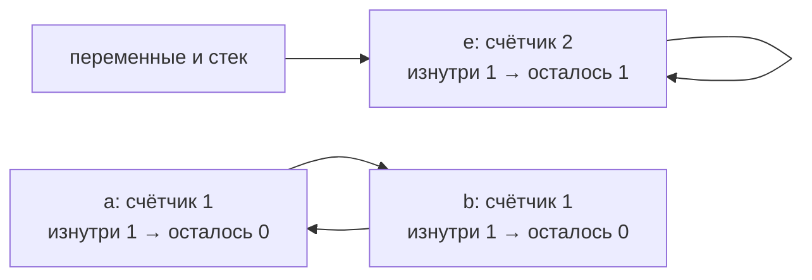
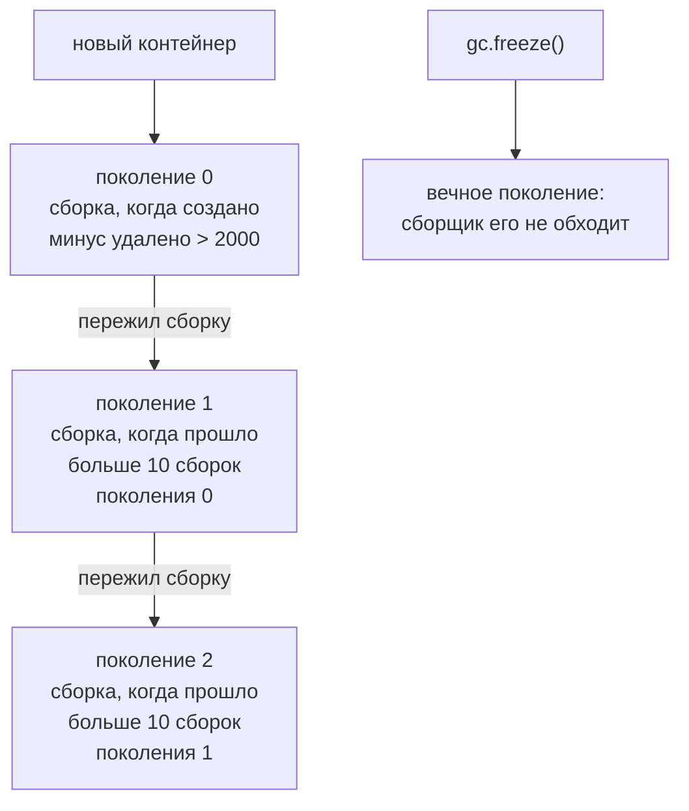

Как CPython освобождает память: подсчёт ссылок, циклический сборщик с поколениями, `weakref` для кэшей и поиск утечек.
Рядом: [[Потоки и процессы]] (GIL опирается на счётчики ссылок) · [[Атрибуты и дескрипторы|атрибуты и слоты]]
Разделы: [[#Как устроен сборщик: схема и модель в коде]] · [[#Поколения: пороги и счётчики]] · weakref и кэш без утечки · Поиск утечки через tracemalloc · [[#Практика]] · [[#Что спросят дальше]]

**Суть.** Объект в CPython живёт, пока на него кто-то ссылается. Почти всю память освобождает подсчёт ссылок: последняя ссылка пропала — объект удалён сразу, на этой же строке. Он не справляется только с циклами, где объекты держат друг друга, и для них есть второй механизм — циклический сборщик `gc`, который время от времени ищет группы объектов, до которых снаружи уже не добраться. Утечки в Python почти всегда не про сборщик, а про ссылку, которую кто-то забыл отпустить.

Похоже на библиотеку. За каждой книгой записано, сколько у неё читателей. Последний вернул книгу — её сразу списывают, ждать инвентаризации не нужно. Но если два читателя передают друг другу две книги по кругу и оба давно уехали, по записям книги всё ещё на руках. Такие пары находит только инвентаризация: раз в какое-то время библиотекарь проверяет, может ли до книги дотянуться хоть кто-то из живых читателей.

**1. Подсчёт ссылок (reference counting) — основной.** У каждого объекта есть счётчик: сколько переменных, контейнеров и других объектов на него ссылается. Присвоили — счётчик +1, переменная вышла из области видимости или её переназначили — −1. Дошёл до нуля — объект удаляется **сразу**, детерминированно. Поэтому в CPython файл, открытый без `with`, обычно закрывается при выходе из функции (но в PyPy — нет, и полагаться на это нельзя). Посмотреть счётчик: `sys.getrefcount(obj)` (покажет на единицу больше: аргумент функции — тоже ссылка).

**2. Циклический сборщик (`gc`) — для циклических ссылок.** Объекты, ссылающиеся друг на друга (`a.b = b; b.a = a`, узел дерева со ссылкой на родителя, исключение, которое держит кадр стека, который держит это исключение), никогда не получат нулевой счётчик. Их находит отдельный сборщик:

- он следит только за **контейнерами** (списки, словари, экземпляры классов), потому что числа и строки не могут ссылаться на другие объекты и цикл не образуют;
- для каждого контейнера считает, сколько ссылок на него приходит **изнутри** проверяемой группы; если все ссылки внутренние, снаружи до объекта не добраться;
- от объектов, на которые есть внешние ссылки, проходит по их ссылкам и помечает всё достижимое как живое; остальное — мусор, его финализируют (`__del__`, с Python 3.4 работает и для циклов, PEP 442) и освобождают.

Сборщик **поколенческий** (generational): новые объекты попадают в поколение 0; пережившие сборку переходят в следующее. Идея — большинство объектов умирают молодыми, поэтому часто проверяют только молодых. Пороги и версии — в [[#Поколения: пороги и счётчики]]. Сборка останавливает программу, пока идёт, поэтому на огромных кучах объектов бывают паузы.

Подсчёт ссылок и цикл, который счётчиком не собрать (`weakref.finalize` печатает сообщение в момент удаления объекта):

```python
import gc
import sys
import weakref


class Node:
    pass


a = Node()
print(sys.getrefcount(a))  # a + аргумент getrefcount
b = a
print(sys.getrefcount(a))
del b
print(sys.getrefcount(a))
del a

x = Node()
weakref.finalize(x, print, "простой объект удалён")
del x
print("после del x")

y, z = Node(), Node()
y.other, z.other = z, y
weakref.finalize(y, print, "цикл собран")
del y, z
print("после del y, z")
gc.collect()
print("после gc.collect()")
```

```text title="Вывод"
2
3
2
простой объект удалён
после del x
после del y, z
цикл собран
после gc.collect()
```

Первая строка — `2`, а не `1`: аргумент `getrefcount` тоже ссылка. Простой объект удалён в момент `del x`, до следующей строки. Пара `y` и `z` ссылается друг на друга, поэтому после `del` счётчики не нули, и объекты живут до `gc.collect()` (или до очередной автоматической сборки).

## Как устроен сборщик: схема и модель в коде

Ниже маленькая куча из пяти объектов. `c` держит `d`, `a` и `b` ссылаются друг на друга, `e` — сам на себя. Снаружи (из переменных и стека) ссылки идут на `a`, `c` и `e`.

Сначала удалим переменную, которая указывала на `c`. Счётчик `c` падает до нуля, и `c` удаляется сразу. Удаляясь, он отпускает свою ссылку на `d`, у `d` тоже ноль, удаляется и он — цепочкой, без всякого сборщика. Потом удалим переменную `a`. У `a` остаётся одна ссылка — от `b`, у `b` — одна от `a`. Счётчики не нули, подсчёт ссылок бессилен. Состояние после этого:



Сборщик не знает, где переменные программы, — он видит только объекты и их ссылки друг на друга. Поэтому он идёт от обратного: копирует счётчик каждого объекта и вычитает из копии ссылки, которые пришли от других объектов кучи. Если что-то осталось, значит, на объект есть ссылка снаружи и он точно жив; у `e` осталась 1 — переменная. Всё, до чего дотягиваются живые объекты, тоже живое. Остальное — мусор: у `a` и `b` после вычитания по нулю, и снаружи до них не дойти.

Модель повторяет оба механизма. `decref` — подсчёт ссылок с каскадным удалением, `collect` — поиск недостижимых циклов:

```python
heap = {
    "a": ["b"],     # a и b ссылаются друг на друга — цикл
    "b": ["a"],
    "c": ["d"],     # c держит d, цикла нет
    "d": [],
    "e": ["e"],     # e ссылается сам на себя
}
external = {"a": 1, "c": 1, "e": 1}    # ссылки снаружи кучи: переменные, стек


def refcounts(heap, external):
    # счётчик ссылок каждого объекта: ссылки снаружи плюс ссылки из других объектов
    counts = {name: external.get(name, 0) for name in heap}
    for refs in heap.values():
        for target in refs:
            counts[target] += 1
    return counts


counts = refcounts(heap, external)


def decref(name, freed):
    # минус одна ссылка; на нуле объект удаляется сразу и отпускает всё, что держал
    counts[name] -= 1
    if counts[name] == 0:
        freed.append(name)
        for target in heap.pop(name):
            decref(target, freed)


def delete(name):
    # del переменной: пропала ссылка снаружи
    external[name] -= 1
    freed = []
    decref(name, freed)
    return freed


def collect():
    # циклический сборщик: кто останется достижим, если не считать ссылки изнутри кучи
    gc_refs = dict(counts)
    for refs in heap.values():
        for target in refs:
            gc_refs[target] -= 1        # вычли ссылки от других объектов кучи
    alive = set()
    stack = [name for name in heap if gc_refs[name] > 0]   # на них есть ссылки снаружи
    while stack:
        name = stack.pop()
        if name not in alive:
            alive.add(name)
            stack.extend(heap[name])    # всё, до чего они дотягиваются, тоже живое
    garbage = sorted(name for name in heap if name not in alive)
    for name in garbage:
        del heap[name]
    return garbage


counts              # {'a': 2, 'b': 1, 'c': 1, 'd': 1, 'e': 2}
delete("c")         # ['c', 'd'] — удалены сразу, цепочкой
delete("a")         # [] — a и b держат друг друга
collect()           # ['a', 'b'] — e жив: на него ссылается переменная
delete("e")         # [] — ссылка на себя не даёт счётчику дойти до нуля
collect()           # ['e']
heap                # {}
```

Настоящий сборщик устроен так же, только смотрит не на всю кучу, а на собираемые поколения (о них ниже), и ссылки из старших поколений считает такими же внешними, как переменные. Прежде чем освободить мусор, он очищает слабые ссылки на эти объекты и вызывает их финализаторы (`__del__`, колбэки `weakref.finalize`).

## Поколения: пороги и счётчики

Проверять всю кучу на каждой сборке дорого: в большом сервисе это миллионы объектов. Поэтому сборщик опирается на наблюдение «большинство объектов умирают молодыми» (временные словари, списки внутри обработки запроса) и делит контейнеры на три поколения:



Молодое поколение маленькое и собирается часто, старое — большое и редко. Сборка старшего поколения захватывает и все младшие. Объект, переживший сборку, переезжает на поколение старше: раз он дожил до сих пор, скорее всего проживёт ещё долго, и проверять его часто незачем.

Версии, о которых спросят: порог поколения 0 был 700 по Python 3.12 включительно и стал 2000 в 3.13. В 3.14.0–3.14.4 сборщик был инкрементальным: два поколения, молодое и старое, старое обходилось порциями, чтобы сократить паузы на больших кучах (`gc.get_threshold()` там возвращает `(2000, 10, 0)`). В 3.14.5 его откатили к поколенческому сборщику из 3.13.

`gc.get_threshold()` — пороги трёх поколений, `gc.get_count()` — сколько объектов накоплено в каждом сейчас (нулевой элемент — молодое поколение):

```python
import gc

print(gc.get_threshold())
gc.collect()
print(gc.get_count()[0])
data = [[] for _ in range(100)]
print(gc.get_count()[0])
data = None
print(gc.get_count()[0])
```

```text title="Вывод"
(2000, 10, 10)
0
103
82
```

Счётчик растёт с каждым созданным контейнером (100 списков и немного служебных объектов) и уменьшается, когда контейнеры освобождаются подсчётом ссылок, а `gc.collect()` обнуляет его. Как только счётчик поколения 0 дойдёт до 2000, запустится сборка. Вывод получен на Python 3.15; точные цифры зависят от версии, пороги по умолчанию — от 3.13 (2000, 10, 10).

## `weakref` и кэш без утечки

Обычный словарь-кэш держит значения вечно. `WeakValueDictionary` хранит слабые ссылки: когда на значение больше никто не ссылается, запись исчезает сама:

```python
import gc
import weakref


class Report:
    def __init__(self, name):
        self.name = name


cache = weakref.WeakValueDictionary()
r = Report("q3")
cache["q3"] = r
print("q3" in cache, len(cache))
del r
gc.collect()
print("q3" in cache, len(cache))

strong = {}
r = Report("q4")
strong["q4"] = r
del r
print(len(strong))
```

```text title="Вывод"
True 1
False 0
1
```

Пока у `r` есть сильная ссылка из переменной, запись в `cache` живёт; после `del r` счётчик падает до нуля и запись пропадает (`gc.collect()` здесь для надёжности: в CPython хватило бы и `del`). Обычный `dict` объект удержал бы. Значения в таком кэше должны быть объектами, поддерживающими слабые ссылки: экземпляры обычных классов да, `int`, `str`, `list` и `dict` — нет.

## Поиск утечки через `tracemalloc`

Утечка — это рост памяти от ссылок, которые не отпустили. `tracemalloc` запоминает, какая строка выделила память; два снимка, взятые в разное время, сравнивает `compare_to`:

```python
import tracemalloc

cache = {}


def handle(i):
    cache[i] = f"{i}" * 1000  # забыли вытеснять


tracemalloc.start()
for i in range(100):
    handle(i)
before = tracemalloc.take_snapshot()
for i in range(100, 1100):
    handle(i)
after = tracemalloc.take_snapshot()
for stat in after.compare_to(before, "lineno")[:1]:
    print(stat)
```

```text title="Вывод"
.../g3.py:7: size=3293 KiB (+3099 KiB), count=1101 (+1000), average=3063 B
```

Первая строка отчёта (самый большой прирост) указывает на `cache[i] = ...`: между снимками там появилось 1000 живых строк и +3 МиБ. Путь к файлу в выводе заменён на `...`. Дальше смотрят, кто держит `cache`, и вводят ограничение размера (`lru_cache(maxsize=...)`, TTL).

## Практика

- **`gc.freeze()` перед `fork`** в серверах с предварительным запуском воркеров (prefork: gunicorn, uWSGI). После `fork` память делится между процессами, пока её не записали (copy-on-write). Но сборщик, обходя объекты, пишет в их заголовки, и страницы копируются в каждый воркер. `freeze()` переносит все текущие объекты в «вечное» поколение, которое сборщик не трогает. Instagram так экономил гигабайты на сервер.
- **`weakref`** — слабая ссылка, которая не увеличивает счётчик. Для кэшей (`WeakValueDictionary`), подписчиков событий, ссылки «ребёнок → родитель», чтобы не создавать циклы и не держать объекты вечно.
- **Утечки памяти в Python** — это почти всегда не баг сборщика, а объекты, на которые кто-то ссылается: глобальный словарь-кэш без ограничения, `lru_cache` на методе, список «для отладки», сохранённое исключение с его traceback и всеми локальными переменными кадров. Искать: `tracemalloc` (кто выделил память, сравнение снимков), `gc.get_referrers`, objgraph.
- **Процесс не отдаёт память ОС** после удаления объектов: малые объекты (до 512 байт) аллоцируются в аренах pymalloc, и арена возвращается системе, только если пуста целиком. Фрагментация держит RSS (resident set size, реально занятую процессом память) высоким. Для воркеров с пиками памяти ставят перезапуск после N задач (`max_requests` в gunicorn, `max_tasks_per_child` в Celery).

## Что спросят дальше

- **Почему в Python бывают утечки, если есть сборщик мусора?** Сборщик освобождает только недостижимое. Объект, на который ещё кто-то ссылается (глобальный кэш, список, замыкание, сохранённый traceback), достижим и не считается мусором. Ищут держателя: `tracemalloc`, `gc.get_referrers`.
- **Когда `__del__` не стоит использовать?** Момент вызова не гарантирован (PyPy, циклы, завершение интерпретатора), исключения в нём игнорируются. Для освобождения ресурсов — контекстный менеджер или `weakref.finalize`.
