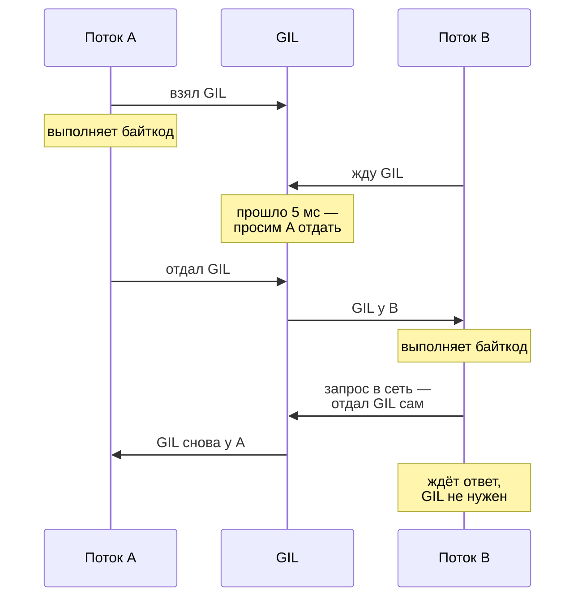

Какие бывают виды параллелизма и какой когда брать, что такое GIL и почему он не делает код потокобезопасным, как синхронизировать потоки и процессы.
Рядом: [[asyncio под капотом]] (конкурентность без потоков) · [[Выбор примитива синхронизации]] · [[Память и сборка мусора]] · [[Распределённая блокировка в Redis|распределённая блокировка]] · [[Блокировки|блокировки в PostgreSQL]]
Разделы: [[#Виды параллелизма]] · [[#GIL]] · [[#Синхронизация потоков]] · [[#Синхронизация процессов]] · [[#Что спросят дальше]]

**Суть.** Конкурентность (concurrency) — умение вести несколько задач одновременно, переключаясь между ними; параллелизм (parallelism) — выполнять их буквально в один момент на разных ядрах. В обычном CPython GIL (global interpreter lock, глобальная блокировка интерпретатора) не даёт двум потокам одновременно выполнять Python-код, поэтому потоки и asyncio дают конкурентность, но не параллелизм: они ускоряют ожидание (сеть, диск, база), а не вычисления. Для вычислений нужны процессы, C-расширения, которые отпускают GIL (numpy), или новая сборка Python без GIL. Правило выбора: ждём ввод-вывод на многих соединениях — asyncio; ждём ввод-вывод, но библиотеки блокирующие — потоки; считаем — процессы.

## Виды параллелизма

| Модель | Модуль | Параллельно на ядрах? | Память | Цена переключения | Когда брать |
| --- | --- | --- | --- | --- | --- |
| Потоки (threads) | `threading`, `ThreadPoolExecutor` | нет, кроме ожидания ввода-вывода и C-кода | общая | переключает ОС, дорого на тысячах | блокирующий ввод-вывод: `requests`, драйверы БД без async, файлы; десятки–сотни задач |
| Процессы (processes) | `multiprocessing`, `ProcessPoolExecutor` | да | у каждого своя, данные передаются через pickle | дорогой запуск, дорогая передача данных | вычисления (CPU-bound): парсинг, сжатие, картинки, математика на чистом Python |
| asyncio | `asyncio` | нет, один поток | общая | дёшево, переключение только на `await` | тысячи одновременных соединений: HTTP-сервер, клиенты API, вебсокеты |
| Субинтерпретаторы (subinterpreters) | `concurrent.interpreters`, `InterpreterPoolExecutor` (3.14+) | да, у каждого свой GIL | раздельная, в одном процессе | дешевле процессов | вычисления без расходов на процессы; библиотеки ещё догоняют |
| Сборка без GIL (free-threaded) | `python3.14t` | да | общая | как у потоков | вычисления в потоках с общей памятью; официально поддерживается с 3.14, но не по умолчанию |

Замер на 4 ядрах, Python 3.15, четыре одинаковые вычислительные задачи (цикл с умножением на чистом Python):

| Как запускали | Время |
| --- | --- |
| последовательно | 0,64 с |
| `ThreadPoolExecutor(4)` | 0,65 с — ускорения нет, мешает GIL |
| `ProcessPoolExecutor(4)` | 0,23 с |

Так же замер можно повторить самому (числа ниже получены на этой машине и округлены: на другой будут другие, важно соотношение):

```python
import time
from concurrent.futures import ProcessPoolExecutor, ThreadPoolExecutor


def cpu(n: int) -> int:
    total = 0
    for i in range(n):
        total += i * i
    return total


def run(name, pool_cls):
    start = time.perf_counter()
    if pool_cls is None:
        list(map(cpu, [5_000_000] * 4))
    else:
        with pool_cls(4) as pool:
            list(pool.map(cpu, [5_000_000] * 4))
    print(f"{name:8} {time.perf_counter() - start:.1f} с")


if __name__ == "__main__":
    run("подряд", None)
    run("потоки", ThreadPoolExecutor)
    run("процессы", ProcessPoolExecutor)
```

```text title="Вывод"
подряд   0.7 с
потоки   0.7 с
процессы 0.2 с
```

Потоки не быстрее последовательного запуска: Python-код в каждый момент исполняет только один из них.

`concurrent.futures` даёт один интерфейс для потоков и процессов: `submit` возвращает `Future`, `map` — результаты по порядку, `as_completed` — по мере готовности.

```python
from concurrent.futures import ProcessPoolExecutor, ThreadPoolExecutor
import time


def fetch(url: str) -> str:
    time.sleep(0.1)  # здесь — requests.get(url): ждём сеть, GIL отпущен
    return url


def cpu(n: int) -> int:
    return sum(i * i for i in range(n))


if __name__ == "__main__":  # обязательно для процессов, см. ниже
    with ThreadPoolExecutor(max_workers=10) as pool:
        pages = list(pool.map(fetch, [f"https://example.com/{i}" for i in range(10)]))
    with ProcessPoolExecutor() as pool:  # по умолчанию — по процессу на ядро
        sums = list(pool.map(cpu, [1_000_000] * 4))
    print(len(pages), len(sums))
```

Особенности процессов, о которых спрашивают:

- **Способ запуска (start method).** `fork` копирует родительский процесс целиком, быстро, но опасно: если в родителе были потоки, в потомке окажутся захваченные чужими потоками блокировки, которые некому отпустить, — взаимная блокировка (deadlock). `spawn` запускает чистый интерпретатор и импортирует модуль заново: медленнее, зато безопасно. `forkserver` — компромисс: отдельный чистый процесс-сервер, от которого делаются `fork`. По умолчанию: macOS и Windows — `spawn`, Linux с Python 3.14 — `forkserver` (раньше был `fork`).
- **`if __name__ == "__main__":`** обязателен при `spawn` и `forkserver`: потомок импортирует главный модуль, и без этой проверки снова начнёт создавать процессы.
- **Аргументы и результаты сериализуются через pickle.** Лямбды, вложенные функции, открытые соединения и файлы передать нельзя; большие объекты передавать дорого. Пересылать нужно мало, считать много.

## GIL

Представь собрание с одним микрофоном. Говорить может только тот, у кого он в руках. Кто-то ушёл звонить — кладёт микрофон на стол, и его берёт следующий. Кто говорит слишком долго, тому ведущий напоминает: «пора передать». Людей в зале может быть сколько угодно, но слышно в каждый момент одного. GIL — этот микрофон, а потоки — участники собрания.

**Что это.** GIL — мьютекс (mutex, блокировка взаимного исключения) внутри CPython: Python-байткод в каждый момент выполняет только тот поток, который держит GIL. Другие потоки ждут.

**Зачем он нужен.** Каждый объект в CPython хранит счётчик ссылок (см. [[Память и сборка мусора]]), и он меняется при каждом присваивании. Без общей блокировки счётчики пришлось бы менять атомарно или защищать отдельными блокировками, а это замедляет однопоточный код. Ещё GIL упрощает C-расширения: их авторы могут не думать о потоках. Цена — потоки не выполняют Python-код параллельно.

**Когда GIL отпускается:**

- на блокирующем вводе-выводе: чтение из сокета, файла, `time.sleep`, ожидание ответа базы. Поэтому потоки отлично ускоряют сетевой код;
- в C-расширениях, которые отпускают его явно: numpy, `hashlib` и `zlib` на больших данных, драйверы БД;
- принудительно: если другой поток ждёт GIL дольше интервала переключения (`sys.getswitchinterval()`, 5 мс), текущий поток просят отдать GIL в ближайшей безопасной точке.

Как это выглядит во времени: поток A считает и держит GIL, B ждёт. Через 5 мс A просят передать GIL. Потом B уходит в сеть и отдаёт GIL сам, не дожидаясь просьбы, — пока он ждёт ответ, A снова работает. Поэтому потоки и ускоряют сетевой код: ожидания разных потоков накладываются друг на друга.



### GIL не делает код потокобезопасным

GIL охраняет внутренности интерпретатора: список не сломается от двух одновременных `append`, счётчик ссылок не собьётся. Вашу логику он не охраняет. Одна строка Python — это обычно несколько инструкций байткода, и поток могут прервать между ними. Вот во что превращается `x += 1` (Python 3.15, `dis.dis`):

```text
LOAD_GLOBAL     x      ← прочитать x
LOAD_SMALL_INT  1
BINARY_OP       +=     ← сложить
STORE_GLOBAL    x      ← записать x
```

Если поток прервали между чтением и записью, второй поток прочитает то же старое значение, и одно из двух увеличений пропадёт. Ниже модель: два потока — генераторы, которые после каждого шага отдают управление, а планировщик играет роль GIL и через `interval` шагов передаёт его следующему потоку. Каждый поток 1000 раз делает `x += 1`, разложенный на три шага.

```python
def worker(name, state, times):
    # x += 1, разложенный на три шага байткода; после каждого шага поток могут прервать
    for _ in range(times):
        x = state["x"]
        yield f"{name}: прочитал {x}"
        x = x + 1
        yield f"{name}: сложил, получил {x}"
        state["x"] = x
        yield f"{name}: записал {x}"


def run(threads, interval):
    # GIL: шаги делает только поток, который держит GIL;
    # через interval шагов его просят отдать GIL следующему в очереди
    log = []
    queue = list(threads)
    while queue:
        thread = queue.pop(0)
        for _ in range(interval):
            try:
                log.append(next(thread))
            except StopIteration:
                break                   # поток закончился и из очереди уходит
        else:
            queue.append(thread)        # отдал GIL по таймеру — в конец очереди
    return log


def counter(interval, times=1000):
    state = {"x": 0}
    run([worker("A", state, times), worker("B", state, times)], interval)
    return state["x"]


state = {"x": 0}
for line in run([worker("A", state, 1), worker("B", state, 1)], interval=2):
    print(line)
print(state["x"])

for interval in [1, 2, 3, 4, 100]:
    print(interval, counter(interval))
```

```text title="Вывод"
A: прочитал 0
A: сложил, получил 1
B: прочитал 0
B: сложил, получил 1
A: записал 1
B: записал 1
1
1 1000
2 1000
3 2000
4 1250
100 1330
```

Первый прогон — гонка крупным планом: оба потока прочитали 0, оба записали 1, одно увеличение потерялось. Дальше — итог 1000 увеличений в каждом потоке при разных интервалах. Верные 2000 получились только при интервале 3, когда переключение случайно совпадает с границей `x += 1`. Длинный интервал гонку не лечит, а только делает реже: при 100 шагах потеряна треть увеличений. Лечит только блокировка вокруг всей операции.

### Где CPython переключает потоки на самом деле

Модель прерывает поток после любого шага. Настоящий CPython проверяет просьбу отдать GIL не после каждой инструкции, а в отдельных точках, например при вызове функции и при переходе в начало цикла. Поэтому голый `x += 1` в цикле на сборке с GIL обычно не теряет увеличений, а стоит вставить вызов функции между чтением и записью — теряет. Четыре потока по миллиону увеличений, интервал переключения по умолчанию:

```python
import threading

x = 0


def one():
    return 1


def plain(n):
    global x
    for _ in range(n):
        x += 1


def with_call(n):
    global x
    for _ in range(n):
        x += one()          # между чтением x и записью — вызов функции


def run(target):
    global x
    x = 0
    threads = [threading.Thread(target=target, args=(1_000_000,)) for _ in range(4)]
    for t in threads:
        t.start()
    for t in threads:
        t.join()
    return x


print("x += 1:    ", run(plain))
print("x += one():", run(with_call))
```

| Сборка | `x += 1` | `x += one()` |
| --- | --- | --- |
| 3.15, с GIL | 4 000 000 | 2 601 498, в другом запуске 3 362 494 |
| 3.12, с GIL | 4 000 000 | 2 317 155 |
| 3.14t, без GIL | 1 047 177 | 1 039 580 |

Верный ответ — 4 000 000. Что голый `x += 1` с GIL «работает» — деталь реализации: точки переключения менялись между версиями, а в сборке без GIL потоки идут по-настоящему параллельно, и три четверти увеличений теряются. Код, который полагается на эту удачу, сломается при обновлении Python или на первом же вызове функции внутри операции.

Реальнее всего гонка (race condition) проявляется в схеме «проверить, потом действовать», где между проверкой и действием есть ввод-вывод:

```python
import contextlib
import threading
import time

balance = 100
start = threading.Barrier(2)  # оба потока стартуют одновременно


def withdraw(amount: int, guard) -> None:
    global balance
    start.wait()
    with guard:
        if balance >= amount:      # проверили
            time.sleep(0.001)      # запрос в БД, логирование — GIL отпущен
            balance -= amount      # действуем по устаревшей проверке


def run(guard) -> int:
    global balance
    balance = 100
    threads = [threading.Thread(target=withdraw, args=(100, guard)) for _ in range(2)]
    for t in threads:
        t.start()
    for t in threads:
        t.join()
    return balance


print("без блокировки:", run(contextlib.nullcontext()))
print("с Lock:        ", run(threading.Lock()))
```

```text title="Вывод"
без блокировки: -100
с Lock:         0
```

`Barrier` нужен, чтобы оба потока стартовали вместе, иначе первый может успеть закончить до запуска второго. Без блокировки оба прошли проверку `balance >= 100`, пока первый «ходил в базу», и баланс ушёл в минус. Под общей `Lock` вся пара «проверил и списал» выполняется целиком, и второй поток видит уже 0. (`time.sleep(0)` здесь гонку не воспроизвёл: GIL он отпускает, но возвращается раньше, чем второй поток успевает дойти до проверки; нужна пауза заметной длины, как у настоящего запроса.)

Лечится блокировкой вокруг всей пары «проверить и действовать» (см. [[#Синхронизация потоков]]), а если состояние лежит в базе — средствами базы, см. [[Блокировки]].

Отдельные операции со встроенными типами (`list.append`, `dict[key] = value`, `queue.put`) в CPython атомарны. Но это деталь реализации: опираться на неё в логике из нескольких шагов нельзя.

### Будущее без GIL

- **PEP 703, сборка без GIL (free-threaded)**: в 3.13 экспериментальная, с 3.14 официально поддерживается (PEP 779), но ставится отдельно (`python3.14t`) и пока не по умолчанию. Вместо GIL — блокировки на уровне объектов, «смещённый» подсчёт ссылок (biased reference counting: поток-владелец меняет счётчик без атомарных операций) и аллокатор mimalloc. Однопоточный код в такой сборке медленнее на несколько процентов, а C-расширения должны явно объявить поддержку, иначе GIL включится обратно при импорте.
- **Субинтерпретаторы со своим GIL** (PEP 684 в 3.12, модуль `concurrent.interpreters` в 3.14): несколько изолированных интерпретаторов в одном процессе, которые работают параллельно и обмениваются данными через очереди.

## Синхронизация потоков

Примитивы модуля `threading`:

| Примитив | Что делает | Когда |
| --- | --- | --- |
| `Lock` | один владелец; повторный захват тем же потоком — deadlock | защитить критическую секцию |
| `RLock` | реентерабельный: тот же поток может захватить повторно, нужно столько же освобождений | рекурсия, метод под блокировкой вызывает другой такой же метод |
| `Semaphore(n)` / `BoundedSemaphore(n)` | не больше n владельцев одновременно; `Bounded` ругается на лишний `release` | ограничить число одновременных запросов к внешнему API |
| `Event` | флаг: `set`, `clear`, `wait` | сигнал «остановиться», «данные готовы» |
| `Condition` | блокировка + ожидание условия (`wait_for(predicate)`, `notify`) | своя очередь, «ждать, пока в буфере есть место» |
| `Barrier(n)` | n потоков ждут друг друга в одной точке | фазы вычислений, тесты на гонки |
| `queue.Queue` | потокобезопасная очередь с блокирующими `get`/`put` и `maxsize` | производитель–потребитель; почти всегда лучший выбор |
| `threading.local()` / `contextvars` | у каждого потока (контекста) своё значение | соединение на поток, id запроса для логов |

Блокировку берут через `with`, а не парой `acquire()`/`release()`: исключение внутри не оставит её захваченной.

```python
import threading


class Account:
    def __init__(self, balance: int) -> None:
        self.balance = balance
        self.lock = threading.Lock()


def transfer(src: Account, dst: Account, amount: int) -> bool:
    # Захватываем всегда в одном порядке (по id), иначе встречный перевод даст deadlock
    first, second = sorted((src, dst), key=id)
    with first.lock, second.lock:
        if src.balance < amount:
            return False
        src.balance -= amount
        dst.balance += amount
        return True


a, b = Account(100), Account(0)
threads = [threading.Thread(target=transfer, args=(a, b, 100)) for _ in range(2)]
for t in threads:
    t.start()
for t in threads:
    t.join()
print(a.balance, b.balance)  # 0 100 — прошёл ровно один перевод
```

**Взаимная блокировка (deadlock)** — два потока держат по блокировке и ждут чужую. Классика — перевод A→B и B→A одновременно. Лечение: захватывать блокировки всегда в одном порядке (как выше), держать их как можно меньше, не вызывать под блокировкой внешний код, ставить таймаут (`lock.acquire(timeout=5)`), а лучше — вообще не делить состояние и передавать данные через очередь.

**Производитель–потребитель через `queue.Queue`:**

```python
import queue
import threading

STOP = object()  # маркер завершения (sentinel)


def worker(tasks: queue.Queue, results: list[int]) -> None:
    while True:
        item = tasks.get()
        if item is STOP:
            break
        results.append(item * 2)  # отдельный append атомарен


tasks: queue.Queue = queue.Queue(maxsize=100)  # maxsize даёт противодавление (backpressure)
results: list[int] = []
workers = [threading.Thread(target=worker, args=(tasks, results)) for _ in range(4)]
for w in workers:
    w.start()
for i in range(10):
    tasks.put(i)  # если очередь полна — производитель ждёт
for _ in workers:
    tasks.put(STOP)
for w in workers:
    w.join()
print(sorted(results))
```

`maxsize` важен: без него быстрый производитель заполнит память, пока медленные потребители не успевают. Это противодавление (backpressure) — тот же принцип, что у консьюмеров [[Kafka]].

## Синхронизация процессов

У процессов нет общей памяти, поэтому сначала вопрос «как передать данные», потом — «как синхронизировать».

| Средство | Что это | Цена |
| --- | --- | --- |
| `multiprocessing.Queue`, `Pipe` | передача объектов через pickle по каналу ОС | сериализация каждого сообщения |
| `Value`, `Array` | число или массив C-типов в разделяемой памяти, со встроенной блокировкой (`get_lock()`) | дёшево, но только простые типы |
| `shared_memory.SharedMemory` | именованный блок общей памяти, поверх него — numpy-массив | без копирования; синхронизация — ваша забота |
| `Manager()` | отдельный процесс-сервер хранит `dict`/`list`, остальные обращаются через прокси | каждое обращение — межпроцессный вызов, медленно |
| `multiprocessing.Lock`, `RLock`, `Semaphore`, `Event`, `Condition`, `Barrier` | те же примитивы, но на семафорах ОС | работают только между процессами одного «семейства» (переданы при создании) |

```python
from multiprocessing import Process, Value


def add(counter, n: int) -> None:
    for _ in range(n):
        with counter.get_lock():  # += на разделяемой памяти не атомарен
            counter.value += 1


if __name__ == "__main__":
    counter = Value("i", 0)
    procs = [Process(target=add, args=(counter, 1000)) for _ in range(4)]
    for p in procs:
        p.start()
    for p in procs:
        p.join()
    print(counter.value)  # 4000
```

**Процессы, которые не родственники**, — воркеры gunicorn, поды в Kubernetes, разные серверы — примитивами `multiprocessing` не синхронизировать. Нужна внешняя точка согласования:

- файловая блокировка (`fcntl.flock`) — только в пределах одной машины;
- блокировка в базе: `SELECT ... FOR UPDATE`, advisory lock, ограничение `UNIQUE` — см. [[Блокировки]];
- блокировка в Redis с TTL и fencing token — см. [[Распределённая блокировка в Redis]];
- очередь сообщений вместо общего состояния — [[Kafka]], [[RabbitMQ]], [[Celery]].

Частая ошибка: кэш в памяти процесса или `threading.Lock` в веб-приложении, которое запущено в нескольких воркерах. У каждого воркера своя копия: блокировка ничего не блокирует, кэши расходятся.

## Что спросят дальше

- **Как веб-сервер на Python использует ядра?** Несколько процессов-воркеров: gunicorn с синхронными воркерами (каждый — процесс, иногда с потоками) или uvicorn/gunicorn с ASGI-воркерами (каждый — процесс с циклом событий). Обычно воркеров ставят примерно по числу ядер, в Kubernetes — чаще один процесс на под, а масштабируют подами.
- **`threading.Lock` в async-коде?** Нельзя ждать его в корутине: `acquire` заблокирует весь цикл событий. Нужен `asyncio.Lock`. И наоборот, `asyncio.Lock` не защищает от других потоков.
- **Почему `multiprocessing` на macOS падает с ошибкой pickle, а на Linux раньше работал?** На macOS по умолчанию `spawn`: функцию и аргументы нужно сериализовать, а лямбды и локальные функции pickle не умеет. Старый Linux с `fork` копировал всё как есть.
