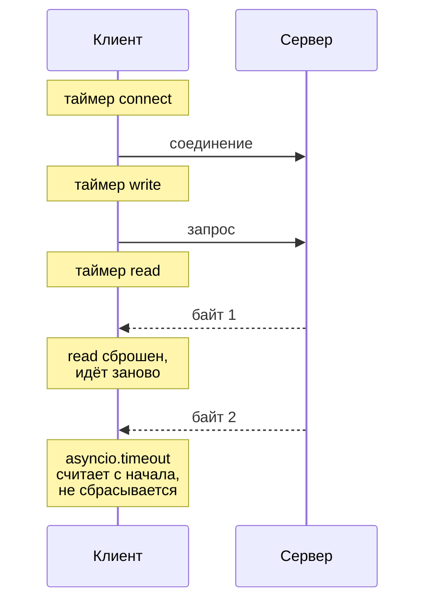
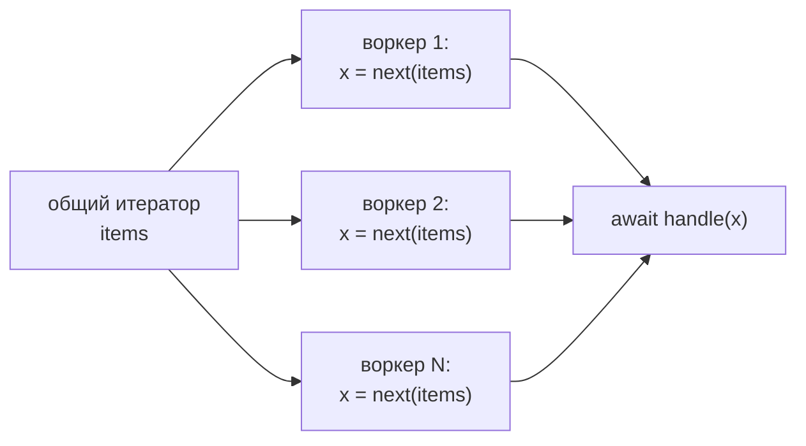
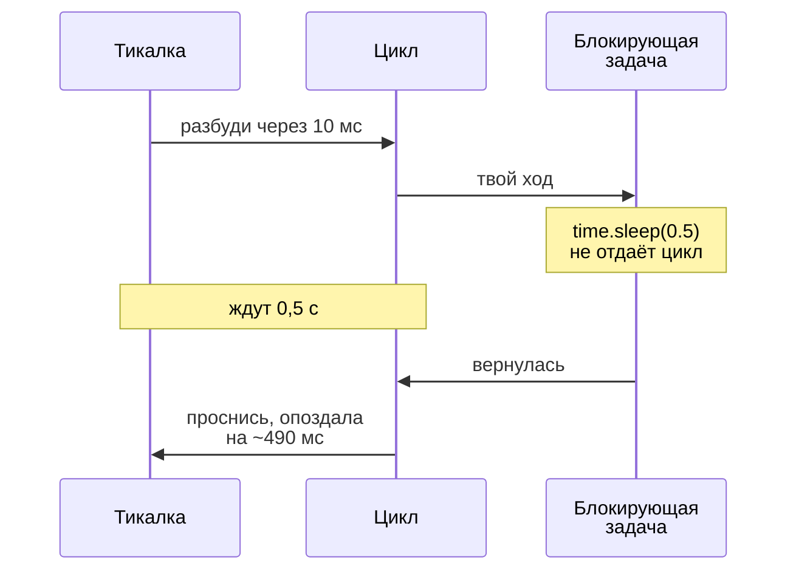

Таймауты HTTP-клиента по фазам, ограничение параллелизма на десятках тысяч задач и блокирующий код, который останавливает цикл событий.
Рядом: [[asyncio на практике]] · [[Ошибки и отмена в asyncio]] · [[asyncio под капотом]] · [[Потоки и процессы]]
Разделы: [[#Таймауты HTTP-клиента: на фазу, а не на запрос]] ([[#Модель: таймер фазы и общий дедлайн]]) · [[#Ограничение параллелизма на 100 000 задач]] ([[#Модель: сколько задач живёт одновременно]]) · Блокирующий код в async def останавливает цикл · [[#Что спросят дальше]]

Представь кухонный таймер и турникет на входе. Таймер звенит, если блюдо молчит слишком долго; турникет пускает внутрь по десять человек, остальные стоят в очереди. Цикл событий (event loop) устроен как в [[asyncio под капотом#Зачем вообще async]]. Три темы страницы — три беды:

- блюдо не несут, и неизвестно, сколько ещё ждать: нужны **таймауты**;
- у входа сто тысяч человек: пускать всех разом нельзя, турникет держит внутри десять-сто, остальные ждут в очереди;
- кто-то застрял в турникете и не двигается: пока код «блокируется», стоит весь цикл.

## Таймауты HTTP-клиента: на фазу, а не на запрос

`httpx.Timeout(3)` задаёт одно число четырём таймаутам сразу: на подключение (connect), чтение (read), запись (write) и ожидание соединения из пула (pool). Каждый срабатывает независимо и отсчитывается заново, поэтому «таймаут 3 секунды» не означает, что запрос уложится в 3 секунды: сервер, который присылает по байту раз в полсекунды, держит клиента сколько угодно, ни один `read` не истекает. Общий дедлайн попытки задаёт `asyncio.timeout`.

Таймер фазы — кухонный таймер: каждый пришедший байт перезапускает его. Общий дедлайн — часы на стене: они идут с начала и не сбрасываются.



Локальный медленный сервер: после заголовков шлёт по байту каждые 0,3 с (10 байт, итого 3 с). Второй сервер принял запрос и молчит.

```python
import asyncio
import time

import httpx


async def slow(reader, writer):
    await reader.readuntil(b"\r\n\r\n")
    writer.write(b"HTTP/1.1 200 OK\r\nContent-Length: 10\r\n\r\n")
    await writer.drain()
    for _ in range(10):          # байт за байтом, пауза 0,3 с
        await asyncio.sleep(0.3)
        writer.write(b"x")
        await writer.drain()
    writer.close()


async def silent(reader, writer):
    await reader.readuntil(b"\r\n\r\n")
    await asyncio.sleep(5)       # принял запрос и молчит


async def main() -> None:
    srv = await asyncio.start_server(slow, "127.0.0.1", 0)
    url = f"http://127.0.0.1:{srv.sockets[0].getsockname()[1]}/"
    async with httpx.AsyncClient(timeout=httpx.Timeout(1)) as client:
        start = time.perf_counter()
        r = await client.get(url)
        print(f"Timeout(1): ответ {r.status_code} за {time.perf_counter() - start:.1f} с")

        start = time.perf_counter()
        try:
            async with asyncio.timeout(1):
                await client.get(url)
        except TimeoutError as e:
            print(f"asyncio.timeout(1): {type(e).__name__} за {time.perf_counter() - start:.1f} с")
    srv.close()

    srv = await asyncio.start_server(silent, "127.0.0.1", 0)
    url = f"http://127.0.0.1:{srv.sockets[0].getsockname()[1]}/"
    async with httpx.AsyncClient(timeout=httpx.Timeout(0.3)) as client:
        try:
            await client.get(url)
        except httpx.TimeoutException as e:
            print(f"str: {str(e)!r}")
            print(f"repr: {e!r}")
    srv.close()


asyncio.run(main())
```

```text title="Вывод"
Timeout(1): ответ 200 за 3.1 с
asyncio.timeout(1): TimeoutError за 1.0 с
str: ''
repr: ReadTimeout('')
```

Время замерено на этой машине и колеблется от запуска к запуску (3.0–3.1 с).

- `Timeout(1)` ни разу не сработал: между байтами проходит 0,3 с, меньше секунды. Запрос занял 3 секунды.
- `asyncio.timeout(1)` оборвал попытку ровно на секунде. С ретраями худший случай — `попыток × таймаут попытки`, его легко посчитать и сверить с бюджетом вызывающего.
- `str()` у `httpx.ReadTimeout` пустая: в логе после `logger.error("ошибка: %s", e)` будет «ошибка: ». Логируйте `repr(e)` или `type(e).__name__`.
- `asyncio.timeout` бросает голый `TimeoutError`, а не `httpx.TimeoutException`: поймать нужно оба, если ретраи настроены на `httpx`-исключения.

### Модель: таймер фазы и общий дедлайн

То же без сети: два таймера смотрят на моменты прихода байтов. Read-таймер сравнивает паузу между соседними байтами, дедлайн — время с начала.

```python
def read_timeout_fires(arrivals, read_timeout):
    # arrivals: моменты (с), когда пришёл очередной байт; запрос ушёл в момент 0
    # read-таймер заводится заново после каждого полученного байта
    last = 0.0
    for t in arrivals:
        if t - last > read_timeout:
            return f"read сработал на {last + read_timeout:.1f} с"
        last = t
    return "read не сработал"


def total_deadline_fires(arrivals, deadline):
    # общий дедлайн отсчитывается один раз с начала попытки
    if arrivals[-1] > deadline:
        return f"дедлайн сработал на {deadline:.1f} с"
    return "дедлайн не сработал"


drip = [0.3 * i for i in range(1, 11)]   # 10 байт, пауза 0,3 с; всего 3 с
silence = [5.0]                          # сервер молчит 5 с

print("капает:", read_timeout_fires(drip, 1), "|", total_deadline_fires(drip, 1))
print("молчит:", read_timeout_fires(silence, 1), "|", total_deadline_fires(silence, 1))
```

```text title="Вывод"
капает: read не сработал | дедлайн сработал на 1.0 с
молчит: read сработал на 1.0 с | дедлайн сработал на 1.0 с
```

Read ловит только молчание, дедлайн ловит и молчание, и медленную капельницу. Поэтому в продакшене ставят оба.

### Про `requests`

Для `requests` то же устройство: `timeout=3` — это connect и read по отдельности, а не весь запрос. Исключения устроены так (проверено на requests 2.34.2): `class ConnectTimeout(ConnectionError, Timeout)` — наследует сразу оба. Поэтому порядок `except` решает: `except ConnectionError` перед `except Timeout` поймает и таймаут подключения, и недоступность хоста; чтобы отличить перегрузку от недоступности, `ConnectTimeout` ловят отдельной веткой первой. `ReadTimeout` наследует только `Timeout`.

## Ограничение параллелизма на 100 000 задач

В терминах турникета: `gather` на всём списке — впустить сто тысяч человек разом. Воркеры — несколько проходов (в примере ниже 100): каждый берёт следующего из общей очереди, обслуживает и возвращается за новым.



`gather(*(handle(x) for x in items))` разворачивает генератор сразу: все 100 000 корутин и задач создаются до первого `await`, и память растёт пропорционально числу элементов, даже если за раз нужны десять. Вариант с N воркерами создаёт задач ровно N, а элементы берёт из общего итератора:

```python
import asyncio
import tracemalloc

N = 100_000


async def handle(x: int) -> int:
    await asyncio.sleep(0.01)  # здесь — await client.get(...)
    return x


async def with_gather() -> None:
    await asyncio.gather(*(handle(x) for x in range(N)))  # все корутины и задачи сразу


async def with_workers(workers: int = 100) -> None:
    items = iter(range(N))  # один общий итератор

    async def worker() -> None:
        for x in items:  # next() синхронный: между проверкой и выдачей нет await
            await handle(x)

    async with asyncio.TaskGroup() as tg:
        for _ in range(workers):
            tg.create_task(worker())


for fn in (with_gather, with_workers):
    tracemalloc.start()
    asyncio.run(fn())
    _, peak = tracemalloc.get_traced_memory()
    tracemalloc.stop()
    print(f"{fn.__name__:13} пик {peak / 1e6:.1f} МБ")
```

```text title="Вывод"
with_gather   пик 160.5 МБ
with_workers  пик 0.2 МБ
```

Пиковая память по `tracemalloc` (число с этой машины; важен порядок: около 1,6 КБ на каждую из 100 000 задач против почти ничего). Гонок у воркеров нет: цикл событий однопоточный, а `next()` у итератора синхронный, так что два воркера не могут получить один и тот же элемент, переключение возможно только на `await`. Ограничение параллелизма задаёт число воркеров; `Semaphore` поверх этого не нужен. Но воркеры должны читать именно общий итератор (`for x in items`), а не каждый свой `range`.

### Модель: сколько задач живёт одновременно

Память — следствие. Причину видно по счётчику: сколько `handle` выполняется одновременно. Здесь 1000 элементов и 10 воркеров, а ожидание вместо сети — `sleep`.

```python
import asyncio

N = 1000


async def run(mode):
    state = {"active": 0, "peak": 0, "tasks": 0}

    async def handle(x):
        state["active"] += 1
        state["peak"] = max(state["peak"], state["active"])
        await asyncio.sleep(0.001)   # здесь был бы запрос в сеть
        state["active"] -= 1

    if mode == "gather":
        coros = [handle(x) for x in range(N)]
        state["tasks"] = N
        await asyncio.gather(*coros)
    else:
        items = iter(range(N))

        async def worker():
            for x in items:          # общий итератор: каждый элемент достаётся одному воркеру
                await handle(x)

        async with asyncio.TaskGroup() as tg:
            for _ in range(10):
                tg.create_task(worker())
        state["tasks"] = 10
    return state


for mode in ("gather", "workers"):
    s = asyncio.run(run(mode))
    print(f"{mode:8} задач создано {s['tasks']:4}, одновременно в handle {s['peak']}")
```

```text title="Вывод"
gather   задач создано 1000, одновременно в handle 1000
workers  задач создано   10, одновременно в handle 10
```

Для внешнего сервиса это ещё важнее памяти: `gather` отправит все 1000 запросов разом, воркеры — не больше десяти.

## Блокирующий код в `async def` останавливает цикл

Задача-«тикалка» просыпается каждые 10 мс и замеряет, насколько опоздала. Под ней — три способа потратить по полсекунды (последний — тяжёлый regex с катастрофическим откатом):

```python
import asyncio
import re
import time


async def ticker(gaps: list[float]) -> None:
    last = time.perf_counter()
    while True:
        await asyncio.sleep(0.01)
        now = time.perf_counter()
        gaps.append(now - last - 0.01)
        last = now


async def blocking_call() -> None:
    time.sleep(0.5)  # синхронный SDK внутри async def


async def threaded_call() -> None:
    await asyncio.to_thread(time.sleep, 0.5)


async def heavy_regex() -> None:
    re.match(r"(a+)+$", "a" * 25 + "!")  # катастрофический откат


async def measure(coro_fn) -> None:
    gaps: list[float] = []
    t = asyncio.create_task(ticker(gaps))
    await asyncio.sleep(0.1)
    await coro_fn()
    await asyncio.sleep(0.1)
    t.cancel()
    print(f"{coro_fn.__name__:14} худшая задержка тика {max(gaps) * 1000:.0f} мс")


async def main() -> None:
    for fn in (blocking_call, threaded_call, heavy_regex):
        await measure(fn)


asyncio.run(main())
```

```text title="Вывод"
blocking_call  худшая задержка тика 492 мс
threaded_call  худшая задержка тика 1 мс
heavy_regex    худшая задержка тика 768 мс
```

Что происходит в цикле, пока задача блокирует: тикалка просила вернуть управление через 10 мс, но управление у блокирующей задачи, и забрать его некому.



Синхронный `time.sleep` (так же — вызов синхронного SDK, например клиента HubSpot) в `async def` остановил весь цикл на полсекунды, остальные задачи и запросы стояли; та же пауза через `to_thread` задержку почти не меняет. Вычисление, которое не отдаёт управление (regex, парсинг, сериализация большого объекта), ведёт себя как блокирующий вызов, и `to_thread` помогает только когда оно отпускает GIL; для чистых вычислений нужен процесс. Для хендлеров FastAPI есть дешёвый вариант: обычный `def` вместо `async def` исполняется в пуле потоков. Время задержек — с этой машины.

## Что спросят дальше

- **Зачем таймаут на фазу, а не один на запрос?** Соединение, отправка, ожидание ответа и чтение имеют разную природу: общий таймаут не отличает медленный DNS от зависшего сервера.
- **Как не запустить 100 000 задач одновременно?** `Semaphore` вокруг тела задачи, а для огромных списков — очередь с фиксированным числом воркеров, чтобы не создавать все задачи заранее.
