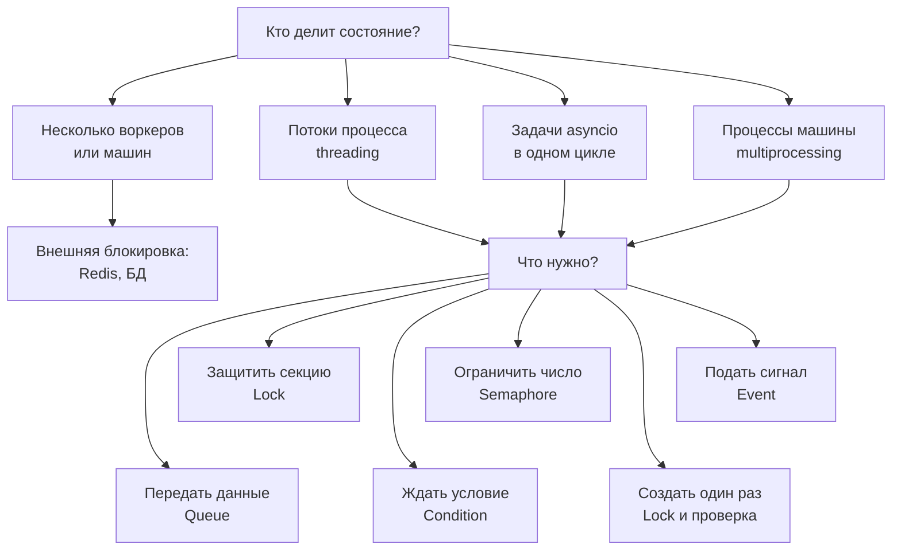

Какой примитив взять, когда состояние делят потоки, задачи asyncio или процессы, и что ломается, если взять не тот: блокировка потоков в корутине, `Lock` вокруг долгого `await`, deadlock из-за порядка, гонка «проверил, потом сделал», `Lock` при нескольких воркерах. Для каждой поломки есть короткая модель, которая сама завершается и печатает симптом, плюс способы найти зависание. Устройство самих примитивов здесь не пересказывается, оно в соседних заметках.
Рядом: [[Потоки и процессы]] · [[asyncio на практике]] · [[Ошибки и отмена в asyncio]] · [[Распределённая блокировка в Redis]] · [[Блокировки|блокировки в PostgreSQL]]
Разделы: [[#Дерево решений]] · [[#Таблица соответствий]] · [[#Блокировка потоков в корутине]] · [[#Блокировка, удержанная через await]] · [[#Две блокировки в разном порядке]] · [[#Повторный захват Lock]] · [[#Проверил, потом сделал]] · [[#Блокировка внутри процесса при нескольких воркерах]] · [[#Мост между потоками и asyncio]] · [[#Как искать зависания]] · [[#Что спросят дальше]]

| Симптом | Как найти | Что сделать |
| --- | --- | --- |
| Весь asyncio замер | таймер не тикает | [[#Блокировка потоков в корутине\|потоки в корутине]] |
| Задач много, идут по одной | время = задачи × вызов | [[#Блокировка, удержанная через await\|Lock вокруг await]] |
| Два потока стоят | дамп: оба на `with` | [[#Две блокировки в разном порядке\|порядок захвата]] |
| Завис на своей блокировке | один поток, два захвата | [[#Повторный захват Lock\|RLock]] |
| Объект создан много раз | счёт создания в тесте | [[#Проверил, потом сделал\|проверка внутри Lock]] |
| Lock не держит | два процесса в секции | [[#Блокировка внутри процесса при нескольких воркерах\|Lock и воркеры]] |
| Корутина спит, поток шлёт | нет `call_soon_threadsafe` | [[#Мост между потоками и asyncio\|мост]] |
| Не ясно, где завис | дамп стеков, задачи | [[#Как искать зависания\|как искать]] |

## Дерево решений

Сначала вопрос «кто делит состояние», потому что от него зависит весь набор: у потоков, задач и процессов классы называются похоже, но работают по-разному. Потом вопрос «что нужно».



Класс берут из того же «мира», что и участники: потоки — из `threading`, задачи — из `asyncio`, процессы — из `multiprocessing`. Для нескольких воркеров или машин блокировка внутри процесса бессильна: нужна общая точка, см. [[Распределённая блокировка в Redis]]. Если нужно защитить строки в базе, это уже блокировки самой БД, [[Блокировки|блокировки в PostgreSQL]].

## Таблица соответствий

Названия почти совпадают, но смешивать нельзя. Сами примитивы `threading` описаны в разделе «Синхронизация потоков» заметки [[Потоки и процессы]], процессные — в разделе «Синхронизация процессов» той же заметки.

| Примитив | threading | asyncio | multiprocessing | Почему нельзя |
| --- | --- | --- | --- | --- |
| Lock | `Lock` | `Lock` | `Lock` | `threading.Lock` вешает весь цикл |
| RLock | `RLock` | нет | `RLock` | в asyncio нет потока-владельца |
| Semaphore | `Semaphore` | `Semaphore` | `Semaphore` | в asyncio нет `timeout` |
| Event | `Event` | `Event` | `Event` | `set()` из потока не будит цикл |
| Condition | `Condition` | `Condition` | `Condition` | у каждого мира своя блокировка |
| Barrier | `Barrier` | `Barrier` (3.11+) | `Barrier` | ждут только свои |
| Queue | `Queue` из `queue` | `Queue` | `Queue` | `get()` из `queue` вешает цикл |

Что общего у всех строк, по документации asyncio: примитивы `asyncio` не потокобезопасны и для синхронизации потоков не годятся, а их методы не принимают `timeout` (ограничение ставят через `asyncio.wait_for` или `asyncio.timeout`). `asyncio.Barrier` добавлен в 3.11, по странице «asyncio synchronization primitives» на docs.python.org.

## Блокировка потоков в корутине

Корутина берёт `threading.Lock` и уходит в `await`, не отпустив её. Вторая корутина в том же потоке зовёт `lock.acquire()`: это обычный блокирующий вызов, цикл стоит, первая корутина не может проснуться и отпустить блокировку. Без таймаута это вечный deadlock. В модели ожидание ограничено секундой, а рядом тикает счётчик, чтобы видеть, что цикл стоял.

```python
import asyncio
import threading
import time

LOCK_TIMEOUT = 1.0  # без таймаута корутина B зависла бы навсегда


async def holder(lock: threading.Lock) -> None:
    lock.acquire()  # берём блокировку потоков...
    try:
        await asyncio.sleep(0.2)  # ...и отдаём управление циклу, не отпустив её
    finally:
        lock.release()


async def waiter(lock: threading.Lock) -> bool:
    # acquire() не await: он блокирует весь поток, а с ним и цикл
    got = lock.acquire(timeout=LOCK_TIMEOUT)
    if got:
        lock.release()
    return got


async def ticker(ticks: list[int]) -> None:
    while True:
        ticks.append(1)
        await asyncio.sleep(0.05)


async def broken() -> None:
    lock = threading.Lock()
    ticks: list[int] = []
    tick_task = asyncio.create_task(ticker(ticks))
    hold_task = asyncio.create_task(holder(lock))
    await asyncio.sleep(0)  # holder взял блокировку и заснул
    started = time.perf_counter()
    got = await waiter(lock)
    print(f"threading.Lock: got={got}, ждали {time.perf_counter() - started:.1f} с, тиков за это время: {len(ticks)}")
    tick_task.cancel()
    await asyncio.gather(hold_task, tick_task, return_exceptions=True)


async def fixed() -> None:
    lock = asyncio.Lock()
    ticks: list[int] = []

    async def hold() -> None:
        async with lock:
            await asyncio.sleep(0.2)

    async def wait() -> None:
        async with lock:  # ждёт через await: цикл свободен
            pass

    tick_task = asyncio.create_task(ticker(ticks))
    hold_task = asyncio.create_task(hold())
    await asyncio.sleep(0)
    started = time.perf_counter()
    await wait()
    print(f"asyncio.Lock: ждали {time.perf_counter() - started:.1f} с, тиков за это время: {len(ticks)}")
    tick_task.cancel()
    await asyncio.gather(hold_task, tick_task, return_exceptions=True)


asyncio.run(broken())
asyncio.run(fixed())
```

```text title="Вывод"
threading.Lock: got=False, ждали 1.0 с, тиков за это время: 1
asyncio.Lock: ждали 0.2 с, тиков за это время: 4
```

Время и число тиков от запуска к запуску немного плавают. `threading.Lock` не дождался (`got=False`) и заморозил цикл на всю секунду: единственный тик случился до блокировки. С `asyncio.Lock` ожидание идёт через `await`, цикл свободен и тикает. Прогон на 3.15 и 3.12 дал одинаковый результат. Если блокировку нужно делить с настоящим потоком, берут не её, а очередь, см. [[#Мост между потоками и asyncio]], либо уносят блокирующую часть в `asyncio.to_thread`, как в разделе «Блокирующий вызов в корутине» заметки [[asyncio на практике]].

## Блокировка, удержанная через await

`asyncio.Lock` безопасна, но если держать её вокруг долгого вызова, остальные задачи выстраиваются в очередь, и вся конкурентность пропадает. Защищать нужно участок, где между чтением и записью общего состояния стоит `await`, а не сам вызов. Если `await` внутри изменения нет, как в `total += result`, блокировка не нужна вовсе: цикл не переключит задачу посреди такого шага.

```python
import asyncio
import time

CALL_SECONDS = 0.1  # «долгий вызов»: сеть, база
TASKS = 5


async def slow_call() -> int:
    await asyncio.sleep(CALL_SECONDS)
    return 1


async def lock_around_call() -> float:
    lock = asyncio.Lock()
    total = 0

    async def work() -> None:
        nonlocal total
        async with lock:  # блокировка держится, пока идёт сам вызов
            total += await slow_call()

    started = time.perf_counter()
    await asyncio.gather(*(work() for _ in range(TASKS)))
    assert total == TASKS
    return time.perf_counter() - started


async def no_lock_needed() -> float:
    total = 0

    async def work() -> None:
        nonlocal total
        result = await slow_call()  # вызов — снаружи
        total += result  # без await внутри: между чтением и записью задача не переключится

    started = time.perf_counter()
    await asyncio.gather(*(work() for _ in range(TASKS)))
    assert total == TASKS
    return time.perf_counter() - started


async def main() -> None:
    print(f"блокировка вокруг вызова:    {await lock_around_call():.1f} с")
    print(f"без блокировки, вызов снаружи: {await no_lock_needed():.1f} с")


asyncio.run(main())
```

```text title="Вывод"
блокировка вокруг вызова:    0.5 с
без блокировки, вызов снаружи: 0.1 с
```

Время округлено до десятых и слегка зависит от машины. Пять вызовов по 0.1 с идут друг за другом (0.5 с) и параллельно (0.1 с). Правило: сначала `await` долгого вызова, потом короткая секция под блокировкой. Если вызов и изменение нельзя разделить (например, «прочитать, дозвониться, записать» должно быть атомарным), блокировку приходится держать и через `await`, и принять, что задачи пойдут по одной. Либо менять схему: проверять при записи, что состояние не изменилось (версия, compare-and-set), или сделать операцию идемпотентной. `Semaphore` тут не помощник: он только ограничивает число одновременных вызовов, а при `n` больше 1 атомарности не даёт.

## Две блокировки в разном порядке

Первый поток берёт `a`, потом `b`; второй берёт `b`, потом `a`. Если каждый успел взять первую, оба ждут вторую вечно. Демонстрация должна завершиться сама: потоки с `daemon=True` не держат выход из программы, `join(timeout=…)` не ждёт вечно, а `faulthandler.dump_traceback(all_threads=True)` показывает, где каждый застрял.

```python
import faulthandler
import threading
import time

JOIN_TIMEOUT = 1.0
a = threading.Lock()
b = threading.Lock()


def transfer(first: threading.Lock, second: threading.Lock) -> None:
    with first:
        time.sleep(0.1)  # пока этот поток спит, другой успевает взять вторую блокировку
        with second:
            pass


def run(order1: tuple[threading.Lock, threading.Lock], order2: tuple[threading.Lock, threading.Lock]) -> bool:
    threads = [
        threading.Thread(target=transfer, args=order1, name="t1", daemon=True),
        threading.Thread(target=transfer, args=order2, name="t2", daemon=True),
    ]
    for t in threads:
        t.start()
    for t in threads:
        t.join(timeout=JOIN_TIMEOUT)
    return not any(t.is_alive() for t in threads)


print("разный порядок (a,b) и (b,a): завершились =", run((a, b), (b, a)), flush=True)
faulthandler.dump_traceback(all_threads=True)  # где застрял каждый поток
```

```text title="Вывод"
разный порядок (a,b) и (b,a): завершились = False
Thread 0x000000016dd6b000 [t2] (most recent call first):
  File ".../b3.py", line 13 in transfer
  File ".../threading.py", line 1160 in run
  File ".../threading.py", line 1218 in _bootstrap_inner
  File ".../threading.py", line 1180 in _bootstrap

Thread 0x000000016cd5f000 [t1] (most recent call first):
  File ".../b3.py", line 13 in transfer
  File ".../threading.py", line 1160 in run
  File ".../threading.py", line 1218 in _bootstrap_inner
  File ".../threading.py", line 1180 in _bootstrap

Current thread 0x00000001e834bac0 (most recent call first):
  File ".../b3.py", line 30 in <module>
```

Адреса потоков и порядок блоков в дампе меняются от запуска к запуску, номера строк библиотеки зависят от версии, длинные пути заменены на `...`. Вывод получен на 3.15; на 3.12 демонстрация так же зависает, но в заголовках потоков нет имён (`[t1]`, `[t2]`), только адреса. Смотреть нужно на строку `b3.py, line 13`: оба потока стоят на `with second`, то есть каждый держит одну блокировку и ждёт другую.

Лекарство одно: единый порядок захвата для всех. Ниже порядок задаётся сортировкой по `id()`; в реальном коде блокировкам обычно дают постоянный номер или уровень.

```python
import threading
import time

JOIN_TIMEOUT = 1.0
a = threading.Lock()
b = threading.Lock()


def transfer(first: threading.Lock, second: threading.Lock) -> None:
    # единый порядок: всегда сортируем блокировки по id() и берём в этом порядке
    first, second = sorted((first, second), key=id)
    with first:
        time.sleep(0.1)
        with second:
            pass


threads = [
    threading.Thread(target=transfer, args=(a, b), daemon=True),
    threading.Thread(target=transfer, args=(b, a), daemon=True),
]
for t in threads:
    t.start()
for t in threads:
    t.join(timeout=JOIN_TIMEOUT)
print("единый порядок: завершились =", not any(t.is_alive() for t in threads))
```

```text title="Вывод"
единый порядок: завершились = True
```

Другие выходы: не брать две блокировки сразу (сменить дизайн), брать вторую с `acquire(timeout=…)` и откатываться, держать одну крупную блокировку вместо двух мелких.

## Повторный захват Lock

`Lock` не знает, кто его держит. Если поток, уже владеющий блокировкой, берёт её снова (метод под блокировкой зовёт другой метод под той же блокировкой), он ждёт сам себя. В модели повторный захват ограничен таймаутом, иначе строка с `acquire()` зависла бы навсегда.

```python
import threading

lock = threading.Lock()
rlock = threading.RLock()


def second_acquire(lk: "threading.Lock | threading.RLock") -> bool:
    with lk:  # первый захват
        got = lk.acquire(timeout=0.2)  # второй захват тем же потоком; без timeout — вечное ожидание
        if got:
            lk.release()
        return got


print("Lock:  повторный захват удался =", second_acquire(lock))
print("RLock: повторный захват удался =", second_acquire(rlock))
```

```text title="Вывод"
Lock:  повторный захват удался = False
RLock: повторный захват удался = True
```

`RLock` запоминает владельца и счётчик, поэтому тот же поток может войти повторно (освобождать нужно столько же раз; через `with` это получается само). Но `RLock` скорее костыль: часто чище разделить метод на публичный, который берёт блокировку, и внутренний `_locked`-вариант, который её не берёт. В asyncio аналога нет, и это подсказка: если внутри корутины нужна реентерабельность, структуру кода лучше поменять.

## Проверил, потом сделал

`if x is None: x = create()` без блокировки: пока первый поток создаёт, остальные тоже прошли проверку. Это же приём «один раз инициализировать». `Barrier` сводит все потоки к проверке одновременно, а пауза в `create` делает гонку воспроизводимой (приём со страницы [[Потоки и процессы]]).

```python
import threading
import time
from collections.abc import Callable

WORKERS = 5
created = 0
client: object | None = None
start = threading.Barrier(WORKERS)  # все потоки доходят до проверки одновременно


def make_client() -> object:
    global created
    time.sleep(0.05)  # дорогое создание: соединение, чтение конфига
    created += 1
    return object()


def get_client_broken() -> object:
    global client
    if client is None:  # проверил...
        client = make_client()  # ...потом сделал: между ними вклинились остальные
    return client


init_lock = threading.Lock()


def get_client_fixed() -> object:
    global client
    if client is None:  # быстрый путь без блокировки
        with init_lock:
            if client is None:  # повторная проверка: пока ждали, кто-то мог создать
                client = make_client()
    return client


def run(getter: Callable[[], object]) -> int:
    global created, client
    created, client = 0, None

    def worker() -> None:
        start.wait()
        getter()
    threads = [threading.Thread(target=worker) for _ in range(WORKERS)]
    for t in threads:
        t.start()
    for t in threads:
        t.join()
    return created


print("без блокировки: клиентов создано", run(get_client_broken), "(ждали 1)")
print("с блокировкой:  клиентов создано", run(get_client_fixed))
```

```text title="Вывод"
без блокировки: клиентов создано 5 (ждали 1)
с блокировкой:  клиентов создано 1
```

«5» стабильно только благодаря `Barrier` и паузе: без них гонка срабатывает не каждый запуск, поэтому тесты на гонки всегда делают с принудительной расстановкой. Исправление — блокировка и повторная проверка внутри неё (double-checked locking): быстрый путь без блокировки, когда объект уже создан, и защита создания, когда нет. Для общего счётчика и подобных изменений «прочитал, поменял, записал» всё то же: вся тройка под одной блокировкой. В asyncio то же самое случается между проверкой и записью, если там есть `await`; если `await` между ними нет, корутины не прерываются, и гонки нет.

## Блокировка внутри процесса при нескольких воркерах

`threading.Lock` живёт в памяти одного процесса. Воркеры (процессы `gunicorn`, `multiprocessing`) получают каждый свою копию, и блокировки между ними нет. В модели родитель держит блокировку уровня модуля; ребёнок (запущен через `spawn`, одинаково на всех системах) заново импортирует модуль и получает свою свободную блокировку.

```python
import multiprocessing as mp
import threading

LOCK = threading.Lock()  # на уровне модуля: у каждого процесса будет СВОЯ копия
WAIT = 0.5


def child_with_module_lock(out) -> None:
    got = LOCK.acquire(timeout=WAIT)
    out.put(("threading.Lock из модуля", got))


def child_with_shared_lock(shared, out) -> None:
    got = shared.acquire(timeout=WAIT)
    out.put(("mp.Lock, переданный в процесс", got))


if __name__ == "__main__":
    ctx = mp.get_context("spawn")  # одинаково на Linux, macOS и Windows
    out = ctx.Queue()

    LOCK.acquire()  # родитель «занял» секцию
    p = ctx.Process(target=child_with_module_lock, args=(out,))
    p.start()
    print(out.get(), "<- ребёнок вошёл, хотя секция занята")
    p.join()
    LOCK.release()

    shared = ctx.Lock()
    shared.acquire()
    p = ctx.Process(target=child_with_shared_lock, args=(shared, out))
    p.start()
    print(out.get(), "<- ребёнок честно ждал и не дождался")
    p.join()
```

```text title="Вывод"
('threading.Lock из модуля', True) <- ребёнок вошёл, хотя секция занята
('mp.Lock, переданный в процесс', False) <- ребёнок честно ждал и не дождался
```

Результат детерминирован. `multiprocessing.Lock` работает, но только для процессов, которые получили его от общего родителя при создании. Независимые воркеры веб-сервера и процессы на разных машинах такой общей точки не имеют. Тогда нужна блокировка снаружи: Redis ([[Распределённая блокировка в Redis]]), блокировка или уникальный ключ в базе ([[Блокировки|блокировки в PostgreSQL]]), на одной машине ещё и файловая блокировка. Подумайте заодно, нужна ли блокировка вообще: идемпотентная операция или уникальный индекс часто проще.

## Мост между потоками и asyncio

Цикл событий живёт в одном потоке, и из других потоков к его объектам трогать нельзя. Есть два способа передать данные. Первый: `loop.call_soon_threadsafe(callback, *args)` ставит вызов в очередь цикла и будит его. Так поток кладёт данные в `asyncio.Queue`: прямой `queue.put_nowait` из потока небезопасен и может не разбудить ждущего.

```python
import asyncio
import threading

ITEMS = 3
STOP = None  # метка «больше данных не будет»


def producer(loop: asyncio.AbstractEventLoop, queue: asyncio.Queue[int | None]) -> None:
    # Запускается в обычном потоке. queue.put_nowait отсюда нельзя:
    # asyncio.Queue не потокобезопасна и цикл мог бы не проснуться.
    for i in range(ITEMS):
        loop.call_soon_threadsafe(queue.put_nowait, i)
    loop.call_soon_threadsafe(queue.put_nowait, STOP)


async def main() -> None:
    loop = asyncio.get_running_loop()
    queue: asyncio.Queue[int | None] = asyncio.Queue()
    threading.Thread(target=producer, args=(loop, queue), daemon=True).start()
    while (item := await queue.get()) is not STOP:
        print("из потока пришло:", item)


asyncio.run(main())
```

```text title="Вывод"
из потока пришло: 0
из потока пришло: 1
из потока пришло: 2
```

Второй способ: `asyncio.run_coroutine_threadsafe(coro, loop)` запускает корутину в чужом цикле и возвращает `concurrent.futures.Future`. В обратную сторону, из цикла в поток, служит `asyncio.to_thread`. В модели они сведены вместе: корутина отдаёт работу потоку, а поток зовёт корутину обратно.

```python
import asyncio
import concurrent.futures

RESULT_TIMEOUT = 2.0


async def fetch_price(item: str) -> float:
    await asyncio.sleep(0.05)  # здесь было бы await client.get(...)
    return {"tea": 3.5, "coffee": 4.0}[item]


def sync_worker(loop: asyncio.AbstractEventLoop) -> float:
    # Обычный поток зовёт корутину в чужом цикле и ждёт результат.
    future: concurrent.futures.Future[float] = asyncio.run_coroutine_threadsafe(fetch_price("tea"), loop)
    try:
        return future.result(timeout=RESULT_TIMEOUT)  # блокирует ПОТОК, не цикл
    except concurrent.futures.TimeoutError:
        future.cancel()  # иначе корутина в цикле продолжит работать без ожидающего
        raise


async def main() -> None:
    loop = asyncio.get_running_loop()
    # to_thread: из цикла в поток; внутри потока — обратно в цикл
    price = await asyncio.to_thread(sync_worker, loop)
    print("цена из потока:", price)


asyncio.run(main())
```

```text title="Вывод"
цена из потока: 3.5
```

Правила моста. `future.result()` блокирует вызвавший поток, поэтому звать его из самого цикла нельзя: цикл не сможет выполнить корутину и ответ никогда не придёт. Всегда ставьте `timeout` в `result(timeout=…)` и при его истечении зовите `future.cancel()`: сам по себе `result(timeout)` корутину не отменяет. Исключение корутины приезжает в `result()`, не потеряется. Остановку потока-производителя и метку конца потока данных (здесь `None`) продумывают заранее. Про отмену задач см. [[Ошибки и отмена в asyncio]].

## Как искать зависания

**Потоки: дамп стеков по таймеру.** `faulthandler.dump_traceback_later(timeout)` печатает стеки всех потоков через заданное время, даже когда главный поток завис. Этот же вызов можно включить в боевом коде как сторожевой.

```python
import faulthandler
import threading
import time

stuck = threading.Event()  # его никто не выставит


def worker() -> None:
    stuck.wait()  # зависаем навсегда


threading.Thread(target=worker, name="worker-1", daemon=True).start()
faulthandler.dump_traceback_later(0.3, exit=False)  # через 0.3 с напечатать стеки всех потоков
time.sleep(0.6)  # «программа зависла»; дамп придёт сам
faulthandler.cancel_dump_traceback_later()
print("конец", flush=True)
```

```text title="Вывод"
конец
Timeout (0:00:00.300000)!
Thread 0x0000000170323000 [worker-1] (most recent call first):
  File ".../threading.py", line 363 in wait
  File ".../threading.py", line 664 in wait
  File ".../b9.py", line 9 in worker
  File ".../threading.py", line 1160 in run
  File ".../threading.py", line 1218 in _bootstrap_inner
  File ".../threading.py", line 1180 in _bootstrap

Thread 0x00000001e834bac0 (most recent call first):
  File ".../b9.py", line 14 in <module>
```

Адреса потоков и номера строк стандартной библиотеки меняются, пути заменены на `...`; дамп идёт в stderr, поэтому порядок строк относительно «конец» на терминале может отличаться. Рабочий поток стоит в `Event.wait` на строке `b9.py:9`.

**Потоки в уже запущенном процессе.** Если процесс завис и кода не поменять, снимите стеки снаружи. Для этого есть внешний инструмент `py-spy` (`pip install py-spy`); вывод здесь не приводится:

```bash
py-spy dump --pid 12345
```

Она печатает стек каждого потока. По умолчанию `py-spy` на короткое время приостанавливает процесс, пока читает стеки; флаг `--nonblocking` пауз не делает, но стеки могут получиться неконсистентными. Обычно нужны права: на macOS — `sudo`, на Linux — `ptrace_scope` или `--cap-add SYS_PTRACE` в контейнере.

**asyncio: список задач.** `asyncio.all_tasks()` даёт все ещё не завершённые задачи, `task.print_stack()` печатает, на каком `await` стоит каждая.

```python
import asyncio
import sys

stuck = asyncio.Event()  # его никто не выставит


async def waiter(name: str) -> None:
    await stuck.wait()


async def main() -> None:
    tasks = [asyncio.create_task(waiter(f"w{i}"), name=f"w{i}") for i in range(2)]
    await asyncio.sleep(0.1)
    for task in sorted(asyncio.all_tasks(), key=asyncio.Task.get_name):
        if task is not asyncio.current_task():
            print(task.get_name(), "ждёт на", task.get_stack()[0].f_code.co_name)
            task.print_stack(file=sys.stdout)
    for task in tasks:
        task.cancel()
    await asyncio.gather(*tasks, return_exceptions=True)


asyncio.run(main())
```

```text title="Вывод"
w0 ждёт на waiter
Stack for <Task pending name='w0' coro=<waiter() running at .../b10.py:8> wait_for=<Future pending cb=[Task.task_wakeup()]>> (most recent call last):
  File ".../b10.py", line 8, in waiter
    await stuck.wait()
w1 ждёт на waiter
Stack for <Task pending name='w1' coro=<waiter() running at .../b10.py:8> wait_for=<Future pending cb=[Task.task_wakeup()]>> (most recent call last):
  File ".../b10.py", line 8, in waiter
    await stuck.wait()
```

Пути сокращены до `...`; задачи отсортированы по имени, потому что `all_tasks()` отдаёт множество без порядка. Задачам стоит давать имена (`name=`): по ним видно, какая именно ждёт.

**asyncio: режим отладки.** Запуск `python -X dev файл.py` включает режим отладки asyncio: он ругается на корутину, которую забыли ждать, и на шаг цикла, который шёл дольше 0.1 с, то есть на блокирующий вызов внутри корутины.

```python
import asyncio
import time


async def side() -> None:
    pass


async def main() -> None:
    side()  # забыли await
    time.sleep(0.2)  # блокирующий вызов в корутине


asyncio.run(main())
```

```text title="Вывод"
.../b11.py:10: RuntimeWarning: coroutine 'side' was never awaited
Coroutine created at (most recent call last)
  ...
RuntimeWarning: Enable tracemalloc to get the object allocation traceback
Executing <Task finished name='Task-1' coro=<main() done, defined at .../b11.py:9> result=None created at .../asyncio/runners.py:110> took 0.214 seconds
```

Вывод получен командой `python3 -X dev b11.py` на 3.15 (на 3.12 те же два предупреждения). Строки трассировки между ними заменены на `...`, длительность 0.2 с чуть плавает. Без `-X dev` блок ничего не печатает и молча проходит.

**asyncio из 3.14: снаружи, без правки кода.** В «What's New in Python 3.14» описан раздел «Asyncio introspection capabilities»: команды `python -m asyncio ps PID` (плоская таблица задач) и `python -m asyncio pstree PID` (дерево ожиданий) показывают задачи уже запущенного процесса и подходят для зависших программ. Им нужно право подключаться к процессу: на macOS `python -m asyncio ps` требует root (`sudo`), без него команда отвечает «The specified process cannot be attached to due to insufficient permissions». Вывод здесь не показан; про права — раздел remote debugging документации Python.

**Гонку воспроизводят паузой.** Если не получается поймать гонку, поставьте `Barrier`, чтобы потоки дошли до проверки одновременно, и `time.sleep` нужной длины между проверкой и действием, как в разделе «Проверил, потом сделал».

## Что спросят дальше

- **Почему нельзя `threading.Lock` в async-коде?** `acquire()` блокирует поток целиком, а в нём живёт весь цикл. Если держатель ждёт `await`, он не проснётся и не отпустит блокировку.
- **Чем `Lock` отличается от `RLock`?** `Lock` повторный захват тем же потоком вешает; `RLock` помнит владельца и счётчик захватов.
- **Как избежать deadlock?** Единый порядок захвата, таймаут на второй захват, одна блокировка вместо двух, либо очередь вместо общего состояния.
- **Как передать данные из потока в asyncio?** `loop.call_soon_threadsafe` вместе с `put_nowait` или `run_coroutine_threadsafe`; прямой вызов методов asyncio из потока небезопасен.
- **Как найти, где завис процесс?** `faulthandler.dump_traceback_later` или `py-spy dump --pid` для потоков, `asyncio.all_tasks()` для задач.
- **Почему `Lock` не работает между воркерами?** У каждого процесса своя память и своя копия блокировки; нужна общая точка: Redis, база, файл.
