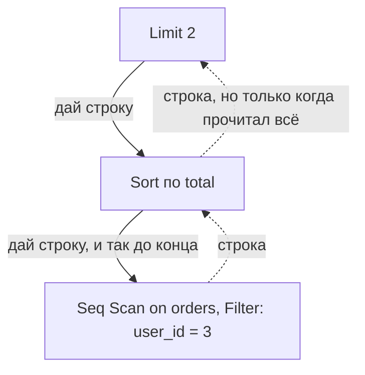
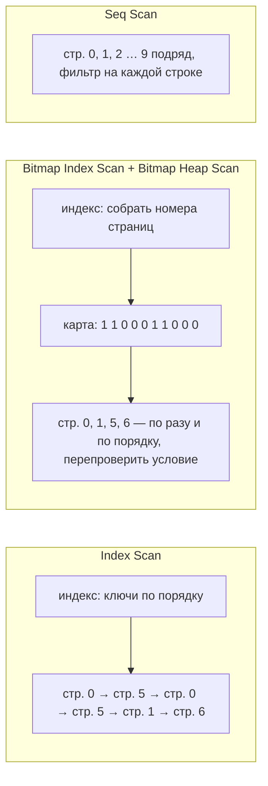
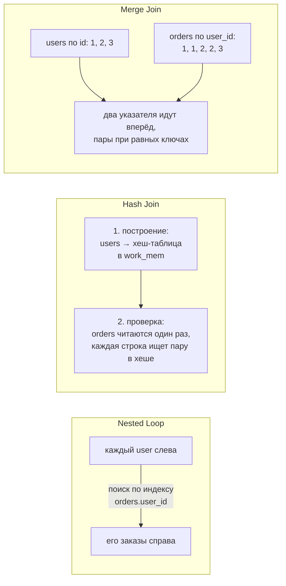

**Суть.** `EXPLAIN` показывает план запроса и *оценки* планировщика, сам запрос не выполняется. `EXPLAIN ANALYZE` *выполняет* запрос и добавляет фактическое время, число строк и число повторов узла (loops). Главный приём диагностики — сравнить оценку `rows` с фактом `actual rows`: большое расхождение значит, что планировщик ошибся в статистике и мог выбрать плохой план.

## Техника: как запускать безопасно

```sql
-- Самый полезный вариант (в PostgreSQL 18 BUFFERS включается вместе с ANALYZE сам)
EXPLAIN (ANALYZE, BUFFERS, VERBOSE, SETTINGS) SELECT ...;

-- DML (INSERT, UPDATE, DELETE) реально изменит данные — запускать только так:
BEGIN;
EXPLAIN ANALYZE DELETE FROM sessions WHERE expires_at < now();
ROLLBACK;

-- В боевой базе тяжёлый запрос можно не дождаться: сначала простой EXPLAIN,
-- либо ANALYZE на копии или реплике с ограничением времени SET statement_timeout
```

## Как читать план

```text
Limit  (cost=0.43..8.91 rows=20 width=64) (actual time=0.031..0.112 rows=20 loops=1)
  Buffers: shared hit=24
  ->  Index Scan using idx_orders_user_created on orders
        (cost=0.43..4210.11 rows=9932 width=64) (actual time=0.029..0.104 rows=20 loops=1)
        Index Cond: (user_id = 42)
Planning Time: 0.15 ms
Execution Time: 0.14 ms
```

Разберём этот план по строкам.

- `cost=0.43..8.91` — оценка стоимости в условных единицах; за единицу принято последовательное чтение одной страницы (`seq_page_cost = 1`). Первое число — сколько стоит выдать первую строку, второе — все строки. Первое важно при `LIMIT`: здесь нужны только 20 строк, поэтому Index Scan остановится задолго до своей полной стоимости `4210`.
- `actual time` и `rows` в скобках `actual` — это значения **на один проход узла (loop)**. Если узел выполнялся много раз, итог получается умножением на `loops`. Узел внутри Nested Loop с `loops=10000` и `time=0.5` на самом деле занял 5 секунд, хотя по цифре кажется мгновенным.
- `Buffers: shared hit=24` — 24 страницы нашлись в кэше Postgres. Если рядом стоит `read`, эти страницы пришлось читать с диска или из кэша операционной системы, а это намного медленнее.

В этом плане их нет, но в других часто встречаются строки, которые прямо подсказывают, что лечить:

- `Rows Removed by Filter` — база прочитала строки и тут же отбросила их по условию. Если отброшенных много, условие стоит покрыть индексом, чтобы такие строки не читать вовсе.
- `Heap Fetches` в узле Index Only Scan — сколько раз базе всё-таки пришлось заглянуть в таблицу. Index Only Scan берёт ответ только из индекса, но верит ему лишь для тех страниц, которые в карте видимости (visibility map, служебный битовый массив) отмечены как «все строки видны всем». Остальные страницы приходится проверять в самой таблице. Карту видимости обновляет `VACUUM`, поэтому после него `Heap Fetches` уменьшается.
- `Sort Method: external merge Disk` — сортировка не поместилась в память, которую ей отводит параметр `work_mem`, и ушла на диск. Помогает индекс, который сразу отдаёт строки в нужном порядке, или больший `work_mem` для этого запроса.

## Узлы плана

План — дерево узлов: каждый узел получает строки от дочерних и передаёт выше. Чаще всего встречаются такие.

| Узел | Что делает | Когда хорош |
| --- | --- | --- |
| Seq Scan | читает всю таблицу подряд | маленькая таблица или нужна большая доля строк |
| Index Scan | идёт по индексу и достаёт строки из таблицы по одной | нужно мало строк или нужен порядок |
| Index Only Scan | берёт всё из индекса | покрывающий индекс и свежий VACUUM |
| Bitmap Index + Heap Scan | сначала собирает по индексу битовую карту нужных страниц, потом читает их подряд | средняя селективность, комбинация нескольких индексов (BitmapAnd, BitmapOr) |
| Nested Loop (вложенные циклы) | для каждой строки слева ищет подходящие справа | слева мало строк, справа есть индекс |
| Hash Join | строит хеш-таблицу по меньшей стороне и ищет в ней строки большей | большие наборы, условие на равенство |
| Merge Join (слияние) | сливает две уже отсортированные последовательности | обе стороны уже отсортированы индексом |

## Как работают узлы: схема и модель в коде

Ниже схемы и модели на Python в несколько строк: как узлы передают строки друг другу, как читают таблицу и как соединяют две таблицы. Модели упрощены, но дают те же эффекты, что видны в реальных планах дальше по странице.

### План — дерево итераторов

Исполнитель Postgres работает «по запросу»: верхний узел просит у дочернего следующую строку, тот — у своего, и так до узла чтения таблицы. Строки поднимаются вверх по одной, а не целыми таблицами. Отсюда две стоимости в `cost=начало..всё`. Большинство узлов отдают первую строку сразу, и тогда `Limit` останавливает работу всего плана рано. А `Sort` и `Hash` — «блокирующие» узлы: прежде чем отдать первую строку, им нужно прочитать всех детей до конца.



```python
stats = {"rows_read": 0}


def seq_scan(table, cond):          # Seq Scan + Filter
    for row in table:
        stats["rows_read"] += 1
        if cond(row):
            yield row               # отдаём строку вверх и ждём, пока попросят следующую


def sort(child, key):               # блокирующий узел: сначала прочитать всё
    rows = list(child)
    rows.sort(key=key)
    yield from rows


def limit(child, n):
    if n == 0:
        return
    for row in child:
        yield row
        n -= 1
        if n == 0:
            return                  # больше не просим строк: нижние узлы просто останавливаются


orders = [{"id": i, "user_id": i % 10, "total": (i * 37) % 100} for i in range(1000)]

list(limit(seq_scan(orders, lambda r: r["user_id"] == 3), 2))
# id 3 и 13, rows_read = 14 — прочитали 14 строк из 1000

stats["rows_read"] = 0
list(limit(sort(seq_scan(orders, lambda r: r["user_id"] == 3), key=lambda r: r["total"]), 2))
# id 73 и 173, rows_read = 1000 — Sort не отдаст ни строки, пока не прочитает таблицу целиком
```

Поэтому `ORDER BY ... LIMIT` без подходящего индекса дорогой: план вынужден отсортировать всё. Индекс по `total` выдаёт строки уже по порядку, Sort исчезает, и `Limit` снова останавливает план рано.

### Seq Scan, Index Scan и Bitmap Heap Scan: в каком порядке читаются страницы

Таблица лежит на страницах по 8 КБ, а индекс хранит ключи по порядку вместе с адресом строки `(страница, позиция)`. Три способа чтения отличаются тем, какие страницы и в каком порядке они читают.



```python
ROWS_PER_PAGE = 4
table = [                           # 10 страниц по 4 строки, user_id разбросаны по таблице
    [{"id": p * ROWS_PER_PAGE + s, "user_id": (p * ROWS_PER_PAGE + s) * 7 % 20} for s in range(ROWS_PER_PAGE)]
    for p in range(10)
]
index = sorted(                     # B-tree по user_id: (ключ, (страница, позиция))
    (row["user_id"], (page_no, slot))
    for page_no, page in enumerate(table)
    for slot, row in enumerate(page)
)
pages_read = []


def read_page(page_no):
    pages_read.append(page_no)
    return table[page_no]


def seq_scan(cond):                 # все страницы подряд
    for page_no in range(len(table)):
        for row in read_page(page_no):
            if cond(row):
                yield row


def index_scan(lo, hi):             # по индексу, и за каждой строкой — в её страницу
    for key, (page_no, slot) in index:
        if key > hi:
            return
        if key >= lo:
            yield read_page(page_no)[slot]


def bitmap_heap_scan(lo, hi):
    bitmap = [False] * len(table)   # Bitmap Index Scan: только отметить нужные страницы
    for key, (page_no, _) in index:
        if lo <= key <= hi:
            bitmap[page_no] = True
    for page_no, needed in enumerate(bitmap):   # Bitmap Heap Scan: страницы по порядку, каждую один раз
        if needed:
            for row in read_page(page_no):
                if lo <= row["user_id"] <= hi:  # Recheck Cond: на странице есть и чужие строки
                    yield row


# WHERE user_id BETWEEN 0 AND 2 — 6 строк:
# seq_scan    → pages_read = [0, 1, 2, 3, 4, 5, 6, 7, 8, 9]
# index_scan  → pages_read = [0, 5, 0, 5, 1, 6], строки по порядку user_id: 0, 0, 1, 1, 2, 2
# bitmap      → pages_read = [0, 1, 5, 6],       строки в порядке страниц: 0, 1, 2, 0, 1, 2
```

Index Scan прыгает по таблице и может читать одну страницу несколько раз, зато отдаёт строки в порядке индекса, поэтому он хорош для пары строк или для `ORDER BY`. Bitmap Heap Scan читает каждую нужную страницу один раз и по порядку, но порядок ключей теряет. Seq Scan читает всё, зато подряд, а последовательное чтение дешевле случайного (`seq_page_cost = 1` против `random_page_cost = 4`). Когда нужных страниц становится больше заметной доли таблицы, планировщик выбирает Seq Scan.

### Nested Loop, Hash Join и Merge Join

Три способа найти пары `users.id = orders.user_id`. Все дают одни и те же пары, но разной ценой и в разном порядке.



```python
users = [{"id": i} for i in (1, 2, 3)]
orders = [{"id": 10 + i, "user_id": u} for i, u in enumerate([2, 1, 3, 2, 1])]


def nested_loop(outer, inner_lookup):       # цена ≈ строк слева × поиск справа
    for u in outer:
        for o in inner_lookup(u["id"]):
            yield u["id"], o["id"]


def hash_join(build, probe):                # цена ≈ одно чтение каждой стороны + память под хеш
    table = {}
    for u in build:                         # Hash: меньшая сторона целиком в память
        table.setdefault(u["id"], []).append(u)
    for o in probe:                         # большая сторона — один проход
        for u in table.get(o["user_id"], []):
            yield u["id"], o["id"]


def merge_join(left, right):                # обе стороны уже отсортированы по ключу
    i = j = 0
    while i < len(left) and j < len(right):
        a, b = left[i]["id"], right[j]["user_id"]
        if a < b:
            i += 1
        elif a > b:
            j += 1
        else:
            k = j                           # все строки справа с этим ключом
            while k < len(right) and right[k]["user_id"] == a:
                yield a, right[k]["id"]
                k += 1
            i += 1


orders_by_user = {}                         # роль индекса по orders.user_id
for o in orders:
    orders_by_user.setdefault(o["user_id"], []).append(o)

list(nested_loop(users, lambda uid: orders_by_user.get(uid, [])))
# [(1, 11), (1, 14), (2, 10), (2, 13), (3, 12)] — в порядке левой стороны
list(hash_join(users, orders))
# [(2, 10), (1, 11), (3, 12), (2, 13), (1, 14)] — в порядке большой стороны, по ключу не отсортировано
list(merge_join(users, sorted(orders, key=lambda o: o["user_id"])))
# [(1, 11), (1, 14), (2, 10), (2, 13), (3, 12)] — сразу по ключу
```

Отсюда выбор планировщика. Nested Loop выгоден, когда слева мало строк, а справа есть индекс: при 19 пользователях это 19 поисков. Hash Join выгоден для больших наборов с условием на равенство: каждая сторона читается один раз, но меньшая должна поместиться в `work_mem`, иначе хеш разбивается на части (`Batches` больше 1) и уходит на диск. Merge Join выгоден, когда обе стороны уже отсортированы индексом и результат нужен по порядку ключа: он не держит хеш в памяти и не требует сортировки после.

## Техника: Seq Scan, Index Scan и Bitmap Heap Scan на одной таблице

Таблица `orders` на миллион строк (57 МБ, 7353 страницы), индексы по `id` (первичный ключ) и по `user_id`; `max_parallel_workers_per_gather = 0`, чтобы план не обрастал `Gather`. Одно и то же `SELECT *` читает таблицу тремя способами в зависимости от того, сколько строк нужно и как они лежат:

```sql
EXPLAIN (ANALYZE) SELECT * FROM orders WHERE status = 'shipped';   -- 66% таблицы
```

```text title="Вывод"
Seq Scan on orders  (cost=0.00..19856.00 rows=663567 width=29) (actual time=0.003..38.882 rows=660000 loops=1)
  Filter: (status = 'shipped'::text)
  Rows Removed by Filter: 340000
Execution Time: 49.921 ms
```

```sql
EXPLAIN (ANALYZE) SELECT * FROM orders WHERE id = 500000;           -- одна строка
```

```text title="Вывод"
Index Scan using orders_pkey on orders  (cost=0.42..8.44 rows=1 width=29) (actual time=0.002..0.002 rows=1 loops=1)
  Index Cond: (id = 500000)
Execution Time: 0.004 ms
```

```sql
EXPLAIN (ANALYZE) SELECT * FROM orders WHERE user_id BETWEEN 1 AND 100;   -- 1000 строк, разбросаны по всей таблице
```

```text title="Вывод"
Bitmap Heap Scan on orders  (cost=19.22..2888.98 rows=1053 width=29) (actual time=0.086..0.350 rows=1000 loops=1)
  Recheck Cond: ((user_id >= 1) AND (user_id <= 100))
  Heap Blocks: exact=993
  ->  Bitmap Index Scan on idx_orders_user  (cost=0.00..18.96 rows=1053 width=0) (actual time=0.036..0.036 rows=1000 loops=1)
        Index Cond: ((user_id >= 1) AND (user_id <= 100))
Execution Time: 0.370 ms
```

Index Scan ходит в таблицу за каждой строкой отдельно, что хорошо для одной строки. Bitmap Heap Scan сначала собирает по индексу карту нужных страниц (`Bitmap Index Scan`), потом читает каждую страницу один раз, подряд. Строки здесь разбросаны, и 1000 строк лежат на 993 разных страницах (`Heap Blocks: exact=993`), поэтому порядок чтения важнее порядка в индексе. `Recheck Cond` — повторная проверка условия на прочитанной странице: бывает нужна, если карта уменьшилась до целых страниц. Если расширить диапазон до `BETWEEN 1 AND 5000` (5% таблицы), останется тот же Bitmap Heap Scan, но уже с `Heap Blocks: exact=7356`: он почти полностью прочитает таблицу, и планировщик вот-вот переключится на Seq Scan.

## Техника: Nested Loop, Hash Join и Merge Join

Один и тот же запрос на соединение `users` (100 тыс. строк) и `orders` (1 млн строк) по `o.user_id = u.id` получает три разных алгоритма, меняется только условие.

Одна строка слева — Nested Loop: для найденного пользователя достаточно один раз заглянуть в индекс заказов.

```sql
EXPLAIN (ANALYZE) SELECT u.id, o.total FROM users u JOIN orders o ON o.user_id = u.id WHERE u.id < 20;
```

```text title="Вывод"
Nested Loop  (cost=4.79..877.07 rows=199 width=10) (actual time=0.004..0.087 rows=190 loops=1)
  ->  Index Only Scan using users_pkey on users u  (cost=0.29..4.64 rows=20 width=4) (actual time=0.001..0.002 rows=19 loops=1)
        Index Cond: (id < 20)
        Heap Fetches: 0
  ->  Bitmap Heap Scan on orders o  (cost=4.50..43.52 rows=10 width=10) (actual time=0.001..0.004 rows=10 loops=19)
        Recheck Cond: (u.id = user_id)
        Heap Blocks: exact=190
        ->  Bitmap Index Scan on idx_orders_user  (cost=0.00..4.50 rows=10 width=0) (actual time=0.001..0.001 rows=10 loops=19)
              Index Cond: (user_id = u.id)
Execution Time: 0.093 ms
```

Обратите внимание на `loops=19`: нижний узел выполнился 19 раз, по разу на пользователя, а `actual time` в нём — на один проход. Если условие отобрать пять тысяч пользователей (`u.id < 5000`), 5000 проходов по индексу стали бы дороже одного чтения таблицы, и план меняется на Hash Join:

```sql
EXPLAIN (ANALYZE) SELECT u.id, o.total FROM users u JOIN orders o ON o.user_id = u.id WHERE u.id < 5000;
```

```text title="Вывод"
Hash Join  (cost=213.71..20194.82 rows=50990 width=10) (actual time=0.416..69.906 rows=49990 loops=1)
  Hash Cond: (o.user_id = u.id)
  ->  Seq Scan on orders o  (cost=0.00..17356.00 rows=1000000 width=10) (actual time=0.003..28.371 rows=1000000 loops=1)
  ->  Hash  (cost=149.79..149.79 rows=5114 width=4) (actual time=0.409..0.410 rows=4999 loops=1)
        Buckets: 8192  Batches: 1  Memory Usage: 240kB
        ->  Index Only Scan using users_pkey on users u  (cost=0.29..149.79 rows=5114 width=4) (actual time=0.004..0.212 rows=4999 loops=1)
              Index Cond: (id < 5000)
              Heap Fetches: 0
Execution Time: 70.716 ms
```

Меньшая сторона (5000 пользователей) превращается в хеш-таблицу (`Hash`, `Batches: 1` — она поместилась в `work_mem`), большая читается один раз подряд и ищет пару в хеше. Merge Join появляется, когда обе стороны можно получить уже отсортированными по ключу, например при `ORDER BY u.id` без фильтра:

```sql
EXPLAIN (ANALYZE) SELECT u.id, o.total FROM users u JOIN orders o ON o.user_id = u.id ORDER BY u.id;
```

```text title="Вывод"
Merge Join  (cost=1.15..64374.62 rows=997059 width=10) (actual time=0.007..348.810 rows=1000000 loops=1)
  Merge Cond: (u.id = o.user_id)
  ->  Index Only Scan using users_pkey on users u  (cost=0.29..2604.29 rows=100000 width=4) (actual time=0.003..4.000 rows=100000 loops=1)
        Heap Fetches: 0
  ->  Index Scan using idx_orders_user on orders o  (cost=0.42..49052.42 rows=1000000 width=10) (actual time=0.002..275.607 rows=1000000 loops=1)
Execution Time: 364.056 ms
```

Оба индекса отдают строки по порядку, сортировка не нужна: Merge Join выбран, потому что выдаёт результат уже упорядоченным по `u.id`, а после Hash Join миллион строк пришлось бы ещё сортировать. Без `ORDER BY` тот же запрос идёт Hash Join'ом (132 мс на этой машине): Merge Join хорош не скоростью самой по себе, а готовым порядком и отсутствием хеш-таблицы в памяти.

## Техника: оценка rows до и после ANALYZE

Таблица `events` из 500 тыс. строк только что заполнена, статистики по ней ещё нет (автоанализ отключён, чтобы показать момент «до»). Запрос `WHERE id < 100`:

```sql
CREATE TABLE events (id int, kind text) WITH (autovacuum_enabled = false);
INSERT INTO events SELECT g, 'x' FROM generate_series(1, 500000) g;
CREATE INDEX ON events (id);

EXPLAIN (ANALYZE) SELECT * FROM events WHERE id < 100;
```

```text title="Вывод"
Bitmap Heap Scan on events  (cost=3128.09..7424.43 rows=166667 width=36) (actual time=0.014..0.016 rows=99 loops=1)
  Recheck Cond: (id < 100)
  Heap Blocks: exact=1
  ->  Bitmap Index Scan on events_id_idx  (cost=0.00..3086.43 rows=166667 width=0) (actual time=0.010..0.010 rows=99 loops=1)
        Index Cond: (id < 100)
Execution Time: 0.030 ms
```

Оценка `rows=166667` против фактических 99: без статистики планировщик подставляет «треть таблицы» для любого неравенства. После `ANALYZE events`:

```text title="Вывод"
Index Scan using events_id_idx on events  (cost=0.42..10.19 rows=101 width=6) (actual time=0.002..0.007 rows=99 loops=1)
  Index Cond: (id < 100)
Execution Time: 0.012 ms
```

Оценка `rows=101`, план сменился на Index Scan. Здесь запрос быстрый в обоих случаях (строк мало), но в соединении такая ошибка в оценке уводит планировщика к неудачному алгоритму.

Отдельный случай — связанные колонки. В `addresses` 200 тыс. адресов, у каждого города одна страна, а планировщик считает колонки независимыми:

```sql
EXPLAIN (ANALYZE) SELECT * FROM addresses WHERE city = 'Москва' AND country = 'Россия';
```

```text title="Вывод"
Seq Scan on addresses  (cost=0.00..4489.00 rows=3311 width=28) (actual time=0.002..6.341 rows=12500 loops=1)
  Filter: ((city = 'Москва'::text) AND (country = 'Россия'::text))
  Rows Removed by Filter: 187500
```

Оценка `3311` вместо `12500`: вероятности двух условий перемножены. Расширенная статистика сообщает планировщику, что колонки зависимы:

```sql
CREATE STATISTICS addr_city_country (dependencies) ON city, country FROM addresses;
ANALYZE addresses;
EXPLAIN (ANALYZE) SELECT * FROM addresses WHERE city = 'Москва' AND country = 'Россия';
```

```text title="Вывод"
Seq Scan on addresses  (cost=0.00..4489.00 rows=12373 width=29) (actual time=0.002..6.442 rows=12500 loops=1)
  Filter: ((city = 'Москва'::text) AND (country = 'Россия'::text))
  Rows Removed by Filter: 187500
```

Оценка стала `12373` при фактических `12500`.

## Типичные проблемы и лечение

- **Планировщик ждал одну строку, а пришло сто тысяч.** В плане `rows=1`, а `actual rows=100000`. Решив, что строка будет одна, планировщик выбрал Nested Loop: для каждой строки слева он ищет пары справа, и на одной строке это идеальный план. На ста тысячах тот же план идёт минутами, а Hash Join справился бы за секунды. Причина почти всегда в статистике. Сначала её пересчитывают командой `ANALYZE table`. Если не помогло, просят собирать по колонке более подробную статистику: `ALTER TABLE ... ALTER COLUMN ... SET STATISTICS 1000`. Отдельный случай — связанные колонки. Планировщик считает их независимыми и перемножает вероятности, поэтому для `city = 'Москва' AND country = 'Россия'` сильно занижает оценку. Здесь помогает `CREATE STATISTICS (dependencies) ON city, country FROM addresses`: она сообщает планировщику, что колонки связаны.
- **Общий план у подготовленных запросов.** Prepared statement — запрос, который разбирают один раз, а потом выполняют много раз с разными параметрами. Первые пять выполнений Postgres планирует под конкретные значения. Если по оценке общий план (generic plan), не учитывающий значения параметров, выходит не сильно дороже, дальше база использует его. Для типичных значений такой план хорош, а для редких может быть плохим: например, для крупного клиента с миллионом заказов. Поведением управляет параметр `plan_cache_mode`.
- **В консоли запрос быстрый, а в приложении медленный.** Значит, приложение выполняет не совсем тот же запрос. Стоит проверить три вещи: те ли значения параметров, не сработал ли общий план из предыдущего пункта и тот ли тип у параметров. ORM (библиотека, которая отображает таблицы на объекты кода) может передать число как `numeric` вместо `bigint`, и индекс перестанет подходить (см. [[Индексы#Когда индекс НЕ используется]]).

## Смежное: как найти, что оптимизировать

Оптимизировать стоит не самый долгий запрос, а тот, который в сумме отнимает у базы больше всего времени. Расширение `pg_stat_statements` копит статистику по каждому запросу, и такой топ получается одним `SELECT`:

```sql
-- Топ запросов по суммарному времени (а не по самому долгому!)
SELECT query, calls, round(total_exec_time) AS total_ms, round(mean_exec_time, 1) AS mean_ms
FROM pg_stat_statements
ORDER BY total_exec_time DESC LIMIT 10;
```

Кроме него, медленные запросы помогают ловить ещё три инструмента. Расширение `auto_explain` само пишет в лог планы запросов дольше заданного порога, так что план виден даже для запроса, который в консоли не воспроизводится. Параметр `log_min_duration_statement` пишет в лог сами такие запросы. А визуализаторы explain.dalibo.com и explain.depesz.com раскладывают большой план в наглядную схему и подсвечивают самые дорогие узлы.

## Бизнес-кейс

«После запуска акции личный кабинет тормозит». Первое желание — найти самый медленный запрос, но обычно виноват не он. Запрос на 10 мс, выполненный миллион раз, нагружает базу сильнее, чем отчёт на 10 секунд раз в день. Порядок работы такой:

1. Открыть `pg_stat_statements` и найти запросы с наибольшим суммарным временем.
2. Разобрать самый тяжёлый через `EXPLAIN ANALYZE`.
3. Выбрать лечение: индекс, переписанный запрос или кэш.

Часто причина — не сам запрос, а N+1 в ORM: один запрос за списком и ещё по запросу на каждый элемент списка.
