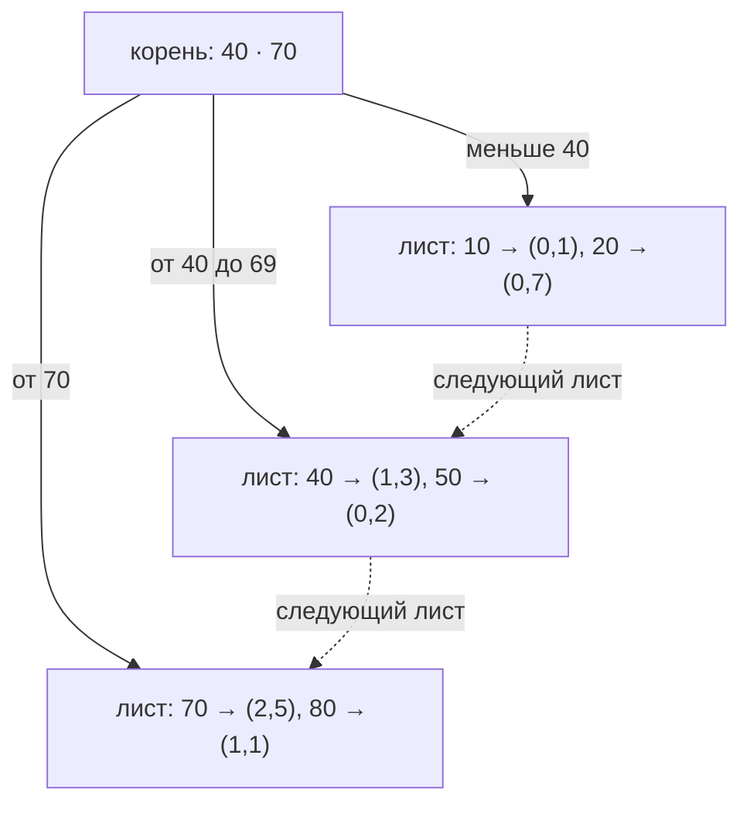
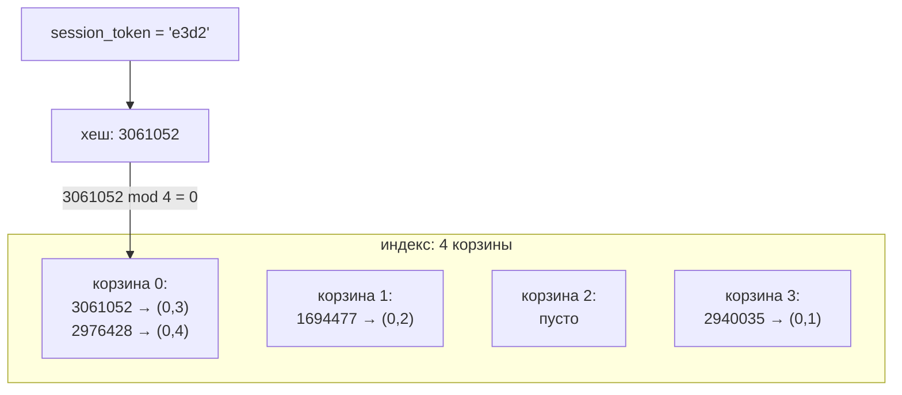
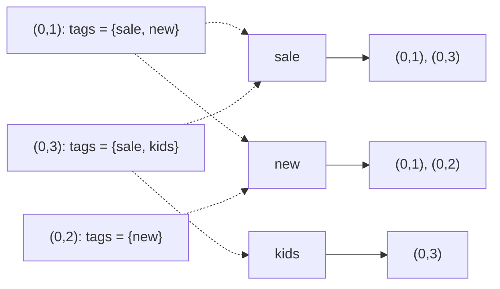
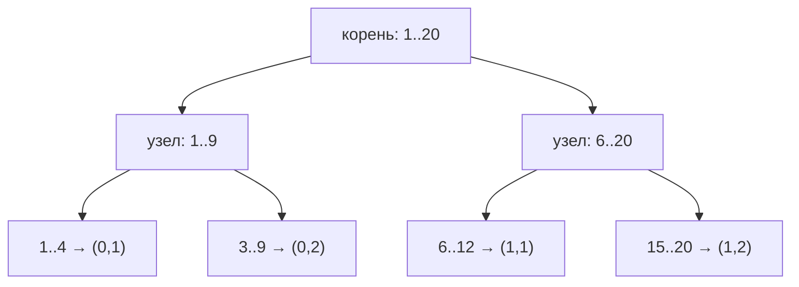
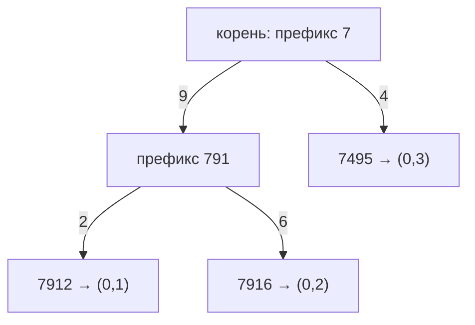
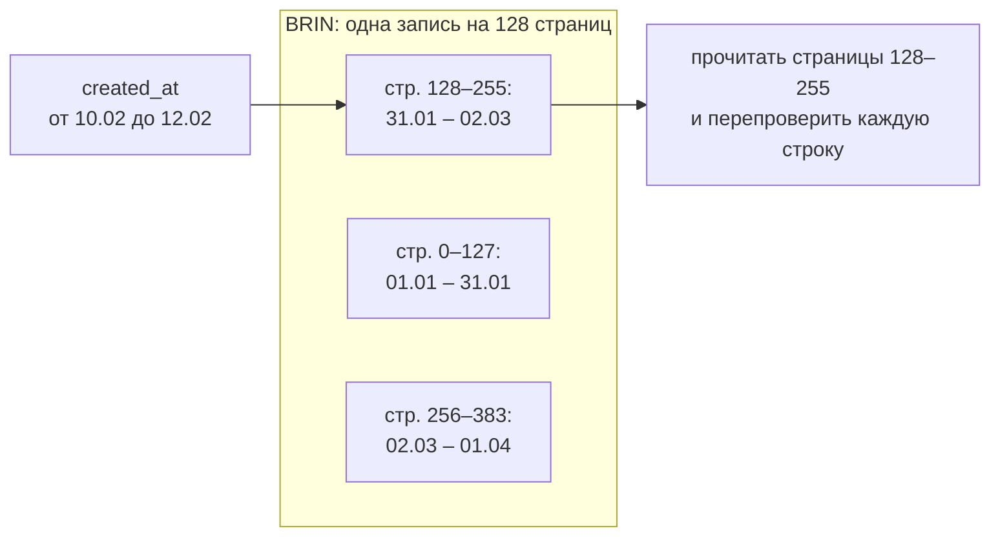

**Суть.** Индекс — отдельная структура данных рядом с таблицей, которая ускоряет поиск: вместо того чтобы просматривать всю таблицу, база идёт по индексу прямо к нужным строкам. Платить за это приходится дважды: каждая запись в таблицу обновляет и все её индексы, а сами индексы занимают место на диске и в памяти. Поэтому индекс заводят не «на всякий случай на каждую колонку», а под конкретные запросы: смотрят, по каким условиям фильтруют и в каком порядке сортируют, и строят индекс, который отвечает именно на них.

## Типы индексов PostgreSQL

| Тип | Операции | Когда брать | Пример |
| --- | --- | --- | --- |
| B-tree (сбалансированное дерево) | `=`, `<`, `>`, `BETWEEN`, `IN`, `ORDER BY`, `LIKE 'abc%'` (только при collation `C` — правилах сравнения строк «по байтам» — или с `text_pattern_ops`), `IS NULL` | по умолчанию, примерно в 90% случаев | `CREATE INDEX ON orders (user_id, created_at)` |
| Hash (хеш-таблица) | только `=` | длинные ключи, поиск только на равенство; редко | `USING hash (session_token)` |
| GIN (Generalized Inverted Index, обобщённый обратный индекс) | `@>`, `?`, `&&`, `@@` | jsonb, массивы, полнотекстовый поиск, триграммы | `USING gin (tags)` |
| GiST (Generalized Search Tree, обобщённое дерево поиска) | `&&`, `<->`, `@>` для геометрии и диапазонов | геоданные, диапазоны, поиск ближайших соседей (KNN, k nearest neighbors), ограничения `EXCLUDE` | `USING gist (during)` |
| SP-GiST (Space-Partitioned GiST, GiST с разбиением пространства) | несбалансированные деревья | IP-адреса, телефонные префиксы | `USING spgist (ip inet_ops)` |
| BRIN (Block Range Index, индекс по диапазонам блоков) | диапазоны значений по блокам таблицы | гигантские таблицы, куда только дописывают, и значения коррелируют с физическим порядком строк | `USING brin (created_at)`: килобайты вместо гигабайт |

## Как устроен каждый тип: схема и модель в коде

Любой индекс в итоге выдаёт адреса строк в таблице — `ctid` вида `(страница, номер строки на странице)`, например `(0,7)`. Ниже для каждого типа: схема того, что лежит в индексе, и модель на Python в несколько строк — что хранится и как идёт поиск. Модели упрощены: в Postgres узлы — это страницы по 8 КБ, и строки после индекса ещё проверяются на видимость (MVCC).

### B-tree

Сбалансированное дерево: все листья на одной глубине, ключи в листьях отсортированы, а листья связаны в цепочку. Внутренние узлы хранят только ключи-разделители, по которым спускаются к нужному листу.



```python
leaves = [                          # отсортированные листья: (ключ, ctid)
    [(10, "(0,1)"), (20, "(0,7)")],
    [(40, "(1,3)"), (50, "(0,2)")],
    [(70, "(2,5)"), (80, "(1,1)")],
]
root = [40, 70]                     # первый ключ второго и третьего листа


def find_leaf(key):                 # спуск от корня: O(log n) страниц
    i = 0
    while i < len(root) and key >= root[i]:
        i += 1
    return i


def range_scan(lo, hi):             # WHERE k BETWEEN lo AND hi
    out = []
    for leaf in leaves[find_leaf(lo):]:     # дальше идём по цепочке листьев
        for key, tid in leaf:
            if key > hi:
                return out
            if key >= lo:
                out.append((key, tid))
    return out


range_scan(15, 45)  # [(20, '(0,7)'), (40, '(1,3)')] — уже по порядку, ORDER BY бесплатно
```

Отсюда все свойства B-tree: равенство и диапазон — спуск и проход по листьям, сортировка — порядок листьев, составной индекс `(a, b)` — сортировка сначала по `a`, а внутри по `b`, поэтому без условия на `a` спускаться некуда.

### Hash

Массив корзин. Ключ прогоняется через хеш-функцию, номер корзины — остаток от деления хеша на их число. В корзине лежит 32-битный хеш-код и `ctid`, а самого ключа нет. Поэтому индекс компактен для длинных ключей, но умеет только `=`: у соседних значений хеши никак не связаны, и порядка нет.



```python
N_BUCKETS = 4
buckets = [[] for _ in range(N_BUCKETS)]


def h32(key):                       # игрушечная хеш-функция вместо hashtext из Postgres
    h = 0
    for ch in key:
        h = (h * 31 + ord(ch)) % 2**32
    return h


def insert(key, tid):
    h = h32(key)
    buckets[h % N_BUCKETS].append((h, tid))     # хранится хеш, не ключ


def lookup(key):                    # WHERE session_token = key
    h = h32(key)
    return [tid for code, tid in buckets[h % N_BUCKETS] if code == h]
    # совпал хеш — строку ещё перепроверят в таблице: у разных ключей хеш может совпасть


for i, token in enumerate(["a1f9", "77c0", "e3d2", "b8b8"]):
    insert(token, f"(0,{i + 1})")
lookup("e3d2")  # ['(0,3)']
```

### GIN

«Обратный» индекс, как предметный указатель в конце книги: для каждого элемента (ключа jsonb, слова текста, значения массива, триграммы) хранится отсортированный список строк, где он встречается. Поэтому GIN хорошо отвечает на вопрос «в каких строках есть вот это». Обновляется он медленно: одна строка с десятью тегами — это десять вставок в разные списки. Чтобы сгладить это, Postgres сначала копит новые записи в «списке ожидания» (`fastupdate`) и переносит их в основную структуру при `VACUUM`.



```python
rows = {
    "(0,1)": ["sale", "new"],
    "(0,2)": ["new"],
    "(0,3)": ["sale", "kids"],
}

gin = {}                            # элемент → список ctid
for tid, tags in rows.items():
    for tag in tags:
        gin.setdefault(tag, []).append(tid)
# {'sale': ['(0,1)', '(0,3)'], 'new': ['(0,1)', '(0,2)'], 'kids': ['(0,3)']}


def contains_all(wanted):           # WHERE tags @> ARRAY['sale', 'new']
    result = set(gin.get(wanted[0], []))
    for tag in wanted[1:]:
        result &= set(gin.get(tag, []))         # пересечение списков
    return sorted(result)


contains_all(["sale", "new"])  # ['(0,1)']
```

### GiST

Сбалансированное дерево, где каждый внутренний узел хранит «обобщение» всех своих детей: для диапазонов — объединяющий диапазон, для геометрии — охватывающий прямоугольник. Обобщения соседних узлов могут пересекаться, поэтому поиск иногда спускается сразу в несколько веток. Что такое «обобщение» и «пересекается», задаёт класс операторов типа, а дерево одно на все случаи — отсюда «обобщённое».



Запрос `during && 7..8` пересекается и с `1..9`, и с `6..20` — поиск идёт в обе ветки.

```python
tree = {
    "bound": (1, 20),
    "children": [
        {"bound": (1, 9), "children": [((1, 4), "(0,1)"), ((3, 9), "(0,2)")]},
        {"bound": (6, 20), "children": [((6, 12), "(1,1)"), ((15, 20), "(1,2)")]},
    ],
}


def overlaps(a, b):                 # оператор && для диапазонов
    return a[0] <= b[1] and b[0] <= a[1]


def search(node, q):                # WHERE during && q
    out = []
    for child in node["children"]:
        if isinstance(child, dict):             # внутренний узел: спускаемся, если обобщение задевает запрос
            if overlaps(child["bound"], q):
                out += search(child, q)
        else:                                   # лист: (диапазон, ctid)
            rng, tid = child
            if overlaps(rng, q):
                out.append(tid)
    return out


search(tree, (7, 8))    # ['(0,2)', '(1,1)'] — прошли обе ветки
search(tree, (16, 17))  # ['(1,2)'] — левая ветка отсечена по обобщению 1..9
```

Тот же принцип даёт поиск ближайших соседей (`ORDER BY point <-> 'точка' LIMIT 5`): дерево обходят, начиная с узлов, чьё обобщение ближе к точке.

### SP-GiST

Дерево, которое делит пространство на непересекающиеся части: префиксное дерево для строк и IP-адресов, квадродерево для точек. В отличие от GiST, каждое значение попадает ровно в одну ветку, зато дерево не сбалансировано: ветка, куда попало много значений с общим префиксом, вырастает глубже других.



В Postgres узел хранит общий префикс целиком (радиксное дерево, как на схеме). Модель ниже проще — по одному символу на уровень:

```python
trie = {}


def insert(key, tid):
    node = trie
    for ch in key:
        node = node.setdefault(ch, {})
    node.setdefault("$", []).append(tid)        # "$" — конец ключа


def starts_with(prefix):            # WHERE phone ^@ '791'
    node = trie
    for ch in prefix:               # спуск по префиксу: другие ветки не трогаем вовсе
        if ch not in node:
            return []
        node = node[ch]
    out, stack = [], [node]         # всё поддерево под префиксом — ответ
    while stack:
        for key, child in stack.pop().items():
            if key == "$":
                out += child
            else:
                stack.append(child)
    return sorted(out)


for tid, phone in [("(0,1)", "7912"), ("(0,2)", "7916"), ("(0,3)", "7495")]:
    insert(phone, tid)
starts_with("791")  # ['(0,1)', '(0,2)']
```

### BRIN

Индекс не по строкам, а по диапазонам страниц таблицы: на каждые `pages_per_range` страниц (по умолчанию 128) хранится одна запись — минимум и максимум значения в них. Поиск отбрасывает диапазоны, куда искомое значение не попадает, а оставшиеся страницы читает целиком и проверяет каждую строку (в плане это `Bitmap Heap Scan` с `Rows Removed by Index Recheck`). Индекс крошечный, но полезен, только если значения лежат в таблице примерно по порядку, как время создания в таблице логов.



```python
PAGES_PER_RANGE = 128

brin = [                            # (первая страница диапазона, минимум, максимум)
    (0, "2026-01-01", "2026-01-31"),
    (128, "2026-01-31", "2026-03-02"),
    (256, "2026-03-02", "2026-04-01"),
]


def pages_to_read(lo, hi):          # WHERE created_at BETWEEN lo AND hi
    out = []
    for start, lo_val, hi_val in brin:
        if lo_val <= hi and lo <= hi_val:
            out.append((start, start + PAGES_PER_RANGE - 1))
    return out


pages_to_read("2026-02-10", "2026-02-12")  # [(128, 255)] — вместо всей таблицы
# Если строки перемешаны, у каждого диапазона минимум ≈ январь, максимум ≈ декабрь:
# под условие попадают все диапазоны, и индекс ничего не отсекает.
```

## Техника: виды B-tree индексов

```sql
-- Составной: сначала колонки с равенством, потом с диапазоном или сортировкой
CREATE INDEX idx_orders_user_created ON orders (user_id, created_at DESC);
-- работает:  WHERE user_id = 5 ORDER BY created_at DESC LIMIT 20
-- работает:  WHERE user_id = 5
-- НЕ работает эффективно: WHERE created_at > now() - '1 day' (нет условия по левому префиксу, то есть по первой колонке)

-- Частичный: индексируем только горячую часть таблицы
CREATE INDEX idx_orders_pending ON orders (created_at) WHERE status = 'pending';

-- Уникальность с условием (мягкое удаление: удалённые строки не мешают занять email повторно)
CREATE UNIQUE INDEX uq_users_email ON users (lower(email)) WHERE deleted_at IS NULL;

-- Покрывающий: index-only scan, то есть ответ целиком из индекса, без обращения к таблице
CREATE INDEX idx_orders_user_cover ON orders (user_id) INCLUDE (status, total);

-- По выражению: запрос должен содержать РОВНО это выражение
CREATE INDEX idx_users_email_lower ON users (lower(email));
-- WHERE lower(email) = 'a@b.c'  -- используется
-- WHERE email ILIKE 'a@b.c'     -- НЕТ

-- Поиск по подстроке: расширение pg_trgm режет текст на триграммы (куски по три символа) и ищет по ним
CREATE EXTENSION pg_trgm;
CREATE INDEX idx_products_name_trgm ON products USING gin (name gin_trgm_ops);
-- WHERE name ILIKE '%телефон%' — теперь по индексу
-- (для кириллицы нужна UTF-8 локаль базы: при LC_CTYPE=C pg_trgm не считает её буквами)

-- В рабочей (боевой) базе индекс создают только так.
-- CONCURRENTLY («без блокировки записи») строит индекс в фоне, не останавливая INSERT, UPDATE и DELETE.
-- Цена: построение дольше и его нельзя выполнять внутри транзакции.
CREATE INDEX CONCURRENTLY ...;
-- Если построение оборвалось, остаётся неисправный индекс со статусом INVALID: его нужно удалить через DROP и построить заново
```

## Техника: планы до и после индекса

Все примеры идут на PostgreSQL 17 с такими данными (числа времени и буферов — с одной машины, у вас будут другие, важны порядки величин):

```sql
-- users: 100 тыс. строк; orders: 1 млн строк, у каждого user_id по 10 заказов, 1% заказов в статусе pending
CREATE TABLE users  (id int PRIMARY KEY, email text NOT NULL, country text NOT NULL, created_at timestamptz NOT NULL);
CREATE TABLE orders (id int PRIMARY KEY, user_id int NOT NULL, status text NOT NULL, created_at timestamptz NOT NULL, total numeric(10,2) NOT NULL);
-- заполнено через generate_series, затем VACUUM ANALYZE; для читаемости планов: SET max_parallel_workers_per_gather = 0;
```

**Без индекса и с индексом.** Заказы одного пользователя:

```sql
EXPLAIN (ANALYZE, BUFFERS) SELECT * FROM orders WHERE user_id = 42;
```

```text title="Вывод"
Seq Scan on orders  (cost=0.00..19853.00 rows=10 width=28) (actual time=0.706..26.927 rows=10 loops=1)
  Filter: (user_id = 42)
  Rows Removed by Filter: 999990
  Buffers: shared hit=7353
Execution Time: 26.949 ms
```

```sql
CREATE INDEX idx_orders_user ON orders (user_id);
EXPLAIN (ANALYZE, BUFFERS) SELECT * FROM orders WHERE user_id = 42;
```

```text title="Вывод"
Bitmap Heap Scan on orders  (cost=4.50..43.52 rows=10 width=28) (actual time=0.019..0.035 rows=10 loops=1)
  Recheck Cond: (user_id = 42)
  Heap Blocks: exact=10
  Buffers: shared hit=10 read=3
  ->  Bitmap Index Scan on idx_orders_user  (cost=0.00..4.50 rows=10 width=0) (actual time=0.014..0.014 rows=10 loops=1)
        Index Cond: (user_id = 42)
        Buffers: shared read=3
Execution Time: 0.047 ms
```

Таблица занимает 7353 страницы, и без индекса Postgres прочитал их все и отбросил 999 990 строк. С индексом хватило 13 страниц, а время упало с 27 мс до 0,05 мс.

**Составной индекс и порядок колонок.** Индекс `(user_id, created_at DESC)` весит 30 МБ при таблице в 57 МБ. Он работает, когда в условии есть первая колонка:

```sql
CREATE INDEX idx_orders_user_created ON orders (user_id, created_at DESC);
EXPLAIN (ANALYZE, BUFFERS)
SELECT * FROM orders WHERE user_id = 42 AND created_at >= '2026-06-01';
```

```text title="Вывод"
Bitmap Heap Scan on orders  (cost=4.49..28.06 rows=6 width=29) (actual time=0.004..0.006 rows=5 loops=1)
  Recheck Cond: ((user_id = 42) AND (created_at >= '2026-06-01 00:00:00+00'::timestamp with time zone))
  Heap Blocks: exact=5
  Buffers: shared hit=8
  ->  Bitmap Index Scan on idx_orders_user_created  (cost=0.00..4.48 rows=6 width=0) (actual time=0.002..0.002 rows=5 loops=1)
        Index Cond: ((user_id = 42) AND (created_at >= '2026-06-01 00:00:00+00'::timestamp with time zone))
        Buffers: shared hit=3
Execution Time: 0.008 ms
```

А запрос только по второй колонке этот индекс не использует, хотя отбирает всего 20 строк из миллиона (на PostgreSQL 17 skip scan'а ещё нет):

```sql
EXPLAIN (ANALYZE, BUFFERS)
SELECT * FROM orders WHERE created_at >= '2026-06-01' AND created_at < '2026-06-01 00:10';
```

```text title="Вывод"
Seq Scan on orders  (cost=0.00..22353.00 rows=19 width=29) (actual time=9.791..24.425 rows=20 loops=1)
  Filter: ((created_at >= '2026-06-01 00:00:00+00'::timestamp with time zone) AND (created_at < '2026-06-01 00:10:00+00'::timestamp with time zone))
  Rows Removed by Filter: 999980
  Buffers: shared hit=7353
Execution Time: 24.431 ms
```

**Частичный индекс.** Просроченные «зависшие» заказы: статус `pending` у 1% строк.

```sql
EXPLAIN (ANALYZE, BUFFERS)
SELECT * FROM orders WHERE status = 'pending' AND created_at >= '2026-12-01';   -- 381 строка, Seq Scan: 24 мс

CREATE INDEX idx_orders_pending ON orders (created_at) WHERE status = 'pending';
EXPLAIN (ANALYZE, BUFFERS)
SELECT * FROM orders WHERE status = 'pending' AND created_at >= '2026-12-01';
```

```text title="Вывод"
Index Scan using idx_orders_pending on orders  (cost=0.29..20.83 rows=374 width=29) (actual time=0.005..0.062 rows=381 loops=1)
  Index Cond: (created_at >= '2026-12-01 00:00:00+00'::timestamp with time zone)
  Buffers: shared hit=283
Execution Time: 0.074 ms
```

Условие `status = 'pending'` в `Index Cond` нет: оно уже вшито в сам индекс. Размеры: частичный индекс — 240 КБ, такой же по всем строкам `(created_at)` — 21 МБ.

**Индекс по выражению.** Поиск без учёта регистра по `users.email` (адреса вида `User777@Example.com`). Обычный индекс по `email` для `lower(email) = ...` бесполезен, нужен индекс по самому выражению:

```sql
CREATE INDEX idx_users_email ON users (email);
EXPLAIN (ANALYZE) SELECT * FROM users WHERE lower(email) = 'user777@example.com';
-- Seq Scan on users ... Rows Removed by Filter: 99999, Execution Time: 13.774 ms

CREATE INDEX idx_users_email_lower ON users (lower(email));
EXPLAIN (ANALYZE, BUFFERS) SELECT * FROM users WHERE lower(email) = 'user777@example.com';
```

```text title="Вывод"
Bitmap Heap Scan on users  (cost=16.29..779.05 rows=500 width=36) (actual time=0.005..0.005 rows=1 loops=1)
  Recheck Cond: (lower(email) = 'user777@example.com'::text)
  Heap Blocks: exact=1
  Buffers: shared hit=4
  ->  Bitmap Index Scan on idx_users_email_lower  (cost=0.00..16.17 rows=500 width=0) (actual time=0.004..0.004 rows=1 loops=1)
        Index Cond: (lower(email) = 'user777@example.com'::text)
        Buffers: shared hit=3
Execution Time: 0.016 ms
```

Обратите внимание на `rows=500` в оценке при фактической одной строке: статистики по выражению `lower(email)` ещё нет, она появляется после `ANALYZE users`. После него оценка становится `rows=1`, а план переключается на Index Scan. Запрос `WHERE email ILIKE 'user777@example.com'` по-прежнему идёт Seq Scan'ом: в нём другое выражение.

**Index Only Scan и `Heap Fetches`.** Покрывающий индекс `(user_id) INCLUDE (total)` отвечает на запрос целиком, не заглядывая в таблицу, но только для страниц, помеченных `VACUUM` как «все строки видимы». После массового `UPDATE` пометки сбрасываются:

```sql
CREATE INDEX idx_orders_cover ON orders (user_id) INCLUDE (total);
VACUUM ANALYZE orders;
EXPLAIN (ANALYZE, BUFFERS) SELECT user_id, total FROM orders WHERE user_id BETWEEN 100 AND 130;
```

```text title="Вывод"
Index Only Scan using idx_orders_cover on orders  (cost=0.42..14.39 rows=298 width=10) (actual time=0.002..0.014 rows=310 loops=1)
  Index Cond: ((user_id >= 100) AND (user_id <= 130))
  Heap Fetches: 0
  Buffers: shared hit=5
Execution Time: 0.022 ms
```

```sql
UPDATE orders SET total = total + 1 WHERE user_id BETWEEN 100 AND 130;
EXPLAIN (ANALYZE, BUFFERS) SELECT user_id, total FROM orders WHERE user_id BETWEEN 100 AND 130;
```

```text title="Вывод"
Index Only Scan using idx_orders_cover on orders  (cost=0.42..18.39 rows=298 width=10) (actual time=0.002..0.029 rows=310 loops=1)
  Index Cond: ((user_id >= 100) AND (user_id <= 130))
  Heap Fetches: 310
  Buffers: shared hit=106
Execution Time: 0.036 ms
```

Узел остался Index Only Scan, но на каждую из 310 строк пришлось сходить в таблицу, и страниц прочитано 106 вместо 5. После `VACUUM orders` `Heap Fetches` снова 0 и `Buffers: shared hit=6`.

## Когда индекс НЕ используется

Индекс есть, а в плане всё равно `Seq Scan`. Обычно причина в одном из следующих случаев.

- **Условие отбирает слишком много строк.** Индекс выгоден, когда нужно найти немного строк: база берёт адрес в индексе и читает одну страницу таблицы. Если же условие отбирает больше 5–10% таблицы, таких прыжков становится столько, что дешевле прочитать таблицу целиком подряд (seq scan, sequential scan). Планировщик это понимает и индекс сознательно не берёт.
- **Над колонкой стоит функция.** Индекс по `created_at` хранит значения самой колонки, а запрос `WHERE date(created_at) = '2026-11-19'` спрашивает о результате функции, которого в индексе нет. Такой запрос переписывают на диапазон: `WHERE created_at >= '2026-11-19' AND created_at < '2026-11-20'`. Другой путь — индекс по выражению (см. выше).
- **Типы не совпадают.** Колонка `bigint`, а приложение передало параметр как `numeric` (`WHERE id = 42.0`, например `Decimal` в Python). Чтобы сравнить, Postgres приводит колонку к `numeric`, и индекс по `bigint` к такому сравнению уже не подходит. Часто приводят пример с `phone text = 79001234567` (число вместо строки), но он про MySQL; в Postgres такой запрос просто упадёт, потому что оператора `text = bigint` нет.
- **Поиск по подстроке.** B-tree упорядочен с начала строки, поэтому помогает с `LIKE 'abc%'`, но бесполезен для `LIKE '%abc'`: неизвестно, с чего начинается значение, и непонятно, где в индексе искать. Здесь нужен триграммный индекс (`pg_trgm`, см. выше).
- **`OR` по разным колонкам.** Ни один из двух индексов не покрывает условие `a = 1 OR b = 2` целиком. Иногда Postgres сам объединяет результаты обоих индексов через BitmapOr. Если не объединил, запрос переписывают на `UNION` двух запросов, у каждого из которых свой индекс.
- **Статистика устарела.** Планировщик выбирает план по статистике о данных: сколько в таблице строк и как распределены значения. Если таблица сильно изменилась, а статистику не пересчитали, он может решить, что подходящих строк много, и выбрать полное чтение там, где индекс был бы быстрее.
- **В условии нет первой колонки составного индекса.** Индекс `(user_id, created_at)` отсортирован сначала по `user_id`, и запрос только по `created_at` не знает, с какого места в нём искать. В PostgreSQL 18 появился skip scan («пропускающий» обход): база перебирает значения первой колонки и внутри каждого ищет по второй. Это выгодно, только когда у первой колонки мало различных значений.

Три из этих случаев в плане, при том что индексы `idx_orders_status (status)`, `idx_orders_created (created_at)` и `idx_users_email_text (email text_pattern_ops)` существуют:

```sql
-- 1. Условие отбирает 66% таблицы: индекс по status есть, но выбран Seq Scan
EXPLAIN (ANALYZE) SELECT * FROM orders WHERE status = 'shipped';
```

```text title="Вывод"
Seq Scan on orders  (cost=0.00..19856.00 rows=661967 width=29) (actual time=0.005..38.763 rows=660000 loops=1)
  Filter: (status = 'shipped'::text)
  Rows Removed by Filter: 340000
Execution Time: 49.508 ms
```

```sql
-- 2. Функция над колонкой: индекс по created_at не используется...
EXPLAIN (ANALYZE) SELECT * FROM orders WHERE date(created_at) = '2026-06-01';
```

```text title="Вывод"
Seq Scan on orders  (cost=0.00..22356.00 rows=5000 width=29) (actual time=18.629..43.437 rows=2880 loops=1)
  Filter: (date(created_at) = '2026-06-01'::date)
  Rows Removed by Filter: 997120
Execution Time: 43.488 ms
```

```sql
-- ...а тот же день диапазоном используется
EXPLAIN (ANALYZE) SELECT * FROM orders WHERE created_at >= '2026-06-01' AND created_at < '2026-06-02';
```

```text title="Вывод"
Index Scan using idx_orders_created on orders  (cost=0.42..124.15 rows=2844 width=29) (actual time=0.005..0.135 rows=2880 loops=1)
  Index Cond: ((created_at >= '2026-06-01 00:00:00+00'::timestamp with time zone) AND (created_at < '2026-06-02 00:00:00+00'::timestamp with time zone))
Execution Time: 0.181 ms
```

```sql
-- 3. LIKE: префикс идёт по индексу (text_pattern_ops), суффикс нет
EXPLAIN (ANALYZE) SELECT * FROM users WHERE email LIKE 'User777@%';
EXPLAIN (ANALYZE) SELECT * FROM users WHERE email LIKE '%777@Example.com';
```

```text title="Вывод"
Index Scan using idx_users_email_text on users  (cost=0.42..8.44 rows=10 width=36) (actual time=0.002..0.002 rows=1 loops=1)
  Index Cond: ((email ~>=~ 'User777@'::text) AND (email ~<~ 'User777A'::text))
  Filter: (email ~~ 'User777@%'::text)
Execution Time: 0.004 ms

Seq Scan on users  (cost=0.00..2084.00 rows=10 width=36) (actual time=0.031..4.209 rows=100 loops=1)
  Filter: (email ~~ '%777@Example.com'::text)
  Rows Removed by Filter: 99900
Execution Time: 4.213 ms
```

## Минусы индексов и почему нельзя индексировать всё

Каждый индекс ускоряет одни запросы и замедляет всё остальное, что происходит с таблицей. Вот чем за него платят.

1. **Каждая запись становится дороже (write amplification, усиление записи).** Вставка строки — это запись в таблицу, во все её индексы и в WAL (журнал, см. выше) за каждый из них. Если индексов десять, одна логическая вставка превращается в одиннадцать физических. Падает TPS (число транзакций в секунду), и растёт отставание реплик, которым приходится проигрывать весь этот журнал.
2. **Пропадают HOT-обновления.** У Postgres есть быстрый путь для `UPDATE` — HOT (Heap-Only Tuple, «версия только в куче»; кучей, heap, Postgres называет файл с данными таблицы). Если ни одна проиндексированная колонка не изменилась и на той же странице есть место, новая версия строки кладётся рядом со старой, а индексы вообще не трогаются. Стоит изменить хотя бы одну проиндексированную колонку, и этот путь закрыт: новая версия записывается во **все** индексы таблицы. Поэтому индекс на `updated_at` или на счётчике просмотров, которые меняются при каждом обновлении, лишает таблицу дешёвых обновлений.
3. **Индексы занимают место и вытесняют данные из кэша.** Страницы индексов и таблиц делят одну область памяти — shared_buffers, кэш Postgres. Суммарный размер индексов нередко больше самой таблицы, и чем их больше, тем меньше нужных страниц помещается в кэш и тем чаще база идёт на диск.
4. **Больше работы для VACUUM.** Мёртвые версии строк копятся не только в таблице, но и в каждом индексе, и вакуум должен пройти по всем. Он идёт дольше, а сильно раздутый индекс иногда приходится перестраивать с нуля командой `REINDEX CONCURRENTLY` (перестроение без блокировки записи).
5. **Планировщику сложнее.** Каждый индекс — ещё один вариант плана, который нужно оценить. Растёт время планирования (planning time), и чем больше похожих индексов, тем выше шанс, что планировщик выберет не лучший.
6. **Создание индекса блокирует запись.** Обычный `CREATE INDEX` берёт блокировку SHARE (о режимах — в разделе [[Блокировки]]): читать таблицу можно, а писать нельзя, пока индекс строится. На большой таблице это минуты простоя, поэтому в рабочей базе индексы строят с `CONCURRENTLY`.
7. **Много индексов не значит хорошие индексы.** Двадцать одиночных индексов не заменят одного составного под нужный запрос. Индекс на колонку `boolean`, где значения делятся примерно поровну, планировщик проигнорирует: любое условие по ней отбирает половину таблицы. А если значения сильно перекошены (флаг стоит у 0,1% строк), нужен частичный индекс только по редким строкам, например `WHERE is_flagged`.

Раз индексы не бесплатны, лишние стоит находить и удалять. Этот запрос показывает индексы, по которым ни разу не искали:

```sql
-- Найти неиспользуемые индексы (статистика накоплена с момента её последнего сброса; смотреть нужно и на репликах!)
SELECT s.relname, s.indexrelname, s.idx_scan, pg_size_pretty(pg_relation_size(s.indexrelid))
FROM pg_stat_user_indexes s
JOIN pg_index i ON i.indexrelid = s.indexrelid
WHERE s.idx_scan = 0
  AND NOT i.indisunique          -- уникальные индексы держат ограничение, даже если по ним не ищут
ORDER BY pg_relation_size(s.indexrelid) DESC;
```

## Бизнес-кейс: фильтры в каталоге

Продукт просит: «дайте пользователю фильтровать заказы по любой из 15 колонок и сортировать по любой». Если делать это в лоб, получится 15 и больше индексов, а часть комбинаций всё равно будет медленной.

Как рассуждать:

1. Спросить, какие комбинации реально используются (аналитика, `pg_stat_statements`, расширение со статистикой по запросам). Обычно 3–4 сценария дают 90% трафика.
2. Почти всегда есть обязательный фильтр (`tenant_id`, `user_id`). Он ставится первым во все составные индексы.
3. Ограничить сценарии интерфейса: обязательный период дат («не больше 90 дней»), курсорная пагинация вместо `OFFSET`.
4. Если нужен полноценный фасетный поиск (счётчики по значениям фильтров, произвольные комбинации), его лучше вынести в Elasticsearch или OpenSearch через CDC (Change Data Capture, захват изменений из базы в поток событий), а Postgres оставить источником правды.

```sql
-- Курсорная (keyset) пагинация вместо OFFSET 100000: следующую страницу ищем «после последней увиденной строки»,
-- а не отбрасываем сто тысяч строк
SELECT * FROM orders
WHERE user_id = :u AND (created_at, id) < (:last_created_at, :last_id)
ORDER BY created_at DESC, id DESC
LIMIT 20;   -- индекс (user_id, created_at DESC, id DESC)
```

## Что спросят дальше

- **Есть ли кластерный индекс в Postgres?** В смысле MySQL или SQL Server нет: таблица в Postgres — куча (heap), строки лежат в порядке записи. Команда `CLUSTER` один раз упорядочивает таблицу по индексу и берёт блокировку ACCESS EXCLUSIVE (самую сильную: она не пускает в таблицу никого, см. [[Блокировки]]), а потом порядок снова расползается. В InnoDB (хранилище MySQL) сами данные лежат внутри дерева первичного ключа (PK, Primary Key), а вторичные индексы ссылаются на PK. Поэтому там важен короткий монотонно растущий PK.
- **Что с UUID в роли PK?** UUID (Universally Unique Identifier) — 128-битный уникальный идентификатор. UUIDv4 случайный: вставки попадают в случайные места B-tree, страницы дерева часто делятся (page splits), и кэш работает плохо. Лучше UUIDv7: он упорядочен по времени, и вставки идут в конец дерева. В PostgreSQL 18 есть функция `uuidv7()`.
- **Как индекс обрабатывает NULL?** B-tree хранит NULL. Порядок `NULLS FIRST` или `NULLS LAST` в индексе должен совпадать с `ORDER BY` запроса, иначе индекс для сортировки не подойдёт.
- **Чем отличаются селективность и кардинальность?** Кардинальность — число уникальных значений в колонке. Селективность — доля строк, которую отбирает конкретное условие: чем она меньше, тем полезнее индекс.
- **Как понять, что индекс лишний?** Разбор на данных с нагрузкой и статистикой сканирований: [[Эффективность индексов]].
