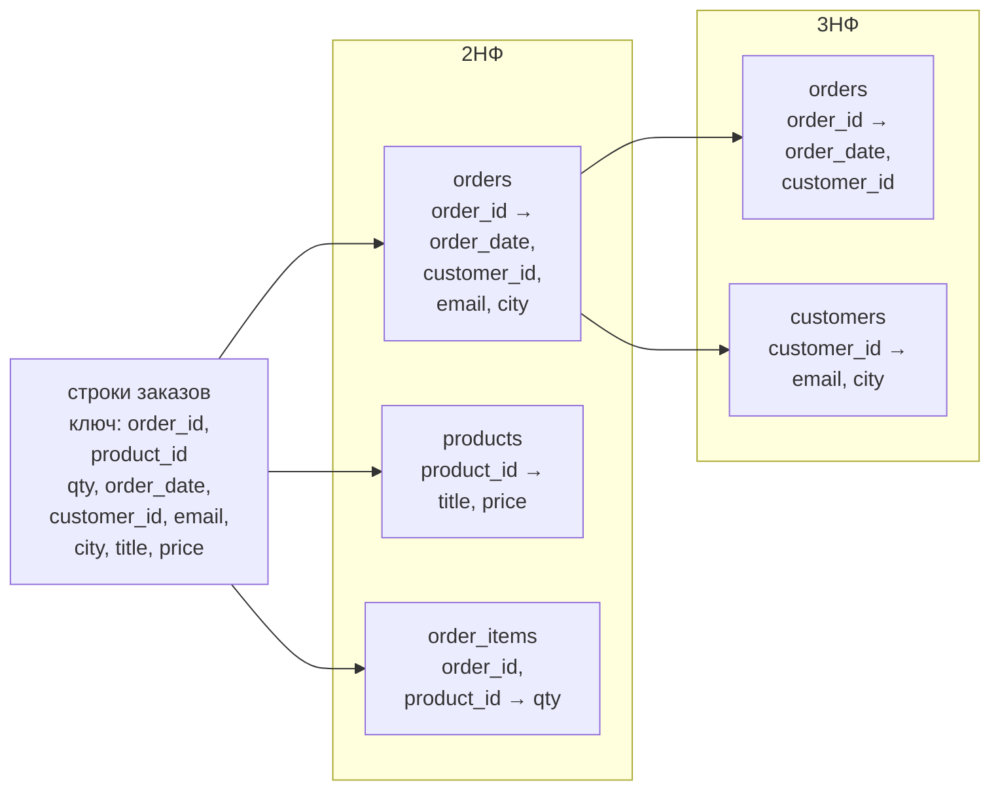

**Суть.** Нормализация — разложение данных по таблицам так, чтобы каждый факт хранился в одном месте. Тогда факт нельзя поправить в одной строке и забыть в другой, нельзя потерять вместе с удалением чужой строки, и для записи факта не нужна фиктивная строка. Для рабочей базы (OLTP — Online Transaction Processing, много коротких транзакций) цель — 3НФ или НФБК. Денормализация — сознательное дублирование ради чтения; у каждого дубля должен быть механизм, который не даёт ему разойтись с оригиналом. Копия, снятая в момент события (цена в позиции заказа), дублем не считается: это другой факт.

> [!note] Термины, которые встретятся в заметке
> - **Функциональная зависимость (ФЗ)** `X → Y` — по значению столбцов X однозначно определяется Y: `customer_id → email`. Это правило предметной области, а не свойство текущих строк: данные могут опровергнуть ФЗ, но не доказать её.
> - **Суперключ** — набор столбцов, который определяет всю строку. **Потенциальный ключ** (candidate key) — минимальный суперключ: убери любой столбец, и он перестанет быть ключом. Первичный ключ — один из потенциальных, выбранный главным.
> - **Ключевой столбец** (prime attribute) — входит хотя бы в один потенциальный ключ. Остальные — неключевые.
> - **Детерминант** — левая часть зависимости, то, от чего зависят.
> - **Транзитивная зависимость** — `A → B → C`, где B не ключ: C зависит от ключа не напрямую, а через другой столбец.

## Аномалии на одной широкой таблице

Магазин хранит строки заказов в одной таблице. Первичный ключ — `(order_id, product_id)`.

| order_id | product_id | qty | order_date | customer_id | email | city | title | price |
| --- | --- | --- | --- | --- | --- | --- | --- | --- |
| 1 | 10 | 2 | 2025-03-01 | 7 | ann@x.io | Riga | Чайник | 40 |
| 1 | 11 | 1 | 2025-03-01 | 7 | ann@x.io | Riga | Кружка | 5 |
| 2 | 10 | 1 | 2025-03-04 | 8 | bob@x.io | Oslo | Чайник | 40 |

Каждый факт («у клиента 7 такой email», «чайник стоит 40») повторён в стольких строках, во скольких встретился. Отсюда три аномалии:

- **Обновления.** Ann сменила email — правим все её строки. Поправили одну, и у клиента 7 стало два email; какой верный, база не знает.
- **Вставки.** Новый товар без заказов не записать: `order_id` входит в первичный ключ и не может быть `NULL`. Остаётся выдумывать фиктивный заказ.
- **Удаления.** Удалили заказ 2 — пропал единственный факт, что Bob живёт в Oslo, и что вообще есть такой клиент.

## Нормальные формы

Каждая следующая форма включает предыдущую. Формулировка Кодда для 3НФ, которую удобно проговорить: неключевой столбец зависит **от ключа, от всего ключа и ни от чего, кроме ключа**. «От ключа» — 1НФ, «от всего ключа» — 2НФ, «ни от чего, кроме» — 3НФ.

### 1НФ: одно значение в ячейке

В каждой ячейке одно значение, нет повторяющихся групп столбцов (`phone1`, `phone2`, `phone3`), у строк есть ключ. Строка `tags = 'sql,pg'` нарушает 1НФ: по тегу не построить обычный индекс, на тег не сослаться внешним ключом, уникальность тега внутри строки не гарантировать.

«Одно значение» понимается относительно запросов. Дата атомарна, пока её не хранят строкой `'2025-03'` и не режут `substring`. В Postgres есть массивы и `jsonb`: формально это нарушение классической 1НФ, на практике их берут, когда список читают и пишут целиком и не ссылаются на элементы внешним ключом ([[JSON и JSONB]]). Если по элементу фильтруют, джойнят или считают — нужна отдельная таблица.

### 2НФ: зависимость от всего ключа

Неключевой столбец не зависит от части составного ключа. С простым ключом из одного столбца 2НФ выполняется сама собой.

В широкой таблице ключ — `(order_id, product_id)`, а `order_date` зависит от одного `order_id`, `title` и `price` — от одного `product_id`. Лечение — вынести каждую такую зависимость в свою таблицу, где её левая часть станет ключом:

- `orders (order_id, order_date, customer_id, email, city)`
- `products (product_id, title, price)`
- `order_items (order_id, product_id, qty)`

### 3НФ: без транзитивных зависимостей

Неключевой столбец не зависит от другого неключевого. В `orders` выше `order_id → customer_id → email, city`: email принадлежит клиенту, а не заказу. Выносим `customers (customer_id, email, city)`, в `orders` остаётся ссылка `customer_id`.

Строгое определение: для каждой нетривиальной ФЗ `X → A` либо X — суперключ, либо A — ключевой столбец. Вторая лазейка и отличает 3НФ от НФБК.

### НФБК: детерминант — всегда ключ

НФБК (нормальная форма Бойса — Кодда, BCNF): для каждой нетривиальной ФЗ `X → Y` X — суперключ. От 3НФ отличается только при нескольких составных ключах, которые пересекаются.

Пример — `lessons (student, subject, teacher)`. По каждому предмету у студента один преподаватель, каждый преподаватель ведёт один предмет:

- ФЗ: `student, subject → teacher` и `teacher → subject`;
- ключи: `(student, subject)` и `(student, teacher)`; все три столбца ключевые, поэтому 3НФ выполнена;
- но `teacher → subject`, а `teacher` не суперключ, поэтому НФБК нарушена. Аномалия та же: преподаватель сменил предмет — правим строки всех его студентов.

Разбиение на `teachers (teacher, subject)` и `lessons (student, teacher)` даёт НФБК и не теряет строк. Зато правило «у студента по предмету один преподаватель» больше не лежит целиком ни в одной таблице, и никаким `UNIQUE` его не проверить. Это известная плата: до НФБК можно разбить любую таблицу без потерь, но не всегда с сохранением зависимостей, а до 3НФ — всегда и так, и так. Как совместить оба свойства в Postgres — в [[#Техника: правило из НФБК на составном внешнем ключе]].

### 4НФ и 5НФ

- **4НФ** — в таблице нет двух независимых многозначных фактов. `employee_skills (employee, skill, language)`, где навыки и языки друг от друга не зависят, вынуждает хранить все сочетания: 3 навыка × 2 языка = 6 строк, и новый язык добавляет 3 строки. Разбивают на `employee_skills` и `employee_languages`.
- **5НФ** — про таблицы, которые без потерь раскладываются только на три части и больше. На практике почти не встречается; на собеседовании достаточно знать, что она есть.

## Как устроена нормализация: схема и модель в коде

Ниже схема разбиения широкой таблицы (шаг к 2НФ убирает зависимости от части ключа, шаг к 3НФ — транзитивную) и маленькая модель на Python: она по списку функциональных зависимостей находит ключи, определяет нормальную форму и проверяет разбиение.



Главный инструмент — **замыкание** набора столбцов: всё, что из него выводится по зависимостям. X — суперключ, если его замыкание покрывает всю таблицу. Нормальная форма проверяется перебором левых частей: для каждой смотрим, что она определяет, и кто она такая — часть ключа, неключевой столбец или суперключ.

```python
def fd(left, right):
    # зависимость "left → right", столбцы через пробел
    return (set(left.split()), set(right.split()))


def closure(attrs, fds):
    # замыкание: все столбцы, которые выводятся из attrs по зависимостям
    result = set(attrs)
    changed = True
    while changed:
        changed = False
        for left, right in fds:
            if left <= result and not right <= result:
                result |= right
                changed = True
    return result


def subsets(items):
    # все подмножества, от маленьких к большим
    result = [[]]
    for item in items:
        result += [s + [item] for s in result]
    result.sort(key=len)
    return [set(s) for s in result]


def candidate_keys(table, fds):
    keys = []
    for s in subsets(sorted(table)):
        if any(k <= s for k in keys):
            continue                    # содержит ключ — суперключ, но не минимальный
        if closure(s, fds) >= table:
            keys.append(s)
    return keys


def normal_form(table, fds):
    # высшая выполненная форма и первая зависимость, которая мешает следующей
    keys = candidate_keys(table, fds)
    prime = set()                       # столбцы, входящие хоть в один ключ
    for k in keys:
        prime |= k
    worst = ("НФБК", None)
    for left in subsets(sorted(table)):
        right = closure(left, fds) & table - left
        if not right or closure(left, fds) >= table:
            continue                    # left ничего не определяет или это суперключ
        problem = (" ".join(sorted(left)), " ".join(sorted(right)))
        non_prime = right - prime
        if non_prime and any(left < k for k in keys):
            return ("1НФ", problem)     # неключевой столбец зависит от части ключа
        if non_prime and worst[0] != "2НФ":
            worst = ("2НФ", problem)    # транзитивная: через неключевой столбец
        elif not non_prime and worst[0] == "НФБК":
            worst = ("3НФ", problem)    # детерминант не ключ, но зависят только ключевые
    return worst


FDS = [
    fd("order_id", "order_date customer_id"),
    fd("customer_id", "email city"),
    fd("product_id", "title price"),
    fd("order_id product_id", "qty"),
]
FLAT = set("order_id product_id qty order_date customer_id email city title price".split())

[" ".join(sorted(k)) for k in candidate_keys(FLAT, FDS)]  # ['order_id product_id']
normal_form(FLAT, FDS)
# ('1НФ', ('order_id', 'city customer_id email order_date'))

ORDERS = set("order_id order_date customer_id email city".split())
normal_form(ORDERS, FDS)            # ('2НФ', ('customer_id', 'city email'))
normal_form(set("customer_id email city".split()), FDS)        # ('НФБК', None)
normal_form(set("order_id order_date customer_id".split()), FDS)  # ('НФБК', None)

LESSONS = [
    fd("student subject", "teacher"),
    fd("teacher", "subject"),
]
L = {"student", "subject", "teacher"}
[" ".join(sorted(k)) for k in candidate_keys(L, LESSONS)]  # ['student subject', 'student teacher']
normal_form(L, LESSONS)             # ('3НФ', ('teacher', 'subject'))
```

Разбиение на две таблицы **без потерь** (lossless join), если общие столбцы — суперключ хотя бы одной из частей (теорема Хита). Иначе `JOIN` частей вернёт лишние строки, которых в исходной таблице не было. Зависимость **сохранена**, если её можно проверить, не соединяя таблицы: замыкание её левой части по каждой таблице отдельно всё равно доходит до правой.

```python
def lossless(r1, r2, fds):
    common = closure(r1 & r2, fds)
    return r1 <= common or r2 <= common


def preserved(dep, tables, fds):
    left, right = dep
    result = set(left)
    changed = True
    while changed:
        changed = False
        for t in tables:
            add = closure(result & t, fds) & t   # что выводится внутри одной таблицы
            if not add <= result:
                result |= add
                changed = True
    return right <= result


ITEMS = set("order_id product_id qty title price".split())
lossless(ORDERS, ITEMS, FDS)        # True: общий order_id — ключ orders
lossless({"order_id", "city"}, {"customer_id", "city"}, FDS)
# False: общий city не ключ, JOIN по городу смешает клиентов из одного города

parts = [{"teacher", "subject"}, {"student", "teacher"}]
lossless(parts[0], parts[1], LESSONS)       # True
preserved(LESSONS[1], parts, LESSONS)       # True: teacher → subject живёт в teachers
preserved(LESSONS[0], parts, LESSONS)       # False: student, subject → teacher потеряна
```

## Техника: нормализованная схема в Postgres

```sql
CREATE TABLE customers (
    id    bigint PRIMARY KEY,
    email text NOT NULL UNIQUE,
    city  text NOT NULL
);

CREATE TABLE products (
    id    bigint PRIMARY KEY,
    title text NOT NULL,
    price numeric(10, 2) NOT NULL              -- текущая цена в каталоге
);

CREATE TABLE orders (
    id          bigint PRIMARY KEY,
    customer_id bigint NOT NULL REFERENCES customers (id),
    created_at  date NOT NULL,
    ship_city   text NOT NULL,                 -- снимок адреса на момент заказа
    UNIQUE (id, customer_id)                   -- цель для составного внешнего ключа ниже
);

CREATE TABLE order_items (
    order_id    bigint NOT NULL,
    customer_id bigint NOT NULL,               -- копия из orders ради индекса без JOIN
    product_id  bigint NOT NULL REFERENCES products (id),
    qty         int NOT NULL CHECK (qty > 0),
    price       numeric(10, 2) NOT NULL,       -- цена на момент покупки
    total       numeric(12, 2) GENERATED ALWAYS AS (qty * price) STORED,
    PRIMARY KEY (order_id, product_id),
    FOREIGN KEY (order_id, customer_id) REFERENCES orders (id, customer_id)
);
```

Что здесь важно:

- `UNIQUE` на `customers.email` — это тоже нормализация. Суррогатный `id` не отменяет зависимость «email определяет клиента»: без ограничения один человек заведётся дважды, и его заказы разъедутся по двум записям.
- `order_items.price` — не дубль `products.price`. Это разные факты с разными ключами: `product_id → price` — цена сейчас, `order_id, product_id → price` — цена в этой покупке. После `UPDATE products SET price = 45` позиции старых заказов остаются по 40, и чек, возврат и отчёт за прошлый месяц не меняются задним числом. То же с `ship_city`: клиент переехал, а курьер везёт старый заказ по старому адресу.
- `order_items.customer_id` — настоящая денормализация: копия столбца родителя, чтобы индекс `(customer_id, product_id)` отвечал «что покупал клиент» без `JOIN`. Разойтись с заказом она не может: составной внешний ключ на `orders (id, customer_id)` отвергает несовпадение.

```sql
INSERT INTO order_items (order_id, customer_id, product_id, qty, price) VALUES (2, 7, 11, 1, 5);
-- ERROR:  insert or update on table "order_items" violates foreign key constraint
--         "order_items_order_id_customer_id_fkey"
-- DETAIL:  Key (order_id, customer_id)=(2, 7) is not present in table "orders".
```

- `total` — генерируемый столбец: зависит только от столбцов той же строки, база пересчитывает его сама при каждой записи, разойтись он не может.

## Техника: правило из НФБК на составном внешнем ключе

Вернёмся к студентам и преподавателям. Нужно и НФБК (предмет преподавателя хранится в одном месте), и проверка «у студента по предмету один преподаватель». Приём — оставить `subject` в `lessons` копией и привязать её составным внешним ключом:

```sql
CREATE TABLE teachers (
    teacher text PRIMARY KEY,
    subject text NOT NULL,
    UNIQUE (teacher, subject)                  -- цель для составного внешнего ключа
);

CREATE TABLE lessons (
    student text NOT NULL,
    teacher text NOT NULL,
    subject text NOT NULL,
    PRIMARY KEY (student, teacher),
    UNIQUE (student, subject),                 -- у студента по предмету один преподаватель
    FOREIGN KEY (teacher, subject) REFERENCES teachers (teacher, subject) ON UPDATE CASCADE
);

INSERT INTO teachers VALUES ('Orlov', 'math'), ('Petrov', 'math'), ('Sidorov', 'physics');
INSERT INTO lessons VALUES ('ann', 'Orlov', 'math'), ('ann', 'Sidorov', 'physics');

INSERT INTO lessons VALUES ('ann', 'Petrov', 'math');
-- ERROR: duplicate key value violates unique constraint "lessons_student_subject_key"
INSERT INTO lessons VALUES ('bob', 'Orlov', 'physics');
-- ERROR: ... violates foreign key constraint "lessons_teacher_subject_fkey"

UPDATE teachers SET subject = 'algebra' WHERE teacher = 'Orlov';
SELECT * FROM lessons;
--  ann | Orlov   | algebra     ← копия обновилась каскадом
--  ann | Sidorov | physics
```

Формально `lessons` снова не в НФБК (`teacher → subject`), но аномалии обновления нет: источник правды один — `teachers`, а копию держит в согласии сама база. Это и есть правильная денормализация: дубль плюс механизм, который не даёт ему разойтись.

## Денормализация: приёмы и чем держать согласие

| Приём | Зачем | Что держит копию в согласии |
| --- | --- | --- |
| Снимок на момент события (цена в позиции, адрес в заказе) | История не должна меняться задним числом | Ничего не нужно: это отдельный факт, его не обновляют |
| Копия столбца родителя (`customer_id`, `tenant_id` в дочерних таблицах) | Индекс и фильтр без `JOIN`, секционирование по арендатору | Составной внешний ключ на `UNIQUE (id, столбец)` родителя |
| Генерируемый столбец (`GENERATED ALWAYS AS ... STORED`) | Индекс или фильтр по вычисляемому значению | База пересчитывает при записи строки |
| Счётчик или сумма в родителе (`comments_count`) | Не считать `count(*)` на каждом показе | Обновление в той же транзакции или триггер; горячая строка, если пишут часто ([[Блокировки#Бизнес-кейс: флеш-распродажа]]) |
| Материализованное представление (`MATERIALIZED VIEW`) | Тяжёлые отчёты | `REFRESH MATERIALIZED VIEW CONCURRENTLY` по расписанию (нужен уникальный индекс), данные отстают |
| Отдельная модель для чтения (поиск, кэш, CQRS) | Другое хранилище, другая форма данных | События через outbox ([[Распределённые транзакции и саги#Dual write и outbox]]), согласованность в конечном счёте |

Плохая денормализация — копия без механизма: `email` клиента в каждом заказе «для удобства», который обновляют кодом приложения в двух местах. Первый же забытый путь записи (админка, миграция, ручной `UPDATE`) — и копии разошлись.

## Бизнес-кейсы

- **Адрес доставки ссылкой.** `orders.address_id` указывает на редактируемую таблицу адресов. Клиент поправил адрес в профиле — у всех его прошлых заказов поменялся адрес доставки, а накладные в архиве больше не совпадают с базой. Решение: в заказ копировать адрес как снимок, а таблица адресов остаётся справочником для подстановки в форму.
- **Аналитика.** Рабочая база в 3НФ, а хранилище для отчётов (DWH) — схема «звезда»: таблица фактов (продажи) и денормализованные измерения (товар вместе с категорией и брендом). Там данные только дописываются, аномалии обновления не страшны, а каждый лишний `JOIN` по миллиардам строк дорог.
- **Многоарендная система.** `tenant_id` копируют во все таблицы, хотя он выводится через родителя: так каждый запрос фильтруется по индексу с `tenant_id` впереди, а политика RLS (Row-Level Security, построчный доступ) проверяется без `JOIN`. Согласие держит составной внешний ключ, как с `customer_id` выше.

## Что спросят дальше

- **Чем 3НФ отличается от НФБК?** В 3НФ разрешена зависимость от не-суперключа, если справа ключевой столбец. Разница видна только при пересекающихся составных ключах; пример — студенты, предметы и преподаватели выше.
- **Всегда ли нормализовать до упора?** Нет. До НФБК не всегда можно разбить с сохранением зависимостей, а лишние таблицы — это лишние `JOIN`. Рабочая цель — 3НФ, дальше по ситуации; денормализуют по измеренной проблеме чтения, а не заранее.
- **Нарушает ли `jsonb` или массив 1НФ?** Формально да. Допустимо, если значение читают и пишут целиком; если по элементам фильтруют, джойнят или нужна ссылочная целостность — отдельная таблица ([[JSON и JSONB]]).
- **Как понять, что разбиение без потерь?** Общие столбцы двух частей должны быть ключом хотя бы одной из них. Иначе `JOIN` частей даст лишние строки (spurious tuples) — пример с городом в модели выше.
- **Суррогатный `id` делает таблицу нормализованной?** Нет. Зависимости предметной области никуда не деваются: если email определяет клиента, нужен `UNIQUE (email)`, иначе дубли.
- **EAV (entity-attribute-value: таблица `сущность, атрибут, значение`) — это ведь предельная нормализация?** Нет: схема уходит из базы в данные, типы и ограничения теряются, каждый объект собирается кучей `JOIN`. В Postgres вместо EAV для произвольных атрибутов берут `jsonb`.
- **Цена в позиции заказа — нарушение нормализации?** Нет, это отдельный факт «цена в этой покупке» со своим ключом `(order_id, product_id)`. Нарушением была бы ссылка на текущую цену там, где нужна историческая.
