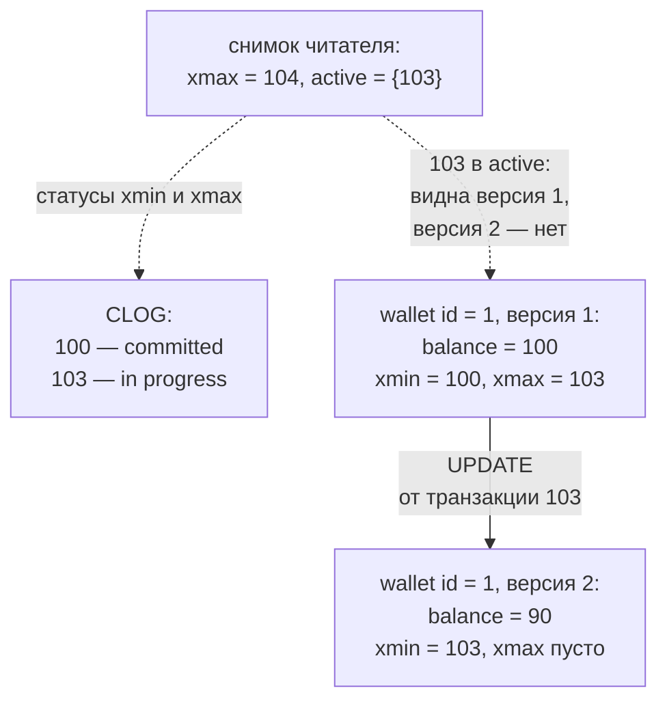
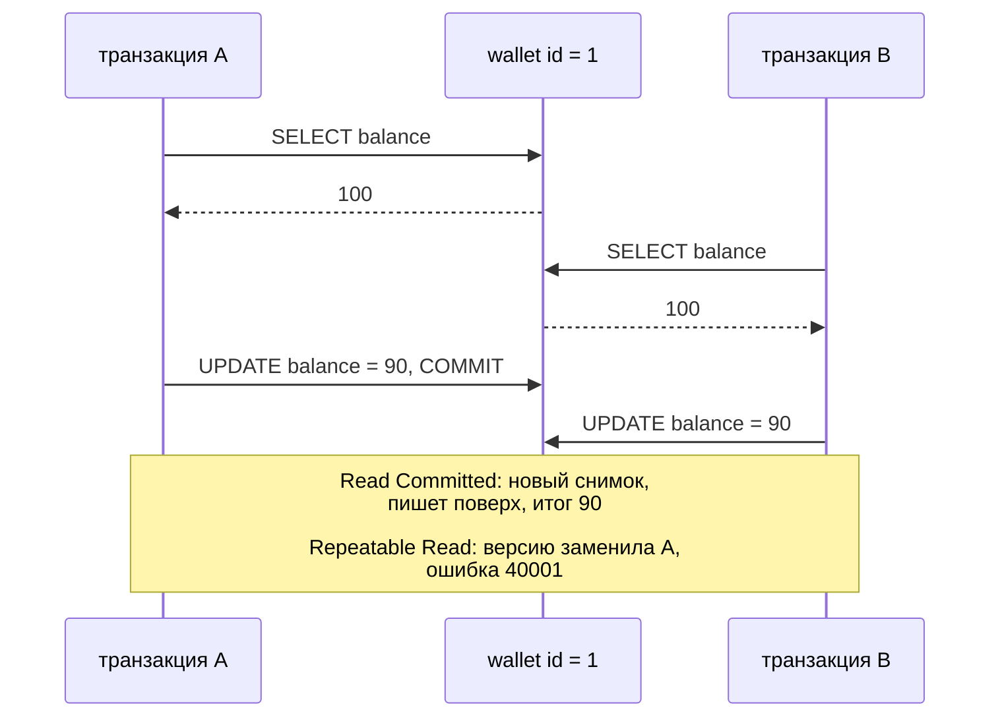
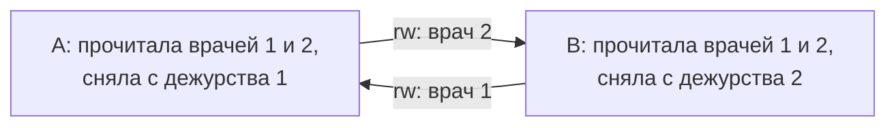

**Суть.** Транзакция — группа операций, которая выполняется как единое целое: либо применяются все, либо ни одна. Когда транзакций много и они идут одновременно, они могут мешать друг другу: одна видит недописанные данные другой, или две затирают изменения друг друга. Уровень изоляции — это договор с базой о том, какие из таких помех (аномалий) она допускает. Чем строже уровень, тем меньше аномалий, но тем чаще база откатывает транзакции и тем ниже пропускная способность.

## Смежное: ACID и MVCC

ACID — набор из четырёх гарантий, которые обещает транзакционная база:

- **Atomicity (атомарность)** — всё или ничего. PostgreSQL обеспечивает её двумя механизмами. Первый — WAL (Write-Ahead Log, журнал упреждающей записи): любое изменение сначала записывается в последовательный журнал на диске, и только потом попадает в файлы таблиц. Второй — CLOG (commit log, журнал статусов транзакций): в нём для каждой транзакции хранится статус «в работе», «закоммичена» или «отменена». Строки отменённой транзакции остаются на диске, но другие транзакции их не видят, потому что CLOG говорит, что автор отменён.
- **Consistency (согласованность)** — правила данных (ограничения вроде `CHECK`, `UNIQUE`, внешние ключи FK — Foreign Key) выполняются и до транзакции, и после неё. Если транзакция нарушила правило, её откатывают.
- **Isolation (изоляция)** — параллельные транзакции не должны портить друг другу результат. Этому разделу посвящён весь текст ниже.
- **Durability (долговечность)** — после успешного `COMMIT` данные переживут падение сервера. Для этого база перед ответом «готово» принудительно сбрасывает WAL на диск (системный вызов `fsync`). Настройка `synchronous_commit=off` отключает ожидание этого сброса: транзакции становятся быстрее, но при падении можно потерять последние доли секунды закоммиченных данных.

**MVCC (Multi-Version Concurrency Control, многоверсионность).** `UPDATE` в PostgreSQL не перезаписывает строку на месте, а создаёт её новую версию (в документации версия строки называется tuple, «кортеж»). У каждой версии есть два служебных поля: `xmin` — номер транзакции, которая эту версию создала, и `xmax` — номер транзакции, которая её удалила или заменила (пока версия актуальна, `xmax` пуст). Каждая транзакция работает со своим снимком (snapshot) — списком того, какие транзакции были закоммичены на момент её старта. Она видит ровно те версии, которые создал закоммиченный до снимка автор и которые к снимку ещё не удалены. Отсюда главное свойство: читатели не блокируют писателей, а писатели читателей. Но у него есть цена: старые версии строк копятся на диске как мёртвые, и их нужно регулярно чистить фоновой операцией VACUUM (вакуум, «уборка»; подробности — в разделе [[Эксплуатация PostgreSQL#VACUUM и раздувание таблиц (bloat)]]).

## Уровни изоляции и аномалии

Стандарт SQL описывает четыре уровня изоляции. Каждый определяется тем, какие аномалии он разрешает:

1. **Read Uncommitted** (чтение незакоммиченного) — самый слабый уровень, допускает все аномалии, включая чтение чужих неподтверждённых изменений.
2. **Read Committed** (чтение закоммиченного) — видны только закоммиченные данные, но каждый запрос внутри транзакции берёт свежий снимок.
3. **Repeatable Read** (повторяемое чтение) — снимок берётся один раз на всю транзакцию, и повторные чтения дают тот же результат.
4. **Serializable** (сериализуемость) — самый строгий уровень: результат параллельных транзакций такой же, как если бы они шли строго по одной в каком-то порядке.

Аномалий в таблице пять. Три первые описаны в самом стандарте SQL, две последние — классические проблемы из теории баз данных, которые стандарт не называет:

1. **Dirty read** (грязное чтение) — транзакция читает изменения другой транзакции, которая ещё не сделала `COMMIT`. Если та потом откатится, первая прочитала данные, которых «никогда не было». Пример: T1 списала с баланса 10 и не закоммитила, T2 увидела уменьшенный баланс и выдала отказ в покупке, а T1 откатилась.
2. **Non-repeatable read** (неповторяемое чтение) — повторный `SELECT` одной и той же строки внутри транзакции возвращает другое значение, потому что между чтениями другая транзакция изменила строку и закоммитила. Пример: T1 прочитала баланс 100, T2 списала 10 и закоммитила, T1 читает снова и видит 90.
3. **Phantom** (фантом) — повторный `SELECT` по условию возвращает другой набор строк: между чтениями другая транзакция вставила или удалила подходящие строки. Пример: T1 посчитала заказы пользователя — 5; T2 добавила шестой; повторный подсчёт в T1 даёт 6. От неповторяемого чтения отличается тем, что изменилась не прочитанная строка, а состав выборки.
4. **Lost update** (потерянное обновление) — две транзакции читают значение, каждая считает новое по прочитанному и записывает; вторая запись затирает первую, и одно изменение пропадает. Пример: обе прочитали баланс 100, одна записала 90, другая тоже 90, хотя списали по 10 каждая — должно было стать 80.
5. **Write skew** (перекос записи) — две транзакции читают одни и те же данные, принимают решения на их основе и пишут в разные строки; по отдельности каждая запись допустима, а вместе они нарушают общий инвариант (правило, которое должно быть верно всегда). Пример с дежурными врачами — ниже.

| Уровень | Dirty read | Non-repeatable read | Phantom | Lost update | Write skew |
| --- | --- | --- | --- | --- | --- |
| Read Uncommitted | да (в Postgres нет) | да | да | да | да |
| Read Committed (по умолчанию в Postgres) | нет | да | да | да | да |
| Repeatable Read (в Postgres это snapshot isolation) | нет | нет | нет в Postgres | нет (вместо этого ошибка сериализации) | да |
| Serializable (в Postgres это SSI, см. ниже) | нет | нет | нет | нет | нет |

Что важно знать про реализацию в PostgreSQL:

- **Read Uncommitted ведёт себя как Read Committed.** Postgres принимает команду `SET TRANSACTION ISOLATION LEVEL READ UNCOMMITTED`, но грязное чтение не поддерживает вообще: благодаря MVCC чужие незакоммиченные версии строк просто невидимы. Поэтому на практике уровней три.
- **Read Committed — уровень по умолчанию.** Каждый отдельный запрос внутри транзакции берёт новый снимок, поэтому два запроса подряд могут увидеть разные данные.
- **Repeatable Read в Postgres — это snapshot isolation (изоляция снимков).** Транзакция берёт один снимок при первом запросе и до конца работает с ним, как с замороженной копией базы. Поэтому в Postgres не бывает ни неповторяемого чтения, ни фантомов (хотя стандарт фантомы на этом уровне разрешает). Если транзакция пытается изменить строку, которую после её снимка изменила другая закоммиченная транзакция, база не даёт молча затереть чужое изменение, а откатывает вторую с ошибкой `could not serialize access due to concurrent update` (SQLSTATE `40001`). Так закрыт lost update. Но write skew остаётся: две транзакции пишут в разные строки, конфликта по строкам нет, и база ничего не замечает.
- **Serializable в Postgres — это SSI (Serializable Snapshot Isolation, сериализуемая изоляция снимков).** Работает как Repeatable Read, но дополнительно следит за зависимостями между параллельными транзакциями: кто что прочитал и кто что записал. Слежение идёт через так называемые предикатные блокировки (predicate locks): они никого не блокируют, а только записывают, какие данные читала транзакция. Если база находит цикл зависимостей, при котором результат нельзя объяснить никаким последовательным порядком транзакций (как в примере с врачами), она откатывает одну из них.
- **Откат при Serializable нормален, и его нужно повторять.** `40001` — это код SQLSTATE (пятизначный стандартный код ошибки SQL) `serialization_failure`, то есть «транзакцию не удалось выстроить в последовательный порядок, повторите её». Ошибка не означает сбой или баг: это штатный способ сказать «я не могу гарантировать корректность, попробуй ещё раз». SSI иногда откатывает и транзакции, которые на самом деле конфликта бы не вызвали (ложные срабатывания), поэтому приложение не может заранее знать, понадобится ли повтор. При повторе транзакция берёт новый снимок, уже видит результат победившей транзакции и в большинстве случаев проходит. Поэтому на Repeatable Read и Serializable приложение обязано ловить `40001` и повторять транзакцию целиком (пример кода — ниже, в разделе про повторную попытку).

Для сравнения с другими базами. MySQL InnoDB по умолчанию работает на Repeatable Read: обычный `SELECT` читает снимок, а фантомы в запросах с блокировкой (`SELECT ... FOR UPDATE`) закрываются gap-блокировками и next-key-блокировками (блокировками «промежутков» индекса, подробнее — в разделе [[Блокировки]]). Oracle поддерживает только Read Committed и Serializable, причём его Serializable по сути тоже snapshot isolation.

## Как устроен MVCC: схема и модель в коде

Ниже схемы и маленькая модель на Python: что хранится в версиях строки, что такое снимок и как из них получаются уровни изоляции. Модель упрощена до одной строки `wallet` и не делает блокировок, но воспроизводит прогоны из разделов ниже.

### Версии строки, снимок и CLOG

`UPDATE` не меняет строку, а помечает старую версию номером своей транзакции в `xmax` и дописывает новую с этим номером в `xmin`. Видна ли версия, решают три вещи: `xmin` и `xmax` версии, снимок транзакции-читателя и CLOG — журнал статусов транзакций. Снимок — это граница «всё, что началось раньше вот этого номера» (`xmax` снимка) и список транзакций, которые на момент снимка ещё не закончились (`active`, в Postgres это `xip`).



```python
class SerializationFailure(Exception):
    pass


class Db:
    def __init__(self):
        self.clog = {}              # xid → "in progress" / "committed" / "aborted"
        self.versions = []          # все версии строки wallet id = 1, и живые, и мёртвые
        self.next_xid = 100

    def begin(self, level="read committed"):
        xid = self.next_xid
        self.next_xid += 1
        self.clog[xid] = "in progress"
        return {"xid": xid, "level": level, "snapshot": None}

    def commit(self, tx):
        self.clog[tx["xid"]] = "committed"      # COMMIT — одна запись в CLOG, строки не трогаются

    def rollback(self, tx):
        self.clog[tx["xid"]] = "aborted"        # версии остаются на диске до VACUUM, но никому не видны

    def take_snapshot(self, tx):
        # Read Committed — новый снимок на каждый запрос, Repeatable Read — один на всю транзакцию
        if tx["level"] == "read committed" or tx["snapshot"] is None:
            active = {xid for xid, status in self.clog.items() if status == "in progress"}
            tx["snapshot"] = {"xmax": self.next_xid, "active": active}
        return tx["snapshot"]

    def committed_in(self, xid, snap):          # закоммичена до снимка
        return xid < snap["xmax"] and xid not in snap["active"] and self.clog[xid] == "committed"

    def visible(self, version, tx, snap):
        me = tx["xid"]
        created = version["xmin"] == me or self.committed_in(version["xmin"], snap)
        deleted = version["xmax"] is not None and (
            version["xmax"] == me or self.committed_in(version["xmax"], snap)
        )
        return created and not deleted

    def insert(self, tx, balance):
        self.versions.append({"xmin": tx["xid"], "xmax": None, "balance": balance})

    def select(self, tx):
        snap = self.take_snapshot(tx)
        return [v["balance"] for v in self.versions if self.visible(v, tx, snap)]

    def update(self, tx, balance):
        snap = self.take_snapshot(tx)
        old = next(v for v in self.versions if self.visible(v, tx, snap))
        # Версию, видимую в нашем снимке, уже заменила закоммиченная транзакция.
        # На Read Committed снимок свежий, и сюда попадают только Repeatable Read и Serializable.
        # (Если заменившая транзакция ещё в работе, Postgres ждёт её конца; модель этот случай не разбирает.)
        if old["xmax"] is not None and self.clog[old["xmax"]] == "committed":
            raise SerializationFailure("could not serialize access due to concurrent update")
        old["xmax"] = tx["xid"]
        self.insert(tx, balance)
```

Прогон: одна строка с балансом 100, читатели на двух уровнях и писатель, который меняет баланс на 90.

```python
db = Db()
t0 = db.begin()
db.insert(t0, 100)
db.commit(t0)

rr = db.begin("repeatable read")    # xid 101
rc = db.begin("read committed")     # xid 102
db.select(rr), db.select(rc)        # [100] [100]

writer = db.begin()                 # xid 103
db.update(writer, 90)
db.select(rr), db.select(rc)        # [100] [100] — незакоммиченная версия не видна никому
db.select(writer)                   # [90] — кроме автора

db.commit(writer)
db.select(rr), db.select(rc)        # [100] [90] — RR живёт старым снимком, RC взял новый
db.versions
# [{'xmin': 100, 'xmax': 103, 'balance': 100}, {'xmin': 103, 'xmax': None, 'balance': 90}]
```

Неповторяемое чтение в Read Committed — это просто новый снимок на втором `SELECT`. Обе версии остались на диске: старую никто больше не увидит, и её уберёт `VACUUM`. Отмена работает так же дёшево, как коммит:

```python
db = Db()
t0 = db.begin()
db.insert(t0, 100)
db.commit(t0)
bad = db.begin()
db.update(bad, 0)
db.rollback(bad)
db.select(db.begin())               # [100]
db.versions
# [{'xmin': 100, 'xmax': 101, 'balance': 100}, {'xmin': 101, 'xmax': None, 'balance': 0}]
# xmax = 101 у старой версии и вся новая версия ничего не значат: в CLOG 101 — aborted
```

### Потерянное обновление на Read Committed и Repeatable Read

Две транзакции читают 100 и пишут посчитанные в приложении 90 — тот же прогон, что в таблице раздела про lost update ниже.



```python
def lost_update(level):
    db = Db()
    t0 = db.begin()
    db.insert(t0, 100)
    db.commit(t0)
    a, b = db.begin(level), db.begin(level)
    db.select(a)                    # 100
    db.select(b)                    # 100
    db.update(a, 90)
    db.commit(a)
    db.update(b, 90)                # значение посчитано в приложении по прочитанным 100
    db.commit(b)
    return db.select(db.begin())


lost_update("read committed")   # [90] — списание A пропало
lost_update("repeatable read")  # SerializationFailure: could not serialize access due to concurrent update
```

### Serializable: как SSI ловит перекос записи

Перекос записи не виден по строкам: транзакции пишут в разные. Поэтому SSI смотрит не на записи, а на зависимости «прочитал — записал» между параллельными транзакциями (rw-зависимости, их отслеживают предикатные блокировки). Ребро `T1 → T2` значит: T1 прочитала данные, которые параллельная T2 потом изменила, то есть в любом последовательном порядке T1 должна стоять раньше T2. Если рёбра образуют цикл, такого порядка нет. Postgres ищет «опасную структуру»: транзакцию, в которую входит rw-ребро и из которой выходит rw-ребро к уже закоммиченной транзакции. Такую транзакцию он откатывает.



Ребро `A → B`: A читала врача 2, а B его потом изменила. Ребро `B → A` — наоборот, по врачу 1.

```python
reads = {"A": {1, 2}, "B": {1, 2}}  # SELECT count(*) FROM doctors WHERE on_call — читали обе строки
writes = {"A": {1}, "B": {2}}       # каждая сняла с дежурства себя
committed = []


def rw_edges():                     # (r, w): r прочитала то, что потом записала w
    return {(r, w) for r in reads for w in writes if r != w and reads[r] & writes[w]}


def commit(tx):
    edges = rw_edges()
    has_in = any(dst == tx for _, dst in edges)
    out_to_committed = any(src == tx and dst in committed for src, dst in edges)
    if has_in and out_to_committed:
        raise SerializationFailure(
            "could not serialize access due to read/write dependencies among transactions"
        )
    committed.append(tx)


sorted(rw_edges())  # [('A', 'B'), ('B', 'A')] — цикл
commit("A")         # проходит: B ещё не закоммичена
commit("B")         # SerializationFailure — как в прогоне ниже: «Canceled on identification as a pivot, during commit attempt»
```

Правила в Postgres тоньше: учитывается, кто когда начал и закоммитил, а предикатные блокировки при нехватке памяти укрупняются со строк до страниц и таблицы. Из-за этого бывают ложные откаты, и приложение повторяет транзакцию при любом `40001`.

## Техника: потерянное обновление (lost update) и четыре способа его избежать

```sql
-- Плохо: два запроса параллельно прочитают 100 и оба запишут 90
SELECT balance FROM wallet WHERE id = 1;          -- 100
UPDATE wallet SET balance = 90 WHERE id = 1;      -- новое значение посчитано в приложении

-- 1. Атомарный UPDATE с условием (лучший вариант, если логика в него помещается)
UPDATE wallet SET balance = balance - 10
WHERE id = 1 AND balance >= 10
RETURNING balance;                                 -- 0 строк = недостаточно средств

-- 2. Пессимистичная блокировка: сначала захватываем строку, потом работаем
BEGIN;
SELECT balance FROM wallet WHERE id = 1 FOR UPDATE;
-- сложная логика в приложении
UPDATE wallet SET balance = 90 WHERE id = 1;
COMMIT;

-- 3. Оптимистичная блокировка (версия строки): блокировок нет, конфликт обнаруживаем при записи
UPDATE wallet SET balance = 90, version = version + 1
WHERE id = 1 AND version = 7;                      -- 0 строк = кто-то изменил раньше, перечитать и повторить

-- 4. REPEATABLE READ или SERIALIZABLE, а в приложении повтор транзакции при ошибке SQLSTATE 40001
```

Как работает каждый способ:

1. Атомарный `UPDATE` выполняет проверку и изменение одной командой, поэтому между ними никто не успевает вклиниться. Этот способ лучший, когда вся логика влезает в одно выражение.
2. Пессимистичная блокировка (`FOR UPDATE`) заставляет вторую транзакцию ждать, пока первая не закончит: прочитал под блокировкой — значит, никто не изменит значение до твоего `COMMIT`.
3. Оптимистичная блокировка не держит блокировок: в строке есть счётчик `version`, и `UPDATE` срабатывает, только если версия всё та же, что была при чтении. Ноль изменённых строк значит, что кто-то успел раньше, и нужно перечитать данные и повторить.
4. Повышенный уровень изоляции перекладывает проверку на базу: она откатит проигравшую транзакцию ошибкой `40001`, а приложение её повторит.

Как это выглядит на двух параллельных сессиях. Таблица `wallet(id, balance)`, в строке `id = 1` лежит 100, каждая сессия хочет списать 10 и пишет в базу значение, посчитанное в приложении. Сначала `READ COMMITTED`, уровень по умолчанию:

| Шаг | Сессия A | Сессия B | Что вернулось |
| --- | --- | --- | --- |
| 1 | `BEGIN; SELECT balance FROM wallet WHERE id = 1` | | `100` |
| 2 | | `BEGIN; SELECT balance FROM wallet WHERE id = 1` | `100` |
| 3 | `UPDATE wallet SET balance = 90 WHERE id = 1; COMMIT` | | `UPDATE 1` |
| 4 | | `UPDATE wallet SET balance = 90 WHERE id = 1; COMMIT` | `UPDATE 1` |
| 5 | `SELECT balance FROM wallet` | | `90`, а должно быть `80` |

База ни на что не пожаловалась: на шаге 4 она просто перезаписала строку, а списание сессии A пропало. На `REPEATABLE READ` и на `SERIALIZABLE` те же шаги дают другой результат: на шаге 4 вторая сессия видит, что строку после её снимка изменила закоммиченная транзакция, и получает ошибку.

```text title="Вывод"
ERROR:  could not serialize access due to concurrent update
```

После ошибки транзакция B в состоянии «прервана»: `COMMIT` превращается в `ROLLBACK`, баланс остаётся 90 от сессии A, а приложение повторяет B целиком (раздел про повторную попытку ниже). Лечение через `FOR UPDATE` на `READ COMMITTED`:

| Шаг | Сессия A | Сессия B | Что вернулось |
| --- | --- | --- | --- |
| 1 | `BEGIN; SELECT balance FROM wallet WHERE id = 1 FOR UPDATE` | | `100` |
| 2 | | `BEGIN; SELECT balance FROM wallet WHERE id = 1 FOR UPDATE` | B **ждёт**, пока A не закончит |
| 3 | `UPDATE wallet SET balance = 90 WHERE id = 1; COMMIT` | | `UPDATE 1`; B просыпается |
| 4 | | (запрос из шага 2 завершился) | `90`: B видит свежее значение, а не 100 |
| 5 | | `UPDATE wallet SET balance = 80 WHERE id = 1; COMMIT` | `UPDATE 1`, итог `80` |

## Техника: перекос записи (write skew), пример с дежурными врачами

```sql
-- Инвариант: на дежурстве хотя бы один врач. Сейчас их двое.
-- T1 и T2 выполняются параллельно, обе на REPEATABLE READ:
SELECT count(*) FROM doctors WHERE on_call;        -- обе видят 2
UPDATE doctors SET on_call = false WHERE id = :me; -- каждая правит свою строку, конфликта по строкам нет
COMMIT;                                            -- итог: 0 врачей на дежурстве
```

Прогон на двух сессиях, таблица `doctors(id, name, on_call)` с двумя дежурными (`id` 1 и 2), обе транзакции на `REPEATABLE READ`:

| Шаг | Сессия A | Сессия B | Что вернулось |
| --- | --- | --- | --- |
| 1 | `BEGIN ISOLATION LEVEL REPEATABLE READ; SELECT count(*) FROM doctors WHERE on_call` | | `2` |
| 2 | | `BEGIN ISOLATION LEVEL REPEATABLE READ; SELECT count(*) FROM doctors WHERE on_call` | `2` |
| 3 | `UPDATE doctors SET on_call = false WHERE id = 1` | | `UPDATE 1` |
| 4 | | `UPDATE doctors SET on_call = false WHERE id = 2` | `UPDATE 1`, B не ждёт: строка другая |
| 5 | `COMMIT` | | `COMMIT` |
| 6 | | `COMMIT` | `COMMIT` |
| 7 | `SELECT count(*) FROM doctors WHERE on_call` | | `0` |

Те же шаги на `SERIALIZABLE`: до шага 5 всё идёт так же, `COMMIT` сессии A проходит, а `COMMIT` сессии B база отклоняет, и на дежурстве остаётся один врач.

```text title="Вывод"
ERROR:  could not serialize access due to read/write dependencies among transactions
DETAIL:  Reason code: Canceled on identification as a pivot, during commit attempt.
HINT:  The transaction might succeed if retried.
```

Каждая транзакция по отдельности ничего не нарушила: она увидела двоих и сняла с дежурства одного. Но вместе они оставили смену пустой, а база не заметила проблемы, потому что строки разные. Три способа лечения:

- Включить `SERIALIZABLE`: одна из транзакций получит `40001`, а приложение её повторит и на этот раз увидит одного врача.
- Явно заблокировать общий ресурс, на котором держится инвариант: `SELECT ... FROM shifts WHERE id = :shift FOR UPDATE`. Тогда транзакции пойдут по очереди.
- Перенести инвариант в ограничение базы (constraint), если его можно так выразить.

Вариант без смены уровня: прочитать дежурных с блокировкой, `SELECT id FROM doctors WHERE on_call FOR UPDATE`. На `READ COMMITTED` вторая транзакция ждёт первую, а после её `COMMIT` перепроверяет условие и получает уже только оставшуюся строку:

```text title="Вывод"
-- сессия A: SELECT id FROM doctors WHERE on_call FOR UPDATE
 id
----
  2
  1
-- сессия B ждёт; A делает UPDATE ... SET on_call = false WHERE id = 1 и COMMIT; B получает:
 id
----
  2
```

B видит одного врача (себя) и отказывает в снятии с дежурства. Если ту же блокировку взять на `REPEATABLE READ`, B вместо этого получит `could not serialize access due to concurrent update`: снимок у неё старый, а строку уже изменили.

## Техника: вставка или обновление (upsert) и ON CONFLICT

Upsert (слово собрано из update и insert) — операция «вставить строку, а если такая уже есть, обновить её». В Postgres это `INSERT ... ON CONFLICT`.

```sql
-- Идемпотентная вставка (идемпотентность — повтор операции не меняет результат): дубль просто не вставится
INSERT INTO processed_events (event_id) VALUES (:id) ON CONFLICT DO NOTHING;   -- 0 строк = дубль

-- Upsert: атомарно вставить или обновить
INSERT INTO cart_items (cart_id, sku, qty) VALUES (:c, :s, 1)
ON CONFLICT (cart_id, sku) DO UPDATE SET qty = cart_items.qty + EXCLUDED.qty
RETURNING qty;
```

- Гонку двух параллельных вставок решает уникальный индекс на колонках конфликта, а не `SELECT` перед `INSERT`: при проверке в приложении обе транзакции увидят «строки нет» и обе вставят.
- `DO NOTHING ... RETURNING` при конфликте ничего не возвращает: id уже существующей строки придётся достать отдельным `SELECT`.
- Если в одной команде `INSERT ... ON CONFLICT DO UPDATE` один и тот же ключ встречается дважды, будет ошибка `cannot affect row a second time`. Пачку нужно заранее убрать от дубликатов.
- Значение последовательности (sequence, генератор числовых id) тратится и при конфликте, поэтому дыры в id нормальны.
- `MERGE` (команда слияния, появилась в PostgreSQL 15; `RETURNING` для неё — с версии 17) удобна для синхронизации таблиц по сложному условию, но при конкурентных вставках может упасть с нарушением уникальности. `ON CONFLICT` от этого защищён.

## Техника: повторная попытка при ошибке сериализации

```python
import asyncio
import random
from collections.abc import Awaitable, Callable

from sqlalchemy.exc import DBAPIError
from sqlalchemy.ext.asyncio import AsyncSession, async_sessionmaker

RETRYABLE_SQLSTATES = {"40001", "40P01"}  # 40001 — serialization failure, 40P01 — deadlock (взаимная блокировка)


async def run_serializable[T](
    session_factory: async_sessionmaker[AsyncSession],
    work: Callable[[AsyncSession], Awaitable[T]],
    *,
    max_attempts: int = 5,
) -> T:
    attempt = 1
    while True:
        try:
            async with session_factory() as session, session.begin():  # COMMIT на выходе — тоже внутри try
                await session.connection(execution_options={"isolation_level": "SERIALIZABLE"})
                return await work(session)
        except DBAPIError as exc:
            # sqlstate есть у ошибок и psycopg, и asyncpg (через адаптер SQLAlchemy)
            if attempt == max_attempts or getattr(exc.orig, "sqlstate", None) not in RETRYABLE_SQLSTATES:
                raise
        await asyncio.sleep(0.05 * 2**attempt * random.uniform(0.5, 1.5))  # экспоненциальная пауза (backoff) со случайным разбросом (jitter)
        attempt += 1
```

Пауза растёт вдвое с каждой попыткой (backoff, «отступление»), а случайный множитель (jitter, «дрожание») не даёт всем упавшим транзакциям повторяться одновременно и снова сталкиваться.

> [!warning] Повторять всю транзакцию
> Повторять нужно **всю** транзакцию целиком, включая чтения: решения принимались на устаревших данных, и после повтора они могут быть другими. Внутри транзакции не должно быть внешних побочных эффектов (HTTP-запросов, отправки в Kafka): при повторе они выполнятся дважды.

## Бизнес-кейсы

| Продуктовое требование | Какая аномалия угрожает | Решение |
| --- | --- | --- |
| «Баланс кошелька не уходит в минус» | lost update при параллельных списаниях | атомарный `UPDATE` с условием `balance >= x` плюс ограничение `CHECK (balance >= 0)`; для финтеха — леджер (журнал проводок) вместо перезаписи баланса |
| «Нельзя забронировать слот дважды» | phantom или write skew: обе транзакции проверили «свободно» и вставили | `UNIQUE (room_id, slot)` или `EXCLUDE USING gist (room_id WITH =, during WITH &&)` — ограничение исключения, которое запрещает пересечение диапазонов времени (о GiST — в разделе [[Индексы]]; чтобы сравнивать скалярную колонку через `=`, нужно расширение `btree_gist`) |
| «Промокод на первые 1000 покупателей» | гонка «проверил — записал»: lost update на счётчике или write skew, если считать строки использований | строка-счётчик с атомарным `UPDATE ... SET used = used + 1 WHERE used < 1000` |
| «Отчёт должен быть согласован по всем таблицам» | non-repeatable read между запросами отчёта | одна транзакция `REPEATABLE READ READ ONLY` (или чтение с реплики) |
| «Перевод между счетами» | deadlock: один перевод со счёта A на B, другой с B на A, и они берут блокировки в разном порядке | блокировать счета всегда в порядке возрастания id |

## Что спросят дальше

- **Почему бы не включить Serializable везде?** Потому что за строгость платят производительностью. Под нагрузкой база начинает откатывать заметную долю транзакций, и каждую нужно повторить, а значит, повтор придётся встроить во весь код, который работает с базой. Предикатные блокировки, через которые SSI следит за чтениями, занимают память. И чем дольше идёт транзакция, тем больше она успевает прочитать и тем вероятнее конфликт, поэтому долгие транзакции на этом уровне откатываются чаще всего. Обычно Serializable включают точечно, для операций со сложным инвариантом.
- **Чем опасны долгие транзакции?** Транзакция держит свой снимок, поэтому VACUUM не может удалить мёртвые строки, которые этот снимок ещё мог бы увидеть. Таблицы и индексы раздуваются (bloat, подробнее — в разделе [[Эксплуатация PostgreSQL#VACUUM и раздувание таблиц (bloat)]]). Транзакция в состоянии `idle in transaction` (соединение открыто, транзакция начата, но запросов нет) ещё и держит блокировки. Защита — настройки `idle_in_transaction_session_timeout` и `statement_timeout`, которые сами обрывают зависшие транзакции и слишком долгие запросы.
- **Как уровень изоляции связан с репликами?** Реплика — копия базы на другом сервере. Асинхронная реплика отстаёт от основного сервера, поэтому чтение с неё может вернуть устаревшие данные независимо от уровня изоляции: после записи на основном сервере «прочитать свою же запись» с реплики не всегда получится (read-your-writes).
