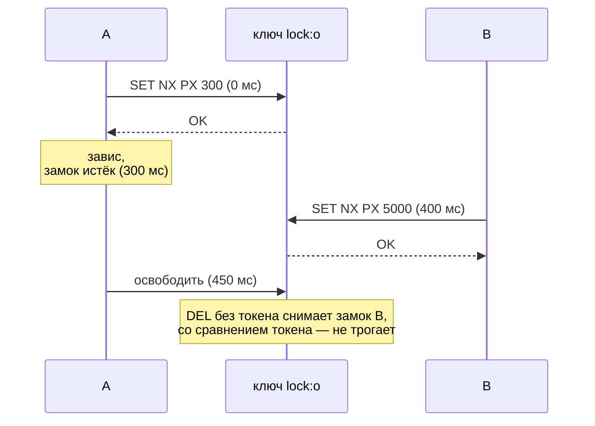

Как взять замок через `SET NX PX`, почему без токена владельца замок снимается чужой рукой, как продлевать замок и что такое fencing token. Отдельно о Redlock и критике Клеппмана.
Рядом: [[Redis]] · [[Атомарность в Redis]] · [[Кэширование в Redis]] · [[Идемпотентность в Redis]] · [[Блокировки]] (блокировки в PostgreSQL) · [[Транзакции и уровни изоляции]]
Разделы: [[#Суть]] · [[#Как устроен замок: схема и модель в коде]] · [[#Рецепт: замок с токеном]] · [[#Рецепт: продление замка]] · [[#Рецепт: fencing token]] · [[#Redlock и его критика]] · [[#Бизнес-кейс]] · [[#Что спросят дальше]]

Примеры снимались на Redis 8 (сервер 8.10.3) и redis-py 8.1.0, соединение `r = redis.Redis(port=6390, decode_responses=True)`.

## Суть

Блокировка нужна, чтобы из нескольких процессов (возможно, на разных серверах) одну работу выполнял только один. В Redis её строят на команде `SET key token NX PX ttl`: ключ записывается, только если его ещё нет (`NX`, not exists), и получает время жизни в миллисекундах (`PX`). Кто успел записать, тот и владеет замком, а TTL (time to live) снимает замок сам, если владелец упал.

У такого замка есть два принципиальных ограничения. Во-первых, он не должен сниматься чужим владельцем, отсюда токен. Во-вторых, замок может истечь, пока владелец ещё работает (пауза сборщика мусора, медленная сеть), и тогда два процесса окажутся в критической секции одновременно; полностью это не лечится замком, нужна проверка на стороне ресурса (fencing token).

## Как устроен замок: схема и модель в коде

Ниже схема и маленькая модель на Python: что на самом деле значат `SET NX PX` и истечение TTL и почему без токена чужой `DEL` снимает чужой замок. Время — явный параметр `now` в миллисекундах. Модель — один ключ и один сервер: ни репликации, ни Redlock в ней нет.

### NX, TTL и снятие по токену

Ключ с замком хранит значение и момент истечения. `SET NX PX` записывает ключ, только если его нет или он уже истёк. Истечение сервер проверяет «лениво», в момент обращения к ключу (плюс фоновая чистка, которая в модели не нужна). Именно поэтому замок, на который владелец не успел вовремя ответить, исчезает сам, и его берёт следующий. Сценарий из рецепта ниже: A берёт замок на 300 мс и зависает, B берёт замок после истечения, а очнувшийся A пытается освободить замок.



```python
class Store:
    def __init__(self):
        self.data = {}                      # ключ -> (значение, момент истечения)

    def get(self, key, now):
        item = self.data.get(key)
        if item is not None and item[1] <= now:
            del self.data[key]              # TTL вышел: ключа как будто нет
            item = None
        return item[0] if item else None

    def set_nx(self, key, value, px, now):
        if self.get(key, now) is not None:
            return False
        self.data[key] = (value, now + px)
        return True

    def delete(self, key, now):             # DEL: снимает, чей бы замок ни стоял
        existed = self.get(key, now) is not None
        self.data.pop(key, None)
        return existed

    def release(self, key, token, now):     # Lua-скрипт: сравнить токен и удалить, одним шагом
        if self.get(key, now) == token:
            del self.data[key]
            return True
        return False


# без токена: у всех значение "1"
s = Store()
s.set_nx("lock:o", "1", 300, now=0)         # True: A взял замок
s.set_nx("lock:o", "1", 5000, now=400)      # True: замок A истёк, взял B
s.delete("lock:o", now=450)                 # True: A «освободил», на самом деле снял замок B
s.set_nx("lock:o", "1", 5000, now=460)      # True: взял C, хотя B ещё работает

# с токеном: у каждого клиента свой
s = Store()
s.set_nx("lock:o", "token-A", 300, now=0)       # True: A взял замок
s.set_nx("lock:o", "token-B", 5000, now=400)    # True: замок A истёк, взял B
s.release("lock:o", "token-A", now=450)         # False: токен не совпал, замок B цел
s.set_nx("lock:o", "token-C", 5000, now=460)    # False: B ещё владеет замком
s.release("lock:o", "token-B", now=470)         # True: B освободил свой замок
```

В первом сценарии `DEL` не различает владельцев, поэтому у C оказывается замок при работающем B: два процесса в критической секции. Во втором освобождение A возвращает `False` и ничего не ломает, а C честно получает отказ, пока B не отпустит замок. Замок A при этом всё равно истёк на 300 мс, и модель показывает ограничение, которое токен не снимает: пока A «завис», B и A могли одновременно работать с ресурсом. От этого защищает fencing token (рецепт ниже).

## Рецепт: замок с токеном

**Задача.** Выполнять обработку заказа только в одном процессе и не снять замок, который уже принадлежит другому.

Сначала плохой вариант: значение замка одинаковое для всех, а освобождение просто `DEL`. Процесс A берёт замок на 300 мс и зависает на 400 мс. Замок истекает, его берёт B, а очнувшийся A «освобождает» замок:

```python
await r.set("lock:o", "1", nx=True, px=300)           # A захватил
await asyncio.sleep(0.4)                              # A завис, замок истёк
print("B захватил:", bool(await r.set("lock:o", "1", nx=True, px=5000)))
await r.delete("lock:o")                              # A очнулся и «освобождает»
print("C захватил, пока B работает:", bool(await r.set("lock:o", "1", nx=True, px=5000)))
```

```text title="Вывод"
B захватил: True
C захватил, пока B работает: True
```

B ещё работает, а замок уже у C: чужой `DEL` снял замок B. Теперь правильный вариант. В значение пишут уникальный токен (`uuid`), а освобождают Lua-скриптом, который сравнивает токен и удаляет ключ только при совпадении. Lua (встроенный в Redis язык скриптов) выполняется на сервере целиком, не пуская между командами чужие, поэтому «прочитать, сравнить, удалить» атомарно ([[Атомарность в Redis#Рецепт: Lua-скрипт и EVALSHA]]).

```python
RELEASE = """if redis.call('get',KEYS[1])==ARGV[1] then
               return redis.call('del',KEYS[1]) else return 0 end"""
ta, tb = uuid.uuid4().hex, uuid.uuid4().hex
await r.set("lock:o", ta, nx=True, px=300); await asyncio.sleep(0.4)
print("B захватил:", bool(await r.set("lock:o", tb, nx=True, px=5000)))
print("A release ->", await r.eval(RELEASE, 1, "lock:o", ta),
      "| владелец всё ещё B:", await r.get("lock:o") == tb)
print("B release ->", await r.eval(RELEASE, 1, "lock:o", tb))
```

```text title="Вывод"
B захватил: True
A release -> 0 | владелец всё ещё B: True
B release -> 1
```

Освобождение от A вернуло 0 и ничего не сломало, освобождение от B вернуло 1. Эквивалент в `redis-cli`:

```text
SET lock:order:42 <uuid> NX PX 30000
EVAL "if redis.call('get', KEYS[1]) == ARGV[1] then return redis.call('del', KEYS[1]) else return 0 end" 1 lock:order:42 <uuid>
```

**Грабли.** `SET` и `EXPIRE` отдельными командами использовать нельзя: процесс может упасть между ними, и замок останется навсегда. Атомарно ставят значение и TTL одной командой `SET ... NX PX`. Токен нельзя делать предсказуемым или общим (номер процесса, имя хоста): после перезапуска процесса с тем же именем он снимет чужой замок.

## Рецепт: продление замка

**Задача.** Работа может идти дольше, чем разумный TTL. Ставить огромный TTL нельзя, потому что после падения владельца замок провисит столько же.

Выход — короткий TTL и фоновое продление, пока владелец жив (его называют watchdog, «сторожевой таймер»). Продлевать, как и снимать, можно только свой замок, поэтому продление тоже Lua-скрипт с проверкой токена.

```python
EXTEND = """if redis.call('get',KEYS[1])==ARGV[1] then
              return redis.call('pexpire',KEYS[1],ARGV[2]) else return 0 end"""

class Lock:
    def __init__(s, key, ttl_ms=1000):
        s.key, s.ttl, s.token, s._task = key, ttl_ms, uuid.uuid4().hex, None
    async def acquire(s):
        ok = bool(await r.set(s.key, s.token, nx=True, px=s.ttl))
        if ok: s._task = asyncio.create_task(s._renew())
        return ok
    async def _renew(s):
        while True:
            await asyncio.sleep(s.ttl / 3000)            # каждую треть TTL
            if not await r.eval(EXTEND, 1, s.key, s.token, s.ttl):
                print("   (замок потерян)"); return
    async def release(s):
        if s._task: s._task.cancel()
        return await r.eval(RELEASE, 1, s.key, s.token)
```

Проверим: TTL 1 секунда, работа 2,5 секунды, в это время второй процесс пытается взять замок.

```text title="Вывод"
A acquire: True
t=0.5s  PTTL=833 мс, B acquire: False
t=1.5s  PTTL=837 мс, B acquire: False
t=2.5s  PTTL=841 мс, B acquire: False
A release: 1 | B acquire после: True
```

Остаток TTL (`PTTL`) каждый раз возвращается к значению около 840 мс, то есть замок продлевается, и B не может его взять, хотя исходный TTL давно прошёл. После `release` замок свободен.

**Грабли.** Продление не защищает от паузы самого процесса: если завис весь процесс вместе с задачей продления, замок истечёт. Поэтому продление не отменяет fencing token. И ещё: задача продления должна падать вместе с владельцем (здесь это задача внутри того же процесса), иначе осиротевший watchdog продлевает замок мёртвого владельца вечно.

## Рецепт: fencing token

**Задача.** Даже с продлением процесс может очнуться после долгой паузы, когда замок давно у другого. Защитить ресурс, который он собирается менять.

Fencing token («токен-ограждение») — монотонно растущий номер, который выдаётся при каждом захвате. Целевое хранилище запоминает наибольший виденный номер и отвергает операции с меньшим. Номер удобно брать командой `INCR` при захвате замка.

```python
ta = await r.incr("fence:job"); print("A получил токен", ta)
tb = await r.incr("fence:job"); print("B получил токен", tb)    # A уже в паузе, замок истёк
print("B:", await write(tb, "от B"))
print("A очнулся:", await write(ta, "от A"))
print("в хранилище:", STORE)
```

```text title="Вывод"
A получил токен 1
B получил токен 2
B: записано (токен 2)
A очнулся: отклонено (токен 1 < 2)
в хранилище: {'token': 2, 'value': 'от B'}
```

Запись от очнувшегося A отвергнута, данные B целы. Функция `write` здесь заглушка хранилища, которая сравнивает номера. На практике проверку делает сама база: `UPDATE ... WHERE fence < :token` или ограничение на версию строки; если хранилище не умеет сравнивать номера, замок Redis защищает только от гонки «в обычной жизни», но не от паузы процесса.

**Грабли.** Счётчик токенов должен переживать перезапуск и переключение на реплику Redis; при потере счётчика номера пойдут с единицы, и защита сломается. Номер из базы (последовательность `SEQUENCE`) в этом смысле надёжнее.

## Redlock и его критика

Redlock — алгоритм захвата замка сразу на нескольких независимых узлах Redis (обычно пяти) по большинству: клиент пытается взять замок на всех узлах и считает его своим, если взял на большинстве за время, меньшее TTL. Идея в том, что один упавший или переключённый узел не ломает замок, как это случилось бы на одном узле с асинхронной репликой ([[Репликация и кластер Redis#Репликация и потеря записей]]).

Мартин Клеппман в разборе алгоритма указывает две проблемы: Redlock не выдаёт fencing token (а без него пауза процесса ломает взаимное исключение), и его корректность опирается на предположения о часах и паузах (скачок системных часов на узле или долгая пауза между шагами нарушают гарантию). Автор Redis Сальваторе Санфилиппо (antirez) с этим спорит и считает допущения разумными. На собеседовании важно не победить в споре, а показать, что ты знаешь про fencing: для эффективности (не делать работу дважды) обычного замка на одном Redis достаточно, а для корректности, когда ошибка стоит денег, замок надёжнее держать в базе данных: `FOR UPDATE`, advisory lock (программная блокировка по числовому ключу) или ограничение `UNIQUE`, см. [[Блокировки]]. Сам Redlock в этом рецепте запуском не проверялся: для него нужны пять независимых узлов.

## Бизнес-кейс

- **Один запуск ночного отчёта на весь кластер.** Десять экземпляров сервиса стартуют по расписанию, и замок `SET lock:report NX PX` с TTL на время работы гарантирует, что отчёт посчитает один. Цена ошибки невелика (отчёт посчитается дважды), поэтому замка в Redis достаточно.
- **Списание денег.** Здесь замок в Redis не источник правды: двойное списание предотвращается ограничением `UNIQUE` на идентификатор операции и транзакцией в базе, а замок — лишь оптимизация, чтобы не гонять лишние запросы ([[Идемпотентность в Redis]]).

## Что спросят дальше

- Зачем нужен токен в значении замка? Чтобы процесс мог снять только свой замок, а не замок, доставшийся другому после истечения TTL.
- Почему освобождение через Lua, а не `GET` и `DEL` отдельно? Между ними замок может истечь и достаться другому; скрипт выполняется атомарно.
- Что делает fencing token и почему он нужен при наличии TTL? TTL не мешает очнувшемуся процессу записать данные; токен позволяет ресурсу отвергнуть устаревшего владельца.
- Что с замком при переключении на реплику? Репликация асинхронная, и ключ замка может не успеть переехать, тогда новый мастер отдаст замок второму клиенту.
