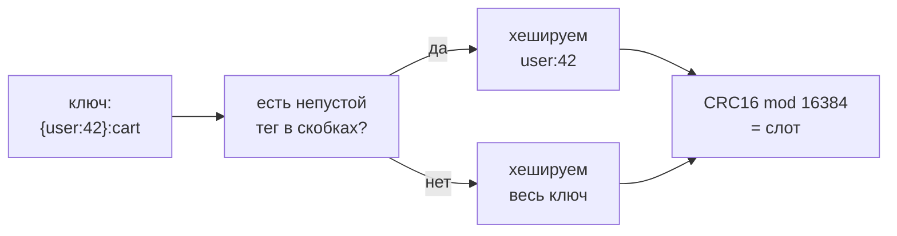
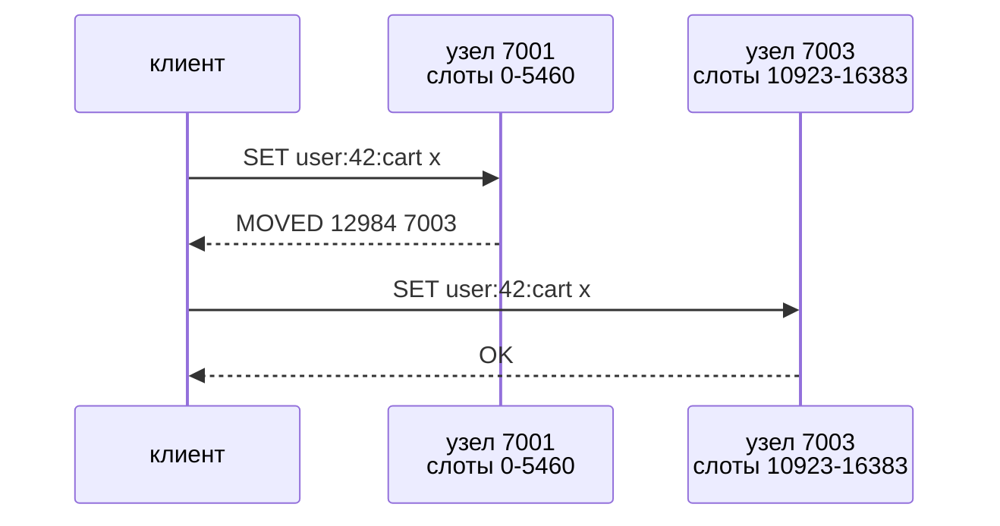

Как Redis масштабируется и переживает отказы: асинхронная репликация и потеря записей, `WAIT` и `min-replicas-to-write`, Sentinel, Redis Cluster со слотами и hash tags, горячие ключи. Репликация и кластер подняты и проверены на трёх узлах.
Рядом: [[Redis]] · [[Персистентность и память Redis]] · [[Распределённая блокировка в Redis]] · [[Атомарность в Redis]] · [[Идемпотентность в Redis]] · [[Эксплуатация PostgreSQL]]
Разделы: [[#Суть]] · [[#Репликация и потеря записей]] · [[#Рецепт: WAIT и min-replicas-to-write]] · [[#Sentinel]] · [[#Cluster и слоты]] · [[#Hash tags]] · [[#Как устроены слоты: схема и модель в коде]] · [[#Горячие ключи и разбиение]] · [[#Бизнес-кейс]] · [[#Что спросят дальше]]

Примеры снимались на Redis 8 (сервер 8.10.3); узлы реплики и кластера запускались внутри одного контейнера на разных портах (7100, 7001-7003), вывод получен через `redis-cli`.

## Суть

Один узел Redis ограничен памятью и пропускной способностью одного ядра, и он единственная точка отказа. Репликация (replication) копирует данные на другие узлы: реплики разгружают чтение и могут заменить главный узел (master). Sentinel («страж») следит за узлами и автоматически переключает на реплику при падении master. Cluster делит данные по нескольким узлам, чтобы выйти за предел памяти одного. Все эти механизмы по умолчанию асинхронные, поэтому при отказе последние записи могут пропасть.

## Репликация и потеря записей

Реплика — копия данных на другом узле, которая получает поток команд от master и применяет его у себя. Репликация асинхронная: master отвечает клиенту «записано» раньше, чем реплика получила команду. Поэтому при аварийном переключении (failover) на реплику последние записи можно потерять, и это важно для замков и ключей идемпотентности ([[Распределённая блокировка в Redis]], [[Идемпотентность в Redis]]).

Поднимем реплику (`redis-server --port 7100 --replicaof 127.0.0.1 6379`) и проверим, что запись на master видна на реплике, а запись на самой реплике запрещена:

```text title="Вывод"
> SET k v                          (на master, порт 6379)
OK
> GET k                            (на реплике, порт 7100)
v
> SET x 1                          (на реплике)
READONLY You can't write against a read only replica.
> INFO replication                 (на master, фрагмент)
role:master
connected_slaves:1
> INFO replication                 (на реплике, фрагмент)
role:slave
master_link_status:up
```

Запись на master появилась на реплике, запись на реплике отвергнута (`READONLY`). Поэтому чтение с реплики возможно, но может отставать: после своей записи читатель не всегда видит её, если читает с реплики.

(Строки с приглашением `>` и пометками добавлены для читаемости, остальное вывод `redis-cli`; сразу после запуска реплика ещё несколько секунд выполняет первичную синхронизацию, поэтому проверку нужно делать после `master_link_status:up`.)

**Грабли.** Реплики по умолчанию отдают устаревшие данные во время синхронизации и при потере связи с master; это настраивается `replica-serve-stale-data`. Эти настройки запуском не проверялись.

## Рецепт: WAIT и min-replicas-to-write

**Задача.** Для важной записи убедиться, что она дошла хотя бы до одной реплики.

Команда `WAIT <число реплик> <таймаут мс>` блокирует клиента, пока указанное число реплик не подтвердит все его предыдущие записи, и возвращает число подтвердивших. Настройка `min-replicas-to-write` заставляет master вообще отказывать в записи, если живых реплик меньше заданного.

```text title="Вывод"
> SET a 1
OK
> WAIT 1 100
1
> CONFIG SET min-replicas-to-write 1
OK
> SHUTDOWN NOSAVE                 (на реплике, она остановлена)
> SET a 2                         (на master, через 11 секунд)
NOREPLICAS Not enough good replicas to write.
```

`WAIT` вернул 1: реплика подтвердила запись. После остановки реплики master через десять секунд (порог `min-replicas-max-lag`) перестал принимать записи, ответив `NOREPLICAS`. Эти механизмы сужают окно потери, но не закрывают его: реплика могла подтвердить запись и умереть вместе с master, и `WAIT` не превращает Redis в систему с синхронной репликацией.

**Грабли.** `min-replicas-to-write` превращает отказ реплики в недоступность записи на master: Redis жертвует доступностью ради сохранности. Включайте осознанно.

## Sentinel

Sentinel — служба наблюдения за одним master и его репликами: следит за их здоровьем и автоматически переключает на реплику при падении master. Запускают минимум три экземпляра Sentinel, потому что решение о том, что master упал, принимается кворумом (большинством): два из трёх. Клиент спрашивает у Sentinel, кто сейчас master, и подключается к нему. Sentinel не делит данные: все они по-прежнему на одном master, лимит по памяти не снимается. В этой работе Sentinel запуском не проверялся: для него нужны отдельные процессы Sentinel и имитация падения master.

## Cluster и слоты

Redis Cluster делит ключи на 16384 слота (hash slot) и раздаёт слоты по шардам (узлам-master). Слот ключа считается от хеша его имени (CRC16 по модулю 16384). Каждый узел знает карту слотов, и клиент с поддержкой кластера идёт сразу на нужный узел. Поднимем три узла и создадим кластер:

```text title="Вывод"
M: 1237643516f6e20fa4b8164e73613ab2784e0d07 127.0.0.1:7001
   slots:[0-5460] (5461 slots) master
M: 4377458ace3d7ce7218e1adffe99b3133761363f 127.0.0.1:7002
   slots:[5461-10922] (5462 slots) master
M: f4adfb4c3671702c470f923e6c12cf7f711d21ae 127.0.0.1:7003
   slots:[10923-16383] (5461 slots) master
[OK] All 16384 slots covered.
```

Слоты разделены поровну между тремя узлами. Если записать ключ не на тот узел, он ответит перенаправлением `MOVED`, а клиент с флагом `-c` (режим кластера в `redis-cli`) пойдёт по нему сам:

```text title="Вывод"
> SET user:42:cart x               (узел 7001, без -c)
MOVED 12984 127.0.0.1:7003
> SET user:42:cart x               (узел 7001, с -c)
OK
```

Ключ `user:42:cart` попал в слот 12984, который принадлежит узлу 7003. В кластере из трёх узлов без реплик отказ любого узла делает его слоты недоступными, поэтому в продакшене у каждого master есть хотя бы одна реплика (минимум шесть узлов).

**Грабли.** Redis Cluster не гарантирует сильную согласованность: он так же асинхронно реплицирует, и при переключении теряет последние записи. Транзакции, скрипты и команды с несколькими ключами требуют, чтобы ключи лежали в одном слоте.

## Hash tags

Команды с несколькими ключами (`MSET`, `SINTER`, `MULTI`, скрипты) в кластере работают, только если все ключи в одном слоте. Чтобы попасть в один слот, в имя добавляют hash tag: хешируется только часть в фигурных скобках. Проверим слоты:

```text title="Вывод"
> CLUSTER KEYSLOT {user:42}:cart
15880
> CLUSTER KEYSLOT {user:42}:profile
15880
> CLUSTER KEYSLOT user:42:cart
12984
> CLUSTER KEYSLOT user:42:profile
9133
```

С тегами `{user:42}:cart` и `{user:42}:profile` лежат в слоте 15880, а без тега тот же набор разъезжается по слотам 12984 и 9133, то есть по разным узлам. Результат многоключевых команд соответствует:

```text title="Вывод"
> MSET {user:42}:cart a {user:42}:profile b
OK
> MSET user:42:cart a user:42:profile b
CROSSSLOT Keys in request don't hash to the same slot
```

**Грабли.** Hash tag собирает все ключи пользователя на один узел, и при очень активном пользователе этот узел становится горячим. Тег должен быть таким, чтобы данные сбалансированно распределялись по слотам: идентификатор пользователя годится, константа вроде `{app}` собирает весь набор на один узел и обесценивает кластер.

## Как устроены слоты: схема и модель в коде

Ниже схемы и маленькая модель на Python: как ключ превращается в номер слота, как hash tag меняет этот номер и как узел решает, ответить на команду или отправить клиента дальше. Модель не реплицирует и не переносит данные, только считает слоты и отвечает так же, как узлы из разделов выше.

### CRC16 и hash tag

Номер слота — `CRC16(ключ) mod 16384`. Это вариант CRC16 XMODEM: многочлен `0x1021`, начальное значение 0, без отражения битов и без финального XOR. Спецификация Redis Cluster даёт контрольное значение: CRC16 от строки `123456789` равен `0x31C3`. Если в имени ключа есть пара фигурных скобок с непустым содержимым, хешируется только это содержимое между первой `{` и следующей за ней `}`. Пустые скобки `{}` не считаются тегом, хешируется весь ключ.



```python
def crc16(data):
    crc = 0
    for byte in data.encode():
        crc ^= byte << 8                    # старший байт регистра смешиваем с очередным байтом
        for _ in range(8):
            if crc & 0x8000:
                crc = ((crc << 1) ^ 0x1021) & 0xFFFF
            else:
                crc = (crc << 1) & 0xFFFF
    return crc


def slot(key):
    start = key.find("{")
    if start != -1:
        end = key.find("}", start + 1)
        if end > start + 1:                 # тег не пустой
            key = key[start + 1:end]
    return crc16(key) % 16384


hex(crc16("123456789"))                     # '0x31c3'
slot("user:42:cart")                        # 12984
slot("user:42:profile")                     # 9133
slot("{user:42}:cart")                      # 15880
slot("{user:42}:profile")                   # 15880
slot("{}user:42:cart") == slot("{}user:42:profile")   # False: пустой тег не работает
```

Значения те же, что показал `CLUSTER KEYSLOT` выше: `12984`, `9133` и `15880`. Контрольная сумма сошлась со спецификацией, значит реализация правильная.

### Таблица слотов, MOVED и CROSSSLOT

Каждый узел-master владеет диапазонами слотов. При создании кластера на три узла `redis-cli` режет 16384 слота на три равные части (диапазоны те же, что в выводе выше). Любой узел знает карту всех диапазонов, поэтому на команду для чужого слота отвечает не данными, а адресом владельца: `MOVED <слот> <адрес>`. Клиент с поддержкой кластера запоминает эту карту и дальше ходит прямо на нужный узел.



```python
NODES = {7001: (0, 5460), 7002: (5461, 10922), 7003: (10923, 16383)}


def owner(slot_number):
    for port in NODES:
        low, high = NODES[port]
        if low <= slot_number <= high:
            return port


def execute(port, keys):
    # keys: ключи одной команды. Все должны быть в одном слоте и на этом узле
    slots = []
    for key in keys:
        if slot(key) not in slots:
            slots.append(slot(key))
    if len(slots) > 1:
        return "CROSSSLOT Keys in request don't hash to the same slot"
    if owner(slots[0]) != port:
        return "MOVED %d 127.0.0.1:%d" % (slots[0], owner(slots[0]))
    return "OK"


execute(7001, ["user:42:cart"])                                 # 'MOVED 12984 127.0.0.1:7003'
execute(7003, ["user:42:cart"])                                 # 'OK'
execute(7003, ["{user:42}:cart", "{user:42}:profile"])          # 'OK'
execute(7003, ["user:42:cart", "user:42:profile"])              # "CROSSSLOT Keys in request don't hash to the same slot"
```

Вывод совпадает с примерами `redis-cli` выше: ключ `user:42:cart` попал в слот 12984, которым владеет узел 7003, а два ключа без общего тега дают `CROSSSLOT`. Последний вызов показывает ещё одно: проверка `CROSSSLOT` идёт раньше проверки владельца.

Модель опускает перенос слота между узлами. Когда слот переезжает (`CLUSTER SETSLOT ... MIGRATING` на старом узле и `IMPORTING` на новом, ключи переносятся командой `MIGRATE`), старый узел отвечает на ключи, которых у него уже нет, не `MOVED`, а `ASK <слот> <адрес>`. Клиент должен один раз послать на новый узел команду `ASKING` и повторить запрос, но карту слотов не обновляет: `ASK` действует на один запрос, а `MOVED` означает, что слот переехал насовсем, и карту пора менять.

## Горячие ключи и разбиение

Если один ключ получает миллион запросов в секунду, он упирается в один шард (одну часть кластера), и добавление узлов не помогает. Что делают: читать с реплик, кэшировать значение в памяти приложения на доли секунды, делить ключ на части (`lb:shard-0`...`lb:shard-15`) и собирать результат при чтении. Для больших ключей см. [[Персистентность и память Redis#Большие ключи и UNLINK]].

## Бизнес-кейс

- **Сессии и кэш каталога на кластере.** Данные потеряются частично при отказе узла, и это допустимо: кэш наполнится заново, сессии придётся создать повторно. Ключи одного пользователя объединяют hash tag, а независимые кэшируемые страницы оставляют без тега, чтобы они разошлись по узлам.
- **Блокировки и идемпотентность на репликах.** При аварийном переключении ключ замка может не успеть переехать, и два клиента окажутся в критической секции ([[Распределённая блокировка в Redis#Redlock и его критика]]). Если ошибка стоит денег, держите источник правды в базе.

## Что спросят дальше

- Что теряем при failover? Записи, которые master подтвердил клиенту, но ещё не отправил реплике; `WAIT` и `min-replicas-to-write` сужают окно, но не закрывают.
- Чем Sentinel отличается от Cluster? Sentinel даёт отказоустойчивость одного набора данных, Cluster делит данные по шардам и масштабирует память и запись.
- Почему в Cluster 16384 слота и что такое hash tag? Слот ключа считается от хеша его имени; тег в фигурных скобках позволяет держать связанные ключи в одном слоте.
- Можно ли читать с реплики? Да, но с возможным отставанием; для чтения собственных записей нужно читать с master.
