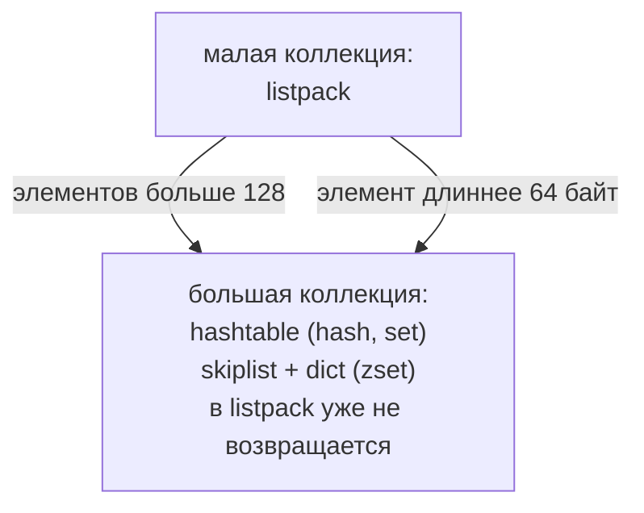
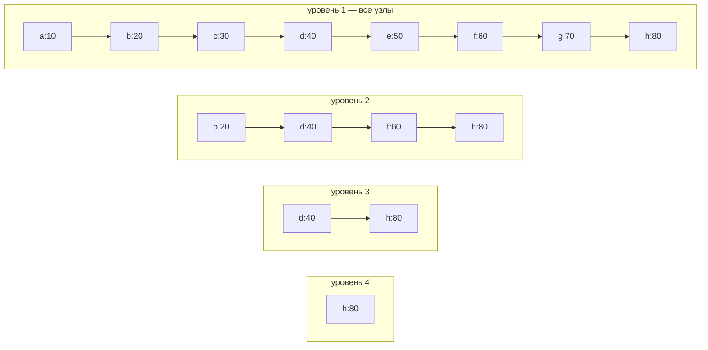

Какая структура Redis подходит под какую задачу и чем платим за выбор: таблица лидеров, корзина, лента, уникальные посетители, подсчёт уникальных значений и активность по дням.
Рядом: [[Redis]] · [[Кэширование в Redis]] · [[Очереди и события в Redis]] · [[Идемпотентность в Redis]] · [[Персистентность и память Redis]]
Разделы: [[#Суть]] · [[#Таблица структур и задач]] · [[#Как устроены структуры внутри: схема и модель в коде]] · [[#Рецепт: таблица лидеров на sorted set]] · [[#Рецепт: корзина в hash]] · [[#Рецепт: лента последних N на list]] · [[#Рецепт: уникальные посетители, set против HyperLogLog]] · [[#Рецепт: активность по дням в bitmap]] · [[#Бизнес-кейс]] · [[#Что спросят дальше]]

Все примеры снимались на Redis 8 (сервер 8.10.3) и redis-py 8.1.0 в асинхронном режиме (`redis.asyncio`). Везде подразумевается соединение `r = redis.Redis(port=6390, decode_responses=True)`; `decode_responses=True` возвращает строки вместо байтов.

## Суть

Значение в Redis не обязано быть строкой. Список, множество, хеш, упорядоченное множество и другие структуры хранятся прямо на сервере, а команды над ними выполняются атомарно, поэтому многие задачи решаются одной командой вместо цикла «прочитать, изменить, записать» в приложении. Выбор структуры определяет и скорость (большинство операций работает за O(1) или O(log N), то есть время растёт медленно вместе с размером данных), и расход памяти. Для малых коллекций Redis сам использует компактное внутреннее представление, а для больших переключается на обычное.

## Таблица структур и задач

| Структура | Команды | Задача |
| --- | --- | --- |
| String (строка) | `GET`, `SET EX NX`, `INCR` | кэш, счётчики, блокировки, ключ идемпотентности ([[Идемпотентность в Redis]]) |
| Hash (хеш) | `HSET`, `HGETALL`, `HINCRBY` | объект (профиль, корзина), поля которого читаются и меняются по отдельности, без сериализации целиком |
| List (список) | `LPUSH`, `BRPOP`, `LMOVE` | простая очередь, лента последних N записей |
| Set (множество) | `SADD`, `SISMEMBER`, `SINTER` | уникальные посетители, теги |
| Sorted Set (упорядоченное множество) | `ZADD`, `ZRANGE`, `ZRANGEBYSCORE` | таблица лидеров, ограничитель частоты со скользящим окном, отложенные задачи по времени |
| Stream (поток) | `XADD`, `XREADGROUP`, `XACK` | очередь с группами потребителей (consumer groups) и подтверждением обработки, «мини-Kafka» |
| HyperLogLog | `PFADD`, `PFCOUNT` | приблизительный подсчёт уникальных значений: около 12 КБ на ключ, ошибка около 0,8% |
| Bitmap (битовая карта) | `SETBIT`, `BITCOUNT` | активность пользователей по дням: один бит на день |
| Pub/Sub (публикация и подписка) | `PUBLISH`, `SUBSCRIBE` | оповещения без гарантий: если подписчик был офлайн, сообщение для него потеряно |

Пояснения к таблице:

- `SET EX NX` записывает значение, только если ключа ещё нет (`NX`, not exists), и сама удаляет ключ через заданное число секунд (`EX`, expire).
- `INCR` атомарно увеличивает число в ключе на единицу; `HINCRBY` делает то же для поля хеша.
- Consumer group — группа читателей потока: Redis раздаёт сообщения между ними, а читатель подтверждает обработку командой `XACK` (ack, acknowledge, «подтверждено»). Подробнее в [[Очереди и события в Redis]].
- `LMOVE` атомарно перекладывает элемент из одного списка в другой, `BRPOP` ждёт элемент, если список пуст.

## Как устроены структуры внутри: схема и модель в коде

Ниже схемы и маленькие модели на Python: когда Redis держит коллекцию в компактном виде и когда переключается на обычный, и как устроен sorted set, раз он быстро отвечает и по имени элемента, и по диапазону счёта. Модели упрощены, и это сказано при каждой.

### Компактная кодировка и пороги

Маленькие hash, set и sorted set Redis хранит в `listpack`: один плотный кусок памяти, где элементы лежат подряд без указателей. Поиск в нём линейный, но на сотне элементов это быстрее и заметно дешевле по памяти, чем хеш-таблица. Как только коллекция выходит за порог по числу элементов или хоть один элемент длиннее порога в байтах, Redis один раз перекладывает её в «большое» представление: `hashtable` для hash и set, `skiplist` для sorted set. Обратно коллекция сама не сжимается, даже если элементы потом удалить.

Пороги задают настройки `hash-max-listpack-entries` и `hash-max-listpack-value` (для sorted set — `zset-max-listpack-*`, для set — `set-max-listpack-*`, и ещё `set-max-intset-entries` для множества из одних целых). Значения по умолчанию (Redis 7.2 и новее, включая 8): 128 элементов и 64 байта; `set-max-listpack-*` появились в 7.2, до этого маленький set из строк сразу был `hashtable`. Фактическое представление показывает `OBJECT ENCODING` (пример с выводом в разделе «Компактные представления» ниже).



```python
# пороги по умолчанию Redis 7.2+: число элементов и длина элемента в байтах
LIMITS = {"hash": (128, 64), "zset": (128, 64), "set": (128, 64)}


def encoding(kind, items):
    # items: для hash список пар (поле, значение), для zset и set список элементов
    max_entries, max_value = LIMITS[kind]
    big = {"hash": "hashtable", "zset": "skiplist", "set": "hashtable"}[kind]
    if len(items) > max_entries:
        return big
    for item in items:
        parts = item if kind == "hash" else [item]
        for part in parts:
            if len(str(part).encode()) > max_value:
                return big
    return "listpack"


encoding("hash", [("a", 1)])                                  # 'listpack'
encoding("hash", [(str(i), "x") for i in range(128)])         # 'listpack'
encoding("hash", [(str(i), "x") for i in range(129)])         # 'hashtable'
encoding("hash", [("a", "x" * 65)])                           # 'hashtable'
encoding("zset", ["m1", "m2"])                                # 'listpack'
encoding("zset", ["m" + str(i) for i in range(129)])          # 'skiplist'
```

Модель упрощена: у set есть ещё промежуточное представление `intset` для чисел, у list пороги задаются размером в байтах (`list-max-listpack-size`), а настоящий Redis сверяет порог и при добавлении, и при чтении настроек из конфига.

### Sorted set: skiplist и словарь

Большой sorted set состоит из двух структур над одними и теми же элементами. Словарь `член → счёт` отвечает на `ZSCORE` за O(1). Skiplist хранит пары `(счёт, член)` по порядку и отвечает на `ZRANGEBYSCORE`, `ZRANK` и вставку за O(log N). Пропускной список — это обычный отсортированный связный список, над которым надстроены «скоростные полосы»: у части узлов есть ссылки, которые перепрыгивают несколько соседей. Поиск идёт сверху вниз: на верхнем уровне шагаем вправо, пока следующий узел ещё меньше искомого, затем спускаемся на уровень ниже и повторяем.



Высоту узла Redis выбирает случайно: каждый следующий уровень с вероятностью 1/4, максимум 32. В модели уровни заданы явно, поэтому результат повторяется. Упрощения: нет ссылки назад и счётчиков пролёта (`span`), по которым Redis считает `ZRANK` и `ZRANGE` по позиции, а равные счета упорядочиваются по имени члена, как и в Redis.

```python
class Skiplist:
    def __init__(self, max_level=4):
        self.max_level = max_level
        self.head = {"score": None, "member": None, "next": [None] * max_level}
        self.steps = 0                      # сколько раз шагнули вправо: мера работы

    def less(self, node, score, member):    # узел стоит раньше пары (score, member)
        return node["score"] < score or (node["score"] == score and node["member"] < member)

    def path(self, score, member):
        # сверху вниз: на каждом уровне идём вправо, пока следующий узел раньше искомого
        update = [None] * self.max_level    # последний узел перед позицией на каждом уровне
        node = self.head
        for lvl in range(self.max_level - 1, -1, -1):
            while node["next"][lvl] is not None and self.less(node["next"][lvl], score, member):
                node = node["next"][lvl]
                self.steps += 1
            update[lvl] = node
        return update

    def insert(self, score, member, level):     # у Redis уровень случайный, у нас задан
        update = self.path(score, member)
        node = {"score": score, "member": member, "next": [None] * level}
        for lvl in range(level):
            node["next"][lvl] = update[lvl]["next"][lvl]
            update[lvl]["next"][lvl] = node

    def remove(self, score, member):
        update = self.path(score, member)
        node = update[0]["next"][0]
        if node is not None and node["score"] == score and node["member"] == member:
            for lvl in range(len(node["next"])):
                update[lvl]["next"][lvl] = node["next"][lvl]

    def range_by_score(self, low, high):
        self.steps = 0
        node = self.path(low, "")[0]["next"][0]  # первый узел со score >= low
        found = []
        while node is not None and node["score"] <= high:
            found.append((node["member"], node["score"]))
            node = node["next"][0]               # дальше по нижнему уровню
            self.steps += 1
        return found


class SortedSet:
    def __init__(self):
        self.scores = {}                    # член -> счёт: ZSCORE за O(1)
        self.skip = Skiplist()              # (счёт, член) по порядку: диапазоны

    def zadd(self, member, score, level=1):
        if member in self.scores:           # смена счёта: удалить старый узел и вставить новый
            self.skip.remove(self.scores[member], member)
        self.scores[member] = score
        self.skip.insert(score, member, level)

    def zscore(self, member):
        return self.scores[member]

    def zrangebyscore(self, low, high):
        return self.skip.range_by_score(low, high)
```

Прогон: восемь членов с явными уровнями, как на схеме.

```python
z = SortedSet()
for member, score, level in [("a", 10, 1), ("b", 20, 2), ("c", 30, 1), ("d", 40, 3),
                             ("e", 50, 1), ("f", 60, 2), ("g", 70, 1), ("h", 80, 4)]:
    z.zadd(member, score, level)

z.zscore("f")                           # 60
z.zrangebyscore(35, 65)                 # [('d', 40), ('e', 50), ('f', 60)]
z.skip.steps                            # 5

z.zadd("c", 75)                         # смена счёта: узел c уехал с 30 на 75
z.zrangebyscore(70, 80)                 # [('g', 70), ('c', 75), ('h', 80)]
```

`ZRANGEBYSCORE 35 65` сначала спускается по уровням до первого узла со счётом не меньше 35 (два шага вправо: `b`, затем `c` на нижнем уровне), потом идёт по нижнему уровню и собирает `d`, `e`, `f` (три шага): всего 5. `ZADD` для существующего члена не создаёт дубль: словарь находит старый счёт, skiplist удаляет старый узел и вставляет новый. Выигрыш от уровней виден на большом наборе: 64 члена, у каждого второго уровень 2, у каждого четвёртого 3, у каждого восьмого 4.

```python
big = SortedSet()
for i in range(1, 65):
    level = 1 + (i % 2 == 0) + (i % 4 == 0) + (i % 8 == 0)
    big.zadd("m" + str(i), i * 10, level)

big.skip.steps = 0
big.skip.path(600, "")                  # спуск до первого счёта >= 600
big.skip.steps                          # 9
```

Девять шагов вместо 59 при обходе списка подряд. Так ядро sorted set и держит и точечные ответы, и диапазоны (таблица лидеров ниже), а вставка идёт за те же O(log N). В маленьком sorted set (до 128 элементов) всего этого нет: он лежит в `listpack` отсортированным массивом, и поиск там линейный.

## Рецепт: таблица лидеров на sorted set

**Задача.** Миллион игроков с очками; нужно быстро прибавлять очки, узнавать место игрока и показывать верх таблицы.

В sorted set каждый элемент хранится вместе с числовой оценкой (score), и Redis держит элементы упорядоченными по ней. Поэтому и добавление очков, и запрос места работают за O(log N), а верх таблицы читается срезом.

```python
await r.zadd("lb", {"anna": 120, "boris": 90, "vera": 150})
await r.zincrby("lb", 40, "boris")                     # boris: 90 -> 130
print(await r.zrevrange("lb", 0, 2, withscores=True))  # от большего к меньшему
print("rank boris:", await r.zrevrank("lb", "boris"), "score:", await r.zscore("lb", "boris"))
```

```text title="Вывод"
[('vera', 150.0), ('boris', 130.0), ('anna', 120.0)]
rank boris: 1 score: 130.0
```

Место считается с нуля: `ZREVRANK` вернул 1 для второго игрока. Для показа пользователю прибавляйте единицу.

**Грабли.** Оценка хранится как число с плавающей точкой двойной точности, поэтому целые очки точны до 2^53; для денег в копейках этого хватает, для произвольных дробей нет. При равных очках порядок определяется лексикографически по имени элемента, а не по времени получения очков. Если нужен «кто раньше набрал», зашивайте время в дробную часть оценки или берите отдельное поле. Один ключ на весь мир при очень большой нагрузке становится горячим ключом ([[Репликация и кластер Redis#Горячие ключи и разбиение]]); тогда таблицу делят на периоды (`lb:2026-11`) или шарды.

## Рецепт: корзина в hash

**Задача.** Корзина покупателя: менять количество одной позиции, не читая и не переписывая всю корзину.

```python
await r.hset("cart:42", mapping={"sku:1": 2, "sku:7": 1})
await r.hincrby("cart:42", "sku:1", 3)
print(await r.hgetall("cart:42"))
```

```text title="Вывод"
{'sku:1': '5', 'sku:7': '1'}
```

`HINCRBY` увеличил одно поле атомарно: два параллельных запроса на добавление не затрут друг друга, как случилось бы при схеме «`GET` JSON, поправить, `SET`». Значения полей всегда строки, число приходится приводить к типу самому.

**Грабли.** У хеша нет TTL на отдельное поле в старых версиях: время жизни есть только у ключа целиком (команды `HEXPIRE` для отдельных полей появились в Redis 7.4; если в продакшене версия старше, опираться на них нельзя). Вложенные структуры в поле не положить: либо JSON-строка, либо отдельные ключи.

## Рецепт: лента последних N на list

**Задача.** Хранить последние три события пользователя, старые отбрасывать.

```python
for i in range(5):
    await r.lpush("feed", f"e{i}")
    await r.ltrim("feed", 0, 2)        # оставить элементы с 0 по 2
print(await r.lrange("feed", 0, -1))
```

```text title="Вывод"
['e4', 'e3', 'e2']
```

`LPUSH` кладёт в голову списка, `LTRIM` обрезает хвост, так что список никогда не растёт сверх N. Обе команды лучше отправлять одним pipeline или `MULTI`, чтобы между ними не успело накопиться лишнее; для ленты это некритично, а для ограничения размера хватает и отдельных вызовов.

**Грабли.** `LRANGE` с большим диапазоном по длинному списку тяжёлый. Доступ по индексу из середины списка — O(N), поэтому «вторая страница ленты» по смещению на списке в миллион элементов медленная; для страниц с курсором берите sorted set с временем в оценке.

## Рецепт: уникальные посетители, set против HyperLogLog

**Задача.** Сколько уникальных пользователей заходило за день; точность до процента допустима, память экономим.

Set хранит каждого посетителя и считает точно, HyperLogLog (вероятностная структура) хранит только компактную статистику и ошибается в пределах около процента. Загрузим по 100 000 уникальных идентификаторов в обе структуры:

```python
pipe = r.pipeline(transaction=False)
for i in range(100000):
    pipe.pfadd("hll", f"user{i}")
    pipe.sadd("exact", f"user{i}")
await pipe.execute()
print("PFCOUNT:", await r.pfcount("hll"), "SCARD:", await r.scard("exact"))
print("memory hll:", await r.memory_usage("hll"), "set:", await r.memory_usage("exact"))
```

```text title="Вывод"
PFCOUNT: 99725 SCARD: 100000
memory hll: 14358 set: 4261834
```

HyperLogLog ошибся на 0,27% и занял 14 КБ (`MEMORY USAGE` в байтах) вместо 4 МБ, то есть примерно в 300 раз меньше. Платим тем, что нельзя спросить «был ли пользователь X» и нельзя получить список. Если нужны пересечения («заходили и в понедельник, и во вторник»), у set есть `SINTER`, а у HyperLogLog только объединение через `PFMERGE`.

Попутно проверим пересечение и объединение на обычных множествах:

```python
await r.sadd("visit:mon", "u1", "u2", "u3")
await r.sadd("visit:tue", "u2", "u3", "u4")
print(sorted(await r.sinter("visit:mon", "visit:tue")))
print(await r.sunionstore("visit:both", "visit:mon", "visit:tue"))
```

```text title="Вывод"
['u2', 'u3']
4
```

**Грабли.** `SMEMBERS` на большом множестве блокирует единственный поток Redis так же, как `KEYS`: для обхода используйте `SSCAN` ([[Персистентность и память Redis#SCAN против KEYS]]).

## Рецепт: активность по дням в bitmap

**Задача.** Хранить, в какие дни пользователь был активен, и считать количество таких дней.

Bitmap — это обычная строка, которую Redis рассматривает как массив битов. Номер дня служит смещением, поэтому год активности одного пользователя занимает около 46 байт.

```python
for day in (1, 2, 3, 5, 8):
    await r.setbit("act:u1", day, 1)
print("active days:", await r.bitcount("act:u1"),
      "day5:", await r.getbit("act:u1", 5), "day6:", await r.getbit("act:u1", 6))
```

```text title="Вывод"
active days: 5 day5: 1 day6: 0
```

**Грабли.** Если первым записать бит с огромным смещением, Redis выделит всю строку до него: бит со смещением в несколько миллиардов займёт сотни мегабайт (этот случай запуском не проверялся). Смещение нужно считать от начала периода, а не от Unix-эпохи.

## Компактные представления

Redis сам выбирает внутреннее представление по размеру коллекции и показывает его командой `OBJECT ENCODING`:

```python
await r.hset("small", mapping={"a": 1})
await r.hset("big", mapping={str(i): "x" * 100 for i in range(200)})
await r.set("n", "12345")
print(await r.object("encoding", "small"), await r.object("encoding", "big"), await r.object("encoding", "n"))
```

```text title="Вывод"
listpack hashtable int
```

Маленький хеш лежит в `listpack` (плотно упакованный массив без указателей), большой превращается в `hashtable` (хеш-таблица). Число в строке хранится как `int`. Пороги задаются настройками вроде `hash-max-listpack-entries`; при переходе память на элемент заметно растёт, поэтому мелкие объекты выгодно держать в компактном виде, не выходя за пороги.

## Бизнес-кейс

- **Таблица лидеров игры на миллион игроков.** `ZINCRBY` (добавить очки) и `ZREVRANK` (место игрока) работают за O(log N). В SQL то же потребует оконной функции по всей таблице на каждый запрос. Источником правды при этом остаётся база: sorted set можно пересобрать из неё после потери Redis.
- **Подсчёт уникальных за день для дашборда.** HyperLogLog на день и `PFMERGE` для недели; процент ошибки в отчёте для руководства допустим, в счёте клиенту нет.

## Что спросят дальше

- Чем sorted set отличается от list? List упорядочен порядком вставки, sorted set упорядочен оценкой, и поиск по месту или по диапазону оценок идёт за O(log N).
- Когда hash лучше, чем JSON в строке? Когда поля читаются и меняются по отдельности; если объект всегда читается целиком, JSON в строке проще и не хуже.
- Что такое `listpack`? Компактный массив для малых коллекций; при росте Redis конвертирует его в обычную структуру.
- Почему HyperLogLog нельзя использовать для проверки членства? Он не хранит элементы, только статистику их хешей.
