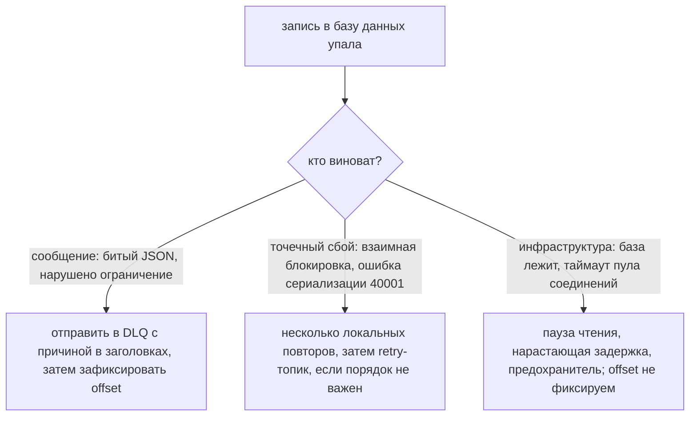

**Суть.** Схема такая: Kafka, дальше консюмер, дальше база данных. Когда лежит база, виновато не сообщение, а инфраструктура. Поэтому сообщения не надо разгонять по retry-топикам (топикам для повторной обработки). Нужно поставить консюмер на паузу и оставить данные в Kafka: она сама служит буфером. Повторные попытки делаются на одном уровне, с растущей паузой между попытками, с разбросом времени повторов и с предохранителем (circuit breaker). Эти термины раскрыты ниже в разделе про консюмера.



Только постоянная ошибка выводит сообщение из потока. При падении базы партиция стоит на паузе, а сообщения спокойно ждут в Kafka.

Расшифровка схемы:

- **`40001`** — код SQLSTATE `serialization_failure` в Postgres: «транзакцию нужно повторить», потому что она конфликтовала с другой.
- **Взаимная блокировка** (дедлок, deadlock) — две транзакции ждут друг друга; база прерывает одну из них, и её можно просто повторить.
- **Фиксация offset** (commit offset) — сообщение Kafka, что группа обработала всё до этой позиции и при перезапуске читать нужно с неё. Подробнее — в разделе [[Когда двигать offset]].
- **Пул соединений** — ограниченный набор открытых подключений к базе, которые приложение берёт по очереди. Таймаут пула значит, что свободного соединения не дождались.

## Откуда берётся снежный ком

- **Повторные попытки на нескольких слоях перемножаются.** Драйвер базы повторяет 3 раза, библиотека tenacity (повторы в коде приложения) ещё 3 раза, retry-топики ещё 3 раза: получается 3 × 3 × 3 = 27 попыток на одно сообщение.
- **Синхронные повторы.** Все инстансы повторяют по одному таймеру, и нагрузка приходит волнами. Это явление называют thundering herd («стадо в панике»): все одновременно бросаются на только что ожившую базу.
- **Восстанавливающаяся база получает пик нагрузки.** Накопленное отставание консюмера (лаг, то есть сколько сообщений не прочитано), плюс повторы, плюс холодный кэш добивают базу снова.
- **Все сообщения улетают в retry-топики или DLQ**, хотя с ними всё в порядке. Потом их приходится вручную переигрывать, и порядок потерян.
- **Перебалансировки.** Консюмер застрял в долгих повторах внутри обработки и превысил `max.poll.interval.ms` (максимальное время между двумя вызовами чтения). Брокер считает его умершим и выкидывает из группы, другой консюмер берёт те же сообщения, и получается дубль и бесконечный цикл.

## Классификация ошибок — первый шаг

| Тип | Примеры | Реакция |
| --- | --- | --- |
| Постоянная (виновато сообщение) | невалидный JSON, нет обязательного поля, нарушено ограничение базы (constraint violation), неизвестная версия схемы | сразу в DLQ с причиной в заголовках сообщения, затем фиксация offset |
| Временная, точечная | связанная сущность ещё не приехала, взаимная блокировка, ошибка сериализации | несколько локальных повторов; затем retry-топик с задержкой (если порядок не важен) |
| Инфраструктурная | база недоступна, таймаут пула соединений, база стала «только для чтения» после переключения на резервную (failover) | пауза чтения, нарастающая задержка и предохранитель; offset не фиксировать |

## Техника: консьюмер с паузой и предохранителем (circuit breaker)

Когда база недоступна, консьюмер действует по шагам:

1. Ловит ошибку инфраструктуры и понимает, что виновато не сообщение, а база. Поэтому сообщение не уходит в DLQ.
2. Ставит на паузу все партиции (`pause`): база общая, и читать соседние партиции, пока она лежит, нет смысла.
3. Возвращает позицию чтения к последнему зафиксированному offset (`seek_to_committed`), чтобы необработанные сообщения пачки не пропали.
4. Считает паузу по схеме **exponential backoff** (экспоненциальная задержка): после каждой подряд идущей неудачи пауза удваивается (2, 4, 8 секунд) до потолка в 60 секунд. Это не даёт долбить базу, которая ещё не поднялась.
5. Добавляет **jitter** (случайный разброс, здесь от 0,5 до 1,5 от рассчитанной паузы), чтобы разные инстансы возобновляли чтение не одновременно и не создавали волну нагрузки.
6. Работает как **circuit breaker** (автоматический предохранитель, как в электрощитке): в состоянии closed («замкнут») обработка идёт как обычно; после ошибок он open («разомкнут») и чтение стоит; когда пауза истекла, он half-open («полуоткрыт»): чтение возобновляется, и первая же успешная запись снова замыкает цепь, а неудача размыкает её снова.
7. Даже на паузе продолжает вызывать `getmany`: иначе брокер решит, что консьюмер умер (превышен `max_poll_interval_ms`), и устроит rebalance.

```python
import asyncio
import random

from aiokafka import AIOKafkaConsumer, AIOKafkaProducer


async def consume(consumer: AIOKafkaConsumer, dlq: AIOKafkaProducer) -> None:
    loop = asyncio.get_running_loop()
    failures = 0        # неудачи подряд: состояние предохранителя (circuit breaker)
    resume_at = None    # когда снять паузу (состояние half-open: пробуем снова)

    while True:
        if resume_at is not None and loop.time() >= resume_at:
            consumer.resume(*consumer.paused())
            resume_at = None

        # getmany вызываем ВСЕГДА, и на паузе тоже: иначе max_poll_interval_ms и ребаланс
        batch = await consumer.getmany(timeout_ms=500, max_records=50)
        try:
            for tp, records in batch.items():
                for rec in records:
                    try:
                        await handle(rec)                   # идемпотентная запись в базу
                        failures = 0                        # closed: база отвечает
                    except PermanentError as exc:           # виновато сообщение
                        await send_to_dlq(dlq, rec, reason=exc)
                    await consumer.commit({tp: rec.offset + 1})
        except InfraError:                                  # база лежит: виновато не сообщение
            failures += 1
            consumer.pause(*consumer.assignment())          # open: не читаем ни одну партицию
            await consumer.seek_to_committed()              # необработанный хвост пачки перечитаем
            delay = min(60, 2**failures)                    # 2, 4, 8 … максимум 60 секунд
            resume_at = loop.time() + delay * random.uniform(0.5, 1.5)  # разброс (jitter)
```

Пауза ставится на все партиции сразу: база общая, и если она лежит, читать соседние партиции бессмысленно. `seek_to_committed` нужен, потому что `getmany` уже сдвинул позицию чтения за всю пачку; без него необработанный хвост пачки пропал бы до перезапуска. Готового обработчика с такими политиками в aiokafka и confluent-kafka нет (в отличие от `DefaultErrorHandler` в Spring Kafka), поэтому цикл пишут сами. Неблокирующие повторы устраивают отдельно: retry-топики со своим консьюмером.

## Чек-лист: как не устроить лавину повторов

1. Классифицировать ошибки. Постоянные сразу уходят в DLQ.
2. Повторять только на одном уровне. В драйвере и ORM (библиотеке работы с базой) повторы отключить или свести к минимуму, иначе попытки перемножатся.
3. Использовать exponential backoff (растущую паузу), jitter (случайный разброс) и верхний предел паузы.
4. Поставить circuit breaker вокруг базы: в состоянии open партиции на паузе, в состоянии half-open делается одна пробная запись.
5. Продолжать вызывать `poll()` (чтение из Kafka) на паузе, чтобы не вылететь из группы.
6. Применить bulkhead («переборки», как в корабле: сбой одной части не топит остальные): ограничить пул соединений и число параллельных обработок на инстанс. Общее число соединений всех подов должно быть меньше `max_connections` базы (или стоит поставить перед базой PgBouncer, прокси, который переиспользует соединения).
7. Разгонять нагрузку плавно после восстановления: ограничитель скорости (rate limiter), меньший `max_records` в `getmany` и постепенное увеличение.
8. Писать в базу идемпотентно (upsert или таблица inbox, см. раздел [[Когда двигать offset]]): повторы неизбежны, и они гарантированно дадут дубли.
9. Мониторить consumer lag (отставание консюмера), размер DLQ и состояние предохранителя. Алерт на лаг ставить во времени (на сколько секунд отстаём), а не в штуках сообщений.
10. Иметь процедуру переигрывания DLQ: инструмент и runbook (пошаговую инструкцию для дежурного), а не «когда-нибудь посмотрим».

## Бизнес-кейс

Сервис начисления бонусов читает события покупок. База была недоступна 15 минут во время распродажи. Вопросы к продукту, от которых зависит дизайн:

- Допустима ли задержка начисления на 15–30 минут? Если да, достаточно паузы и догона отставания, retry-топики не нужны. Это почти всегда дешевле и надёжнее.
- Что видит пользователь, пока бонусы не начислены? Статус «бонусы поступят в течение часа» снимает нагрузку с поддержки; это тоже часть решения.
- Что хуже для бизнеса: начислить дважды или не начислить? Для денег выбирают at-least-once (доставка минимум один раз) и идемпотентность по `purchase_id`.
- Какой срок разбора DLQ (SLA, согласованный срок реакции) и кто его владелец? Это организационный вопрос; без ответа на него DLQ превращается в кладбище потерянных денег.

## Что спросят дальше

- Чем блокирующий retry отличается от неблокирующего? Блокирующий держит партицию, пока сообщение не обработается, и поэтому сохраняет порядок. Неблокирующий отправляет сообщение по цепочке retry-топиков с растущей задержкой (5 секунд, 1 минута, 10 минут, затем DLQ). Он не тормозит остальной поток, но ломает порядок.
- Что такое poison pill (отравленное сообщение)? Сообщение, которое всегда падает при обработке, часто из-за ошибки десериализации. Без DLQ оно блокирует партицию навсегда. В aiokafka ошибка `value_deserializer` вылетает прямо из `getmany`, и одно битое сообщение аккуратно не пропустить. Поэтому читают сырые байты и разбирают их в обработчике, где битое сообщение уходит в DLQ.
- Что такое backpressure («обратное давление») в Kafka? Модель pull: консюмер сам решает, сколько сообщений взять, и поэтому его не заваливает отправитель. Рычаги: `pause` и `resume`, `max_records` в `getmany`, ограничение параллелизма.
