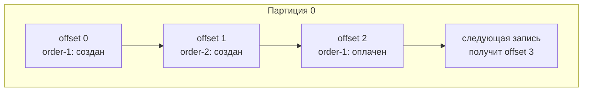
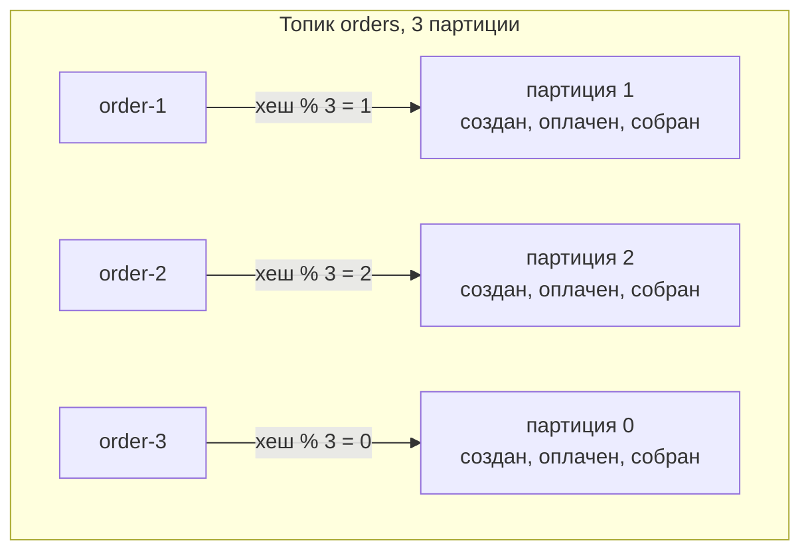

Рядом: [[Kafka]] · [[Продюсер Kafka на практике]] · [[Консьюмер и группы Kafka]] · [[Когда двигать offset]] · [[Retry-топики и DLQ в Kafka]] · [[Эксплуатация Kafka и CLI]]

**Суть.** Kafka хранит сообщения в топиках, а каждый топик делится на партиции (упорядоченные журналы, в которые сообщения только дописываются). Порядок гарантирован только внутри одной партиции. Всё, что раскидывает события одной сущности по разным партициям или по разным потокам обработки, этот порядок ломает.

## Базовые понятия Kafka

- **Топик** (topic) — именованный поток сообщений, например `orders`. Он делится на **партиции** (partition): каждая партиция — упорядоченный журнал, куда сообщения только дописываются. Каждому сообщению в партиции присваивается номер — **offset** (позиция сообщения в партиции, считается с нуля).
- **Как выбирается партиция.** Если у сообщения есть ключ, партиция считается как `murmur2(key) % partitions`. Здесь `murmur2` — быстрая хеш-функция, `partitions` — число партиций топика. Так считают Java-клиент, kafka-python и aiokafka. Благодаря этому все сообщения с одним ключом попадают в одну партицию и остаются упорядоченными. Без ключа работает sticky partitioner («липкий» разбрасыватель): он копит пачку сообщений для одной случайной партиции, потом переключается на другую. У librdkafka и confluent-kafka по умолчанию другой алгоритм — `consistent_random` на основе CRC32 (контрольной суммы), поэтому тот же ключ попадёт в другую партицию, чем у Java-клиента.
- **Consumer group** (группа консьюмеров) — набор процессов-читателей с общим именем группы. Каждая партиция читается ровно одним консьюмером группы, поэтому параллелизм чтения не больше числа партиций. Когда консьюмер входит в группу или выходит из неё, происходит **rebalance** (перебалансировка): партиции заново раздаются между живыми консьюмерами, и на это время чтение может приостановиться.
- **Репликация.** У каждой партиции есть leader (реплика, которая принимает записи и отдаёт чтение) и followers (копии, которые подтягивают данные с лидера). **ISR** (In-Sync Replicas) — множество реплик, которые не отстали от лидера. Настройка продюсера **`acks`** (acknowledgements, подтверждения) говорит, кого ждать перед ответом «записано»: `acks=all` означает, что ответ приходит, когда сообщение записано на все реплики из ISR. Настройка топика `min.insync.replicas` задаёт нижнюю границу: если в ISR реплик меньше, продюсер получает ошибку `NotEnoughReplicas` и знает, что запись не принята, а не теряет её молча. Для важных данных стандарт — `acks=all` и `min.insync.replicas=2` при RF=3 (replication factor, фактор репликации — число копий партиции). Консьюмер видит только сообщения ниже **high watermark** (верхней отметки) — те, что уже записаны на все реплики из ISR.
- **Retention** (срок хранения) — сколько Kafka хранит сообщения: по времени или по размеру. Альтернатива — **log compaction** (сжатие журнала): хранится только последнее значение для каждого ключа, подробнее в разделе [[Схема событий и compaction]].
- Начиная с Kafka 4.0 ZooKeeper (внешняя служба координации кластера) убран; кластер управляет собой сам через KRaft (встроенный протокол согласования на базе Raft).

## Где ломается порядок

| # | Причина | Сторона | Как избежать |
| --- | --- | --- | --- |
| 1 | Нет ключа или ключ не тот (случайный UUID, то есть уникальный идентификатор события, вместо id заказа) | producer (отправитель) | ключ равен id агрегата, то есть сущности, чьи события нельзя перемешивать |
| 2 | Увеличили число партиций, и результат `hash % N` для тех же ключей изменился | эксплуатация | закладывать партиции с запасом сразу; либо завести новый топик и перенести данные |
| 3 | Повторные отправки продюсера при `max.in.flight > 1` без идемпотентности | producer | включить `enable.idempotence=true` (в Java-клиенте дефолт с Kafka 3.0, а в `aiokafka` и `confluent-kafka` выключено, см. [[Продюсер Kafka на практике#acks и идемпотентный продюсер]]), `max.in.flight` не больше 5 |
| 4 | Параллельная обработка внутри одного консьюмера (пул потоков, async) | consumer (читатель) | параллелить по ключу: Confluent Parallel Consumer или шардирование по ключу |
| 5 | Сообщение ушло в retry-топик или DLQ, а следующие по ключу обработались без него | consumer | блокирующая повторная попытка или «парковка» всего ключа |
| 6 | Rebalance и доставка at-least-once: старое сообщение приходит повторно после нового | consumer | идемпотентная обработка и версия события |
| 7 | Несколько продюсеров пишут одну сущность (два сервиса или два инстанса) | архитектура | один владелец агрегата; события идут через outbox в порядке коммита |
| 8 | События одной сущности лежат в разных топиках (`order-created`, `order-paid`) | архитектура | один топик на агрегат, тип события — поле или заголовок |
| 9 | Потеря сообщений при unclean leader election | кластер | `unclean.leader.election.enable=false` (это дефолт) |
| 10 | Продюсеры на разных клиентах (Java и confluent-kafka) считают партицию разными хешами | producer | один партиционер: в confluent-kafka `partitioner=murmur2_random` |

Расшифровка терминов из таблицы:

- **Агрегат** — группа связанных данных, которую всегда меняют целиком и по порядку (например, заказ со всеми его статусами). Его идентификатор берут ключом.
- **`max.in.flight`** — сколько неподтверждённых запросов продюсер держит в полёте одновременно. Если их больше одного и один из них пришлось повторить, повтор может обогнать следующий запрос, и порядок собьётся. **Идемпотентный продюсер** (`enable.idempotence=true`) нумерует запись и позволяет брокеру отбросить дубль и сохранить порядок.
- **at-least-once** — доставка «минимум один раз»: сообщение может прийти повторно, но не потеряется. Подробнее в разделе [[Когда двигать offset]].
- **Retry-топик** — отдельный топик, куда сообщение отправляют на повторную обработку позже. **DLQ** (Dead Letter Queue, очередь «мёртвых» сообщений) — топик, куда складывают сообщения, которые обработать не удалось, чтобы разобрать их вручную.
- **Идемпотентная обработка** — повторная обработка того же сообщения даёт тот же результат, что и первая, без задвоения эффекта.
- **Outbox** — таблица в базе, через которую события безопасно попадают в Kafka; подробнее в разделе [[Когда двигать offset]].
- **Unclean leader election** — выбор новым лидером реплики, которая отстала. Так сообщения, которых у неё нет, теряются.

## Как устроен лог партиции: схема и модель в коде

Ниже схемы и модели на Python в несколько строк: что такое offset, как ключ выбирает партицию и почему порядок есть только внутри одной партиции. Модели упрощены: настоящая партиция — это файлы-сегменты на диске с репликами, а не список в памяти.

### Партиция — журнал, куда только дописывают

Партиция хранит записи в порядке прихода. Запись попадает в конец, и её **offset** — просто номер места в журнале, с нуля. Читать запись не значит её забрать: журнал не меняется, а консьюмер лишь помнит, с какого номера читать дальше. Поэтому одну и ту же запись можно прочитать повторно, а разные группы читают один журнал независимо. Записи исчезают только по сроку хранения (retention) или при compaction, но не потому, что их прочитали.



```python
class Partition:
    def __init__(self):
        self.log = []                       # журнал: список записей, только дописываем

    def append(self, key, value):
        self.log.append((key, value))
        return len(self.log) - 1            # offset = позиция записи в журнале, с нуля

    def read(self, offset, n):
        return self.log[offset:offset + n]  # чтение не удаляет записи: можно читать с любой позиции


p = Partition()
p.append("order-1", "создан")                # 0
p.append("order-2", "создан")                # 1
p.append("order-1", "оплачен")               # 2
p.read(0, 2)    # [('order-1', 'создан'), ('order-2', 'создан')]
p.read(1, 5)    # [('order-2', 'создан'), ('order-1', 'оплачен')]
p.read(0, 2)    # [('order-1', 'создан'), ('order-2', 'создан')] — те же записи, ничего не пропало
len(p.log)      # 3
```

### Ключ выбирает партицию, порядок — только внутри неё

Топик — это несколько таких журналов. Продюсер по ключу считает номер партиции как `хеш(ключ) % число партиций`, поэтому все события одного ключа идут в один журнал и читаются в том порядке, в каком были записаны. Между партициями никакого общего порядка нет: консьюмер может прочитать партицию 2 раньше партиции 1, и события разных заказов перемешаются. В модели хеш упрощён (в Kafka у Java-клиента `murmur2`), но важно именно свойство: один ключ всегда даёт один номер.



```python
def partition_for(key, partitions):
    h = 0
    for ch in key:                          # упрощённый хеш: у Kafka murmur2, но свойство то же —
        h = (h * 31 + ord(ch)) % 1000003    # одинаковый ключ всегда даёт одинаковый номер
    return h % partitions


topic = [[], [], []]                        # три партиции, в каждой свой журнал
for status in ["создан", "оплачен", "собран"]:
    for key in ["order-1", "order-2", "order-3"]:
        topic[partition_for(key, 3)].append((key, status))

partition_for("order-1", 3), partition_for("order-2", 3), partition_for("order-3", 3)   # (1, 2, 0)
topic[1]   # [('order-1', 'создан'), ('order-1', 'оплачен'), ('order-1', 'собран')]
topic[2]   # [('order-2', 'создан'), ('order-2', 'оплачен'), ('order-2', 'собран')]
topic[0]   # [('order-3', 'создан'), ('order-3', 'оплачен'), ('order-3', 'собран')]
partition_for("order-3", 3), partition_for("order-3", 4)   # (0, 3) — число партиций выросло, ключ переехал
```

Статусы каждого заказа лежат подряд и по порядку, хотя продюсер отправлял их вперемешку. Последняя строка объясняет, почему число партиций у топика с ключами не меняют без причины: после увеличения `order-3` пойдёт в партицию 3, а старые его события останутся в партиции 0, и порядок внутри ключа разорвётся на переходе.

## Техника: надёжный продюсер

```python
from aiokafka import AIOKafkaProducer
from confluent_kafka import Producer

# aiokafka
producer = AIOKafkaProducer(
    bootstrap_servers=settings.kafka_bootstrap,
    acks="all",
    enable_idempotence=True,   # брокер получает номер продюсера и порядковый номер записи: повторная отправка не задвоит и не переставит сообщения
)
await producer.start()
await producer.send_and_wait(topic, key=str(order_id).encode(), value=payload)  # ждём подтверждения брокера

# confluent-kafka: имена настроек как у Java-клиента
producer = Producer({
    "bootstrap.servers": settings.kafka_bootstrap,
    "acks": "all",
    "enable.idempotence": True,          # не больше 5 запросов в полёте, порядок сохраняется
    "partitioner": "murmur2_random",     # тот же алгоритм выбора партиции, что у Java-клиента, см. таблицу выше
})

# топик создаётся с replication.factor=3 и min.insync.replicas=2
```

## Рецепт: один ключ, три клиента, три партиции

Задача: убедиться, что «один ключ даёт одну партицию» верно только внутри одного алгоритма хеширования. Те же шесть ключей отправлены на топик из 6 партиций тремя способами: `aiokafka`, `confluent-kafka` с партиционером по умолчанию и он же с `murmur2_random`.

```text title="Вывод"
ключ        aiokafka   confluent (по умолчанию)   confluent murmur2_random
order-1            4                          1                          4
order-2            3                          3                          3
order-3            3                          5                          3
order-4            2                          2                          2
order-5            2                          4                          2
order-6            3                          0                          3
```

`aiokafka` и `confluent-kafka` с `murmur2_random` совпали по всем шести ключам, а `confluent-kafka` по умолчанию дал другую раскладку, совпавшую лишь у двух ключей из шести. Если два сервиса пишут один топик разными клиентами, события одного заказа окажутся в разных партициях. Код и разбор — в [[Продюсер Kafka на практике#Ключ и выбор партиции]]; что происходит с раскладкой ключей при добавлении партиций — в [[Эксплуатация Kafka и CLI#Увеличение числа партиций]].

## Техника: защита от устаревших событий на стороне консюмера

Консюмер может получить событие, которое уже устарело. Чтобы не затереть новое состояние старым, в событии хранят монотонно растущую `version` агрегата (или номер из outbox), а запись в базу делают условной.

```sql
-- В событии есть монотонная version агрегата (или sequence из outbox)
INSERT INTO order_view (order_id, status, version)
VALUES (:id, :status, :version)
ON CONFLICT (order_id) DO UPDATE
SET status = EXCLUDED.status, version = EXCLUDED.version
WHERE order_view.version < EXCLUDED.version;   -- старое событие просто игнорируется
```

Запрос работает как upsert (вставка или обновление, если строка уже есть): если для заказа уже есть строка с большей или равной версией, обновление пропускается.

> [!warning] Не timestamp
> Не полагайтесь на timestamp (время события) для упорядочивания: часы разных инстансов расходятся, и два события в одну миллисекунду неразличимы.

Проверка на Postgres 17: события одного заказа приходят не по порядку (версия 2, версия 3, затем повтор версии 2 после ребалансировки). Без условия по версии повтор откатывает состояние назад, с условием — игнорируется (статус команды `INSERT 0 0` значит «строка не изменена»).

```text title="Вывод"
без условия по версии
  событие v2 paid     -> INSERT 0 1  состояние: paid (v2)
  событие v3 shipped  -> INSERT 0 1  состояние: shipped (v3)
  событие v2 paid     -> INSERT 0 1  состояние: paid (v2)
с WHERE version <
  событие v2 paid     -> INSERT 0 1  состояние: paid (v2)
  событие v3 shipped  -> INSERT 0 1  состояние: shipped (v3)
  событие v2 paid     -> INSERT 0 0  состояние: shipped (v3)
```

Альтернатива — **state machine** (конечный автомат): консюмер знает допустимые переходы (`created → paid → shipped`) и не откатывает `shipped` обратно в `paid`.

## Бизнес-кейс: статусы заказа

Пользователь оплатил и сразу отменил заказ. Если событие `OrderCancelled` обработается раньше `OrderPaid`, склад соберёт отменённый заказ, а деньги не вернутся. Вопросы к продукту и архитектуре:

- Кто источник правды статуса? Если оплата и отмена пишутся разными сервисами в разные топики, порядок не гарантирован вообще. Нужен сервис-владелец заказа: он сам решает, какие переходы допустимы, и публикует события с версией.
- Нужен ли строгий порядок для всех событий? Для аналитики кликов нет, можно максимально распараллелить. Для денег и статусов нужен, но только в рамках одного агрегата. Глобальный порядок (всё в одной партиции) почти никогда не нужен: одна партиция ограничивает пропускную способность всей системы.
- **Hot key** («горячий» ключ): один крупный мерчант даёт 30% трафика, и одна партиция перегружена, пока остальные простаивают. Ключ нужно делать мельче (id заказа, а не id мерчанта), если бизнесу не нужен порядок по мерчанту.

## Что спросят дальше

- Сколько партиций завести? Считать от целевого потока: целевой поток делим на поток, который тянет один консюмер, и берём запас на 2–3 года роста. Слишком много партиций тоже плохо: дольше rebalance и больше метаданных.
- Что такое cooperative rebalancing и static membership (запуск с выводом — в [[Консьюмер и группы Kafka#Ребалансировка eager и cooperative]])? Cooperative rebalancing (`CooperativeStickyAssignor`) — перебалансировка без остановки всей группы: у консюмеров отбирают только те партиции, которые нужно переместить. Static membership (`group.instance.id`) — консюмер получает постоянное имя, и рестарт пода не вызывает rebalance, если он вернулся достаточно быстро. Отдельно существует новый протокол групп KIP-848 (Kafka Improvement Proposal номер 848, общедоступен с Kafka 4.0, включается настройкой `group.protocol=consumer`): партиции между консюмерами распределяет брокер, а не клиент, и перебалансировка проходит мягче.
- Kafka или RabbitMQ? Подробная таблица — в [[RabbitMQ#Kafka vs RabbitMQ]]. Kafka — журнал: сообщения можно перечитать, пропускная способность высокая, порядок есть внутри партиции. RabbitMQ — брокер с гибкой маршрутизацией, подтверждением каждого сообщения отдельно и отложенными сообщениями; сообщение удаляется после обработки.
